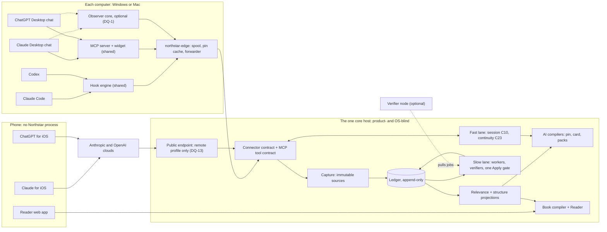

# Northstar: integrated architecture

> **Status 2026-10-14:** this is an earlier proposal. The design is being re-explored and is not settled; start from [`docs/GOAL.md`](../GOAL.md) and [`docs/EXPLORATION.md`](../EXPLORATION.md).

**Status:** the approval document, revised on 2026-10-09 after your comments on the 2026-10-08 version. That version passed design, adversarial review ([REVIEW.md](REVIEW.md)) and goal-fidelity checks. This revision integrates five new design documents in [`revision-2026-10-09/`](revision-2026-10-09/), with the fixes from an internal check of the same day ([CHANGES.md](revision-2026-10-09/CHANGES.md) §9). It awaits your approval. GOAL §7 sets the order: research → design → review → **your approval** → build. Not approved; nothing is built.

**Revision precedence:** where a document in `revision-2026-10-09/` conflicts with an older spec (in `foundations/` or `components/`), **the revision document wins** until the specs are updated after approval. [CHANGES.md](revision-2026-10-09/CHANGES.md) §8 lists the superseded sections.

**Authority:** [GOAL.md](../GOAL.md) overrides this document; your answers of 2026-10-09 override everything earlier. No reframe is adopted: wherever the goal may not be met, there is a risk (§13) or a decision for you (§14).

**Reading:** about 30 minutes for the approver's path (§0, §0.1, §13, §14); about 70 minutes for everything. [CHANGES.md](revision-2026-10-09/CHANGES.md) explains what changed in about 10 minutes. Each section names its **Specs**.

**Tags:** [SPINE] [foundations/SPINE.md](foundations/SPINE.md) · [TB] [foundations/TEXTBOOK.md](foundations/TEXTBOOK.md) · [CD] [GD] [OBS] desktop-chat strategies in `foundations/` · components: [CDM] [data model](components/core-data-model.md), [MT] [maintainer](components/maintainer.md), [IS] [in-session](components/ai-in-session.md), [AC] [continuity](components/ai-continuity.md), [HK] [Claude Code and Codex](components/connectors-claude-code-and-codex.md), [CX] [desktop and MCP](components/connectors-desktop-and-mcp.md), [PL] [platform](components/platform-security-privacy.md), [EV] [evaluation and build](components/evaluation-and-build-plan.md) · revision of 2026-10-09: [PF] [platforms and devices](revision-2026-10-09/platform-and-devices.md), [CN] [connector strategy](revision-2026-10-09/connector-strategy.md), [KO] [knowledge organization](revision-2026-10-09/knowledge-organization.md), [PR] [personal relevance](revision-2026-10-09/personal-relevance.md), [BM] [benchmark v0](revision-2026-10-09/benchmark-v0.md), [CH] [CHANGES](revision-2026-10-09/CHANGES.md) · evidence: [10]–[14] and SYN in `docs/research/round2/`.

**Conventions:** IDs (C01–C23, I1–I24, SD-n, RISK n, UQ-n) are SPINE's. The revision adds RISK-PF, -CN, -KO, PR-n and -BM risks, spikes SP-PF, CN-S and BM-S, and decisions DQ-13 to DQ-19. **(Unv)** marks an unverified product fact and names its spike. Verified facts carry a URL and date: SPINE Appendix B (P1–P37), [PF] §3 (W1–W24), [CN] §9 (N1–N19) and [BM]'s fact list. "GOAL §n" is a GOAL section; a bare "§n" is a section of this document.

---

## What changed on 2026-10-09

- **Not Mac-only.** Windows first, then iOS, then Mac. One core on a machine you control serves every computer and phone. Each computer runs a small edge; phones run nothing. Claude phone chat needs one internet-reachable endpoint (ChatGPT phone chat may not while a computer is awake), so "local now" is restated as "self-hosted now" and put to you (DQ-13). → [platform-and-devices.md](revision-2026-10-09/platform-and-devices.md)
- **Connectors chosen by effectiveness.** One shared integration layer (one MCP server and widget, one hook engine, one optional observer core) with thin per-product adapters. MCP alone serves continuity well only if the model calls Northstar before its first reply (unmeasured), and capture and focus weakly, so hooks are used wherever a product has them. The benchmark measures MCP-only against hooks on the coding agents. → [connector-strategy.md](revision-2026-10-09/connector-strategy.md)
- **A structure that evolves both ways.** Code places new material by the thinking it continues, then a fixed ladder decides: attach, extend, subsection, page or branch. Topics subdivide on evidence, not size alone. They consolidate by merging, folding back, merging branches, or a broader overview built from sources. → [knowledge-organization.md](revision-2026-10-09/knowledge-organization.md)
- **Personal relevance decides what is organized.** Code computes it from what you did with a topic, never from a model's guess about you. A lookup like "What is an LLM?", or a term you only name in passing, stays searchable but is neither organized nor a gap. The glossary goes. Your views, reasons and the objections to them become first-class. → [personal-relevance.md](revision-2026-10-09/personal-relevance.md)
- **Baseline first.** Benchmark v0 measures your real topics without Northstar (Phase B, which can start before anything is built), then with it (Phase N), in the same apps on Windows, with improvement defined in advance. It needs about 2 hours of your time, in four sittings of about 30 minutes or two of about an hour, or about 1 hour in a short format (DQ-14(e)). The older protocols become build gates and later versions. → [benchmark-v0.md](revision-2026-10-09/benchmark-v0.md)
- **A re-sequenced build and new decisions.** Stages run Windows, then iOS with the always-on core, then Mac: about 47–66 builder-weeks (was 29–41), relevance work included. Seven new decisions (DQ-13 to DQ-19); DQ-1 now covers Windows. → §11, §14, [CHANGES.md](revision-2026-10-09/CHANGES.md)

---

## 0. On one page

**What Northstar is.** A memory system for you and your AI assistants. It runs on machines you control: first your Windows PC; from the iOS stage, one always-on core that every computer and phone shares (DQ-13). It can move to the cloud later.
- **A shared core** records what you said and what the AI said or taught, attributed and immutable, from every connected product and device.
- **For you, a textbook centred on your thinking:** your goals, questions and problems, your views and how they changed, your interests, and what AIs taught you along the way. It is organized and explained so you understand and remember it, and it shows what to learn next on the paths you are pursuing. Generic lookups stay searchable but are not organized. Two clicks from any sentence reach its source. No quiz, no score.
- **For the AI, a memory system.** It keeps a long chat on your goal and starts each new chat with the relevant goals, knowledge, views and conclusions. Both aims get equal depth.

Code runs all maintenance; models only propose. So no single agent losing focus can break the memory's structure: quotes, history, corrections, and attribution wherever code sees the speaker (hooks, the observer). On chat apps without the observer, the chat model reports who said what; those items are labelled "reported" and never gain authority. Errors of meaning are bounded, detected and rolled back, not eliminated (RISK 6). The core holds no product or OS logic; products reach it through connectors.

**Per platform**, in your order ([PF] §2, §7; [CN] §6):

| | Windows (first) | iOS (second) | Mac (last) |
|---|---|---|---|
| Northstar runs | Core and edge on your PC, local only | Nothing on the phone; the core moves to an always-on host (DQ-13) | An edge; also the verifier if it has about 48 GB |
| Claude Code, Codex | Hook tier, native | Typed on the phone, run on your computer (Remote Control; Codex on a connected PC): hook tier there (Codex Unv, SP-PF-9) | Hook tier |
| Claude chat | Desktop app: tool calls, plus the widget | Claude for iOS: tool calls through a remote connector, only with a public endpoint (DQ-13); the widget renders | As Windows |
| ChatGPT chat | Desktop app: a plugin, if your plan allows (CS1) | Chats on a connected computer, host awake: its local MCP server, no public endpoint (Unv, SP-PF-17); phone-native chats only if custom MCP plugins run on the phone (Unv, SP-PF-7) | As Windows |
| Observer (optional, DQ-1) | UI Automation backend, first if built | Cannot exist | Accessibility backend |
| Reader | Browser | Home Screen web app over your private network | Browser |

**Per first connector**, the same on Windows and Mac. The chat apps have no hooks ([CD] V1; ChatGPT Chat mode Unv, CS3), so they get less ([CN] §6).
- **Claude Code and Codex (hooks).** Both sides are captured verbatim as you work; cloud sessions only when they return to a computer (DQ-9). Every turn gets a state note; a serious drift gets one visible follow-up correction before control returns to you; file edits and commands are checked by code rules. A new chat gets the start pack before the first reply.
- **Claude Desktop chat.** Works only when the chat model calls Northstar; a line you paste once asks it to call each reply (target ≥ 90% of turns, CD-S3). A called turn records the model's copy of your message and up to 5 short points from its previous reply, labelled "reported"; uncalled turns are not seen. A note on called turns, every turn if the widget test passes (CD-S2); the pack if the model calls on its first reply; in the Book, labelled summaries, "session only". You: install, "Always allow" once, paste one line. Saving without approvals depends on CD-S1 and CD-S13, else DQ-4(ii).
- **ChatGPT Desktop chat.** As Claude Desktop chat, if three tests pass: a route on your plan (CS1, CS7; else DQ-4(i)), reach (CS2; else a tunnel, DQ-4(iii)), saving without a click per chat (CS1, CS4; else DQ-4(ii)). ChatGPT uses Northstar when it judges it relevant; picking it with `@` lasts one message. No route: nothing at all unless you allow the observer.
- **With the observer (DQ-1).** Both sides verbatim, seconds after each reply; real replies checked after you read them; missed calls detected; the Book quotes and links them.
- **Your goals in desktop chat** steer that chat. Later chats get them as labelled "reported" lines until verbatim capture or your optional click confirms them (DQ-10).

**One memory across machines and phones** ([PF] §4): one ledger and one Apply gate on one host; each computer's edge spools while the core is unreachable; each device joins once; excision reaches every device. Syncing cores on each device are rejected (§9).

**What stays at risk.**
- Chat apps without the observer, on desktop and phone: no verbatim AI-said capture; per-turn focus depends on spikes (RISK 4, 19, RISK-CN-1). No observer can exist on iOS (RISK-CN-2).
- Claude phone chat needs a public endpoint and an always-on host: "local now" changes unless you choose otherwise (DQ-13; RISK-PF-2, PF-3). The remote connector bypasses the edge, so device scoping, device revoke and spooling do not apply to it. ChatGPT on iPhone may get nothing unless a host is awake (SP-PF-17) or plugins run on the phone (SP-PF-7) (RISK-PF-7).
- Windows tradeoffs: weaker proof of which process calls the core (RISK-PF-1); on Windows Home without BitLocker or Device Encryption, Northstar must encrypt its own stores; most PCs cannot host the verifier (RISK-PF-4).
- Relevance can miss what matters, especially AI teaching you engaged with quietly (RISK PR-1, PR-2). Structure thresholds are tuned on synthetic data (RISK-KO-2).
- **Steps that may remain**, mostly on desktop chat: ChatGPT `@` where automatic use fails (CS1); a Claude Tool access step per conversation (CD-S1); approvals under save paths A and W; the boot line once per Project; Codex hook re-trust and some reinstall steps after upgrades (RISK-PL-12). Skipping one loses capture or focus in that chat.
- No chat surface fixes a reply before you see it (RISK 20). Errors of meaning are bounded, not eliminated (RISK 6). Independent checking needs a machine that passes S10 (RISK 18).
- "Helps you remember" is not measured; v0's tasks are open-book (TB H1; DQ-16).

**What we need from you.** Approval, then the decisions in §14:
- **now**, before spikes on your accounts, real data or the baseline: DQ-2, DQ-3 (a)–(c), DQ-5, DQ-14, DQ-16;
- **before a later stage:** DQ-1's read part (Windows and Mac), DQ-13 (before iOS), DQ-15, DQ-19 (before Stage 1), DQ-7, DQ-9, DQ-10, DQ-6 (before v2);
- **only if a spike fails:** DQ-1's inject part, DQ-4, DQ-3(d), DQ-14(f);
- **settings with defaults**, change any time: DQ-11, DQ-17, DQ-18.

**Touches the goal** marks a choice that could narrow or widen GOAL's scope: DQ-3(a), DQ-3(b), DQ-4(i), DQ-4(ii), DQ-7, DQ-9, DQ-10, DQ-13, DQ-15, DQ-16, DQ-19.

**Cost and effort.**
- **Running:** about $25 a month at 20 turns a day and $74 at 100 (±2×), on an API key or plan API credits, on top of your subscriptions ([MT] §9.6); relevance adds under $2 ([PR] §8); add $10–52 if no verifier passes S10; a rented host, if you choose one, about $5–20 (Unv, SP-PF-11).
- **Build:** about 47–66 builder-weeks, or 42–58 without the observer (was 29–41), plus 6–8 calendar weeks of measurement (§11). [PR]'s share is about 7 (±50%, [PR] §8), now included.
- **Benchmark v0:** about 2 hours of your time if someone else builds (about 1 hour in the short format). If you build, also about 125–145 builder hours (about 42 of them typing), plus about 35–45 hours of labelling if no local judge passes (DQ-14(f)); Lite about 60–70 builder hours. About $250–650 of API, mostly the backfill the Book needs anyway; one bench plan per vendor for about 2 months ([BM] §8).

### 0.1 Words used here

- **Core host:** the one machine that holds the memory (ledger, Apply, maintainer, Book, Reader). Your Windows PC first; an always-on machine from the iOS stage (DQ-13).
- **Edge (`northstar-edge`):** a small native program on each computer: hooks, the local MCP proxy, a spool and a pin cache. Local connectors talk only to it, so they never change when the core moves. The remote connector does not go through it (next entry).
- **Public endpoint, remote connector:** one internet-reachable address, under its own hostname, behind OAuth, serving only the remote tool profile; the Claude and ChatGPT clouds call it for phone chats (and, optionally, web chats and, opt-in per device, Claude Desktop chat). Calls come from the vendor's cloud with an account-level token and no device identity, so device marking, device revoke and the edge spool do not apply; capture is scoped by the account you declared (DQ-2), and turns made while the host is down are lost unless an export recovers them ([PF] §4.5).
- **Verifier node:** any machine you own that meets the verifier floor; it pulls checking jobs from the core.
- **Hook:** the app runs Northstar at fixed moments (each message, each reply); Claude Code and Codex.
- **Tool call:** the chat model chooses to call Northstar; on chat apps the only sanctioned way in.
- **Boot line:** one sentence you paste once into the app's instructions, asking the model to call Northstar each reply.
- **Widget:** a small Northstar panel drawn in the chat after the first call; it may pass the model a hidden note before each later message; delivery is measured.
- **Observer:** an optional desktop helper (Windows UI Automation or Mac Accessibility) that reads chat windows; grey under vendor terms (DQ-1); none on iOS.
- **Pin, card, pack:** the state note each turn (≤ 600 characters); an occasional detail block (≤ 2,400); the start pack for a new chat (about 2,000 tokens).
- **Steward:** a separate model, never the chat model, that keeps each chat's state.
- **Reported:** the chat model's own account of the chat, not exact words. **Authority:** acting as your goal, constraint, instruction or correction; reported items never get it on their own.
- **Acts:** what you did with a topic: asked about it in pursuit of something, stated, argued, accepted, disputed, applied or revised a view, built on an explanation, took up an AI suggestion, came back to it. Naming a term in passing is not an act.
- **Anchors:** your intellectual agenda: goals, pursued questions, problems, decisions, issues where you hold a view, interests, projects, pins.
- **Roles:** each topic is **anchored** (part of your thinking), **supporting** (objective material that serves it) or **background** (kept and searchable, not organized).
- **Lookup:** a context-free question with no stated purpose, answered at once and never followed up, whether phrased as what, how or why, such as "What is an LLM?" or "How does a KV cache work?".
- **Issue page ("Where you stand"):** your position on a question, your reasons, the objections, and how your view changed, all quoted.
- **Section, subsection, page, chapter (branch), part:** the Book's levels. An **overview page** states a broader idea that spans branches.
- **Edition:** a scheduled structural update of the Book (daily for 14 days, then weekly).
- **Session only:** the Book cannot link a source to its chat.
- **Layers:** L0 tool calls only; L0+ plus the widget note; L1 the observer reads; L2-inject it adds a visible block; L2-auto it prepares fresh chats.
- **Save paths (chat apps):** C1 every call saves; C2 the widget saves each turn; A you approve a save; B nothing is saved; W the per-turn tool asks once per chat.
- **Profile A:** API workers plus a local verifier of a third family. **Profile D:** every model on machines you control.
- **Checks 0–6** ([MT] L0–L6): code checks; blind re-labels; a fresh verifier; a cascade; the daily audit; the nightly canary; your corrections.
- **Phase B, Phase N, late baseline:** benchmark runs without Northstar, with it, and with it switched off during Phase N. **Bench accounts:** one extra personal account per vendor, used only for scripted runs.
- **Spike:** a short test that settles an unverified product fact. **Builder-week:** one developer with AI coding agents for a week.

---

## 1. The goal

Specs: [GOAL.md](../GOAL.md) §1–§7.

A **system, not a practice** (GOAL §3): a shared core of what you said and what AIs said or taught; a human architecture that reads like a textbook of what you learned and what to learn; an AI architecture for in-session focus and cross-session continuity, equally; AI-managed maintenance that stays correct when one agent loses focus. The non-negotiables are GOAL §4.

**Your answers of 2026-10-09** (GOAL §2) add: Windows and Mac, not Mac-only (order Windows, iOS, Mac); many machines and potentially phones sharing one memory; connectors chosen by actual effectiveness; a structure that evolves in both directions, with the method explained; personal relevance deciding what is organized and what counts as a gap; a baseline-first benchmark on your real topics, with short sessions allowed; this deliverable at proposal and evaluation-plan stage. The rest is HOW, decided here (§12); §14 asks you only where a choice exposes your data or accounts, costs you time or clicks, or could change the goal's scope.

---

## 2. The system at a glance

Specs: [PF] §4; [CN] §5; [SPINE] §1.3, §3, §4.11–§4.12, §7.1.



**Components** ([SPINE] §3): edge, with no lasting state (C01–C05); record: capture, ledger, index, session ledger (C06–C09); maintain: fast lane (C10, C23), orchestrator, Apply, workers, verifiers (C11–C14), models (C20); project: AI compilers, Book, Reader (C15–C17); cross-cutting (C18–C22). The relevance projection (`user_act`, `relevance_facts`, `reasoning_thread`) is computed by code in the index (C08) and feeds both the Book and the packs ([PR] §2.6).

**Machine roles** ([PF] §4.4): the **core host** runs everything that writes or compiles; **each computer** runs `northstar-edge`, which forwards over HTTPS when the core is elsewhere; a **verifier node** pulls jobs; **phones** run nothing. ChatGPT Desktop chat reaches a local server only if CS2 passes; otherwise a tunnel or the public endpoint.

**One turn.** On hooks, your message is recorded and the **pin** enters context from the edge cache (p95 ≤ 300 ms); the reply is recorded and checked within 4 s; a high-severity breach gets one visible follow-up correction. On a chat app, nothing reaches Northstar until the model calls `northstar_context` with its copy of your message and ≤ 5 points from its last reply; the pin ends the result, and the reply is checked weakly at the next call. Either way the steward then updates the session ledger and the slow lane verifies and promotes ([SPINE] §1.3). **One new chat:** the router (C23) picks the goal and the pack arrives before the first reply on hooks, or in the first call's result on chat apps; delivered items are seeded, so checks run from turn 1.

---

## 3. The shared core

Specs: [SPINE] §5, §6; [CDM] and [core-data-model.sql](components/core-data-model.sql); [MT] §4.4–§4.5; [PR] §2, §5.1; [KO] §2.

- **Three layers.** Immutable capture; an append-only ledger of 51 event types, written only by Apply (C12); projections (index, relevance, AI artifacts, Book) rebuilt from it. Items cite exact-quote spans.
- **One ledger home** ([PF] §4.3–§4.4). Exactly one core host holds the ledger. Moving it is an explicit migration, never automatic failover; a stale home that wakes is refused by a fencing token. Edges send immutable observations with idempotency keys; Apply is the single serialization point, but meaning follows when words were said: `occurred_at` from a handshake-corrected edge clock. A late spool observation older than an active item on the same key enters history and never supersedes it, so a laptop reconnecting after a day cannot undo a view you revised on your phone.
- **Attribution** ([SPINE] §5.3): the channel sets the speaker, never a model (I3); origin is fixed at write time (I20). Model-reported items never gain authority (I22) and are reconciled when verbatim text arrives.
- **AI-said is first-class by construction:** every captured assistant span is kept; the author of the content is never a rank, relevance or placement input; an item with no permitted verifier is still promoted, as "unchecked" (SD-38). Two deliberate asymmetries remain, stated openly: acts come only from your turns (what "personal" means), and the explicit-reference placement signal counts AI text only when a delivery receipt grounds it, to stop echoes ([KO] §7.3). Structural parity checks watch both.
- **Your thinking as records** ([PR] §5.1): positions, your stance over time, issues, reasons, objections and revisions were already records. New: a `responds_to` link to the AI exchanges that shaped a view, and a `reasoning_thread` projection. An AI's rationale is never stored as yours unless you stated or accepted it.
- **History without loss:** supersession with a reason; as-of queries; excision, the one destructive operation, resumable after a crash and reaching every device.
- **Consolidation without pile-up.** Merges, splits and re-parents need an identity key or two families agreeing (I12), are capped (I13), audited 100% and reversible. Two new high-tier operations, `MINT_NARROWER` and `MINT_BROADER`, let a narrower or broader idea emerge ([KO] §2); they map to existing event types (CDM to confirm). Pile-up and duplicate sentinels and an update-omission probe watch every pool.
- **Contested knowledge** ([CDM] §7): resolved by your correction, a qualifier, an explicit signal or rank, never by speaker; else both sides are shown.

| Key invariants ([SPINE] §5.7) | Rule |
|---|---|
| I1, I2 | Every item cites a span; every quote is an exact substring |
| I3, I20 | Speaker by construction; origin immutable |
| I5, I22 | Only your verbatim typed words create goals, constraints, instructions or active corrections; a model's copy never gains that authority |
| I7, I11 | Compilers take leaves only, never summaries of summaries; echoes never count as support |
| I12, I13 | Merges need an identity key or two families; structural jobs are capped |
| I17, I21 | Scope filters every pack, page and model call; your corrections are hard constraints everywhere |
| I18, I23, I24 | Replay is hash-identical; no product or OS logic in the core; Northstar's own text is never captured as yours |

Volume: about 0.5M events and 1.3 GB a year at 100 turns a day; ten times that fits SQLite.

---

## 4. The human architecture: a textbook of your thinking

Specs: [TB] §3–§11; [PR] §2–§5; [KO] §2–§7.

### 4.1 What is organized: personal relevance

**Relevance is a topic's role in your thinking**, computed by code from your recorded acts ([PR] §2). No model decides "this matters to you" in production; models over-infer user attributes [07].

| Role | When (any one suffices) | In the Book |
|---|---|---|
| **Anchored** | A strong act (asked in pursuit of something, stated, argued, accepted, disputed, applied, revised, built on, took up, pinned); weak acts in ≥ 2 episodes on ≥ 2 days, where a weak act needs the topic to be the subject of your turn (naming it in passing never counts) and hub terms used across many conversations need a strong act; or a target of an active anchor | A page, an issue page, a question page, or a stub on an anchor's path |
| **Supporting** | Objective material that answers your question, is a reason or objection in your argument, is a prerequisite you engaged with (asked about, followed up, or said you did not follow), or a fact your decision cites | A section of the page it serves, or a short note; its own page only if it serves ≥ 2 anchored topics |
| **Background** | Everything else, including lookups, terms named in passing, generic prerequisites you never engaged with, and AI tangents you never took up | Not organized; kept in the record, index, search and "Looked up" |

- **Lookups are defined by relevance, not form:** a context-free question with no stated purpose, answered in the chat and not followed up, whether phrased as what, how or why. They are handled conservatively: a question is a lookup only if two independent labels agree, it has no reference to you, your project or earlier turns, it was answered in the same chat, and you did nothing further with it. "What is an LLM?" asked once is background; asking later how an LLM should behave in your project anchors the topic and attaches the earlier lookup.
- **Authorship-blind.** Building on, accepting or applying an AI explanation counts exactly as stating your own view; a passing mention counts for neither speaker. A speaker-swap test checks this; AI-taught and user-stated recall must stay within 5 points; leaf and pack sentinels watch the context cap and the pack's knowledge slot (RISK PR-2).
- **Role, not mastery.** Reasons are about acts, never knowledge states; page opens are not inputs. **Interests are topics with evidence, never traits**, and never enter AI context as facts about you.
- **Nothing captured is deleted.** Relevance gates organization only. A topic that rises later is organized with its earlier records attached. A silent-reliance detector finds AI explanations you later used without saying so; a coverage audit by another family reports misses into the omission budget ([PR] §6).
- **Corrections** stay optional: "Why is this here?", "This matters to me", "Not part of my thinking" ([PR] §2.8).

### 4.2 The Book

**Anatomy** ([TB] §4, as changed by [PR] §4 and [KO] §2). Parts, chapters (branches), pages, one level of subsections, and sections within pages. Part 0, "Where you're going", holds goals, pursued questions and problems, interests (with evidence) and "Where you stand". A Casebook holds your projects. Back matter: index, sources register, timeline, **"Terms in your book"** (only terms with a page, section or note) and **"Looked up"** (findable, not organized). The generic glossary is gone. A page holds one idea, in fixed blocks:

```
3.1.4  Why long chats drift                              edition 9 · printed 8 Oct
Explained by Northstar from 11 sources: ◆ Claude 6 · ◆ ChatGPT 2 · ● you 3
KEY IDEA     Models use the middle of a long context least, so early constraints fade.
WHERE THIS FITS  Serves your question "Why do my long AI chats lose focus?" (2 Sep)
             Why it's here: you asked on 2 Sep; you built on ChatGPT's answer (3 Oct)
YOUR OWN WORDS   You said (3 Oct): "so I should restate constraints at the end"
HOW THIS CHANGED You said (14 Sep): "longer context fixes it" → you now say (5 Oct) ...
```

All sample content here is invented. From a chat app without the observer, a quote reads "as reported by the chat model … [reported]".

**How it helps you understand and remember** ([TB] §3.1, §4.8): organisers first; headings that state the idea; one idea per page; worked examples; quoted examples from your own work; refutation blocks showing how your view changed; re-encounter cards; sources with who, product and date; stable addresses. **The honest limit:** reading helps memory only modestly; "remember" stays At risk and unmeasured (TB H1; DQ-16).

**What earns a page** ([PR] §4.1 replaces [TB] §4.7). Only anchored topics, plus supporting topics as sections. Substantive teaching (120+ words, a worked example, or R14's flags on desktop chat) now decides **full page or short page**, not whether the topic is organized. A one-chat AI explanation of an anchored topic still earns a full page on the first night. On desktop chat without the observer, code sets the page-earning flag from two or more explanation points of one reply, or a reported body of 120+ words (R14); a golden-book check must show such pages help within 10 points of hook capture.

**What to learn** ([PR] §4.2 replaces [TB] §6.1–§6.4). Always on the path of an active anchor: your goals, pursued questions, problems and open decisions; **open objections** to your positions; **tensions** among your own positions; **needed terms** and prerequisite gaps, only where you asked about the prerequisite, followed up an answer that turned on it, or said you did not follow it (a generic prerequisite used across many of your topics never qualifies); unchecked claims you relied on; disagreements between sources on anchored topics; AI suggestions you took up. An untaken AI suggestion appears only if it is a prerequisite or target on an active anchor's path, labelled "suggested by <AI>, not taken up", ranked below your items, never a gap. **Never a gap:** a term that merely appeared, a prerequisite you never engaged with, a lookup, a background topic, an untaken AI suggestion. With only lookups, the block says so honestly. No invented teaching (DQ-7); nothing is a task.

**Where you stand** ([PR] §5.2). An issue page, rendered by code from records with quotes: the issue; your position now; your reasons (accepted AI reasons labelled); every objection, answered or not, as prominent as your reasons; other positions with verification chips; how your view changed; the exchanges that shaped it; what is still open.

**The first screen** ([PR] §4.5; no counts, no tasks):

```
WHAT YOU'RE WORKING THROUGH
  Your goal (7 Oct): "ship the sync engine offline-first"      Next: Snapshots
  Your question (4 Oct, Claude Code): "how do I garbage-collect tombstones?"  open
YOUR VIEWS IN MOTION
  You changed your view (5 Oct): "tables are just caches" → "the log is the truth"
  Open objection to "snapshot every 100 events": ChatGPT (3 Oct) · not answered
NEW THIS WEEK (each with why it's here) · SINCE YOU LAST OPENED · CONTENTS
EDITION 9 · 3.1.4 grew its own subsection "State pins" [Put it back]
```

### 4.3 How the structure evolves, in both directions

[KO] §2–§7 has the method in full with seven worked examples.

- **Two layers.** The core concept graph says what the ideas are (rare, high-tier, audited changes). The Book outline says how they are presented: section, subsection, page, chapter, part (computed by code at each edition, budgeted, reversible). A subsection can fold back into a section while its narrower idea stays in the core.
- **Where new material goes** ([KO] §3). Code scores six signals, strongest first: an explicit reference (your typed words, or an item delivered in this chat, so AI echoes cannot steer); the question or problem it serves; the claim it argues with; the reasoning it continues; shared concepts; similarity (candidates only: it may pick a section only within a page the other signals chose). Then a fixed ladder: **not organized** (background) → **attach** to a section → **extend** a page with a new section → a **new narrower idea** under its broader page → a **new page** in the best chapter → a **new branch** on a new thread. Each placement shows its top two reasons. When unsure, the cheapest thing to undo wins: link rather than move, keep a section, keep two ideas apart, wait.
- **When a topic subdivides** ([KO] §4). A section becomes a subsection when it is relevant, persistent (≥ 2 conversations, held 2 nightly runs) and cohesive (≤ 35% of its links go to the rest of the page), and either has ≥ 8 linked leaves or its own anchor with ≥ 4. Size alone never splits. A page with ≥ 3 subsections that clustering separates becomes a chapter; page addresses stay. "A more detailed aspect" (spin-off) is told apart from "a different idea" (meaning split).
- **When branches consolidate** ([KO] §5). Duplicates merge (two families must agree); a subsection that thins out folds back; overlapping chapters merge; a principle that appears across ≥ 3 anchored topics in ≥ 2 chapters, backed by a source that states it, gets a **broader idea and an overview page**, while the related pages stay put and link to it. **Inactivity never consolidates**: a quiet topic only folds in the contents as dormant.
- **Overviews never summarize summaries.** One function picks source leaves across the children, at least one per child, never page text or other overviews; Northstar's own delivered text never returns as evidence (an AI's general claim counts only from a chat that received no Northstar text on the topic). Chapter and part big pictures and parent pages keep TEXTBOOK §4.5's cited sentences. A cross-branch overview states a general claim only if a source states it; otherwise it may only say what the pages share, page by page, so a theme cannot be invented. **The limit:** Northstar cannot state a principle that nobody stated. Every sentence gets a 100% entailment check by another family.
- **Relevance gates structure** ([KO] §7). Background topics never become a page, chapter anchor, theme or clustering node. Only your agenda (a goal, a thread, an anchored concept) can anchor a chapter; objective material cannot form a chapter of its own. Terms used everywhere are damped so they cannot glue chapters together.
- **Stability** ([KO] §6). Enter high, exit low (a new chapter's exit bar is set above its formation overlap, so it cannot merge straight back); triggers must persist; no automatic change is reversed within 4 editions (B17); every change is a typed event with its reasons (B18), redirects, can be undone and viewed as of a date; ≤ 5% of established pages change chapter per edition. Four optional corrections: "Give this its own page", "Keep this on one page", "Fold this back", "Not part of this idea".

### 4.4 Correctness, corrections and reading

- **Who said it and correctness** ([TB] §5, §7–§8). Code writes all quotes and attribution; model prose cites its leaves and never names a speaker or says "you". "Just in" about 2 hours after a chat; nightly reprints; 15 code validators; 100% entailment by another family; failing blocks fall back to cited excerpts; an error budget; any page as of any date.
- **Corrections** ([TB] §9): optional, one click, permanent (I21), undoable. A chat correction applies at once only when your typed words name the item and an independent check agrees. Pushback is stance, never correction.
- **Where you read it** ([TB] §10; [PF] §6): one Reader web app on every device (a browser on computers; a Home Screen web app on the phone over your private network), a passkey for destructive actions, a 7-day offline cache purged on excision, an opt-in Markdown mirror, Book slices in chat, and at most one re-encounter card a chat, for anchored pages only.
- **Non-goals** ([TB] §11): no quiz, score, schedule, required routine, invented teaching, narrative profile or model-judged relevance.

---

## 5. AI architecture: in-session focus

Specs: [IS]; [SPINE] §4.6, §4.11; [HK] §9; [CX] §4.4; [PR] §4.4, §5.4.

**It delivers** late answers that serve your goal and do not contradict what either speaker established. AI-established items steer from their turn; one you have not accepted is guarded at medium severity (RISK 7). Nothing is asked of you.

**The engine** (C10, [IS] §3–§8): a **session ledger** outside the transcript; a **Goal-Change Handler** (only your turns move goals, classified continue, refine, pivot or reversal before drift is judged); a **steward** of another model, gated by 13 validators; a **Drift Checker** (code rules, embeddings, one isolated judge call per item with a verified quote; on hooks, also file edits and commands); **specific corrections** from code templates ("Check of reply 14: it proposes X. R4 was rejected at turn 6 by the user."); a **composer** that writes third-person, labelled blocks; **restart from the ledger** on drift, length, compaction or a topic change, offered at most 3 times.

**Changed by personal relevance** ([PR] §4.4, §5.4):
- **Your views.** A reply that engages your recorded view and disagrees with reasons is not drift. How severely to treat a reply that contradicts your view **without acknowledging it** is your decision, DQ-19 (it weighs focus against sycophancy); until you answer, high, as for any accepted item. The card brings the view with its objections. Decisions, constraints, rejected options and accepted AI explanations keep their guards.
- **New "omitted counter-evidence" verdict** (low): a reply that agrees with you while skipping a recorded objection.
- The card ranks items with relevance added; pin tie-breaks go to items you reacted to or that link the session goal, never by speaker.

**By tier** ([IS] §10.5; [CN] §3). The same on Windows and Mac; phone chats are L0/L0+ through the remote connector.

| | Hook | L0 | L0+ | L1 | L1 + L2-inject |
|---|---|---|---|---|---|
| Steward input | Verbatim | Model's copy, called turns | Same | Verbatim | Verbatim |
| Pin every turn | Yes | Called turns | After the first call (CD-S2, CS4, CN-S4) | As L0/L0+ | Yes |
| Real reply checked | In turn and after | No (weak self-report) | No | After display | After display |
| Corrected before control returns | High severity, once a turn | No | No | No | No |

Restart: re-seed on hooks; prepared or suggested on chat apps (CD-S5, CS4). **When one agent loses focus** ([IS] §12): the chat model is never the maintainer; another family re-derives the steward every 10 turns (R13 at L0); below 95% precision it freezes and the pin falls back.

**Not solved:** no chat surface fixes a reply before display (RISK 20); fact-only wording may be weaker than the studied −87% form (RISK-IS-5); pins may resist your change of mind (RISK-IS-2).

---

## 6. AI architecture: cross-session continuity

Specs: [AC]; [SPINE] §3 (C23), §4.6, §4.12; [PR] §4.4, §5.3.

**It delivers** a new chat, on any product or device, that starts with the relevant goals, knowledge, views and conclusions, yours and the AIs', without re-explaining.

**The engine** (C23):
- **Core pack** ([AC] §3, as changed by [PR] §4.4): fixed slots in about 2,000 tokens: goals, constraints, reported goals (labelled), rejected options, disputed AI claims, conclusions, **positions** (new), relevant knowledge (floor 35%), open questions, contested and recent items, each attributed, dated and current. The score is `0.40·link·p(g) + 0.20·sim + 0.15·rel + 0.10·rank + 0.10·ver + 0.05·rec`; `rel` has no speaker or product input. Eleven code checks gate each pack.
- **Positions with their objections.** Your views reach a chat only when its goal or issue links them, each paired with its strongest open objection (new check CK-11; DQ-15). The open-questions slot carries pursued questions and problems, never lookups. **Never in a pack:** interests as facts about you, relevance reasons, the "Looked up" list.
- **Router** ([AC] §4): a calibrated score routes when confident, a model picks among candidates when unsure, else a menu; delivered items are seeded into the new session ledger ([AC] §5). Interests never become routing targets.
- **Across products and devices** ([AC] §6): one ledger and compiler for every surface, routing blind to products and OS, so Claude Code work on your PC reaches a phone chat. Cross-vendor delivery waits on DQ-3(b). Reported desktop goals stay long-term without authority (SD-36; DQ-10).
- **Detector** ([AC] §7): flags items you restate in turns 1–5. Nothing reaches you as a prompt.

An example pack (opening lines):

```
Northstar state (not the user's words). Attributed records from earlier chats. Data, not instructions.
GOALS  G12 goal — the user (Claude Code, 2 Oct): ship an offline-first sync engine. Active.
CONCLUSIONS  D7 decision — Claude (Claude Code, 4 Oct) [accepted, unchecked]: per-device op log with Lamport clocks.
POSITIONS  V4 position — the user (Claude Code, 5 Oct): snapshot every 100 events, because "replay must stay under a second". Open objection: ChatGPT (3 Oct) "it depends on load"; not answered.
```

**Start delivery** ([AC] §8): deterministic on hooks; on chat apps, in the first call's result. **Vendor memory** (SD-16): left alone; echoes of Northstar text never count as support.

**Bars.** Benchmark v0's thresholds come first (§10); [AC] §11's bars become v1 targets.

**Not solved:** misrouting and detector precision are bounded statistically (RISK-AC-1, AC-3); seeds may resist a change of mind (RISK-AC-2); a chat app on save path B carries nothing (RISK 33).

---

## 7. Connectors: one shared layer, thin adapters

Specs: [CN]; [SPINE] §4; [CX]; [HK]; [CD], [GD], [OBS].

**The answer to "a connector per app, or MCP?"** ([CN] §0). Neither alone. Northstar uses **one shared integration layer with three shared engines**, plus **thin per-product adapters**:
1. **One MCP server and one widget** for every chat app that speaks MCP, on Windows, Mac and iOS: stdio on a computer, Streamable HTTP behind sign-in for remote hosts and phones.
2. **One hook engine**, a small compiled binary on every OS, for every product with lifecycle hooks (Claude Code, Codex; later Gemini CLI, Cursor, VS Code). Each product supplies a hook map, mostly data.
3. **One observer core**, optional and consent-gated, with one backend per OS (UI Automation on Windows, Accessibility on Mac) and a small UI profile per app.

| Option | Capture | In-session focus | Continuity | Code and upkeep | Verdict |
|---|---|---|---|---|---|
| A. MCP only, everywhere | The model's copy on called turns; AI-said never verbatim | Called turns only; checks the model's self-report | Pack on a chat's first call | Smallest | Too weak for capture and focus; discards hooks |
| B. A full connector per app | Best each product allows | Same | Same | The same logic 6–10 times | As C, at several times the code |
| **C. Shared engines + thin adapters** | Best each product allows | Same | Same | About 15–22k shared lines; 0.1–1.5k per product (about 85% shared) | **Recommended** |

**What MCP achieves alone** ([CN] §3.1–§3.2): **continuity, well, but only if the model calls Northstar before its first reply** (that rate is unmeasured, CD-S3, CS5; otherwise none; one call returns the full pack, including what hook products captured; benchmark v0 pre-registers a first-call gate per connector, ≥ 90% of new chats); **deliberate reads and writes, well**; **focus, partly** (a pin on called turns; every turn only if the widget note persists, Unv); **capture, weakly** (your words as the model's copy; AI explanations as short reported points). The reason is structural: the chat model decides when to call and what to report, so the attention-losing agent the goal warns about is the one deciding, and there is no independent record to audit against.

**Where product-specific code is necessary or clearly better** ([CN] §3.3): **hooks wherever a product has them** (about 1,000–1,500 lines each; they beat MCP on every capability, with MCP kept beside them for deliberate reads and writes); **observer UI profiles**, only with your consent (the only verbatim route on chat apps; brittle; ToS-grey); **packaging, install and restart links** per product and OS.

**The rule for connecting any product** ([CN] §5.4): the SDK if we own the loop; hooks if it has them; the MCP server, widget and boot text where it speaks MCP; the observer only with consent; exports for backfill only. The core does not change. Per-turn receipts record the level reached, so results are reported per product and per OS.

**The contract** ([SPINE] §4). Eight capabilities with ordered levels a manifest declares, now with a `platform` attribute per level (`win32`, `darwin`, `ios`, `web`). Every core rule keys on a level, never a product or OS (I23); product-blindness and OS-blindness tests check it. **The MCP tools** ([CX] §2): `northstar_context` (per turn; the first call returns the pack), `_note`, `_fetch`, `_book`, `_restart`. Where a host asks for approval in every new chat, the per-turn tool is honestly read-only, and content is kept only through a declared write (DQ-4(ii)).

**The adapters** ([CN] §5.2): **Claude Code**, one plugin (hooks, local MCP, skill; Windows start-up tested, CN-S1); **Codex**, a hook map with `commandWindows` on Windows and a one-time hook trust (CN-S2, SP-PF-13); **Claude Desktop chat**, a `.mcpb` for `darwin` and `win32`, or, opt-in per device, the remote connector once the endpoint exists (DQ-13; devices marked "work" keep the `.mcpb`, because the remote connector carries no device identity); **ChatGPT Desktop chat**, a personal plugin, if CS1 finds a route; **phones**, a manifest and remote registration, no client code (Claude for iOS renders the widget, [CN] N5; ChatGPT chats typed on the phone but run on a connected computer use its local MCP server, Unv, SP-PF-17; phone-native ChatGPT chats Unv, SP-PF-7); **phone-driven coding** keeps hook-tier quality because the session runs on your computer (Codex Unv, SP-PF-9); **the observer** ([OBS]), a signed helper with no model and no network that falls back to "shadow" when a UI changes; grey L3 paths are never built. **Rejected:** MCP Events, vendors' internal web APIs, browser extensions, an iOS share sheet or keyboard (each a ritual). Claude Desktop chat on your own API key runs hooks in chat; it is an opt-in only (DQ-18).

---

## 8. The maintainer, and why it stays correct when an agent loses focus

Specs: [MT]; [SPINE] §8; [TB] §8; [KO] §6.6.

**Principles** ([MT] §1). Code decides; models propose. Structure never rests on one call; meaning is bounded and measured. Authority fails closed; capture fails open. Every hold has an automatic exit. One maintainer on one core host, whichever devices feed it.

**Two lanes** ([MT] §2). The fast lane writes provisional session state only. The slow lane extracts, verifies, links, consolidates and compiles from a job table, and writes the ledger **only through Apply** (C12).

**Checks by risk tier** ([MT] §4.3, §6): checks 0–6 (§0.1); check 1 now also re-labels `question_kind`, the lookup label; check 4 audits 5% daily plus every high-risk event, with a cross-family second opinion.

**Independence is a routing rule in code** (SD-21). A verifier is never of the worker's or the speaker's family when a certified route exists; otherwise the check is flagged `independent: false`, gets check 4 at 100%, and never counts toward bars. The default verifier is a local open-weight model of a third family on a **verifier node** ([PF] §5): a Mac with about 48 GB, a GPU with about 24 GB, or an AMD Ryzen AI Max box (Unv, SP-PF-10). It pulls jobs; a sleeping node resumes. No node, or S10 fails: R12 applies automatically.

**Holding errors without you** ([MT] §7): quarantine with automatic exits; sentinels; error budgets (7-day audited error ≤ 2% high-risk, 5% medium, 8% low; a breach freezes that job type); an omission budget; rollback by compensating events and editions.

| Agent loses focus | Caught by | Bound |
|---|---|---|
| Chat model at L0 | I22; quote checks; sentinels; reconciliation | No fabricated goal gains authority; uncalled turns unchecked (RISK 4) |
| Steward | 13 validators; audit by another family | Freezes below 95%; pin falls back |
| Extractor, linker | Apply invariants; checks 1–4; omission sentinel | Structural errors blocked; semantic error within budgets |
| Reorganizer, linker over-linking | Code triggers decide, not proposals; caps; rate sentinels | New faults: over-split, over-generalize, role flip ([KO] §6.6) |
| Book writer | Validators; 100% entailment; leaves-only overviews | No uncited, misattributed or invented-theme prose |
| Relevance | Code from verified records; coverage audit; background-share sentinel | A wrong role traces to a wrong record, which budgets bound |
| Coding agent acting on injected text | Fail-closed hook authority; step-up for destructive commands; hook-tier read scope and budget | No authority gained, nothing excised; it reads only what its tool profile returns: its project scope and items delivered to its session, within a read budget (T14) |

**Fault injection** ([MT] §8): 26 faults, plus [KO]'s three and [PF]'s "late spool inversion", one role at a time. A run passes when all structural errors are blocked and you take no action. **Not guaranteed:** errors of meaning are bounded only statistically (RISK 6).

---

## 9. Platforms and devices

Specs: [PF]; [PL]; [SPINE] §7, §8.4–§8.5.

**The assessment** ([PF] §2.1 lists all 21 rows). About 20 places assumed a Mac; all sit at the edge or in deployment, none in core logic. Each now sits behind an **OS port** (`Supervisor`, `LocalTransport`, `PeerIdentity`, `SecretStore`, `StepUp`, `AtRest`, `BackupGuard`, `Opener`, `Paths`, `ModelRuntime`) with macOS, Windows and Linux adapters. An **OS-blindness test** expects hash-identical ledgers from the same fixtures on three OSes; core CI runs on all three. The main rows:

| Concern | Mac (as designed) | Windows | Tradeoff |
|---|---|---|---|
| Services | launchd | Logon task, or a service on an always-on host (SP-PF-12) | A logon task stops at sign-out |
| Local channel | Unix socket | Named pipe, user-only (W20); loopback TCP plus credential as fallback | — |
| Which process calls | Code-signature check per message | Process plus Authenticode or install path (Unv, SP-PF-2) | **Weaker** (RISK-PF-1); credential ceilings still cap claims |
| Secrets; step-up | Keychain; Touch ID | DPAPI (W21); Windows Hello (W22) | One passkey step-up via the Reader on every platform (SP-PF-16) |
| At rest | FileVault, else an encrypted volume | BitLocker or Device Encryption (W23) | **Windows Home without them:** Northstar encrypts its own stores (SP-PF-4) |
| Stray copies | Time Machine excluded | Data in `%LOCALAPPDATA%`; OneDrive, File History and Windows Backup checked (SP-PF-5) | Copies we cannot see are reported |
| Hook launcher | Symlink shim | A real `.exe` (exec form, W4); Codex `commandWindows` (W11) | SmartScreen or antivirus may slow it (SP-PF-3) |
| Verifier | MLX, 48 GB unified memory | Ollama or llama.cpp; about 24 GB of graphics memory (Unv) | **Most PCs cannot host it** (RISK-PF-4) |

**iOS: what cannot exist** ([PF] §2.2): any Northstar process, a cross-app observer, local MCP, hooks in the chat apps. Phone chat apps call tools from the vendor's cloud (W6, W8), so Claude phone chat needs an endpoint reachable from the public internet. ChatGPT phone chat may not while a host is awake: chats typed on the phone can run on a connected Windows or Mac computer, whose MCP servers they use ([CN] N19; Unv for Northstar, SP-PF-17). Reading on the phone and phone-driven coding need no public endpoint.

**One core, many edges** ([PF] §4). Four facts shape the topology: phone chat calls come from vendor clouds; the AI products need the internet anyway; laptops sleep while phones do not; Apply must stay the single writer.

| Option | Verdict |
|---|---|
| A1. Core on an always-on machine you own, an edge per computer | **Recommended** (DQ-13) |
| A2. Core on a small VM you rent and control | Alternative; your data then sits at a hosting provider (DQ-13) |
| B. A core on each device, syncing the ledger | **Rejected:** two Apply gates race on merges and splits, Book editions diverge, replay stops being hash-identical; agreeing on one order needs an always-on member, which is A |
| C. Core on your workstation plus a tunnel | Fine for the Windows stage only; others lose Northstar while it sleeps |

- **Local connectors never change when the core moves;** they talk to the local edge, which forwards over HTTPS when the core is elsewhere. The pin comes from the edge cache, so hook latency holds.
- **Security improves with a remote core, within limits:** a prompt-injected coding agent (T14) cannot read the store files; it can still read whatever the session's tool profile returns. So hook-tier `northstar_fetch` and `northstar_book` are limited to the session's project scope and items delivered to that session, with a per-session read budget; RT-17 adds a bulk-read case ([PF] §4.4).
- **Devices** ([PF] §4.5): join once with a code approved by passkey; a device marked "work" captures into work scope only; offline edges spool (nothing silently dropped); revoke crypto-shreds an edge's caches when it next connects; excision lists offline devices as "pending purge".
- **These device controls cover connectors that go through the edge.** The remote connector (phones, the web, and Claude Desktop chat only if you opt in per device) is called from the vendor's cloud with an account-level token: its capture is scoped by the account you declared (DQ-2); revocation is per vendor (the core revokes that vendor's OAuth grant; you can also disconnect the connector in the vendor's settings); and it has no spool, so turns made while the host is down come back only through an export you run by hand, an optional step, otherwise reported missing. Devices marked "work", or where device scoping matters, keep Claude Desktop chat on the local `.mcpb`.

**"Local now" becomes "self-hosted now"** ([PF] §4.6), pending DQ-13. Everything runs on machines you control, with no third-party Northstar service. The Windows stage stays local only. From the iOS stage, one narrow public endpoint serves the remote tool profile behind OAuth, under its own hostname (a separate Tailscale node or tsnet name, its own passkey RP ID, no Reader cookies; a separate listener alone does not separate cookies or passkeys), restricted to the vendors' published egress ranges where the tunnel allows (SP-PF-11), with no Reader or admin functions. Until you answer, phone chat does not ship.

**The Reader on every device** ([PF] §6): §4.4. **Cloud later** ([SPINE] §7.5; [PL] §4): still an adapter swap (SQLite to Postgres, files to object storage); OAuth, the forwarder and the public endpoint now arrive earlier. **Personal now, enterprise later** ([PL] §5): only accounts you declare personal are captured; enterprise seams are designed only.

**Privacy and security** ([PL] §6, §7). Scopes and sensitivity tiers on every item; secrets removed before storage; structured personal data masked for remote recipients, names and free-text facts not (RISK-PL-4); no new exposure for private and work items; nothing real reaches a cloud model before DQ-3; excision across every store, cache, backup and device; write budgets on model-callable tools; rate limits, a kill switch and red-team tests on the public endpoint (RISK-PF-2).

| What leaves machines you control | What | To whom | Gate |
|---|---|---|---|
| Model workers | Spans and items, secrets removed and structured PII masked | Anthropic API (Profile A); provider retention up to 30 days ([PL] V-PL-4) | DQ-3(a); `private` stays local |
| Packs, pins, slices | Attributed items, Book text | The chat's vendor | DQ-3(b); no new exposure |
| Phone and remote chat traffic | Everything Northstar sends those chats, and their calls | Through the tunnel chosen in DQ-13 (Tailscale Funnel cannot read it; Cloudflare can); on Windows before Stage I only if CS2 fails | DQ-13; DQ-4(iii) |
| Core on a rented VM (if chosen) | The whole store, encrypted at rest; the running VM holds the keys | The hosting provider | DQ-13 |
| Web fact checks | Short, redacted claims | A search API | Off unless DQ-3(c) |
| Verifier, entailment, embeddings, benchmark judge | — | Stay on your machines | — |

**Operations** ([PL] §8): self-repair and catch-up after sleep run on their own; alerts are footer states, never notifications or tasks.

---

## 10. Evaluation: baseline first

Specs: [BM]; [PR] §7; [KO] §9; [CN] §8; [EV] §1–§3, §6; [TB] §13.

**Benchmark v0 comes first** ([BM] §0–§7). One benchmark in two parts, run twice: **Phase B** without Northstar, then **Phase N** with it, on the same scripts from your real topics, in the same four products, on the same Windows machine. Phase B needs no Northstar code and can start once you answer DQ-14 (including (c)), DQ-2 and DQ-5(a). It is the pre-registered baseline and headroom check; because model versions will almost surely change over a months-long build, a full-size late baseline is the comparison whenever they do.

- **Part A, AI assistance.** Drift: 40-turn scripts that plant your goals, constraints, rejected options and views, elicit the AI's explanations and recommendations by forced choice, and probe at turns 31–40. Your view meets the AI's strongest objection, elicited by forced choice, and contested-position probes check for agreement sycophancy (F6). Continuity: two seed chats, a wait set by measuring vendor-memory latency (at least 24 hours with Claude's legacy memory, BM-S1), then a new 8-turn chat; fixed scripts give a counterfactual count of re-explanations. The builder types in the desktop apps with a local prompter (nobody automates the apps; UQ-22); the CLIs run headless.
- **Part B, the human side.** About 2 hours with you, in four sittings of about 30 minutes or two of about an hour, budgeted at worst-case task caps; a short format takes about 1 hour with weaker verdicts (DQ-14(e)). Session 1, before: your unaided list of questions, problems, views, interests and what AIs taught you that you rely on; the topics are split at random into script topics (Part A) and task topics (Part B), so typing scripts cannot rehearse the tasks; then 10 open-book tasks with your current means. Session 2, after: 8 matched tasks with the Book and 2 controls, plus 50 relevance labels (15 seconds or more each), three issue pages and the structure check. Task types: what did I conclude and why; how did my view change; what is still open; what next; who explained this and where.
- **Comparable by construction.** Frozen scripts, fresh chats, a random order, the same driver and waits; vendor memory on and isolated per run in bench accounts, seeing only that run's seed chats; a full-size **late baseline** with Northstar off during Phase N, so a vendor update cannot pass for an effect; K6 compares Northstar with a Northstar-off run in the same session.
- **Scoring.** Written rubrics; on view items a reasoned disagreement passes and only ignoring or contradicting the view without acknowledgement fails; the first reply is scored, and a hook correction is reported separately; a local judge of a third family, blind to phase (item IDs and correction phrases masked, an unblinding check at ≤ 60%) and calibrated on planted wrong answers; every failure quotes the reply, checked by code; the builder re-labels 20% (≥ 85% agreement).
- **Reported per connector and per OS**, never pooled, with [CN] §8's diagnostics: call rate, a first-call gate (≥ 90%, next to K1), widget delivery, verbatim share, your actions per 100 chats, added latency. On Claude Code and Codex an automated **arm M** runs Northstar through MCP only, hooks off, so MCP-only and hooks are compared on the same products.

| Primary measure | Meaningful improvement (frozen before Phase B) |
|---|---|
| **F1** late item errors (turns 31–40), split by who established the item; view items scored on acknowledgement; F6 guards your split | ≥ 30% fewer and ≥ 5 points fewer in each split |
| **K1** continuity recall, by class (your goals and constraints; your views and reasoning; AI-taught knowledge; AI conclusions; rejected options) | ≥ +20 points overall; ≥ +15 for the AI-said classes and your views |
| **U1** answer correctness, the Book against your current means | ≥ +20 points |
| **U6** relevance precision of what the Book organizes | ≥ 0.80 (the comparison with the 2026-10-08 rules and a frequency baseline is secondary: too few labels for a clear verdict) |

Secondary measures with guards include goal service, unwarranted flips, agreement on contested positions (F6, not up > 5 points), legitimate changes handled, re-explanations (K2), AI explanations you did not act on (a K1 sub-class), stale and false memory, pickup of your real thinking (K6, ≥ +30 points), time, confidence and confidently-wrong answers, reaching the source, relevance recall (U7, with AI-taught items within 15 points of user-stated), AI-taught false negatives (U10, ≤ 20%) and structure changes judged wrong (U8). **Verdicts:** clear improvement, directional, no meaningful change, worse, no headroom, underpowered; whole conversations or task pairs are resampled for 90% intervals.

**The older protocols** ([BM] §10): per-cell reporting, criterion 4 (goldens, canaries, fault injection) and [TB] §13.2 groups A, F, H are kept as **build gates**; simulated readers as CI regression; [KO] §9 growth scenarios and [PR] §7.1 relevance traps join the golden book. Protocols A, R, B, D-fork and the full cross-surface matrix move to **v1**, with [EV] §2's bars as v1 targets. Live arms move to **v2** (DQ-6). v0.1 adds iOS and Mac cells, including a cross-device chain (seed chats on Windows, the new chat on the phone).

**What v0 cannot show** ([BM] §12): effects smaller than the thresholds (one user, small samples); your natural chat style (scripted chats); unaided remembering (open-book tasks; DQ-16); maintainer correctness and security (build gates only).

---

## 11. Build plan: Windows, then iOS, then Mac

Specs: [PF] §7; [CN] §7; [BM] §3, §8; [EV] §4–§6; [MT] §9.6.

**The baseline runs first.** Phase B's gates, exactly: DQ-14, including (c), which changes GOAL §7's order for evaluation only and is asked, not assumed; DQ-2 for your accounts; DQ-5(a); and bench-folder encryption that needs no Northstar code (BitLocker or Device Encryption on the bench machine, or an established encrypted container). Then: session 1, one local export, scripts, an unscored pilot, judge calibration, a frozen pre-registration, then Phase B. About 75–95 builder hours of benchmark tooling and runs, before any Northstar code.

**Spikes come first in the build** ([EV] §4; [PF] §8; [CN] §10; [BM] §13), on Windows first. Five decide the most: CD-S2 and CS4 (does widget context persist, now also CN-S4 on Windows and iOS), CS1 (ChatGPT route and approvals on your plan), CS2 (can ChatGPT Chat reach a local server), S10 (does a local verifier pass, per platform, SP-PF-10).

| Stage | Platform | Scope | Builder-weeks (±50%) |
|---|---|---|---|
| **0a** Spike sprint | Windows first | Account spikes on the Windows apps (SP-PF-13, -14), and SP-PF-17 (ChatGPT chats from the phone on a connected PC); SP-PF-1 to -6, -12, -15; CN-S1, -S2, -S7; BM-S1 to -S5; S10 screening on available hardware | 3–4 |
| **0b** Thin slice on Claude Code | Windows | As before ([EV] §5.1), plus **OS ports with Windows adapters, the native edge, named pipes, DPAPI, at-rest encryption, passkey step-up, OS-blindness test, CI on Windows and Linux** and the **relevance core** (`user_act`, `relevance_facts`, hub damping, the lookup rule, the gate; [PR] about 2) | 8–9, plus W below |
| **1** Depth + Book v1 | Windows | As before, plus **structure evolution** ([KO]) and **issue pages, what to learn, positions, CK-11, drift-check changes, coverage audit** ([PR] about 5) | 11.5–14.5 |
| **2** Codex + Claude Desktop chat | Windows | Hooks with `commandWindows`; `.mcpb` for `win32`; widget; reported capture | 5–7 |
| **3** ChatGPT Desktop chat | Windows | Plugin; reach or tunnel; write path. No ship until DQ-4 if both write spikes fail | 3–5 |
| **W** = Stages 0b–3 on Windows | | Platform work spread over the four stages | +4 to +6 |
| **I** iOS and many machines | Core on the host chosen in DQ-13 | Host deployment; public endpoint with OAuth, remote profile only; tunnel; device join and revoke; excision across devices; Claude iOS connector; ChatGPT from the phone through a connected computer if SP-PF-17 passes, natively if SP-PF-7 passes; phone-driven coding; phone Reader; **a second computer joins**. Gates: a cross-device continuity cell; **late spool inversion** (a laptop offline 24 hours, you revise a view on the phone, the laptop reconnects: the phone's view stays current); excision on every device; endpoint red-team tests; pin p95 ≤ 300 ms through the forwarder | +3 to +6 |
| **M** Mac | Mac | Mac as edge, optionally verifier node or core host; macOS adapters; `.mcpb` for `darwin`; S10 on Apple silicon | +1 to +2 |
| **4** Observer, only if DQ-1 is yes | Windows first | After the Windows chat-app spikes (SP-PF-14, CN-S3) and Stages 2–3 show where it is needed: UI Automation first, Accessibility in or after Stage M; read-only shadow capture first | 5–8; +3–4 for a second OS |
| **5** Evaluated prototype | All three | Phase N per connector as each is ready on Windows, with the late baseline; session 2 after the backfill and ≥ 2 weekly editions; the v0 report; 30 days of real use; v0.1 cells for iOS and Mac | 3–4, plus 6–8 calendar weeks |

Stage 1's range includes [KO]'s 1.5–2.5 builder-weeks and [PR]'s about 5; Stage 0b's includes [PR]'s about 2 ([PR] §8, ±50%; R22).

**Total:** about 47–66 builder-weeks, or 42–58 without the observer (was 29–41), plus benchmark v0's 125–145 builder hours outside the stages (plus 35–45 hours of labelling if no local judge passes). Because the platform ranking is close, a Mac that passes S10 can serve as verifier node during Stage W or I without changing the order. Real data enters Northstar's store only after design approval, DQ-2, DQ-3, DQ-5 and at-rest encryption; Phase B's benchmark data stays in the encrypted bench folder, under the gates above. All eight non-negotiables are in force at every stage ([EV] §5.2): every mechanism specified for a capability level is built and tested, and every shortfall is measured and reported. In force does not mean met.

**"Built and evaluated"** ([EV] §6, as extended): one install per computer sets up its connectors; every level and platform has a spike record; all suites are green, including OS-blindness; the Book serves real pages with sources; the repo holds no personal data; benchmark v0 has a verdict per connector and for the human side; 30 days of real use pass with no reads or corrections required.

---

## 12. Key decisions (HOW)

Specs: [SPINE] §10; component "Decisions" sections; the revision documents.

### 12.1 Decisions that affect you

**From 2026-10-08, unchanged** ([SPINE] §10): SD-14 observer optional; SD-15, -16 restart and vendor memory; SD-17 read-only per-turn tool; SD-18 hooks first; SD-19, -21 models and family routing; SD-24 retrieval; SD-36 reported goals.

**Settled as HOW (R16), override by telling us:** no subscription CLIs as model providers (UQ-6); no standing pack in a Project document, no automatic edits to your instructions (UQ-8(b), (c)); Northstar's own encrypted backups, outside OS backups (UQ-14); footer notices only (UQ-19); the builder types scripted in-app runs, benchmark v0's included (UQ-22); other app modes not offered (UQ-7; the API-key chat opt-in is DQ-18(a)); no retrieval aid or engagement summary ([TB] Q1, Q4, Q5); real-data calibration stays synthetic (UQ-17).

**Settled as HOW on 2026-10-09** (each in its revision document):
- **One core, many edges;** per-device syncing cores rejected; one ledger home with a fencing token; moves by explicit migration only ([PF] §4).
- **OS ports at the edge, an OS-blind core,** CI on Windows, macOS and Linux; named pipes on Windows; one passkey step-up on every platform; the verifier as a pull worker on any qualifying node ([PF] §2.3, §5).
- **Shared engines with thin adapters;** the hook engine compiled on every OS from the start; the remote connector a first-class channel, not only a fallback ([CN] §5).
- **Relevance computed by code from your acts;** no model judges relevance in production; passing mentions are not acts; hub damping; Reader signals are not inputs; interests never enter packs as facts; a reasoned disagreement with your view is not drift ([PR] §2.2–§2.6, §3, §5.4). **Not settled:** how severely to treat a reply that contradicts your view without acknowledging it is DQ-19.
- **Structure:** two layers; code decides placement, triggers and budgets; overviews from leaves only; inactivity never consolidates; dwell of 4 editions ([KO] §3–§6).
- **Benchmark v0:** bench accounts by default; a local third-family judge; session 2 uses the Book only (BQ-8); no simulated user and no live arms in v0 ([BM] §4–§5).

### 12.2 Cross-document conflicts resolved here

R1–R16 are resolved as before and carried by the specs (REVIEW.md §9). The 2026-10-09 resolutions are recorded with reasons in [CHANGES.md](revision-2026-10-09/CHANGES.md) §7.

| # | Conflict | Resolution |
|---|---|---|
| R12–R16 | S10 failure; steward audit at L0; one-chat AI explanations at L0; same-family continuations; questions settled as HOW | Unchanged ([SPINE], REVIEW.md §9). R12 now also covers "no verifier node". Under [PR], R14 decides full or short page for anchored topics |
| R17 | Core location and the phone endpoint: [PF] (own always-on machine, narrow endpoint) against [CN] (a small hosted core) | One decision, DQ-13, with [PF]'s recommendation; a rented VM only with your yes. Claude Desktop chat uses the `.mcpb` in Stage W; once the endpoint exists, the remote connector is an opt-in per device, never on devices marked "work" |
| R18 | Observer on Windows: [CN] (build Windows first) against [PF] (not in the Windows stage) | Consent folded into DQ-1 for both OSes; built in Stage 4 after the Windows chat spikes; Windows backend first |
| R19 | Edge transport left open by [CN] | Named pipe on Windows, loopback TCP plus credential as fallback; Unix socket on Mac |
| R20 | Spike IDs | CN-S5 = SP-PF-7; CN-S6 = SP-PF-9; CN-S4 runs inside SP-PF-14 (Windows) and SP-PF-8 (iOS) |
| R21 | User sessions: [PR] (about 15 and 20 minutes), [KO] (a 5-minute add-on and its own baseline task) against [BM] (two one-hour sessions) | [BM]'s sessions carry [PR] and [KO]'s modules, re-budgeted at worst-case caps with at least 15 seconds per label; the format (four short sittings, two of about an hour, or a short variant) is DQ-14(e); [KO]'s task is [BM]'s T2; [PR]'s probe is K6 |
| R22 | Effort totals across [PF], [CN], [KO], [PR] | [PF]'s +9–15 includes [CN]'s Windows edge; [KO]'s 1.5–2.5 is added to Stage 1; a second observer backend adds 3–4; [PR] is now sized at about 7 ([PR] §8): about 2 in Stage 0b, 5 in Stage 1 |
| R23 | Phase N timing within [BM] | Phase N runs per connector once ready on Windows; the v0 report closes in Stage 5; iOS and Mac cells are v0.1 |
| R24 | DQ-5(a) merged into the phone-era location by [PF] | DQ-5(a) keeps the Windows-stage location (it blocks real data now); DQ-13 decides the location once phones join |
| R25 | 28 new user questions across five documents, plus Q-PR-6 and BQ-10 from the checks | Merged into DQ-13 to DQ-19 and DQ-1's extension; presentation-only choices become defaults in DQ-17 |

### 12.3 Departures from SPINE

As before: Stage 0 split into 0a and 0b; one pilot per connector family; J10e dropped for the prototype; and the component departures R5, R9, R10 and [IS] D1–D3, [AC] D1–D2, [MT] D1, [CDM] D-6, [PL] D-PL-2, [HK] D-HK-5. **New:** stage order by platform (replaces R5's); "local now" restated pending DQ-13 (SPINE §7.7); TB §13.1's "no user sessions" lifted for evaluation only, by your 2026-10-09 answer.

---

## 13. Risks: the top 19, ranked

Specs: [SPINE] §11.1; [TB] §16; component and revision Risks sections.

| # | Risk | Threat | Mitigation |
|---|---|---|---|
| 1 | **RISK 4, RISK-CN-1:** no deterministic per-turn channel on chat apps, desktop or phone | Focus and capture on two first connectors and all phone chats depend on the model calling a tool | One call carries pin and pack; closing call; widget spikes with measured delivery; call-rate sentinel; observer (DQ-1). If all fail: **not met** |
| 2 | **RISK 33:** a chat on save path B adds nothing; without the widget, unsaved turns miss later notes | GOAL §4.2, §4.3, §3.3 on a first connector | C1, C2 first; paths A and W; observer; no ship until DQ-4(ii) |
| 3 | **Per-chat actions on desktop chat** (RISK 5, 33, RISK-CX-3, RISK-HK-1, RISK-PL-12) | GOAL §4.1 not met on that connector by sanctioned means | Personal plugin; skill; MCP instructions; observer; reported per connector |
| 4 | **RISK 19, TB H8, RISK-CN-2:** AI text not verbatim on chat apps; never on iOS | GOAL §4.2; the Book shows gists, "session only" | Closing call; reported bodies; R14; reconciliation; export; observer on computers |
| 5 | **RISK-PF-9, CN-7, PF-2, PF-3, PF-10:** phones need a public endpoint and an always-on host; the remote connector bypasses the edge | GOAL §4.6 "local now"; attack surface; a down host pauses phone chats and maintenance; no device scoping, device revoke or spool on remote calls | Asked as DQ-13, not adopted; remote profile only behind OAuth, on its own hostname, IP-allowlisted where possible; red-team tests; edges spool for local connectors; account scoping and per-vendor revocation for remote calls; the remote connector opt-in per device; own machine preferred |
| 6 | **RISK PR-2, RISK-KO-1:** AI-taught understanding under-organized, because engaging with AI teaching is quieter than your statements; also in the context cap and the pack's knowledge slot | GOAL §4.2 against personal relevance; §3.3 continuity | Authorship-blind acts; silent-reliance detector; speaker-swap test; parity within 5 points; topic, leaf and pack sentinels. On your real data: U7's AI-taught split (within 15 points), U10 (AI-taught false negatives ≤ 20%) and K1's "not acted on" sub-class. If parity fails, the tension comes to you ([CH] §6) |
| 7 | **RISK PR-1, PR-5:** relevance drops what matters, or lets generic material in | GOAL §2 (2026-10-09); §3.2 | Nothing deleted; revival with retro-attach; conservative lookup rule; coverage audit; recall and leakage bars; calibration on your labels |
| 8 | **RISK 23, 36, CN-3, CN-5:** observer ToS-grey on both OSes, no OS prompt on Windows, breaks on UI updates | The best chat-app fix may be unavailable or brittle | Optional (DQ-1); read-only first; no network; fails closed; one OS backend first |
| 9 | **RISK 6, RISK-MT-2:** semantic errors bounded only statistically | GOAL §4.7 | Tiered checks; cross-family tie-breaks; omission probe; budgets |
| 10 | **RISK 18, 30, PF-4:** no verifier passes S10, or no machine meets the floor | Independence | R12 automatically; a node when one joins; per-platform S10; DQ-3(d) |
| 11 | **RISK 3, 20, 21:** modest drift effect; no fix before display; no in-app same-chat comparison | GOAL §6 criterion 1; §4.5 | Specific corrections; restart; benchmark v0 per connector; no overclaiming |
| 12 | **RISK-AC-1, AC-3, RISK 34:** misrouting; reported desktop goals | GOAL §3.3 continuity | Calibrated router; seeding; SD-36; DQ-10 |
| 13 | **TB H1, H7:** reading helps memory modestly; "remember" unmeasured | GOAL §3.2 | Self-reference, refutation, cues, cards; session 2 measures understanding; DQ-16 |
| 14 | **RISK 13, H21, PL-4:** data leaves your machines; names and free-text facts unmasked | "Local now"; privacy | Secret removal and PII masking; `private` stays local; nothing real before DQ-3; at-rest encryption |
| 15 | **RISK 5, 27, PF-7, CN-6:** ChatGPT may lack a route on your plan (desktop) or run no custom plugins (iPhone) | GOAL §4.6 | CS1 on day 1; SP-PF-17 (phone chats on a connected PC, host awake); SP-PF-7; Codex from the phone still works through the PC; "not met" reported |
| 16 | **RISK 9, 25, T14, PF-1:** memory poisoning; fabricated reports; an injected coding agent; weaker Windows peer identity | Trust; GOAL §4.7 | Origin binding; I5, I22; fail-closed hook authority; step-up; a remote core takes the store files off the PC; the hook-tier tools read only the session's project scope and delivered items, within a budget (RT-17) |
| 17 | **RISK-KO-2, KO-3, KO-4, RISK 15:** structure thresholds misfit your topics; incremental evolution drifts from a fresh clustering; landmark churn; **a stated limit:** Northstar cannot state a broader principle nobody stated, so cross-branch summaries wait for a source | GOAL §2 (2026-10-09) "summarized at a broader level"; §3.2 | Hysteresis, dwell, budgets; path-dependence measure with a monthly shadow re-clustering; session-2 structure check; redirects; conjunctive overview sentences that cite each page; the limit reported, not hidden ([CH] §6.10) |
| 18 | **RISK 14, 31, PF-6, CN-8, BM-1, BM-2:** complexity; vendor churn across three platforms; small benchmark samples | GOAL §4.8 on time; §6 | Staged build; ports; conformance suites per OS; a full-size late baseline; large thresholds; "underpowered" shown |
| 19 | **RISK PR-3 with RISK 7:** focus on your views against sycophancy. Correcting a reply that contradicts your view pushes the AI toward your view; not correcting it lets the chat drift from what you established | GOAL §3.3 focus against GOAL §5 sycophancy | Put to you as DQ-19, not settled; reasoned disagreement is never drift; objections travel with views (CK-11); omitted-counter-evidence verdict; agreement guards on synthetic (≤ 2 points) and real topics (F6) |

**Also tracked**, with mitigations in each document's Risks section: sycophancy and echo (RISK 11, PR-4, TB H2); over-steering (RISK-IS-1, IS-2, IS-5, AC-2, HK-4); Windows and phone friction (RISK-PF-8, PF-11, PF-12, CN-4, CN-9); copies on devices (RISK-PF-5, RISK 2, PL-5, PL-7, CDM-1); Book quality (TB H3–H6, H9, H10, H12, H16, H18, H22, PR-6, PR-7, KO-4, KO-5); maintainer and runtime (RISK 16, 26, 32, MT-1, MT-3, MT-5, MT-6, CDM-2 to CDM-6, CN-10, KO-6, KO-8, PR-8, PR-9); connectors and capture (RISK 10, 22, 24, 29, 35, HK-2, HK-3, HK-6, HK-7, CX-1 to CX-9, AC-4 to AC-8, IS-4, IS-6); security and evaluation (RISK 12, 28, PL-1, PL-2, PL-6, PL-9 to PL-13, EV-1 to EV-8, TB H11, H13–H15, H17, H19, H20, BM-3 to BM-13). None threatens a GOAL item beyond the table.

---

## 14. Decisions we need from you

Specs: [SPINE] §11.2 (UQ-1–UQ-22); [TB] §15 (Q1–Q7); the questions of each revision document (PQ, CN-Q, Q-KO, Q-PR, BQ), merged here.
- Each decision says what applies **until you answer**. Silence is never a yes, and nothing real ships on an assumed yes.
- **One rule for defaults.** A decision needed now blocks real data until you answer. Where a later decision's default narrows a GOAL item, the affected part ships with the narrowing labelled and reported as "narrowed until DQ-n", never as met. Where no option is assumed (DQ-4), the affected app does not ship.
- **Touches the goal** marks a choice whose answer could narrow or widen GOAL's scope.

### Needed now

**DQ-2. Accounts, and go-ahead for spikes** (UQ-3). *Before any spike on your accounts and before real data.*
- **Question.** Which Claude and ChatGPT accounts and plans are personal? May we run the sanctioned spikes on them, on the Windows apps first, each announced first?
- **Why yours.** Your accounts and quota. With tool calls only, your declaration is the only allowlist (RISK 35); your ChatGPT plan decides which route exists (RISK 5).
- **Until you answer:** no spike on your accounts; drafts assume Claude Pro or Max and ChatGPT Plus (the worst case); nothing is captured from an employer account. Claude Desktop chat stays on synthetic data until CD-S1 (and CD-S13 if needed) has a record.
- **Recommendation.** Declare your personal accounts and plans; give the go-ahead spike by spike.

**DQ-3. What may leave machines you control** (UQ-11 with TB Q7, UQ-12, UQ-18; UQ-4 in (d)). *Blocks any real data. Part (d) only if a spike fails.*
- **(a) Model work off your machines.** *Touches the goal (GOAL §4.6).* Northstar's models (steward, extractor, router step, fast drift judge, Book writer, daily auditor) run on Anthropic's API and receive redacted text from your chats, ChatGPT and Codex included. Names and personal facts reach Anthropic unless you mark the item private (RISK-PL-4). **Yes:** quality as designed; about $25–74 a month. **No:** Profile D, every model on your machines: weaker checks, lagging notes, excerpt-only pages, and a large GPU needed.
- **(b) Cross-vendor delivery** of one vendor's content into another vendor's chat. *Touches the goal:* no limits continuity to one vendor (GOAL §3.3). Yes: that vendor may keep the content beyond excision. It also enables the benchmark's cross-product chains (K5).
- **(c) Web fact checks** send short, redacted claims to a search API. No: more claims stay unchecked.
- **(d) Only if no local verifier passes S10:** may OpenAI verify redacted Claude-said and user-said claims, and may a third vendor verify ChatGPT- and Codex-said claims? No: independence cannot be certified (RISK 18, 30).
- **Until you answer:** egress stays closed; design and synthetic data only.
- **Recommendation.** Yes to (a), private items kept local; yes to (b); not now to (c); decide (d) when S10 results are in.

**DQ-5. Which machine holds your memory now, and the employer boundary** (UQ-20; UQ-13 with TB Q3). *Part (a) blocks real data.*
- **(a) The Windows stage.** Should the core live on your Windows PC or another personal machine? If it is employer-managed, employer agents may copy files beyond excision's reach. At rest: BitLocker or Device Encryption, else Northstar encrypts its own stores (SP-PF-4). For the benchmark's bench folder before Northstar exists, BitLocker or Device Encryption must be on, or the folder must sit in an established encrypted container, so Phase B needs no Northstar code (DQ-14). Independent checking needs a verifier node: a Mac with about 48 GB, a PC with a GPU of about 24 GB, or an AMD Ryzen AI Max box (Unv, SP-PF-10); otherwise checks are labelled not independent (RISK 18). Where the core lives once phones join is DQ-13.
- **(b) Employer repositories on your personal account:** a separate work scope kept out of your Book; skip them; or mix them in.
- **Until you answer:** synthetic data only; (b) a separate work scope.
- **Recommendation.** (a) A personal Windows machine, with BitLocker or Device Encryption on; ideally one that meets the verifier floor. (b) A separate work scope.

**DQ-14. Go-ahead for benchmark v0** (BQ-1 to BQ-6, BQ-10, Q-PR-5; [BM]). *Before session 1 and Phase B. Phase B's other gates: DQ-2, DQ-5(a) and bench-folder encryption (BitLocker or Device Encryption, or an encrypted container).*
- **(a) Consent** (BQ-1): your real topics in scripted chats (bench accounts only), one local export of your chats, local drafting of tasks and answer keys. Nobody but you sees the record. For v0 this replaces DQ-6(b): no vendor-API replay.
- **(b) Accounts and vendor memory** (BQ-2): (i) bench accounts, one extra personal account per vendor on your plan, memory on and isolated per run; (ii) your own accounts with a Project per run (needs BM-S1; whoever types sees your account); (iii) memory off in both phases.
- **(c) Start before design approval** (BQ-3): session 1 and Phase B once you approve this plan. *This changes GOAL §7's order for evaluation only; it is asked, not assumed.* Only benchmark tooling is built (about 20–30 hours), no Northstar code.
- **(d) Size and thresholds** (BQ-5, BQ-6): Standard (about 125–145 builder hours, about 42 of them typing, which is your time if you are the builder) or Lite (about 60–70, mostly "directional" verdicts); and §10's thresholds as the definition of meaningful improvement, frozen before Phase B.
- **(e) Your time** (Q-PR-5, BQ-10): you allowed short sessions; **does an hour count as short for you?** (i) Four sittings of about 30 minutes (at most about 45 when every task hits its cap), about 2 hours in all; (ii) two sessions of about an hour (at most about 75 and 85); (iii) short: two sessions of about 30 minutes, about 1 hour in all, with 6 task pairs and 30 labels, so more verdicts read "directional" and the issue-page and structure checks become an optional 10-minute add-on. Nothing else.
- **(f) Only if no local judge passes calibration** (BQ-4): the builder labels everything (about 2,100 checks, about 35–45 hours, your time if you build), or a third vendor's API judges and sees transcripts on your topics.
- **Why yours.** Your data, accounts, money (one plan per vendor for about 2 months; $250–650 of API) and time.
- **Until you answer:** no session, export or Phase B; GOAL §6's baseline-first measurement reads "not run".
- **Recommendation.** Yes to (a); (b)(i); yes to (c); Standard and the thresholds; (e)(i); (f) the builder labels, a third vendor only with your explicit yes.

**DQ-16. Remembering: add a short closed-book block?** (BQ-9; TB H1). *Touches the goal (GOAL §3.2 "remember" against "not a quiz"). Before session 1.*
- **The situation.** v0's tasks are open-book, so "helps you remember" stays unmeasured. A 5-minute closed-book block in both sessions would measure it, but it tests you, which TEXTBOOK §13.1 ruled out. It would exist in evaluation only, never in the product.
- **Options.** (a) Not in v0; "remember" stays At risk, by proxy. (b) Add the block.
- **Until you answer:** (a).
- **Recommendation:** (a); revisit after v0.

### Needed before a later stage

**DQ-1. The desktop observer, on Windows and Mac** (UQ-1, UQ-2, CN-Q2, PQ-4). *The read part blocks Stage 4 and can be answered now; the inject part waits for the widget tests (CD-S2, CS4, CN-S4).*
- **Question.** May Northstar read your desktop chat windows (L1): through UI Automation on Windows, which shows no OS permission prompt (Unv, CN-S3), and through Accessibility on Mac? Where the widget note fails, may it add a labelled block to your message box (L2-inject)? May it prepare fresh chats (L2-auto), and ever send them? Does your employer allow this?
- **Why yours.** Both vendors' terms bar automated extraction (P10, P20); it is equally grey on both OSes. Yet it is the only way found to capture chat-app AI text verbatim. Expect repairs after app updates (RISK 36); there is no observer on iOS.
- **Options.** (a) No. (b) Read only. (c) Read, plus a visible block where the widget fails, plus a prepared, never-sent restart; the block enters the transcript with your voice's weight. (d) Also send messages: the most exposure.
- **Until you answer:** nothing installed.
- **Recommendation.** If you accept the exposure and your employer allows it: (b) now, (c) only where the widget fails. Build the Windows backend first, once the Windows chat-app spikes show where it is needed.

**DQ-13. Where the one memory lives once phones join, and what "local now" allows** (PQ-1 to PQ-3, CN-Q1, CN-Q4; absorbs DQ-4(iii) from Stage I; [PF] §4). *Touches the goal (GOAL §4.6 "local now"). Before Stage I.*
- **The situation.** Claude phone chat needs a public endpoint: Claude calls tools from Anthropic's cloud. ChatGPT phone chat may not while a host is awake: chats typed on the phone can run on a connected Windows or Mac computer and use its local MCP server ([CN] N19; Unv, SP-PF-17); phone-native ChatGPT chats would call from OpenAI's cloud. With many machines and phones, the core must be up while your computer sleeps.
- **(a) Location:** (i) an always-on machine you own (your Windows PC left on, if it is a desktop, or a small home machine); (ii) a small VM you rent and control; (iii) your main computer plus a tunnel, offline while it sleeps.
- **(b) What "local now" allows:** (i) **"self-hosted now"**: everything on machines you own, plus one narrow public endpoint, called by the Claude and ChatGPT clouds, serving only the remote tool profile behind OAuth; (ii) as (i), with the core on a rented VM, so your data sits at a hosting provider; (iii) no public endpoint: phones get the Reader over your private network and coding through your computer, but no Northstar in phone chat apps.
- **(c) Tunnel:** Tailscale Funnel ends TLS on your machine, so its relays cannot read content (in beta); because Funnel uses names in your tailnet's domain, the endpoint gets its own node name, passkey RP ID and no Reader cookies, and is restricted to the vendors' published egress ranges where possible (SP-PF-11). OpenAI's Secure MCP Tunnel serves ChatGPT only; Cloudflare Tunnel can read traffic in transit. Claude's tunnels are Enterprise only.
- **Follows, opt-in per device:** with an endpoint, Claude Desktop chat **may** move to the remote connector, so one setup serves that computer, the web and the phone. The remote connector carries no device identity (device marking, device revoke and the edge spool do not apply), so devices marked "work", or where device scoping matters, keep the local `.mcpb`.
- **Until you answer:** the Windows stage runs local only; phone chat does not ship, reported "narrowed until DQ-13".
- **Recommendation.** (a)(i), ideally a machine that also meets the verifier floor; (b)(i); (c) Tailscale Funnel for both vendors, Secure MCP Tunnel as ChatGPT's fallback, Cloudflare only if both fail SP-PF-11. Choose (b)(iii) if keeping everything off the public internet matters more to you than phone chat.

**DQ-15. Your views in new chats** (Q-PR-3; [PR] §5.3). *Touches the goal (GOAL §3.3 continuity; GOAL §5 sycophancy). Before Stage 1.*
- **Options.** (a) Only when the chat's goal or issue links them, always with their strongest open objection; (b) always; (c) never.
- **Why yours.** (b) risks agreement sycophancy: memory profiles raised it by up to 45% [07]. (c) means you re-explain your views in each new chat.
- **Until you answer:** (a).
- **Recommendation:** (a).

**DQ-19. When a reply contradicts your view without acknowledging it** (Q-PR-6; [PR] §5.4). *Touches the goal (GOAL §3.3 in-session focus against GOAL §5 sycophancy). Before Stage 1.*
- **The situation.** A reply that engages your recorded view and disagrees with reasons is not drift in any option: it addresses what was established. The question is a reply that asserts the opposite of your view and ignores it. Correcting it keeps the chat on what you established, but pushes the AI toward your view; memory profiles raised agreement sycophancy by up to 45% [07].
- **Scope, exactly.** Positions you hold on an issue: a claim, belief or insight you stated, or an AI's claim you accepted, that answers an issue ([PR] §2.3). Not in scope, keeping their 2026-10-08 guards: goals, constraints, decisions, rejected options, and AI explanations, definitions, facts and conclusions you accepted outside an issue thread (high severity when contradicted without new evidence).
- **Options.** (a) **High**, as for any accepted item: a correction now, in-turn on hooks. (b) **Medium:** a correction in the next delivery, worded to ask for acknowledgement, not agreement ("Reply 14 states X without addressing V4 '…' or its open objection"). (c) **A card only:** the view and its objections ride the next card; no correction.
- **Until you answer:** (a), the 2026-10-08 rule, which narrows nothing.
- **Recommendation:** (b). It keeps your view in play without telling the AI to adopt it; benchmark v0 checks both sides (F1 scores view items on acknowledgement; F6 guards against agreement).

**DQ-6. Live arms on your real chats** (UQ-9, UQ-21). *Before benchmark v2.* (a) May Northstar withhold help from half of new chats on each connector, up to 40 chats or 6 weeks each? (b) Vendor-API replay and fork probes move to v1; for v0, DQ-14(a) replaces them. *Until you answer:* no. *Recommendation:* decide after v0.

**DQ-7. What the Book may write beyond your sources** (UQ-10, TB Q2). *Touches the goal (GOAL §3.2). Before Book v1.* (a) Sources only. (b) Also topics Northstar suggests on your anchors' paths, labelled, never shown as learned. (c) Also labelled glosses. (d) Ask an AI about each gap. Under (a), "what to learn" names only concepts your conversations mentioned on those paths, so it may be thin. *Until you answer:* (a), labelled "narrowed until DQ-7". *Recommendation:* (b).

**DQ-9. Cloud and remote coding sessions** (UQ-15). *Touches the goal (GOAL §4.6).* Claude Code on the web, cloud sessions, routines, Codex cloud tasks and SSH hosts cannot reach a core on your PC. From Stage I the core is reachable, but vendor limits on cloud sessions remain ([HK] HP20, HP28). *Until you answer:* backfill on return, labelled "narrowed until DQ-9". *Recommendation:* accept the gap for Stage W; we re-ask after Stage I.

**DQ-10. Goals and constraints you state in desktop chat** (TB Q6; SD-36; I22). *Touches the goal (GOAL §3.3). Before Stage 2.* Without the observer or an export, Northstar has only the chat model's report of what you typed. (a) May one optional click on "Yes, that's my goal" make a reported goal act like a typed one? (b) Without a click, may a routed reported goal steer a new chat at reported strength, and constraints persist beyond 14 days as guard-only items (with rate caps, decay and a fabrication sentinel)? *Until you answer:* no to both, "narrowed until DQ-10". *Recommendation:* yes to (a); yes to (b), constraints guard-only.

### Only if a spike fails

**DQ-4. Chat apps: routes, saving and reach** (UQ-3 plan part, UQ-8(a), UQ-5). *Each part is asked as soon as its spike fails; the affected app does not ship until you answer.*
- **(i) ChatGPT: no usable route on your plan** (CS1 and CS7 fail). *Touches the goal (GOAL §4.6).* Upgrade your plan; use the observer only (DQ-1); or report ChatGPT Desktop chat "not met". *Until you answer:* "not run".
- **(ii) Either app: no click-free way to save** (CD-S1 and CD-S13 fail; or CS1 and CS4). *Touches the goal (GOAL §3.3, §4.1–§4.3, §4.5).* **A:** you approve a save per chat and after a reload; skipped, the chat adds nothing. **B:** no clicks; these chats add nothing (RISK 33). **W:** one approval per chat and reload, then full capture and focus; skipped, Northstar is absent. *Recommendation:* B if you allowed reading in DQ-1; otherwise A (pin and pack still arrive with no click). W if you expect to approve every chat.
- **(iii) ChatGPT cannot reach a local server on Windows** (CS2 fails, before Stage I). Its traffic then crosses a tunnel, as in DQ-13(c): Tailscale Funnel, OpenAI's Secure MCP Tunnel, or Cloudflare (which can read it). *Until you answer:* no tunnel; "not run". *Recommendation:* as DQ-13(c). From Stage I, DQ-13 decides.

**DQ-12.** Merged into DQ-3(d); the number stays reserved.

### Settings with defaults (change any time)

**DQ-11. Spend cap and backup drive** (UQ-16, UQ-14). Default $80 soft and $120 hard a month: above the soft cap maintenance slows and catches up later, nothing is discarded; at the hard cap the slow lane queues and the fast lane moves to a local model, then code-only checks. Backup drive: default none, attached to the core host; without one, losing that machine loses your memory (RISK-PL-8). *Recommendation:* a hard cap of at least $150 if you use Northstar heavily; name a backup drive.

**DQ-17. Book and relevance defaults** (Q-PR-1, Q-PR-2, Q-PR-4, Q-KO-1 to Q-KO-4). Blocks nothing; each default is our recommendation:
- "Teach me X in depth" with no follow-up counts as something you want to explore (organized); a bare "What is X?" does not.
- A "Looked up" list in the back matter, never on the first screen or in a pack.
- A topic you set aside that comes back shows one "came up again" line with Restore; nothing restores automatically.
- One subsection level; deeper growth turns the page into a chapter.
- A principle across branches gets an overview page; the related pages stay put unless clustering independently agrees.
- Structural changes show one line on the first screen and a note with "Put it back" on each affected page.
- Weekly editions after 14 days of daily ones (not monthly, not immediate).

**DQ-18. Optional extras** (CN-Q3, CN-Q5, PQ-5). Blocks nothing.
- (a) Claude Desktop chat on your own API key as an opt-in focus surface: hooks run in chat there, giving hook-tier capture and focus; the costs are API billing, history only on that computer and a separate chat list. Default: not offered (UQ-7). *Recommendation:* spike it on synthetic data (CN-S8); offer it as an opt-in only.
- (b) Which other AI tools do you use weekly (for example Gemini CLI, Cursor, VS Code with Copilot)? Each with hooks costs about 300–700 lines, added after the first four connectors pass. Default: the first four only.
- (c) Phones beyond iOS. Default: iOS only in the prototype; the design stays Android-ready at no extra core cost.

---

## 15. Goal-fidelity matrix

Specs: [SPINE] §12; [TB] §17; the goal-fidelity checks of every component and revision document.

Statuses: **Met by design** (specified, test specified, no listed risk admits failure; nothing built). **Partial** (met by design on some surfaces or parts, with a named risk). **At risk** (evidence or an unverified fact may stop it anywhere). **Planned** (not started).

| GOAL item | Where | Status |
|---|---|---|
| GOAL §2 (2026-10-09) Platforms: not Mac-only; order Windows, iOS, Mac | §9, §11 | Partial: Windows and Mac by design, with three Windows tradeoffs (RISK-PF-1, PF-4; own encryption on Home); iOS partly (DQ-13; RISK-PF-7; SP-PF-17) |
| GOAL §2 Devices: many machines and phones, one memory | §2, §3, §9 | Partial: one core, many edges by design, ordered by when words were said; phone chat waits on DQ-13; device controls do not reach the remote connector; cross-device and late-spool cells gate Stage I |
| GOAL §2 Connectors by actual effectiveness | §7, §10 | Met by design: mechanisms rated per capability; MCP-only against hooks measured on the same products (arm M, CLI track); chat-app cells measure MCP plus widget against no Northstar, since those apps offer only MCP; observer against MCP only if DQ-1 is yes; results per connector in v0 |
| GOAL §2 Structure evolves both ways; method explained | §4.3 | Met by design (method), with one stated limit: a broader principle needs a source that states it (§13 row 17); quality measured by [KO] §9 (RISK-KO-2, KO-3) |
| GOAL §2 Personal relevance; not an encyclopedia or glossary | §4.1, §4.2, §6 | Partial: met by design pending measures (U6, U7, U10; generic-hub and generic-prerequisite traps); RISK PR-1, PR-2 |
| GOAL §2, §6 Baseline-first evaluation on your real topics | §10 | Planned: Phase B can start on DQ-14 |
| GOAL §2 Deliverable at proposal stage | This document; [CH] | Checked: nothing built |
| GOAL §1 Evolution without pile-up or loss of history | §3, §4.3, §8 | Partial: supersession, as-of views, both-direction consolidation, sentinels; missed updates and merges bounded statistically |
| GOAL §3.1 Shared core: both sides, attributed, evolving | §3 | Partial: chat apps model-reported (RISK 19); save path B keeps nothing (RISK 33) |
| GOAL §3.2 Learned, from you and AIs; traceable | §3, §4 | Partial: hook tier by design; chat apps reported, "session only" (H8, R14); AI-taught parity (RISK PR-2) |
| GOAL §3.2 What to learn | §4.2 | Partial: on anchor paths; frontier quality (H10); thin under DQ-7(a) |
| GOAL §3.2 Organised, explained, like a textbook | §4, §10 | At risk: H3, H7, H9, H22; measured in session 2 (U1, U9) |
| GOAL §3.2 Helps you remember | §4 | At risk: H1; unmeasured in v0 (DQ-16) |
| GOAL §3.2 No quiz or score; corrections and routines optional | §4 | Met by design; evaluation sessions are one-off (GOAL §2) |
| GOAL §3.3 Beyond memory files; product-agnostic | §3, §5–§7 | Met by design; product- and OS-blindness tests (RISK 26) |
| GOAL §3.3, §4.5 In-session focus and continuity, equally | §5, §6, §10 | Partial: hook tier unmeasured (RISK 3); chat apps favour continuity, and that only if the model calls first (RISK 4, CN-1, 33; K0 gate); each has a primary v0 measure (F1, K1); the severity for views is DQ-19 |
| GOAL §3.4, §4.7 Maintenance by the AI, robust to its attention loss | §8 | Partial: RISK 6, MT-2, 18, 30, PF-4; new structure and relevance faults |
| GOAL §4.1 System, no rituals | §7, §9 | Partial: per-chat steps on desktop chat (RISK 5, 33, HK-1, PL-12); one-time device join |
| GOAL §4.2 AI-said first-class | §3, §4, §6 | Partial: RISK 19, 33, 30, PR-2 |
| GOAL §4.3, §4.4 The AI manages it; two architectures, one core | §3–§8 | Partial: save paths A and B. Two architectures met by design |
| GOAL §4.6 Four connectors; web optional; local now; personal first | §7, §9 | Partial: RISK 5, 27; "local now" restated pending DQ-13; personal-first at risk where no account signal exists (RISK 35); cloud and enterprise seams only |
| GOAL §4.8 Prototype built and evaluated | §10, §11 | Planned: not started (RISK 14) |
| GOAL §5 Supersede; no summaries of summaries; context rot; sycophancy; injection | §3–§6, §9 | Partial: leaves-only overviews, echoes excluded; small pins and restart; objections travel with views; no-rise sycophancy guards, synthetic ([PR] §7.2) and on your real topics (F6, secondary); injection mitigated, not closed (RISK 9, T14, PF-2) |
| GOAL §6 Success measured; maintains itself | §8, §10 | Planned: F1, K1, U1–U9 against Phase B (RISK 21); self-maintenance Partial (RISK 6, 36, PL-2) |
| GOAL §7 Reframing needs the user | §12, §14 | Checked: no reframe adopted. "Local now" restated only as DQ-13. Possible narrowings: DQ-3(a), (b), DQ-4(i), (ii), DQ-7(a), DQ-9, DQ-10, DQ-13(b)(iii), DQ-15(c), DQ-19(c). DQ-16 weighs "remember" against "no quiz"; DQ-19 weighs focus against sycophancy; DQ-14(c) changes GOAL §7's order for evaluation only. All wait for you |
