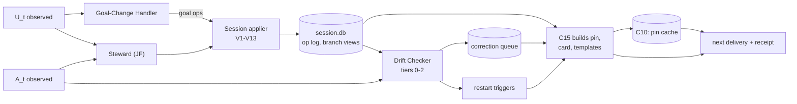

# AI side: in-session focus

**Status:** component design draft for adversarial review. Not approved. Nothing here is built.
**Written:** 2026-10-08. Product facts are from SPINE Appendix B, or were checked for this document on 2026-10-08 (PV table at the end). Revised after the adversarial review on 2026-10-08; see "Review revisions (2026-10-08)" at the end.
**Authority:** [`docs/GOAL.md`](../../GOAL.md) overrides this document. [`SPINE.md`](../foundations/SPINE.md) is binding; differences are listed under "Departures from SPINE". This document changes only the HOW and adopts no reframe.
**Components:** C09 session ledger; C10 session engine (Goal-Change Handler, Session Steward, Drift Checker, correction policy, composer and restart triggers, turn receipts, arms); C15's in-session artifacts (pin, card, correction, resume pack). C23 (cross-session) is designed in parallel; this document uses its outputs and offers it three queries.
**Inputs:** GOAL §3.3, §4, §6; SPINE §3–§8; SYN §3.3, §5, §7.1; [10], [11], [13]; [CD], [GD], [OBS]; TEXTBOOK §5.8, §5.9, §10.8. Sibling component docs: [CX] `connectors-desktop-and-mcp.md` (the MCP tool contract), [HK] `connectors-claude-code-and-codex.md`, [AC] `ai-continuity.md`, [MT] `maintainer.md`, [CDM] `core-data-model.md`.
**Labels:** (Unv) unverified, with its spike. PV-n: product fact checked here. "Starting value": tuned once after the protocol B pilot (SYN S8), then frozen.

---

## 0. Summary

1. **State lives outside the transcript** in a branch-aware, event-sourced session ledger (C09): goals, user constraints, items established by either speaker with reason and reaction, assumptions, open questions, rejected options, artifact versions. Every item cites a span.
2. **One engine on every tier.** Only input timing and output channel differ, read from the capability vector (SPINE §4.6, I23). §10 walks one turn per tier and states what is lost.
3. **The chat model never maintains state.** A separate steward sees a bounded ledger view and the last turn window and emits typed operations; thirteen code validators gate each one. Pins never wait: the last validated pin, built by C15, is served from C10's cache (p95 300 ms).
4. **Only user turns move goals.** The Goal-Change Handler classifies each user turn before drift is judged.
5. **Each item is judged in isolation:** tier 0 deterministic checks, tier 1 embeddings (selection only), tier 2 one judge call per item from either speaker, each verdict backed by a verbatim reply quote. Corrections are specific and written by code from templates.
6. **Pin ~80–150 tokens every turn; card ≤ ~600 on triggers; corrections first.** Attributed third-person facts, labelled Northstar state, never imitating vendor tags.
7. **Restart comes from the ledger**, never the transcript; the old chat always stays usable (SD-15).
8. **Tiers.** Hook: an in-turn `Stop` check with at most one continuation per user turn; tier-0 checks on tool actions; re-seeding after compaction. Desktop L0: everything rides the Northstar call; corrections arrive one call late; L0+ adds widget delivery between calls. L1: the real reply is judged. L2: deterministic delivery; sending gated by UQ-1.
9. **Measurement is built in:** bars are reported separately for user- and AI-established items; desktop L0 call rate is exact only where a second turn counter exists.
10. **Stated risks:** no correction before display on chat surfaces (RISK 20); L0 checks use the model's self-report (RISK 4); fact-only wording may be weaker than the −87% evidence form (RISK-IS-5); Claude Code no longer marks pastes (PV-2, RISK-IS-6).

---

## 1. What this subsystem must deliver

Late answers in a long chat keep serving the goal and do not contradict what either speaker established (GOAL §3.3, §4.5). AI-established items steer from their turn, with reason and the user's reaction (§4.2; SYN AD10). Nothing is asked of the user (§4.1, §4.3). Behaviour is keyed on capability levels only (§4.6). It stays correct when any one agent loses focus (§4.7, §12), and the reduction is measured, split by speaker (§6, §11). The goal-fidelity check at the end maps each item to its status.

**Design rules.** R1 state survives compaction, branches and restarts. R2 the chat model is never the maintainer; its tool arguments are untrusted. R3 no model output steers until code validates it. R4 the pin is always servable. R5 fidelity gates long-term authority, never live steering (I22). R6 no product logic (I23). R7 only user turns create or move goals and constraints. R8 nothing repairs itself from its own output: the resume pack comes from ledger items; steward and judge never read earlier verdicts or pins ([11 F2], impl. 8).

---

## 2. Turn model and timing

Turn t = user message U_t, Northstar's delivery D_t, reply A_t.

| Tier (SPINE §4.6) | U_t reaches the core | A_t reaches the core | D_t placed | Pair t closes |
|---|---|---|---|---|
| Hook | `UserPromptSubmit`, verbatim, before the model | `Stop`, verbatim, before control returns | `additionalContext` | At `Stop` |
| L1 (observer) | Composer at send | Reply end, rendered | As L0/L0+ | At reply end |
| L1 + L2-inject | As L1 | As L1 | Visible block pre-armed before U_t | At reply end |
| L0/L0+ | Model's copy in call t, if called | Model's points about A_t, in call t+1 | Result of call t; widget (L0+) | At call t+1 |
| SDK | `observe` | `observe`/`check` | Client-built prompt | At `check` |

At L0 the turn number is the **call index**; turns without a call are invisible. Each turn stores `turn_basis: ordinal | call_index`, reconciled when verbatim text arrives (RISK-IS-4).



---

## 3. The session ledger (C09)

### 3.1 Records in `session.db` (writer: C10 session applier)

Additions to SPINE §5.2 are marked (+).

| Record | Key fields |
|---|---|
| Session | SPINE §5.2, plus (+) `state`, `capabilities_effective` (after spike and consent gating), `restart_offers` |
| Turn (+) | `handle`, `branch_path`, `turn`, `turn_basis`, observation refs and fidelities, GCH labels, `steward_status` (applied, lagging, failed, gap), `audit_status` |
| Session operation | SPINE §5.2, plus (+) `section`, `cites[]`, `basis`, `authority`, `actor` (steward, gch, seeding, user, reconciliation, audit), `actor_ref` (for `seeding`, the `continuity_params` version), `model@version`, `prompt_hash`. Append-only; the only way state changes |
| Session item (view) | Per branch, rebuilt hash-identically from ops (I18 at session scope); §3.2 |
| Drift verdict | SPINE §5.2, plus (+) `item_by`, `item_origin` (this_session, seeded, resume), `item_fidelity`, `tier`, `weak`, `independent` |
| Queued correction (+) | `verdict_id`, `item`, `severity`, `text_hash`, `state` (queued, delivered, resolved, expired, superseded), `deliveries`. A message to the model, not the user's C18 Correction |
| Receipts | Turn, continuity and context receipts (SPINE §4.5, §5.2) |

### 3.2 Item schema by section

Items use the Item schema with `scope: session:<handle>`, `status: provisional` (SPINE §5.5), plus:

| Section | Created from | Extra fields | Statuses |
|---|---|---|---|
| **goal** | User spans; seeding | `level` (north_star, session_goal, focus), `tangent?`, `authority` (provisional, reported, confirmed), `reason?` | active, paused, done, superseded, proposed, expired |
| **constraint** | User spans of origin `user_typed` (or `model_reported`, with reported authority); seeded constraints; active corrections (I21) | `force` (must, should), `check?` (§6.2), `authority` | active, lifted, superseded |
| **established** | Either speaker | `kind` (decision, conclusion, definition, explanation, fact, plan, recommendation), `by` (user, ai), `agent_id`, `reason?` with its own span, `user_reaction` (accepted, challenged, rejected, unknown) with evidence span, `supersedes?` | active, superseded, retracted, contested |
| **assumption** | A span stating an unconfirmed premise (usually AI) | `by`, `relevant_to[]` | open, confirmed, refuted |
| **open_question** | Either speaker | `raised_by`, `answered_by?` | open, answered, dormant |
| **rejected** | Either speaker | `option`, `reason?` with span, `by` | active, reinstated |
| **artifact** | Either speaker | `name`, `versions[] {v, turn, by, span or hash}`, `current` | active, abandoned |

All items carry `source {turn, cites[], fidelity, origin}`, `seeded_from?` and `last_referenced_turn` (set by tier 1; drives "not in your recent context"). Seeds also carry `seed_kind`, `delivery` and `on_route` (§3.6).

- **Authority** uses the [CDM §2.2] enum: `provisional` (in-session, from a verbatim span), `reported` (model-reported text, I22), `confirmed` (seeded from long-term items).
- **Reasons are never inferred:** set only from a span that states them (inferred rationale matched at ~0.27 precision, SYN §5 item 1).
- **Pasted user text** never creates goals or constraints (I5). A pasted requirement becomes an established fact `by: user`, quoted, checked at medium severity.
- **Model-reported user text** creates items with `authority: reported` (I22): they steer now (AD10), labelled "as reported by the chat model".
- **Artifacts** are named outputs in replies. Tool-made edits arrive as `tool_action` observations (contract 1.2; [HK] §5.1).

### 3.3 Goal stack

- `north_star`: ≤ 3, from C23 routing or a user span stating an overarching aim.
- `session_goal`: at most one active per branch; `GOAL_SUPERSEDE` keeps the old one with status and reason.
- `focus`: a stack; tangents pushed with `tangent: true`, popped on return.
- `proposed`: AI-suggested; active only when a user span takes it up ([11] impl. 5).
- **Reported goals** seeded from earlier sessions (SD-36): `authority: reported`, shown as "reported, not confirmed", never scored for adherence; a verbatim user span here restating one gives it `provisional` authority, so it steers and is scored. A reported goal confirmed by a click under a DQ-10(a) yes (TB Q6) is seeded `confirmed` and scored (§3.6).

### 3.4 Branches

- Ops are recorded on the branch of the turn they cite. Branch B's view = ancestors' ops up to the fork + B's ops.
- `branch.switched` (edit, regenerate, observer branch indicator [OBS §4.3]) forks at turn k from the state after k−1; the GCH re-runs on the edited message. Abandoned items leave the view and become `branch_abandoned` stance evidence (SPINE §5.2).
- **At L0 branches are invisible.** A call whose copied user message hashes like the previous call's is treated as a regenerate and forks (SP-IS-7). Two calls with the same copied message of 20 characters or less ("continue", "go on") never fork a branch (SP-IS-7). Edits look like new turns.
- **Product forks** create a new handle with `parent_handle`, seeded from the parent at the fork point (§9.3).

### 3.5 Lifecycle

| State | Entered on | What runs |
|---|---|---|
| opened | `session.started`, or the first call at L0 | Arm assigned (SD-31); C23 routes |
| seeded | C23 seeding applied (§3.6) | Drift Checker live from turn 1 |
| active | First user turn | Full pipeline |
| compacting | `session.compacting` | Ledger watermark noted; the window closes (`window.closed`, reason `compact`) |
| idle | No turn for 30 min, or 60 min with no call on a `model_pulled` session (starting values; [MT §3.7] schedules on them) | The window closes (`window.closed`, below) |
| ended | `session.ended` (product end), or idle 24 h | Last window closes (reason `session_end`); promotion handoff (§3.7); back to active if the chat continues |

**Window close.** C10 emits `window.closed{handle, branch, window_id, turn_range, reason, active_item_ids[], spans[]}` through the outbox on every close: idle 30 min; 60 min with no call on `model_pulled`; compact; clear; session end. There is no size-cap close. `session.ended` marks the lifecycle end only.

This table is the one C10 lifecycle. The 30-minute close also covers a late or missing Codex `SessionEnd` ([HK §10.2]). A restart never ends the parent (§9.3).

### 3.6 Seeding at session start (by C23)

C23 routes and selects; the C10 applier writes `ADD` ops at turn 0 ([AC §5.1]). There is no separate seed or route op type; routing is a `routing_record` row. Each seed op has `actor: seeding`, `actor_ref` = the `continuity_params` version, `seeded_from {item_id@version, artifact_hash, delivery_receipt}`, `seed_kind`, `delivery` (delivered, unknown, guard_only; [AC §5.2]), `on_route`, and `by` keeping the original speaker (user, ai). Items cut by the budget or in an undelivered part are seeded only if they are rejected, disputed or constraint items, as `guard_only`. In a shadow arm they are seeded too, marked `arm: shadow`, so verdicts log as "would have corrected".

| Pack content (SPINE §4.7) | Seeded as |
|---|---|
| Routed goals | `goal` (north_star or session_goal), `authority: confirmed` |
| Reported goals confirmed by a click (only with a DQ-10(a) yes, TB Q6) | `goal`, `authority: confirmed`; scored for adherence |
| Reported goals and questions (SD-36) | `goal` / `open_question`, `authority: reported`. Reported goals and model-reported constraints seed per the DQ-10 answer; until then, unchanged |
| Long-term constraints; active corrections (I21) | `constraint`, `must`, `by: user`, `authority: confirmed` |
| Conclusions, decisions, knowledge-slot passages | `established`, keeping original `by`, `agent_id`, product and date. A seeded AI conclusion the user accepted keeps High severity (§6.5), matching its in-session status; an unaccepted, unverified one stays Medium |
| Rejected options; disputed AI claims | `rejected`; `established` with `user_reaction: challenged`, status contested |
| Open questions; recent provisional items | Their sections, `authority` as captured, labelled with the source session |

Re-routing on the first user turn adds items at turn 1. Seeded items are first-class: re-proposing a seeded rejected option gets the same correction as an in-session one (SYN §3.4).

### 3.7 End of session

The slow lane extracts from spans, never from session items (SPINE §5.5). Each `window.closed` carries active item IDs and spans so C11 can measure lane disagreement and record `promoted_from` (§3.5). C23 reads ended sessions' items for the 14-day window through `recent_provisional`.

### 3.8 Capture when the per-turn tool is read-only

Under `per_turn_readonly` the core holds nothing from unrecorded turns: no cache (SPINE §4.6, §5.5; [CX] §2.5). The call computes the pin from persisted items and any widget-held state ([CX] §2.5). It keeps no copy or hash of the message and makes no model call; what it may log is content-free ([CX] §2.5).

| Path (`capture_mode`) | What is recorded |
|---|---|
| C2 (`widget_record`) | Each turn, through the widget |
| A (`save_on_request`) | The turns that `save_chat` or the widget click carries, when it is approved ([CX] §2.6) |
| W (DQ-4(ii): the per-turn tool is declared a write instead) | Every call after its approval |
| B (`receipts_only`) | Nothing |

The steward, Goal-Change Handler stage 2 and the R13 audit run only on recorded turns; path-B sessions are reported "no audit" (RISK 33). What a chat establishes on unrecorded turns does not reach later deliveries in that chat (DQ-4(ii)).

---

## 4. The Session Steward (JF)

### 4.1 Inputs, assembled by code

| Input | Content | Bound |
|---|---|---|
| Ledger view | Goal stack, constraints, items touched in the last 10 turns, items retrieved by embedding against the new turns, and an ID-plus-gist index of the rest. The index lists goal-linked and recent items first; older items are reachable by a code lookup the steward may request, so it supersedes instead of duplicating | ≤ 2,500 tokens |
| Turn window | Hook, L1, SDK: pairs t and t−1. L0/L0+: pair t−1 plus U_t (Departure D2) | ≤ 4,000 tokens per message (head and tail) |
| Metadata | Message IDs, speaker, fidelity, origin, offsets, paste ranges; Northstar blocks stripped (I24) | — |
| L0 reported points (`prev_reply_points`, [CX §2.3]) | `{kind, text, quote}` | ≤ 5 |
| GCH labels for U_t | §5 | — |
| Job card, last | Deliverable, op schema, validator rule IDs | — |

Never in the input: verdicts, pins, cards, transcript beyond the window, long-term items not in the ledger. Input size stays constant however long the chat runs ([11 F7]).

### 4.2 Operations

The ten SPINE operations plus a `section` field. Reactions, answers and rejections use them; no new op type.

| Op | Use | Citation needed |
|---|---|---|
| `ADD` | New item | A span from a speaker the section allows (V4) |
| `REFINE` | Narrow or extend; set `user_reaction`; mark answered | User span for `user_reaction` |
| `SUPERSEDE` | Replace; `basis` ∈ user_statement, user_new_evidence, ai_self_correction | Span for the basis |
| `RETRACT` | Speaker withdraws an item | That speaker's span, or a user span |
| `MARK_CONTESTED` | Speakers disagree, or the AI reversed an item without user evidence (V10) | Both sides' spans |
| `GOAL_PUSH`, `GOAL_POP`, `GOAL_SUPERSEDE` | Goal moves; pop sets done, paused or expired | User span |
| `ASSUMPTION_CONFIRM` | User confirms or refutes | User span |
| `ARTIFACT_VERSION` | New version, or the user reverting | The version's span, or a user span |

Shape: `{op, section, target?, item{…}, cites[{id, msg, start, end, quote}], basis?}`.

### 4.3 Validators (code, 100% of ops)

| ID | Rule | On failure |
|---|---|---|
| V1 | Schema and enums | Reject |
| V2 | Each `quote` is an exact substring of the cited message after NFC and whitespace normalization, offsets matching (I2). At L0 the message is the model's copy or the reported point | Reject |
| V3 | A span lies in one message; its speaker is that message's captured speaker (I3) | Reject |
| V4 | Goals, constraints, `ASSUMPTION_CONFIRM`, `user_reaction` and user rejections need a user span. An AI span creates only `by: ai` items (established, assumption, open question, AI-rejected option, `proposed` focus, artifact version) | Reject |
| V5 | Goals and constraints need origin `user_typed`, or `model_reported` (then V6 applies) (I5, I20). Pasted, tool, external and Northstar text is quoted data only. On hook channels, long-term authority also needs `observation.origin_confirmed` (below) | Rewrite to a fact, or reject |
| V6 | I22: `model_reported` user evidence sets `authority: reported`; the item steers this session and is non-promotable as goal, constraint, instruction or endorsement | Set authority |
| V7 | Items from reported AI points carry `fidelity: model_reported`, "reported by the AI" | Set label |
| V8 | Spans overlapping a Northstar block, or AI spans with n-gram containment ≥ 0.6 against this session's delivered artifacts, create nothing (I24; `northstar_echo`, TEXTBOOK §5.9) | Reject |
| V9 | Target exists and is live on this branch; same section; no supersession cycle | Reject |
| V10 | **Flip guard.** After GCH `pushback_no_evidence`, a SUPERSEDE or RETRACT of an established item becomes `MARK_CONTESTED` plus a flip candidate. `user_new_evidence`/`user_statement` need a user span; `ai_self_correction` is allowed only when U_t is not pushback ([11 F4]; SYN §5 item 7). Also applied inside the Drift Checker (§6): a reply that explicitly corrects its own earlier item with a stated reason or grounding, when U_t is not pushback, becomes a `MARK_CONTESTED` candidate, never a continuation; silent flips stay checked | Convert |
| V11 | Idempotent on (handle, branch, turn, op hash) | Drop |
| V12 | ≤ 12 ops per window, ≤ 3 goal ops | Split the window into sub-windows and re-run; never discarded whole ([MT] §4.4); sentinel |
| V13 | One active session goal; pops by ID or from the top | Reject |

**Origin confirmation (hook channels).** Origin stays immutable once C06 binds it (I20). Confirmation is a separate intake flag, `observation.origin_confirmed`, set by [HK §8]'s transcript sweep and read by the C12 I5/I22 gate before long-term authority. Live steering never waits for it (R5). When the transcript reader is unavailable, C06 records `confirmed_degraded` (method `template_continuation_hash`): the prompt steers live (AD10) but gains no long-term authority until the reader confirms it or HK-S3 re-certifies the templates for the running version; a later `not_confirmed` triggers a C12 revocation under one `compensation.batch` ([HK] §8). C06 reports the degradation to C21. Prompts arriving while agent work is pending are `self_started` unless the transcript confirms a typed entry.

Rejected ops are logged with the rule ID, never "fixed" in the same call; a schema failure gets one fresh retry (SPINE §8.5 rule 4). The surviving error is omission, which the audit bounds.

### 4.4 Model role, cadence, latency

Role `steward` (SPINE §8.1): Haiku 5.5, standard API, structured output, recorded; alternative Sonnet 5.5, or the local model ([MT] V1) when the provider is down ([MT §2, §9.2]). Once per closed window (at L0, once per call). p95 under 5 s after the window closes (SP-6); on hook and L1 tiers the next pin is normally current. About 4k input and 300 output tokens per window: ~0.4M input tokens a day at 100 turns, within [13 §I]'s cost band.

### 4.5 When the steward lags or fails

| Condition | Behaviour |
|---|---|
| Lag ≥ 1 window | Pin from the last validated state, labelled "as of turn k". GCH goal ops still apply at once |
| Lag ≥ 3 windows | Backlog processed oldest first, one window per call, never skipped (omission dominates) |
| Timeout or schema failure | One fresh retry on the alternative model; then `steward_gap`, filled by the audit |
| Provider down | Degraded ([MT §2]): steward on the local model ([MT] V1, not validator V1); if none, deterministic mode (GCH rules, tier 0, seeded items), marked in receipts |
| Reject rate > 20% over 10 windows | **Degraded** ([MT §2]): the steward runs on its alternative, Sonnet 5.5 (the local model [MT] V1 if the provider is down); exit per [MT] §2 (below); sentinel to C21 |
| J10a precision < 95% or audit disagreement > 5% (per connector tier), or the steward canary regresses | **Frozen** ([MT §2, §7.3]): pin from the last validated state; only deterministic GCH rules and tier-0 checks; turns marked `steward_gap`, filled by J10a; exit per [MT] §2 (below) |

C11 owns these modes and thresholds ([MT §2, §7.3]); C10 applies them. **Exits** from Degraded and Frozen follow [MT] §2: the primary runs in shadow on live windows, its ops recorded and never applied, and J10a scores them.

### 4.6 Audit re-derivation

Every 10 turns and at session end, on tiers with verbatim text, role `session_auditor` (a family different from the steward's; local open-weight default; Departure D1) re-extracts ops from the raw turns, seeing only item IDs and gists of the ledger ([11] impl. 8). The diff gives steward precision and recall. Disagreements on goal changes or on supersession of accepted items become `MARK_CONTESTED` (actor `audit`); omissions are added; nothing is overwritten. At L0/L0+, J10a runs every 10 recorded calls on the model-reported window on the local verifier (R13). It checks the steward's and Goal-Change Handler's reading, not copy fidelity, and it feeds the steward budget per tier. It runs only on recorded turns; path-B sessions are reported "no audit" (§3.8).

---

## 5. Goal-Change Handler

Runs on every user turn before the steward and the judge.

**Outputs.**
- `shift`: continue, refine, pivot (new focus inside the session goal), goal_change, tangent, return, meta.
- `cues`: pushback_no_evidence, new_evidence, correction_cue ("as I said", "no, I meant"), acceptance, none.
- `items`: for each flagged or seeded item, whether U_t mentions it (ID, option name, alias, key phrase) outside a negation window, or carries a reopen or reversal cue. If so, its verdict this turn is `pending_steward`: no continuation and no correction about it.

| Stage | Method | Budget |
|---|---|---|
| 1. Rules | Shift-marker lexicon; question vs instruction; embedding similarity of U_t to focus, session goal and paused foci; mentions of item IDs or rejected options; pushback lexicon with or without new content (figures, sources, quoted facts) | p95 50 ms, sync |
| 2. Model | Role `goal_change` (Haiku 5.5), U_t plus goal stack, only when stage 1 is ambiguous | ≤ 1 s, async |

**Actions.** A confident pivot, goal change, tangent or return emits goal ops (actor `gch`, citing U_t, validated like steward ops); the old goal keeps its status and reason. Low confidence emits nothing; the card carries one fact line, "Open: unclear whether the focus moved from G1 (…) to (…)", which the model may raise with the user ([11] D7). On a low-confidence result, the reply's goal-service score is not scored (treated as meta) and only that uncertainty fact line is delivered. `pushback_no_evidence` arms V10 and the flip check. `correction_cue` counts as drift evidence against A_{t−1} and triggers the card.

**Timing.** Hook: stage 1 inside `context.get`; stage 2 during the reply, applied before the same turn's `reply.check` (Departure D3). L1: the same, before the post-display check. L0: stage 1 in the call; stage 2 applies to the next delivery.

**Pivot or drift.**

| User turn | Reply vs focus | Verdict |
|---|---|---|
| continue, refine | Serves the focus | Pass |
| continue, refine | Moves elsewhere | AI-led drift |
| pivot, goal_change, tangent | Serves the new focus | Pass (no false alarm) |
| pivot, goal_change, tangent | Keeps serving the old focus | Stale-goal drift |
| meta | — | Not scored |

A reply that follows a `proposed` focus the user has not taken up is scored against the user's focus.

---

## 6. The Drift Checker

### 6.1 Items in scope

Always: the goal stack, every `must` constraint, active rejected options, contested or challenged AI items, the current version of any artifact named in U_t or A_t. Plus up to 12 established items from either speaker (provisional and seeded included), ranked by embedding similarity to U_t + A_t and lexical mention, and relevant unconfirmed assumptions.

### 6.2 Tier 0: deterministic

| ID | Check |
|---|---|
| T0-1 | Re-proposal: the reply names a rejected option (name, alias, key phrase) outside a negation window |
| T0-2 | Re-assertion of a contested or challenged AI claim |
| T0-3 | Compiled constraint: where a constraint maps to `forbid_terms`, `require_terms`, `max_words`, `language` or `format`, the steward attaches the form, code validates it against the constraint's span, and code checks each reply and each `tool_action` diff (for example `forbid_terms` against a dependency manifest) |
| T0-4 | Stale artifact: content in the reply, or in a `tool_action` diff, is closer (diff ratio) to a superseded version than to the current one (a stale-version edit) |
| T0-5 | Premature answer: an answer attempt while a relevant assumption is unconfirmed or a blocking question open ([11 F2]) |
| T0-6 | Bloat: > 2× the session median for the same shift class and > 1,500 characters |
| T0-7 | Flip markers ("you're right, actually") after `pushback_no_evidence`, touching an established item |
| T0-8 | A correction cue in U_{t+1} about A_t |

### 6.3 Tier 1: embeddings

Similarity of the reply to the focus, the goal and each item. Never a verdict alone ([11 F9]). It orders tier 2, records a similarity series and updates `last_referenced_turn`.

### 6.4 Tier 2: one isolated judge call per item

- Each `drift_judge` call sees one item (text, speaker, turn, reason, reaction), U_t, A_t (or reported points) and a fixed rubric. Calls run in parallel and never see each other's verdicts.
- Verdict: consistent, violates, contradicts, re_proposes, flips_without_evidence, not_applicable or uncertain, with a verbatim reply quote. A failing verdict whose quote fails V2 becomes `uncertain`.
- A separate call scores goal service 1–5 against focus and session goal, with a quote. The flip call also gets the GCH cues: did the reply reverse the item without new user evidence?
- **The latest user turn first.** The rubric asks "does the latest user turn change this item?" A tier-2 verdict may overrule a tier-0 flag on that ground. Items the GCH marks `pending_steward` (§5) get no correction this turn.
- **Volume:** in turn (hook tier) only tier-0/1-flagged items, ≤ 3; asynchronously ≤ 6 per reply, by signal then severity class.
- **Families** (SPINE §8.3): the judge should differ from the reply's speaker family. In turn on a Claude reply this does not fit the budget, so Haiku judges with `independent: false` and the local verifier re-judges each such verdict asynchronously. Asynchronous judgments of Claude replies run directly on the local verifier, with no Haiku duplicate. Only independent verdicts count for bars and restart triggers, except as below.
- **No certified independent judge for this reply family** (for example the local verifier has not passed S10 for the drift judge): tier-0 code verdicts count as independent; a continuation needs a tier-0 verdict; same-family tier-2 verdicts count half toward restart, flagged as a degraded mode; the R15 sentinel uses label-free proxies (T0-8 correction cues, and the user's `correction_cue` turns after a continuation). Judge status is reported per connector.
- **R15 false-positive sentinel:** the share of the last 20 continuations on a connector not confirmed by the asynchronous independent re-judge. Above 20%, continuations on that connector need a tier-0 or independent verdict. Reported under RISK-HK-4 ([HK]) and RISK-IS-1 (§11).
- **Calibration:** the S10 bar on synthetic wrong-but-on-topic violations, per verdict type and per item speaker (SP-IS-2).

### 6.5 Severity

| Severity | Verdicts | Action |
|---|---|---|
| **High** | Violates a live `must` constraint; re-proposes a user-rejected option; contradicts an accepted item of either speaker without new evidence; flips without evidence; edits a stale artifact version | Correction now (in-turn continuation where possible); 2 restart points |
| **Medium** | Violates a `should` constraint; contradicts an unaccepted AI item or a reported item; re-proposes an AI-rejected option; relies on an unconfirmed assumption; goal score ≤ 2 | Correction in the next delivery; 1 restart point |
| **Low** | Bloat; premature flag; goal score 3; uncertain | Card trigger; logged |

**Weak verdicts:** any verdict resting on model-reported text is capped at medium and marked `weak`. It is delivered but never counts toward the SYN §7.1 bars (SPINE §4.6).

Coverage and the continuation false-positive rate are reported by item speaker and AI vendor family; speaker-blind severity is an ablation arm ([EV] §2.1).

---

## 7. The specific-correction generator

C15 renders each correction from a fixed template. No model writes correction text.

| Verdict | Template (code fills the fields) |
|---|---|
| re_proposes | `Northstar check of reply {t}: it proposes {option} ("{quote}"). {R} was rejected at turn {k} by {who}{, reason: "{reason}"}. No later user turn reverses this.` |
| violates | `Northstar check of reply {t}: "{quote}". Constraint {C} [user, turn {k}]: "{constraint}". It is still active.` |
| contradicts, flips | `Northstar check of reply {t}: it states "{quote}". {E} [{who}, turn {k}, {reaction}]: "{item}"{, because "{reason}"}. The user's turn {t} gave no new evidence against it. {E} still stands.` |
| stale artifact | `Northstar check of reply {t}: it edits {name} v{old} (turn {k}). The current version is v{cur} (turn {m}).` |
| goal drift | `Northstar check of reply {t}: it addresses "{quote}". The active focus is {G} [user, turn {k}]: "{goal}".` |

- Quotes are ≤ 25 words and verified substrings. "No later user turn reverses this" is computed: if a user op superseded the item, there is no correction.
- Facts, not orders (SPINE §4.7). The closing fact carries the expected behaviour; whether it matches the instruction form behind −87% is tested (SP-IS-5, RISK-IS-5).
- **Lifecycle:** queued → delivered → resolved (the next checked reply passes on the item), expired (3 deliveries or 10 turns; adds 2 restart points) or superseded. One pending correction per item and verdict. ≤ 2 per delivery, highest severity first. Expiries of weak L0 self-report corrections add no restart points.
- **The current turn first.** No correction is sent about an item the GCH marks `pending_steward` this turn (§5). At L0, queued corrections are re-evaluated after the steward applies the call that carried U_t; a tier-2 correction is dropped if more than one user turn has passed since its verdict was created.
- **Golden fixtures:** a reversal, a reopening, a self-correction and an ambiguous pivot must each produce zero continuations.

---

## 8. The composer (C15 in-session artifacts)

C10 decides when and what is pending; C15 builds deterministically and solely writes `artifacts.db`.

### 8.1 Artifacts

| Artifact | Size | Contents, in fitting order |
|---|---|---|
| **Pin** | 80–150 tokens, cap 600 chars ([CX §2.7]) | Label and as-of turn; top pending correction; `must` constraints (≤ 3); session goal and focus (north star if room); 1–2 newest established items, either speaker; at model-pulled tiers, "not in your recent context" (≤ 3 IDs, [GD §5 P2]) and the refresh fact ([CD §4.2.2]) |
| **Card** | ≤ 2,400 chars (~600 tokens) | Items relevant to U_t; middle-turn items (from the middle third, unreferenced for 5 turns, [11 F2]); unconfirmed assumptions; open questions; rejected options with reasons; current artifact versions; contested items with both sides; the GCH uncertainty line |
| **Correction** | ≤ 400 chars (~100 tokens), ≤ 2 per delivery | §7 |
| **Resume pack** | 1.5–3k tokens; ≤ 12,000 chars on a first call | §9.1 |

C15 rebuilds the pin on every applied op; C10 holds the pin cache per (handle, branch), so `context.get` meets p95 300 ms (SPINE §7.2). The card is built by C15 on request from the cached state plus an embedding of U_t; if late, it rides the next delivery.

**Card triggers:** every 6 turns (static; adaptive timing gained nothing, [11 F6]); pivot or goal change; branch switch; compaction (detected on hook tiers; suspected at L0 after a long call gap or a question about an established item); a medium or high verdict; turn 2 after a split start pack (SPINE §4.7); an expired correction; a mid-chat switch (§9.2).

### 8.2 Wording rules

| Rule | Enforcement |
|---|---|
| Labelled Northstar state | First line of every pin and card: `[Northstar session state, kept for the user; not the user's words; as of turn N; supersedes all earlier Northstar blocks in this chat]`; last `[end Northstar]` |
| Attributed third-person facts with IDs | `D2 [AI (Claude), t12, accepted]: … because "…"`; `G2 [user, as reported by the chat model, t5]`. No identity statements, inferred stances or engagement states |
| Status visible | `provisional`, `reported`, `seeded from <product, date>` |
| Never vendor tags | Plain bracket delimiters; a lint rejects angle-bracket tags and vendor tag names |
| Facts, not commands | A closed template set; a build-time check rejects imperatives addressed to the model. The user's boot text is the only instruction source ([CD §4.2.3]) |
| Injection-safe | The one rendering rule in [AC] §3.2 applies to every artifact here (pin, card, correction, resume pack); there is no separate rule in this document |
| Pushback is not evidence | "challenged by the user at t15 without new evidence; still stands" (SYN §5 item 7) |

**`pin_delta` ablation arm.** When nothing changed, the pin is one line, "state unchanged since reply k"; the full pin is sent on any change or every N turns; pending corrections always come first. It is tested against the full pin every turn ([EV] §2.1).

Example pin (~130 tokens):

```
[Northstar session state, kept for the user; not the user's words; as of turn 23; supersedes all earlier Northstar blocks in this chat]
Check of reply 22: it proposes R2 ("a nightly cron job"). R2 was rejected at turn 9 by the user, reason: "the laptop sleeps". No later user turn reverses this.
C1 [user, t3]: "no new runtime dependencies".
G1 [user, t1]: a backward-compatible migration plan. Focus G3 [user, t18]: the rollback step.
D4 [AI (Claude), t20, accepted]: feature flags for the cutover, because "both versions can run at once".
[end Northstar]
```

### 8.3 Channel budgets and fitting

Budgets come from the manifest (SD-30). [CX §2.7] is the single table for MCP channels and the [HK §15] manifest for hook channels; this table restates them. Fitting order: corrections, `must` constraints, goals, newest established, card items (SPINE §4.7). Truncation is deterministic and recorded. 4 characters ≈ 1 token.

| Placement | Budget | What fits |
|---|---|---|
| Claude Code hook context | Turn 2,400 chars; start 9,000; subagent pin 1,200 ([HK §15]; host cap 10,000, PV-2) | Pin, card, corrections; resume pack at start, split when over budget (SPINE §4.7) |
| Codex hook context | As Claude Code; start within `additionalContextLimit`, about 2,500 tokens (approximate tokens; [HK] §5.2, §15, HP36) | Pin, card, corrections; resume pack split if larger |
| Desktop tool result | Per-turn ≤ 4,000 chars (pin ≤ 600, card ≤ 2,400, correction ≤ 400, "not in your recent context" ≤ 400); first call ≤ 12,000; book ≤ 2,400; fetch ≤ 8,000 ([CX §2.7]) | Corrections, card, restart offer, then pin and refresh fact last; the start pack on the first call |
| Widget model context | 1,200 chars in the manifest; real limit (Unv: CD-S2, CS4) | Pin and one correction |
| Restart prefill (Claude Desktop) | Handle plus one fixed line, cap 600 chars, no item text (RISK-CX-5) | The pack arrives on the new chat's first `northstar_context` call |
| L2-inject block | Per turn 600 chars; 1,800 on triggers. Start block: C23 part S under the same rule, ≤ 1,500 chars ([AC §3.4]) | The pin's user-typed goals and constraints and pending corrections only ([OBS] §4.4 content rule) |
| SDK | Client's choice | Up to a resume pack per turn |

Average load at starting values ≈ 230 tokens per turn (pin every turn, card every 6), under the 600-token bar; measured in §11.

---

## 9. Consolidate and restart

### 9.1 The resume pack

Built by C15 from ledger items only, never from the transcript or earlier pins and packs (I7; [11 F2], impl. 6).

| Slot | Content |
|---|---|
| Lineage | "Continues Northstar session NS-7F3K (Claude Desktop chat, 3 Oct). This chat starts from its recorded state." |
| Goals; constraints | Goal stack (paused goals one line each); all active constraints with source turns |
| Established | In-scope items from both speakers with reasons and reactions; contested items with both sides |
| Do not re-propose / re-assert | Rejected options; challenged AI claims |
| Assumptions, questions | Unconfirmed assumptions; open questions |
| Artifacts | Current version of each, verbatim from its span if it fits, else its ID for `northstar_fetch` |
| Last turns | The last 2 turns as captured, labelled with fidelity |
| From the core | ≤ 500 tokens of linked long-term items not already present, chosen by C23 (`select`) |

Item IDs are kept and the child ledger is seeded with them as §3.6 `ADD` ops whose `seeded_from` names the resume pack's `artifact_hash` (`item_origin: resume`), so checks run from its turn 1. A restart into another vendor's chat is scope-filtered (I17).

### 9.2 Triggers (starting values)

| Trigger | Threshold |
|---|---|
| Drift budget | ≥ 4 points in 10 turns from independent verdicts (high 2, medium 1, unresolved expired correction 2; weak L0 expiries add none, §7). Without a certified independent judge, same-family tier-2 verdicts count half (§6.4) |
| Goal service | Mean goal score ≤ 2.5 over the last 6 scored replies |
| Length | ≥ 40 turns, or estimated total context ≥ 50% of the model's window, Northstar traffic included (call count × mean turn size plus delivered Northstar characters at L0). At desktop L0 the turn threshold is set per connector at the depth where measured r(t), the per-turn call rate (`p_call`, §11.3), falls below 0.8 (start: 40 turns) |
| Compaction | Detected or suspected |
| Topic | Goal change to an unrelated session goal after ≥ 20 turns |
| Asked | The user asks, or `northstar_restart` is called |

No repeat offer within 10 turns unless a new high verdict lands; at most 3 per session. Nothing nags (GOAL §4.1).

**Mid-chat switch** (not a restart offer). On a confident `goal_change` or pivot toward a long-term goal not on the session's stack, C10 calls C23 ([AC] §4.3). Its goal section is delivered in the next card, and its items are seeded as §3.6 `ADD` ops at that turn.

### 9.3 Policy by `restart` level (SD-15)

| Level | Behaviour |
|---|---|
| `automatic` (SDK; L2-auto only with UQ-1 consent to send) | SDK rebuilds the prompt from the resume pack, every turn if it wants (CONCAT, [11 F1]). L2-auto: at reply end the observer opens a new chat with the pack and the pending draft, and sends only if UQ-1 allows |
| `reseed_on_reset` (hook) | `SessionStart compact`: always re-seed from the resume pack. `fork`: re-seed from the fork point. `clear`: re-seed only if a restart was offered in the last 10 turns or C23 routes the first prompt to the same goals; otherwise a new session with C23's pack, since the user may be starting something new. `resume`: the known session's pin and card. On drift triggers the pin states a fact: "A fresh context with the recorded state is ready; /clear starts it." |
| `prepared` (desktop where CD-S5 or CS4 pass) | Claude Desktop: `northstar_restart` or the widget (`northstar_widget_action(action: restart)`) opens a new chat prefilled with the handle and one fixed line, cap 600 chars, no item text (CD-S5; RISK-CX-5); the resume pack arrives on the new chat's first `northstar_context` call. ChatGPT L0+: `ui/message {target: "new"}` with the pack (CS4). One user action sends |
| `suggested` | The next delivery says a fresh chat is ready. The pack waits 24 h in a **pending-resume registry**; a new chat whose first call names the handle, or that C23 routes to the same goals, gets the resume pack instead of a plain core pack |

The old chat is always kept: a restart never ends the parent, which continues with its own ledger if used (offers pause 10 turns). Prefilled or sent text is `northstar_authored` (I24). A pending draft is carried over only where it can be read (L2).

---

## 10. One turn, by tier

### 10.1 Hook tier (Claude Code, Codex)

| Step | What happens |
|---|---|
| Start | `SessionStart` (startup, resume, clear, compact; fork on Claude Code only, PV-4) → C23's pack, the resume pack, or the known session's pin and card (§9.3), in `additionalContext` |
| User sends | `UserPromptSubmit` → `turn.observed` (user, `verbatim_live`) → GCH stage 1 → `context.get(turn_start)`: cached pin, card if triggered, pending corrections → `additionalContext`, a system reminder that is saved in the session transcript and replayed on resume (PV-2; [HK] HP14) |
| Model works | GCH stage 2 if needed. Northstar tool results omit the pin here (SPINE §6.2) |
| Tool use | `PostToolUse` → `tool_action` observation (contract 1.2; [HK] §5.1) → T0-3 and T0-4 on its diff; a failing check returns its correction as PostToolUse feedback. **Mid-turn pin refresh** every N tool calls (a starting value in the hook manifest, [HK] §15) and after an in-turn compaction, within the cumulative budget |
| Reply ends | `Stop` → `turn.observed` (assistant, `last_assistant_message`) → `reply.check` (connector `budget_ms` 4,000; contract default 8 s): tiers 0–1 (p95 150 ms), tier 2 on ≤ 3 flagged items. A **high** verdict on an item not `pending_steward` (§5), with no continuation yet this user turn and fewer than 4 continuations in this session in the past hour ([HK] §9.1), returns `continue: true` and the correction. When the R15 sentinel is above 20%, or no certified independent judge exists, the verdict must be tier-0 or independent (§6.4). Claude Code: `decision: "block"` with it as `reason`, or Stop `additionalContext` (PV-1). Codex: `decision: "block"`, which becomes a new user-role prompt (PV-4) that C06 stores as `northstar_authored` (I24). The continued reply is re-checked on the flagged items only; no second continuation (the core counts its own; `stop_hook_active` is a backstop). Other verdicts queue for the next pin |
| After | Steward on pairs t, t−1; independent re-judge; pin cache refresh |
| Compaction | `PreCompact` → `session.compacting` (never blocked). `PostCompact` → `compact_summary` (PV-3) held transiently, never a source; active items absent from it are listed "possibly dropped" and lead the next card. `SessionStart compact` → resume pack (constraints pinned outside compacted text stayed at 0% violations, SYN §3.3) |

**Lost:** correction before display only for flagged high verdicts, once per user turn (tool actions get tier-0 feedback only); in-turn verdicts on Claude replies not independent until re-judged; Codex audit `live_single` (SPINE §4.10); pastes unmarked (RISK-IS-6); restart needs one `/clear`; added `Stop` latency (RISK-IS-1).

### 10.2 Desktop chat L0 and L0+ (Claude Desktop, ChatGPT Desktop)

| Step | What happens |
|---|---|
| Start | Boot line → first call: `northstar_context` with no `session` and the model's copy of the first message (`readOnlyHint` false under `per_turn_write`, true under `per_turn_readonly`; [CX §2.2, §2.5]) → C23 routes on `hint_text` → start pack (≤ 12,000 chars) → seeding. No call, no session (SPINE §4.6) |
| Turn t, called | `northstar_context` with `user_message` (copy of U_t), `prev_reply_points` (≤ 5 quoted points from A_{t−1}) and `session` (handle and turn tag; ChatGPT also sends `openai/session`). Core takes both as `model_reported`, persisted per `capture_mode` (Persistence row); pair t−1 closes |
| In the call (≤ 300 ms) | Tier 0 on A_{t−1}'s points; GCH stage 1 on U_t. Result: corrections (this tier 0; async verdicts on A_{t−2}), card if triggered, restart offer, "not in your recent context", then the pin and refresh fact last. Under `per_turn_readonly` on an unrecorded turn, the result is the pin computed from persisted items and widget-held state (§3.8) |
| After the call | On recorded turns only (§3.8): steward on pair t−1 + U_t (D2); tier 2 on reported points (weak); GCH stage 2; all reach the next delivery |
| Closing call (explaining replies) | When a reply explains something, the model makes one closing report call after it, so a chat's final reply is captured; a reported explanation body is ≤ 1,500 chars ([CX] §2.3). Persisted per `capture_mode` like any call; weak like other reported points. Conditional on its spike (BOOK-2) |
| Between turns (L0+) | The newest widget polls the core and pushes pin and top correction via `ui/update-model-context` (hidden on ChatGPT) with the as-of turn (cond. CD-S2, CS4); receipts say `delivered: true` when the model echoes the widget tag, else `unknown` (§11.3) |
| Turn with no call | L0: nothing reaches the core; the last pin stays in the transcript. L0+: the widget still delivers the last pin and corrections, but the ledger does not advance |
| Persistence | By `capture_mode` ([CX §2.5]): `per_call` (path C1) records each call; `widget_record` (C2) records through the widget; path A records what an approved `save_chat` or widget click carries; path W records every call after its approval; path B records nothing. There is no held cache (§3.8). The pin works on all paths, from persisted items and widget-held state |

**Lost at L0:** verbatim capture (reported items stay provisional, I22). Uncalled turns are invisible: no capture, GCH, steward or check, and on ChatGPT no sign a turn happened. Checks see only the model's self-report, and models miss 64.5% of their own errors ([13 F1]), so they are weak and excluded from bars. Corrections land one call late (two for tier 2). Edits invisible; regenerates by heuristic; compaction only suspected; the audit checks only the model-reported window (R13, §4.6), and path B has none; restart `prepared` or `suggested`. **L0+ restores** per-turn delivery of pin and corrections after the first call, not capture.

### 10.3 Desktop chat L1 (observer read)

| Step | What happens |
|---|---|
| User sends | Composer read at send → `turn.observed` (user, `verbatim_live`) → GCH stage 1 |
| Model replies | Any Northstar call is joined to the observed turn (handle, timing, hash); its copy becomes a fidelity cross-check ([GD §7]) |
| Reply ends | `turn.observed` (assistant, `verbatim_rendered`) → full cascade on the real reply, after display (`next_turn_verbatim`); verdicts not weak |
| Delivery | Correction pushed to the widget at once (L0+) and leading the next result. A correction turn via `ui/message` (CD-S4) only if UQ-1 allows; off by default |
| Branches, compaction, audit | Branch indicator → `branch.switched`; visible compaction state triggers the card (Unv, DS4); observer vs reports gives `live_independent` audit every 10 turns |

**Lost:** correction before display. If CD-S2/CS4 fail, delivery stays model-pulled, so a correction found on the real reply may not reach the model on uncalled turns. Missed calls become visible and measured.

### 10.4 L2-inject and L2-auto (gated by UQ-1)

- **L2-inject** (UQ-1 working assumption: only where the widget spike fails): after each reply, into an empty composer only, the observer pre-arms a visible block. What fits: the pin's user-typed goals and constraints and pending corrections only ([OBS] §4.4 content rule); 600 chars, 1,800 on triggers. At chat start the block is C23 part S under the same rule, ≤ 1,500 chars ([AC §3.4]), never the full pack. On send the block is split out by exact match and stored `northstar_injected` (I24); a deleted block is `user_removed` and not re-added that turn.
- **L2-auto:** on a trigger, at reply end, the observer prepares a fresh chat with the resume pack and pending draft; it never sends under the working assumption. Correction turns stay off.
- **Lost:** correction before display; visible blocks enter the transcript and possibly vendor memory (RISK 11, SD-16); no block on turns where the user already types. If UQ-1 is declined the level counts as absent and the session falls back to L1 or L0 (SPINE §4.2).

### 10.5 What each tier keeps and loses

| Capability | Hook | L0 | L0+ | L1 | L1 + L2 |
|---|---|---|---|---|---|
| Steward input | Verbatim | Copy, called turns | Same | Verbatim, every turn | Verbatim |
| GCH every user turn | Yes | Called turns | Called turns | Yes | Yes |
| Pin every turn | Yes | Called turns | After first call (cond.) | As L0/L0+ | Yes, unless user typing |
| Check on the real reply | In turn and after | No (weak self-report) | No | After display | After display |
| Correction before display | High, once per turn | No | No | No | No |
| Correction delivery | Next turn | Next call | Next turn (cond.) | As L0/L0+ | Next turn |
| After compaction | Re-seeded | Pin at next call | Widget re-sends | As L0/L0+ | Block re-sent |
| Branch-aware | Fork events | Regenerate heuristic | Same | Indicator | Indicator |
| Restart | Re-seed; `/clear` | Prepared/suggested | One tap | Prepared; auto only with UQ-1 | Prepared; send per UQ-1 |
| Live audit | Yes | Reported window only (R13; none on path B) | Same | Yes | Yes |

---

## 11. Measurement hooks

### 11.1 Records for C22

C22 only reads (SPINE §6.4 rule 8). Per turn: the receipt (arm, fidelities, placement, artifact hash, injected characters), GCH labels, steward ops with validator results, verdicts, correction lifecycle, restart offers and uptake, latencies, C20 call records. In a shadow arm the pipeline runs fully and C15 suppresses delivery, so verdicts and corrections log as "would have delivered" (SD-31); live shadow arms on real chats wait for UQ-9.

**The system never grades itself:** C22 re-judges sampled replies with `eval_judge`, a family different from both system and verifier (SPINE §8.1). In-system verdicts drive behaviour and diagnostics only.

### 11.2 Metrics, split by who established the item

Verdict rows carry `item_by`, `item_origin` and `item_fidelity`, so each item metric has four cells: user- and AI-established, each in-session and seeded.

Sources per SYN §7.1 metric: **contradictions** from eval-judge verdicts per applicable (item, turn), by `item_by`; **adherence AUC** from the eval-judge goal score over depth; **violations and know-but-violate** from constraint verdicts plus a restatement probe; **flips** from flip verdicts after `pushback_no_evidence` and scripted pushback; **version editing** from artifact verdicts; **premature answers and bloat** from T0-5 and T0-6 against single-turn references; **A90, U90–10** from ≥ 8 samples; **live correction rate** from `correction_cue`; **goal-shift F1 and false alarms** from GCH labels against the gold ledger; **steward precision and recall** from validators and the audit; **tokens, latency, cost** from receipts and C20.

**Bars** (SYN §7.1, ≥ 40 turns): ≥ 30% fewer contradictions than vanilla, **separately for user-established and AI-established items**; adherence AUC ≥ 25% higher; no rise in flips; steward precision ≥ 95%; audit disagreement ≤ 5%; ≤ 600 injected tokens per turn. Hook and desktop results are reported separately (SD-18). Weak verdicts never count.

**Protocol B arms added** (HOW ablations): correction wording (SP-IS-5); card every 6 vs 10 turns; in-turn continuation on vs off; resume pack with and without the last two turns; `pin_delta` vs the full pin (§8.2); speaker-blind severity (§6.5). Each also checks that refusals of legitimate revisions do not rise (RISK-IS-2).

**Continuation false positives (R15).** The R15 sentinel (§6.4) and judge status are reported per connector, by item speaker and AI vendor family, under RISK-HK-4 ([HK]) and RISK-IS-1.

### 11.3 Per-turn call rate on desktop L0

`p_call(d)` = share of user turns at depth d with a Northstar call. At L0 the denominator is invisible, so:

| Source | Gives | Where |
|---|---|---|
| Spikes CD-S3, CS5, DS3 | Exact `p_call(d)`, 40-turn scripted chats, 8 runs per arm, by boot-line and widget support; CD-S3 and CS5 also measure the added time to first token per call | Stage 0; sets the ≥ 90%-over-40-turns bar ([CD §4.2.9]) |
| Observer (L1, or shadow) | Exact: observed turns vs joined calls, every session | Production, if UQ-1 allows |
| Export reconciliation (one-off) | Exact, after the fact | When an export is ingested |
| L0 alone | Calls per session; call gaps vs the user's typical turn interval | Reported as a lower bound |

Where the host allows, the call-rate metric separates "not offered" (the tool was not in the model's list that turn) from "offered but not called" (CS5). ChatGPT `openai/session` watermarks show missing calls, not missing turns ([GD §8]).

**Widget delivery** is measured by the widget-tag echo: a receipt says `delivered: true` when the model echoes the widget's tag, else `unknown`, never `false`. CD-S2 and CS4 set the rules.

---

## 12. When one agent loses focus

- **Chat model** (drifts, skips calls, misreports): never the maintainer; I22; call-rate sentinel; reconciliation; L1.
- **Steward** (invents, misattributes, omits): V1–V13; the audit bounds omission; the error budget sets Degraded or Frozen ([MT §2, §7.3]).
- **GCH** (misses or invents a pivot): rules first; low confidence changes nothing; goal ops reversible; audit.
- **Judge** (lenient or wrong): per-item isolation; quote check; independent re-judge; S10; the eval judge scores results.
- **Composer:** no model; linted templates. **Fast lane down:** last validated pin; fail open (SD-29); deterministic mode.

Fault injection (SYN §7.4) degrades one role at a time via the C20 port. Targets: 100% of invented or misattributed ops blocked; never a delivery without a pin.

---

## 13. Product facts checked for this document

| ID | Fact | Source | Checked |
|---|---|---|---|
| PV-1 | Claude Code `Stop` input has `stop_hook_active` and `last_assistant_message`; `decision: "block"` needs a `reason` that "Tells Claude why it should continue"; after eight consecutive continuations the next block is overridden (count resets on a tool call; `CLAUDE_CODE_STOP_HOOK_BLOCK_CAP`); `Stop` also accepts `additionalContext`, labelled "Stop hook feedback" | https://code.claude.com/docs/en/hooks | 2026-10-08 |
| PV-2 | `UserPromptSubmit`: pasted content collapsed to a placeholder "arrives expanded in place" in `prompt`; `additionalContext` is added as a system reminder, capped at 10,000 characters; on timeout it is discarded and the prompt still goes through. Corrected in review: injected `additionalContext` is saved in the session transcript and replayed on resume ([HK] HP14), not "no transcript entry" | Same | 2026-10-08 |
| PV-3 | `PreCompact` gets `trigger`, `custom_instructions` and can block; `PostCompact` gets `trigger`, `compact_summary`, no decision control | Same | 2026-10-08 |
| PV-4 | Codex `Stop` has `stop_hook_active`, `last_assistant_message`; `decision: "block"` "creates a new continuation prompt that acts as a new user prompt, using your `reason` as that prompt text"; `PreCompact`/`PostCompact` on `trigger`; `SessionStart` sources startup, resume, clear, compact; hook output ~2,500 tokens by default | https://learn.chatgpt.com/docs/hooks | 2026-10-08 |

Other product facts: SPINE Appendix B (P2, P5, P6, P12, P17, P19) and the connector docs, with their dates.

---

## Interfaces

### Provides

| To | What | Shape |
|---|---|---|
| C04, C05 | `context.get` (`turn_start`, `post_compact`, `tool_call`) | `{artifact_kind, text, item_ids[], as_of_turn, artifact_hash, receipt_token, truncations[]}` within `budget_chars` |
| C04 | `reply.check` | `{verdict: pass \| correct, continue, correction_text?, reasons[{item, verdict, severity}], independent}` or `deferred` |
| C04, C05 | `restart.prepare` | `{resume_pack, new_handle, open_hints{prefill_text?}}`; pending-resume entry |
| C15 | Ledger view; verdicts; corrections | `state(handle, branch, as_of?)`; `pending_corrections(handle, branch)` |
| C23 | Seeding path; early turns; recent items; pending resumes | Applier accepts `ADD{actor: seeding, actor_ref, seeded_from, seed_kind, delivery, on_route, by}` (§3.6); `session.early_turn(handle, turn ≤ 5)`; `recent_provisional(since, scope) → items[]`; `pending_resume(handle \| goal_ids) → resume_pack_id?` |
| C11 | `window.closed{handle, branch, window_id, turn_range, reason, active_item_ids[], spans[]}` on every window close (§3.5); `session.ended(handle, reason)`, the lifecycle end only | Outbox |
| C16, C17 | Context receipts by session | SPINE §5.2 |
| C21 | Sentinels | Steward lag and reject rate; audit disagreement; `p_call` bounds; copy fidelity; correction backlog; continuation rate; R15 continuation false-positive share and judge status, per connector (§6.4); injected tokens |
| C22 | Receipts, split verdicts, shadow logs, GCH labels | Read-only `session.db` tables |

### Needs

| From | What |
|---|---|
| C06 | Normalized `turn.observed` (speaker by construction, fidelity, origin, paste and Northstar ranges, hash); `tool_action` observations with diffs (contract 1.2; [HK] §5.1); Codex continuation prompts classified `northstar_authored` |
| C08 | Embeddings; lookup p95 < 20 ms (SP-1) |
| C15 | Pin, card, correction and resume-pack builders; template lint |
| C18 | User corrections of session items (`app_click` through `northstar_widget_action` with a valid `action_nonce`, `reader_click`) as ops with actor `user`; chat corrections through `northstar_note(kind: correction)` stay proposals unless `chat_verbatim` ([CX §2.4–§2.6, §3.5]) |
| C19 | Scope and sensitivity filters; excision reaching `session.db`, the C10 pin cache and `artifacts.db` |
| C20 | Roles `steward`, `goal_change`, `drift_judge`, `session_auditor` (new); family routing; fault hooks |
| C23 | Seeding after delivery; `select(goal_ids, budget) → item_ids[]`; pending-resume lookup in its router; a mid-chat route call on a switch toward a long-term goal not on the stack ([AC] §4.3; §9.2) |
| C02 | Composer and reply events, branch indicator, `reply.ended`, placement receipts |
| C12 | `items.retracted(ids)`: the applier retracts seeds whose `seeded_from` matches, expires queued corrections citing them, and invalidates pins and pending resume packs (SPINE §6.3; [AC] §5.3) |

---

## Departures from SPINE

| # | SPINE says | This design | Why |
|---|---|---|---|
| D1 | §8.1 has no role for the in-session audit | New role `session_auditor`, family different from the steward's (local default) | [11] impl. 8 needs independent re-derivation; reusing `steward` keeps it in the checked work's family (CAPA, [13 F3]) |
| D2 | §8.1 steward input: "the last two turn pairs" | At L0/L0+: pair t−1 plus U_t | A pair closes one call late at L0; two full pairs would bring a user's new constraint in two calls late |
| D3 | §8.1 `goal_change`: inside `context.get` (< 1 s), else next turn | Stage 1 inside `context.get`; stage 2 during the reply, applied before the same turn's `reply.check` | The pin budget is p95 300 ms (§7.2); this removes false alarms on the pivot turn itself |

**Additions, not departures:** op fields `section`, `cites[]`, `basis`, `authority`, `actor`, `actor_ref`; item fields `check`, `seeded_from`, `seed_kind`, `delivery`, `on_route`, `authority`, `last_referenced_turn`; Turn and queued-correction records; the pending-resume registry C23 consults; the L0 regenerate heuristic; the internal `window.closed` event (§3.5); the GCH `items` output and the `pending_steward` verdict state (§5).

---

## Risks

Carried from SPINE and SYN, with this design's mitigation: **3** modest effect (sized in S8); **4** desktop delivery rests on calls or widget context (§10.2, §11.3); **20** no correction before display on chat surfaces (next-delivery corrections, widget push); **6** steward error bounded statistically (§4.3, §4.6); **9, 25** injection, fabricated reports (V4–V8, quoting, reported items capped at medium); **11** vendor memory (hidden channels first); **16** steward lag (§4.5); **12, 21** no in-app counterfactual (§11; UQ-9); **24** wrong joins (views rebuild from ops); **19** no live verbatim AI-said capture at desktop L0 (reported items stay provisional, reconciled later); **33** path B records nothing and has no audit, and path A keeps a chat's turns only when an approved `save_chat` or widget click carries them (RISK-CX-3); with no cache, what such a chat establishes on unrecorded turns does not reach its later deliveries (§3.8).

| # | New risk | Threatens | Mitigation |
|---|---|---|---|
| **RISK-IS-1** | The in-turn `Stop` check adds latency, and a continuation can lengthen or worsen a reply | §4.1 experience; §6 | Tier 2 in turn only on flagged items; one continuation per user turn; fewer than 4 an hour; the R15 false-positive sentinel (§6.4); budget; SP-IS-4 (target added p95 ≤ 1.5 s); ablation arm |
| **RISK-IS-2** | Over-steering: the model holds items the user would now revise, or leans to Northstar's record | §3.3 (serve the user's goal) | Computed "no later user turn reverses this"; the GCH `items` output holds corrections on items U_t touches (§5); tier 2 asks whether the latest user turn changes the item (§6.4); any user statement supersedes; flips measured both ways; sycophancy probes |
| **RISK-IS-3** | Retired by the review (FEAS-1): there is no held cache to lose. Unrecorded turns under paths A and B are never kept (RISK 33) | — | — |
| **RISK-IS-4** | L0 turn numbers are call indices, so "t12" and depth curves may be off | §6; traceability | `turn_basis`; reconciliation; labelled L0 curves |
| **RISK-IS-5** | Fact-only corrections may be weaker than the instruction form behind −87% ([11 F6]) | §6 criterion 1 | SP-IS-5; any stronger form must keep the labelling and injection rules |
| **RISK-IS-6** | Claude Code expands pastes in `prompt` (PV-2), so pasted text may pass as typed and create goals or constraints | I5; §4.2 attribution | C06 paste detection by transcript cross-check (SP-IS-9); until it passes, qualifying segments are demoted to `user_pasted` for every authority kind ([HK] §8); overlap sentinel (MT #21) |

---

## Questions for the user

No new questions; this design accepts no new risk to the WHAT. Existing questions cover what it touches (SPINE IDs, with the ARCH DQ that asks them): **UQ-1**, DQ-1 (correction turns, fresh chats sent for the user, visible blocks); **UQ-8(a)**, DQ-4(ii) (what a desktop chat persists without the observer, now for either desktop app, with option W, §3.8); **UQ-9**, DQ-6 (live shadow arms); **UQ-3**, DQ-2 (which accounts are captured); **DQ-10** (TB Q6; whether a click-confirmed or routed reported goal steers later chats, and whether desktop-stated constraints persist, §3.6). In-turn continuation, restart thresholds, card cadence and wording are HOW, with a user override available.

---

## Spikes

| Spike | Question | Settles |
|---|---|---|
| SP-IS-1 | Steward precision and recall on synthetic long chats (both speakers, pivots, reversals, pastes): Haiku vs local vs Sonnet; reject rates; p95 (with SP-6) | §4.4; 95% bar |
| SP-IS-2 | Per-item judge catch and false-alarm rates by verdict type, item speaker and family; in-turn p95 for 3 parallel calls | §6.4; S10 per type |
| SP-IS-3 | GCH pivot/refine F1 and false alarms, rules alone vs rules plus model | §5 |
| SP-IS-4 | `Stop` continuation on Claude Code and Codex: fix rate, side effects, added latency, how Codex's continuation prompt is transcribed | §10.1; RISK-IS-1; I24 |
| SP-IS-5 | Correction wording in the S8 pilot: fact-only vs fact plus expected behaviour vs generic reminder | §7; RISK-IS-5 |
| SP-IS-6 | "Possibly dropped" list from `compact_summary`: recall of items later contradicted | §10.1 |
| SP-IS-7 | L0 regenerate heuristic precision; short repeated messages (≤ 20 characters) never fork | §3.4 |
| SP-IS-8 | Pin size, injected tokens per turn and card trigger rate on realistic ledgers | §8; 600-token bar |
| SP-IS-9 | Paste detection on Claude Code with pastes expanded in `prompt` | RISK-IS-6 |

Also relies on SP-1, SP-2, SP-6, SP-7; CD-S2, CD-S3, CD-S4, CD-S5, CS4, CS5, CS11, DS2, DS3, DS4, DS6, DS7, DS10; S8, S10.

---

## Goal-fidelity check

| GOAL item | How served | Status |
|---|---|---|
| §3.3, §4.5 in-session focus | Ledger, steward, GCH, Drift Checker, corrections, pin, card, restart; every tier walked (§10) | **Met at hook tier. Partial on desktop chat:** per-turn delivery conditional (RISK 4), no correction before display (RISK 20), L0 self-report checks. Effect size open (RISK 3, RISK-IS-5) |
| §4.2 AI-said first-class | AI items steer from their turn with reason and reaction, are judged like user items; bars split by speaker | Met at hook and L1. **Partial at L0:** AI items are the model's report (RISK 19) |
| §4.1, §4.3 | No per-turn user action; uncertainty as a fact line; restart and corrections optional | Met; `prepared` restart takes one action by design (SD-15) |
| §4.4 two architectures | Session state on the AI side; context receipts feed "this chat draws on"; promotion only via the slow lane | Met |
| §4.6 product-agnostic | Capability-keyed behaviour; product facts only in connectors | Met |
| §4.7 robust maintainer | §12; validators; audit; independent re-judge | Met at hook and L1. **Partial at L0:** the audit checks only the model-reported window (R13), and path B has none (RISK 4, 6, 33) |
| §4.8 prototype evaluated | §11 hooks; shadow arms; protocol arms | Met by plan |
| §6 criterion 1 | Split bars; eval judge; `p_call` | **Partial:** no whole-chat same-chat counterfactual in the apps (RISK 21); live arms need UQ-9 |

---

## Consistency fixes (2026-10-08)

Applied so this document agrees with the rest of the design set. No non-negotiable is weakened.

| Issue | Change |
|---|---|
| X01 | Tool names follow the [CX §1.2, §2] catalog, the one tool contract (SPINE §6.2 is rewritten to it under X01): §10.2 uses `northstar_context` for the first and every later call (with `prev_reply_points`, §4.1); restart via `northstar_widget_action(action: restart)` (§9.3); C18 needs list `northstar_widget_action` with `action_nonce` and `northstar_note(kind: correction)` |
| X02 | Path A is [CX] D5: held in the cache until `northstar_note(kind: save_chat)`, one approval per chat, lost after 24 h if never saved (§3.8, §10.2). RISK 33 and RISK-IS-3 now include the "model never calls `save_chat`" loss (RISK-CX-3) |
| X06 | §8.1 sizes and §8.3 budgets restate [CX §2.7] (per-turn 4,000; first call 12,000; card 2,400; pin ≤ 600 chars) and [HK §15] (turn 2,400; start 9,000; subagent 1,200). Restart prefill: handle plus one fixed line, cap 600 chars, no item text; the pack arrives on the first `northstar_context` call (§9.3). L2-inject: 600/1,800 per turn; start block part S ≤ 1,500 (§8.3, §10.4) |
| X07 | Seeds are `ADD` ops with `actor: seeding`, `actor_ref`, `seeded_from {item_id@version, artifact_hash, delivery_receipt}`, `seed_kind`, `delivery`, `on_route` and the original `by`; no seed or route op type (§3.1, §3.2, §3.6, §9.1, Interfaces). Authority uses [CDM §2.2]'s `provisional`, `reported`, `confirmed`; "live" is gone (§3.2, §3.3, §3.6) |
| X08 | §3.5 is the one C10 lifecycle: window close at 30 min idle (60 min with no call on `model_pulled` sessions), ended at 24 h idle or product end. The held cache expires 24 h after the last call or at a daemon restart (§3.8) |
| X18 | §4.3: V5 notes, and a new paragraph defines, `observation.origin_confirmed` for hook channels, read by the C12 I5/I22 gate; origin stays immutable; template and continuation-hash fallback when the transcript reader is unavailable |
| X21 | §4.5 cites [MT §2, §7.3] modes: Degraded at reject > 20% over 10 windows (Sonnet 5.5; local V1 if the provider is down); Frozen at J10a precision < 95% or disagreement > 5%. §4.4 and §12 match |

---

## Review revisions (2026-10-08)

Review fixes from the adversarial review. The full record is [`REVIEW.md`](../REVIEW.md). No non-negotiable is weakened and no WHAT changes; the questions these touch are the user's (DQ-4(ii), DQ-10).

| Finding | What changed here |
|---|---|
| FEAS-1, SEC-7, CONS-9 | §3.8 renamed and rewritten: under `per_turn_readonly` there is no cache. The call computes the pin from persisted items and widget-held state, keeps no copy or hash and makes no model call. Paths: C2 records each turn through the widget, A saves what `save_chat` or the widget click carries, W records every call after its approval, B records nothing. §10.2 rows (in the call, after the call, persistence) match. RISK 33 reworded; RISK-IS-3 retired; C19 excision names the C10 pin cache, not an ephemeral cache. The cache wording in X02 and X08 below is superseded |
| FEAS-3 | §11.3: the call-rate metric separates "not offered" from "offered but not called" where the host allows |
| FEAS-5, AIE-11 | §10.2 and §11.3: widget delivery is measured by the widget-tag echo; `delivered: true` on an echo, else `unknown`, never `false` |
| MR-6 | §4.5: Degraded and Frozen exits follow [MT] §2; the primary runs in shadow on live windows, recorded and never applied, scored by J10a |
| AIE-1 | §5: new GCH output `items`; an item U_t mentions, reopens or reverses is `pending_steward` this turn (no continuation, no correction); a low-confidence shift leaves the goal score unscored and delivers only the uncertainty line. §4.3 V10 also applies inside the check (grounded self-corrections become `MARK_CONTESTED` candidates, never continuations). §6.4: tier 2 asks whether the latest user turn changes the item and may overrule tier 0. §7: L0 re-evaluation after the steward applies the call carrying U_t; tier-2 corrections dropped after more than one user turn; golden fixtures (reversal, reopening, self-correction, ambiguous pivot) produce zero continuations. §10.1 and RISK-IS-2 follow |
| AIE-2, CONS-2 | §3.6: goals confirmed by a click under a DQ-10(a) yes (TB Q6) seed as `confirmed` and are scored; reported goals and model-reported constraints seed per the DQ-10 answer, unchanged until then. §3.3 and the questions list name DQ-10 |
| AIE-3 | §3.6: a seeded AI conclusion the user accepted keeps High; an unaccepted, unverified one stays Medium. §6.5: coverage and the continuation false-positive rate are reported by item speaker and AI vendor family; speaker-blind severity is an ablation arm ([EV] §2.1), also listed in §11.2 |
| AIE-4 | §3.2: tool-made edits arrive as `tool_action` observations (contract 1.2; [HK] §5.1). §6.2: T0-3 and T0-4 also run on `tool_action` diffs. §10.1: new "Tool use" row with PostToolUse checks and mid-turn pin refresh (every N tool calls and after an in-turn compaction). §0 item 8 and C06 needs follow |
| AIE-5 | §9.2: mid-chat switch trigger: on a confident goal change or pivot toward a long-term goal not on the stack, C10 calls C23 ([AC] §4.3), delivers its goal section in the next card and seeds its items. §8.1 card triggers and C23 needs follow |
| AIE-7, CONS-7 (R15) | §6.4 defines "no certified independent judge for this reply family" (tier-0 verdicts count as independent; continuations need tier-0; same-family tier-2 counts half toward restart, flagged as degraded; label-free proxies; judge status per connector) and the R15 false-positive sentinel (last 20 continuations per connector; above 20%, tier-0 or independent verdicts only). §9.2, §10.1, §11.2, RISK-IS-1 and the C21 sentinels follow; reported under RISK-HK-4 and RISK-IS-1 |
| AIE-8 | §9.2: at desktop L0 the length trigger is set per connector at the depth where measured r(t) falls below 0.8 (start: 40 turns). §11.3: added time to first token is a CD-S3/CS5 metric. Arguments are not shrunk (REVIEW §6) |
| AIE-9 | §8.2: the first line of every pin and card says it supersedes all earlier Northstar blocks in this chat; new `pin_delta` ablation (§8.2, §11.2). §9.2: the length trigger uses total context, Northstar traffic included |
| CONS-1 | §3.5: every window close emits `window.closed{handle, branch, window_id, turn_range, reason, active_item_ids[], spans[]}` through the outbox (idle 30 min; 60 min with no call on `model_pulled`; compact; clear; session end); no size-cap close; `session.ended` is the lifecycle end only. §3.7 and the C11 interface list both |
| CONS-3 (R13) | §4.6: at L0/L0+, J10a runs every 10 recorded calls on the model-reported window on the local verifier; it checks the steward's and GCH's reading, not copy fidelity, and feeds the steward budget per tier. Only recorded turns are audited; path B is reported "no audit" (§3.8). §10.2, §10.5 and the goal-fidelity check follow |
| SEC-4 | §8.2: the "Injection-safe" row points to the one rendering rule in [AC] §3.2 for every artifact |
| CPLX-1 | §6.4: asynchronous judgments of Claude replies run directly on the local verifier (no Haiku duplicate); in-turn Haiku verdicts on Claude replies are re-judged by it |
| BOOK-2 | §10.2: new "Closing call" row for explaining replies (reported explanation body ≤ 1,500 chars, [CX] §2.3), conditional on its spike |
| Smaller issues (CONS, AIS) | §10.1: the "fewer than 4 continuations in the past hour" cap from [HK] §9.1. §4.1: the ledger-view index lists goal-linked and recent items first, with a code lookup for older ones. §3.4 and SP-IS-7: copied messages of 20 characters or less never fork. §7 and §9.2: expiries of weak L0 corrections add no restart points. §8.1, §2 diagram and §0 item 3: C15 builds pins; C10 holds the pin cache. §10.1 and §13 PV-2: injected `additionalContext` is saved in the transcript and replayed on resume ([HK] HP14) |
| Carried task (a) | UQ IDs here were already SPINE IDs; the questions list now also names the ARCH DQ that asks each |
| MR-4, SEC-3 | Landed at the final gate. §4.3: with the transcript reader down, C06 records `confirmed_degraded`; the prompt steers live but gains no long-term authority until the reader confirms or HK-S3 re-certifies; a later `not_confirmed` is revoked by compensation; prompts during pending agent work are `self_started`. Risks, RISK-IS-6: pastes are demoted to `user_pasted` for every authority kind until SP-IS-9 passes |
| MR-8 | Landed at the final gate. Interfaces (Needs, from C12): `items.retracted(ids)` retracts matching seeds, expires corrections citing them and invalidates pins and pending resume packs. §4.3 V12: dense windows are split and re-run, never quarantined whole ([MT] §4.4) |

---

## Final-gate fixes (2026-10-08)

The final gate found decided review fixes that had not reached this file. Each is a HOW change; no non-negotiable is weakened.

| Finding | What changed |
|---|---|
| MR-4, SEC-3 | Hook origin confirmation fails closed: `confirmed_degraded`, no long-term authority until confirmed; revocation by compensation (§4.3). Paste demotion for every authority kind until SP-IS-9 (Risks, RISK-IS-6) |
| MR-8 | C10 handles `items.retracted(ids)` (Interfaces); V12 splits dense windows (§4.3) |
| FEAS smaller issue (Codex budget) | One value: about 2,500 approximate tokens (§8.3) |
| L2-inject content rule (SEC smaller issue) | Visible blocks carry only the user's typed goals and constraints and pending corrections ([OBS] §4.4) (§8.3, §10.4) |
