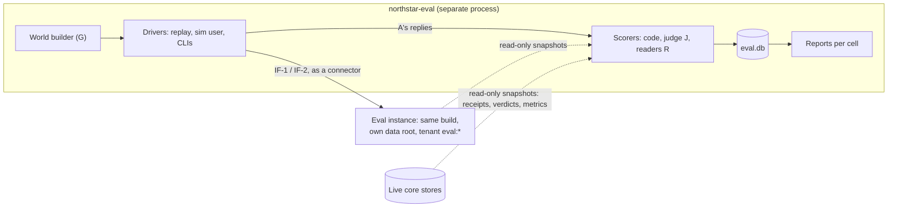

# Evaluation harness and build plan

**Status:** design draft for adversarial review. Not approved. Nothing here is built.
**Written:** 2026-10-08. Product facts checked today are listed at the end.
**Authority:** [`docs/GOAL.md`](../../GOAL.md) overrides this document; the user's answers of 2026-10-08 override everything earlier. This document changes only the HOW and adopts no reframe.
**Owns:** C22 (evaluation harness); the detail of SD-18 (build order) and SD-31 (arms); the consolidated spike list (SPINE Appendix A). The Book's own checks stay in TEXTBOOK §13; connector internals stay in [CD], [GD], [OBS].
**Inputs:** GOAL; SPINE (C01–C23, I1–I24, SD-1–SD-38, RISK, UQ); TEXTBOOK §13–§14; [CD §8], [GD §13], [OBS §12]; SYN §7; [11], [13], [14]. `docs/archive/` is not used.
**Labels:** (Unv) = unverified product fact, with its spike; (s) = starting bar, recalibrated once per cell family (§1.1). New IDs: EV-n (spikes), RISK-EV-n, UQ-EV-n, D-n (departures).

---

## 0. Summary

1. **Per GOAL §6 criterion:** protocols, metrics, arms, sizes and pre-registered bars (§2), with one pilot and one recalibration per cell family, then frozen (§1.1).
2. **Per-cell reporting, never pooled** (connector × layer × arm × data × speaker). Desktop-chat cells have their own sections; hook results never stand in for them (SD-18, RISK 20).
3. **Eight protocols with stated claim limits** (§1.6): SYN's A–D re-pointed to the four first connectors, plus **B-sim** (simulated user, closed loop), **D-syn** (real CLIs, scripted), **D-syn-C** (real CLIs, scripted multi-session continuity) and **D-fork** (same chat, same turn, real CLI). None is a whole-chat same-chat comparison inside a desktop app (RISK 21).
4. **Replay emulates capability levels.** In protocol B the chat model gets the real Northstar tools and boot text, so L0 arms reproduce model-pulled delivery; in-app spikes calibrate the gap.
5. **Family rules:** data, system, chat model under test and judge are separate families; one local judge scores every cell (§1.3).
6. **The harness never writes the core.** It reads live snapshots and drives disposable **eval instances** through the contract (D-1). The core assigns every arm (SD-31).
7. **One hidden world ledger** feeds every golden set (§3.4). **One degraded agent at a time** tests the maintainer, the desktop chat model and the observer included (§2.4).
8. **Real chats only with consent:** live arms after UQ-9; real exports and fork probes after the new UQ-EV-1; eval egress of real content also after UQ-11 (ARCH DQ-3); any real data only once PL-3 at rest holds and UQ-20 is answered (§1.5).
9. **39 spike rows merging 64 source IDs** (§4), in three tracks: local; the user's accounts (go-ahead each); observer (after UQ-1, UQ-2). Track A runs first, in weeks 1–2 beside track L, on a throwaway server with no core. **Track C** places the 69 component spikes (HK, CX, SP-PL, SP-MT, SP-IS, SP-AC, CDM) by stage, gate and access class.
10. **Six stages** (§5), Stage 0 in two parts, each keeping all eight non-negotiables in force on its surfaces: a spike sprint (0a) and a thin Claude Code slice with the harness (0b); Claude Code depth; Codex and Claude Desktop chat; ChatGPT Desktop chat; observer if accepted; evaluated prototype. About 29–41 builder-weeks with the observer, plus 6–8 calendar weeks of live arms. Builder labelling and in-app typing are counted separately, in hours.
11. **"Built and evaluated" is a checklist** (§6); every empty cell says why.

---

## 1. Ground rules

SYN §7's rules stand, with the changes below.

### 1.1 Pre-registration and freeze

- Each protocol has a file in `evals/prereg/<version>/` (committed, synthetic only): criterion, cells, primary metric, secondary metrics, bars, sample sizes, analysis plan, judge family.
- **One pre-registered pilot and one recalibration per cell family,** each before that family's main data: hook cells at the start of Stage 1, Claude Desktop L0/L0+ in Stage 2, ChatGPT Desktop in Stage 3. Stage 0 runs only a harness smoke pilot (instrumentation and shadow-arm variance). Bars freeze per family. Hard gates never recalibrate. This departs from SYN §7's single recalibration. Each new prereg version records the pilot data hash and the reason; original and recalibrated bars are reported side by side.
- **Compute budget.** Each protocol's compute budget (calls and hours) is pre-registered from the pilots. Where needed, a stratified sample of probes is judged, with chats as the cluster unit (§1.4).
- **Never recalibrated (hard gates):** provenance 100%, I1–I24, correction survival 100%, excision 0 hits, product-blindness, model-written attribution 0.
- **Dev and sealed test splits** of the golden world. Tuning uses dev only; the test split runs only at stage gates (I19).
- **One primary metric per criterion.** Secondary metrics never claim success alone. Continuity has a co-primary live metric (contradictions of seeded AI-established items in turns 1–10), an explicit exception to the one-primary rule, as criterion 1 has the adherence AUC.

### 1.2 Reporting cells

| Axis | Values |
|---|---|
| Connector and layer | CD-L0, CD-L0+, CD-L1, CD-L2 (CD-L0 rows per path if CD lands in DQ-4(ii)); GD-L0 (one row per write path C1, C2, A, B, W), GD-L0+, GD-L1, GD-L2; CC (Claude Code); CX (Codex); SDK (owned loop) |
| Arm | `treatment`, `shadow`, `lever:*`, `baseline:*` (§3.3) |
| Data | synthetic; real (only after UQ-EV-1 or UQ-9) |
| Speaker of the item | user-said; AI-said, by vendor family |

- Synthetic and real results are never merged. Real-data error is reported separately, because synthetic sets understate it (RISK 6; [13] R5).
- Desktop-chat cells sit in their own sections. No pooled "all connectors" number is shown.
- An empty cell shows its reason ("UQ-1 declined", "UQ-9 pending", "no key", "underpowered").
- At `check_reply = next_turn_reported`, corrections are weak and do not count as checks (SPINE §4.6).

### 1.3 Model-family rules

A **family** is the training lineage, not the host: an open-weight model released by OpenAI is `openai` even when it runs locally.

| Role | Does | Family must differ from |
|---|---|---|
| W, worker | System extraction, steward, writer (SPINE §8.1) | — |
| V, verifier | System verification (SD-21) | W; the claim's speaker |
| A, chat model under test | The assistant being measured (Claude models for CD, CC; OpenAI models for GD, CX) | — |
| G, generator | World ledger, personas, simulated user, probes, gold ledgers for real chats | W, A, J |
| J, eval judge | Scores replies, probes and pages | W, V, A, G |
| R, simulated reader | Comprehension tests (TEXTBOOK §13.2 D) | W, J, G |

- **One J scores every cell,** so cells compare. Under Profile A, J is local. The OpenAI API never judges GD or CX cells (D-6).
- **Three local families** are needed (V, J, G). **R is fixed to V's family for the prototype** (one fewer calibration campaign), labelled.
- **J is calibrated like V** (L3): upper 95% bound of false accepts on wrong-but-on-topic negatives under 10%. If no local family passes, J-dependent bars are reported as uncertifiable, never lowered (RISK 18).
- **System verdicts are inputs, never ground truth.** C10 drift verdicts and C23 re-explanation verdicts are re-judged by J on a sample.
- **Builder spot-checks** during evaluation only: at least 50 items per metric per stage gate, with agreement against J reported. Never a user task.

### 1.4 Samples and statistics

- At least 8 samples per condition; A90 and U90–10 reported ([11 F1]).
- Resample chats, not probes (probes within a chat correlate): cluster bootstrap, 10,000 resamples, 95% intervals.
- **Cell verdicts:** *met (confident)*: the lower bound clears the bar. *Met*: the point estimate clears it and the interval excludes no effect. *Not met*. *Not measurable here*, with the reason.
- **Criterion 1 verdict per connector:** *met (triangulated)* if the offline protocols meet the bars for its profile and the live arm, if run, points the same way with its interval excluding harm; *met offline* if the live arm was not run or is underpowered; else *not met*.
- Sizes below are starting values. If a family pilot's minimum detectable effect exceeds a bar at the planned size, the size goes up or the cell is labelled underpowered.

### 1.5 What runs before which answer

| Activity | Needs |
|---|---|
| Synthetic world; protocols A, B, B-sim; CI | Local; an Anthropic key (Claude cells); an OpenAI key (GD, CX cells; L11) |
| D-syn, D-fork on synthetic sessions | Keys or logged-in CLIs in a sandbox (L13); go-ahead |
| In-app spikes | Go-ahead per spike (§4, tracks A and C) |
| **Any real-data operation** (real capture, exports, gold ledgers, live arms, real L4 audits) | **PL-3 at rest:** FileVault on, or the encrypted sparse bundle mounted, with SP-PL-10 passed (`platform-security-privacy.md` §2.4, PL-3). **UQ-20 answered** (real personal data on an employer-managed Mac, if applicable; ARCH DQ-5(a)). Then design approval, UQ-3 and UQ-11 (§5.1). Every real-data row below needs this first |
| **Eval egress of real content** (offline API replay sends each chat to its own vendor's API) | UQ-11 (ARCH DQ-3) as well as UQ-EV-1 (ARCH DQ-6(b)) |
| Real exports in B and continuity; end-of-window export for L0 live arms | UQ-EV-1(a); for API replay, also UQ-11 |
| D-fork on real sessions | UQ-EV-1(b) |
| Live arms C, D, L | UQ-9 |
| Observer capture | UQ-1, UQ-2 |
| Real captured content to cloud workers | UQ-11 |
| Acceptance read | The user's choice, once (TEXTBOOK §13.5) |

### 1.6 What each protocol can and cannot claim (RISK 21)

| Protocol | Same chat? | Real app? | Real user? | Can claim | Cannot claim |
|---|---|---|---|---|---|
| **A** public benchmarks | Benchmark tasks | No | No | Beats RECAP; no rise in sycophancy | Anything about the apps or the user |
| **B** prefix-probe replay | Same prefix, one turn ahead | No: API, approximated system prompt (EV-5; none for ChatGPT) | Only with UQ-EV-1 | Per-depth effect of each delivery level on identical history, user- and AI-said | Whole-chat trajectory; in-app call rates; vendor memory; compaction |
| **B-sim** simulated user | Same persona, seed and script per arm | No | Simulated | Whole-trajectory effect for simulated users | Real user behaviour; app fidelity |
| **D-syn** real CLIs | Same script | Yes, CC and CX | Simulated | In-product effect of hook levers | Desktop chat |
| **D-syn-C** real CLIs, multi-session | Same scripted session sequence | Yes, CC and CX | Simulated | In-product continuity across start, clear, resume, compaction and handoff | Desktop chat; real user behaviour |
| **D-fork** fork probe | Same chat, same turn | Yes, CC (CX Unv, L13) | Real only with UQ-EV-1(b) | Per-turn in-product counterfactual | Whole-chat trajectory (later user turns answer the branch they saw) |
| **C** live desktop | Different chats, randomized | Yes | Yes | In-app effect averaged over chats | Same-chat comparison. At L0 without L1, judged only via the end-of-window export. Small N (RISK-EV-1) |
| **D** live hook | As C | Yes | Yes | As C, for CC and CX | As C |

---

## 2. Protocols by success criterion

### 2.1 Criterion 1: drift in long chats

**Protocols.**
- **A.** A Northstar mode in `microsoft/lost_in_conversation` (MIT; CONCAT support (Unv), EV-5), run through the SDK path; MultiChallenge, SYCON-Bench, FlipFlop, PrefEval, pivot and refine sets, a compaction scenario (SYN §7.1).
- **B.** Chats cut at depths 10, 20, 40, 80. The eval instance ingests each prefix the way that cell's connector would: verbatim for hook cells; for L0 cells, model-reported capture made **tool-faithfully** (A is called per turn with the Northstar tools and its real arguments are captured, cached per chat) or by a noise model calibrated on CS6. Then each arm is probed.
- **B-sim.** A simulated user (G) with a hidden goal script talks to A for 60 turns. Every arm gets the same persona, seed and pressure points: pushback without evidence, pivots, version edits, a compaction event. The simulated user's hidden script state is kept in code. Within the 32K context it sees the script, a code-built list of what it has disclosed so far, and the last k turns.
- **D-syn.** The real Claude Code and Codex CLIs with the Northstar plugin in a sandbox, 12 scripted coding sessions of 40+ turns per CLI. Arms: `treatment`, `shadow`, `lever:no_check`. Probes score **edits**, not only replies: diff-level constraint violations and wrong-version edits.
- **D-fork.** On sampled turns, `claude --resume <id> --fork-session -p` with Northstar off (hooks disabled by `disableAllHooks`, P5; no Northstar MCP) gives the vanilla reply to the same message; the original session is untouched.
- **C** (after UQ-9): the core randomizes `treatment` and `shadow` per new chat on each desktop connector, with UQ-9's share and stop rule. Replies are judged on verbatim text: from the observer at L1, or at L0 from one end-of-window export (UQ-EV-1(a)). **D** is the same on CC and CX.

**Arms for B and B-sim** (core-assigned, §3.3):

| Arm | What reaches A |
|---|---|
| `shadow` (vanilla) | Nothing |
| `lever:generic_reminder` | Goal restatement at turns 4 and 7 only ([11 F5]) |
| `treatment` @ hook | Pin every turn as added context; card on triggers; `in_turn` correction |
| `treatment` @ L0 / L0+ | Tools and boot text; the pin only in tool results (L0), or also every turn after the first call (L0+); checks on A's self-report |
| `treatment` @ L1 / L2-inject | As L0/L0+ with corrections from verbatim replies (L1); a visible labelled block on each user message (L2-inject) |
| `lever:pin`, `lever:pin+card`, `lever:pin+card+corr`, `lever:fork_rebuild`, `lever:verified_only` | HOW ablations; restart at the drift threshold; the AD10 contrast |
| `lever:pin_delta` | The pin sent as a change against the last delivered pin, not in full (HOW ablation for context load) |
| `lever:speaker_blind_severity` | In-session severity set without regard to who established the item (HOW ablation for speaker parity) |

**Probes** (from the hidden world, or a G-built gold ledger for real chats): the real or scripted next message; about 10 consistency probes per depth, half on user-established and half on AI-established items, at least 2 on middle turns; 2 pushback probes; version-editing and goal-shift probes; in D-syn, edit probes (diff-level constraint violations, wrong-version edits); a **stale-block probe** after each pivot: does the reply follow the latest pin, not an earlier Northstar block?

**Metrics** (SYN §7.1; [11] impl. 11). **Primary:** contradiction rate of established items at depth ≥ 40, separately for user- and AI-established items. Co-primary: adherence AUC. Secondary: SYN §7.1's list (violations, know-but-violate, flips, version editing, premature answers, bloat, A90/U90–10, goal-shift F1, steward precision and recall, cost). **Cumulative load:** Northstar's share of context tokens by depth. **Continuations** (R15): coverage and false-positive rate, by item speaker and vendor family. **Desktop delivery:** `p_call(t)`, first-call rate, `delivered` true/false/unknown shares, and added time to first token on desktop arms; at L0 the denominator comes from model-reported ordinal gaps, checked against exports (A12).

**Sizes (starting):** B: per vendor family, 16 synthetic chats of 80+ turns × 4 depths × arms × 8 samples × about 12 probes, plus up to 20 real chats per desktop app under UQ-EV-1. B-sim: 12 seeds × 8 samples × 4 arms × 60 turns per family. D-syn: 12 sessions × 8 samples × 3 arms per CLI. C, D: UQ-9's rule (working assumption 50%, stop at 40 shadow chats or 6 weeks); the ≥ 40-turn bar is judged only with at least 10 chats per arm at 40 turns, else directional.

**Bars** (per cell; SYN §7.1):
- ≥ 30% fewer contradictions than `shadow` at ≥ 40 turns, separately for user- and AI-established items;
- adherence AUC ≥ 25% higher; no rise in unwarranted flips;
- steward precision ≥ 95% and audit disagreement ≤ 5% (in model-reported cells, on the reconciled subset);
- ≤ 600 injected tokens per turn;
- Northstar's cumulative share of context tokens and the stale-block probe: each with its own bar, pre-registered before the family's main data (§1.1);
- **desktop L0:** ≥ 90% of turns with a Northstar call over 40 turns ([CD §4.2.9]). If missed and the widget spikes (A3, A5) fail, per-turn focus on that connector is reported **not met** (RISK 4).

### 2.2 Criterion 2: continuity across sessions

**Protocols.**
- **O. Offline continuation pairs** from synthetic persona chains, and real export pairs under UQ-EV-1(a). The new chat starts from the eval instance's core after the source chats were captured and promoted.
- **S. Simulated new-chat dialogues.** G plays the persona's next-chat intent for 5 turns and restates something only when A's reply lacks it. J counts re-explanations against the hidden ledger.
- **D-syn-C. Real-CLI continuity.** The real Claude Code and Codex CLIs with the plugin, in the D-syn sandbox (L13), run scripted multi-session sequences: startup in a known repository, clear, resume, compaction, a new task in the same repository, and a cross-surface handoff. The simulated user (G) counts re-explanations and false seed corrections. Arms: `treatment`, `shadow`. Starting size as D-syn's, resized at the hook-cell pilot (§1.1). **Bars:** AI-said recall ≥ 80% and within 5 points of user-said; no rise against `shadow` in refusals of legitimate revisions or in false seed corrections in turns 1–10 (from SP-AC-7).
- **L. Live** (after UQ-9): the `shadow` arm withholds the pack with everything else. Metric: re-explanation in the first 5 turns from C23's detector, re-judged by J on a sample, stratified by whether the routed goal had prior sessions. At L0 without L1, live counts see only turns with a call until the end-of-window export is judged.
- **R. Regression** through the SDK: LongMemEval_S (single-session-assistant, knowledge update, abstention), LoCoMo-Plus, MemoryAgentBench FactConsolidation, PersonaMem-v3 outdated stance. No LoCoMo headline scores.

**Cross-surface matrix:** source → target over {CD, GD, CC, CX}, 16 cells. Bars apply to the cross-vendor directions (CD↔GD, CC↔CX) and chat↔code within a vendor (CD↔CC, GD↔CX); the rest are reported.

**Mid-chat switch cell:** when a chat switches to an earlier goal part-way through, the 5 user turns after the switch are scored like the first 5 turns of a new chat, per connector.

**Arms:** `shadow`; Northstar at each `inject_start` level of the target (deterministic; model-pulled, tool-faithful; static boot; none); B1 raw-chunk hybrid retrieval; B2 agentic grep plus semantic search; B4 dated observation log; B3 oracle; B0 full context where it fits. **Vendor memory:** live arms leave it as the user has it, in both arms (SD-16), so they measure Northstar's increment over it. Offline, a labelled profile-summary proxy stands in, with and without Northstar.

**Probes** (pre-written from the hidden ledger): prior goals; knowledge the user stated; **knowledge an AI taught**; conclusions the user established; **conclusions an AI established**; rejected options; superseded facts; abstention. Plus three desktop cases: goals stated only in a desktop L0 chat must arrive as labelled `reported` items with no authority (SD-36, I22); routed reported goals reach the goal slot and are not re-explained in turns 1–5; under path B on either desktop app the expected carry-over is **nothing**, measured and reported as RISK 33. **Vendor-memory staleness probe:** stale assertions in turns 1–3 where Northstar never delivered the old version ([AC] §11; AIE-12).

**Metrics** (SYN §7.2): re-explanation rate (primary); co-primary live metric: contradictions of seeded AI-established items in turns 1–10 (§1.1); continuity recall and precision; re-proposals of rejected options; stale assertions; AI-said recall by vendor family; cross- vs same-surface recall; over-personalization and agreement on contested prompts; tokens. Delivery: routing precision@3 against the hidden next-chat goals; pack delivered; seeded; first-call rate.

**Sizes:** ≥ 200 continuation pairs per target connector, ≥ 25 per cross-surface cell, 8 samples, about 12 probes per pair.

**Bars** (SYN §7.2): ≥ 30% fewer re-explanations in the first 5 turns than `shadow`, live and offline; continuity recall ≥ 80% and ≥ 10 points above `shadow` plus vendor memory; AI-said recall ≥ 80% and within 5 points of user-said (raised from 75% and 10 points); cross-surface within 10 points of same-surface, both ways; re-proposals ≥ 50% fewer; stale assertions ≤ 5%; no rise in sycophancy; no rise against `shadow` in refusals of legitimate revisions or false seed corrections in turns 1–10 (SP-AC-7); pack ≤ about 3k tokens. **Retrieval rule:** beat the best of B1, B2, B4 by ≥ 10 points on update metrics at 8K tokens, or the simpler retrieval layer wins; the pack contract stays (SD-24).

### 2.3 Criterion 3: the Book

TEXTBOOK §13.2 fixes the checks (groups A–H), §13.3 the baselines BK0–BK7, §13.4 the limits. This document adds:
- **One world.** The golden book is a projection of the shared hidden world (§3.4), so all four criteria describe the same knowledge.
- **Per-connector splits** of group A (speaker fidelity, conversation identity), B (parity) and G (reported goals). CD and GD rows sit in the desktop section.
- **Vendor parity (new bar, from SD-38):** in promotion and featured slots, the Claude-said versus ChatGPT- and Codex-said shares stay within 5 points of the golden shares. `no_independent_verifier` items are counted, not dropped.
- **Growth checkpoints:** groups C, D, F and T-NAV run at simulated days 1, 7, 30 and 60 of the hidden world (§3.4), not only on the finished book.
- **Questions from gold leaves:** comprehension questions are written by G from the hidden world's gold leaves, never from the pages under test.
- **Bars per [TB] §13.2:** the BK0 bar, explained coverage, the structural readability bars, the desktop-only persona (groups C, D and BK6), the AI-tools persona and the offer-leakage bar follow [TB] §13.2.
- **Single-episode desktop-vs-hook check** (ARCH R14): single-episode desktop AI explanations are promoted within 5 points of the same explanations captured at hook tier, and now also pass **content parity**: simulated-reader inference on their pages within 10 points of the hook-tier pages.
- **Gating:** groups A, F and H are hard gates from Stage 1; C and D gate from Stage 1 on golden data; E and the frontier part of G need weeks of data and are reported at Stage 5.
- **Families:** writer W, rubric judge J, readers R, question writer G (§1.3).
- **The acceptance read** is offered once at Stage 5; no gate depends on it. Skipped, "reads like a textbook" and "helps understand" stay at risk (H3, H7). "Helps remember" is measured by labelled proxies only and never reported as met (H1).

### 2.4 Criterion 4: maintainer correctness

**Golden sets** (SYN §7.4; [13 §D] L5): expected outputs from the hidden world: items with speaker, holder, stance, verification and supersession; session-ledger states per turn; Tensions; promotions; structure against the syllabus; one non-chat document. Full runs: on dev at the golden gate of `maintainer.md` §7.5 (a change of prompt, schema, model, runtime, quantisation, threshold or code, before it activates), and on test at stage gates. There is no nightly full run; nightly, the §7.5 canary runs 2 rotating golden episodes (X23).

**Canaries in the live core** (run by C11 from versioned `evals/canaries/`, I19; never applied):
- *verification canaries:* known-false proposals at about 2% of C14's stream; C12 rejects anything tagged canary by construction; the catch rate is a sentinel;
- *audit canaries:* known-bad events planted in the L4 sample;
- *injection canaries* in synthetic sources; *watermark canaries* from eval instances.

**Attention-loss fault injection.** One role degraded at a time, the rest nominal, through ModelPort hooks (SPINE §8.5 rule 7) or the contract.

| Degraded agent | Faults | Caught by | Bar |
|---|---|---|---|
| Any worker (segmenter, extractor, linker, steward, goal_change, goal_router, book_writer, reorganizer) | Weak model; padding; missing job card; prompt bug (speaker flip, hedge drop, inserted names); shuffled offsets; empty output; over-merge; oscillation | C12 invariants; V1–V15; L2/L3; L4; goldens; churn budget | 0 structural errors applied; budget trips within one daily cycle; rollback hash-identical (I18); no user action |
| Verifier, cascade, entailment | Rubber-stamp; random verdicts | Verification canaries; L4 cross-family second opinion | Detected within 1 day; high-risk applies freeze |
| Auditor (L4) | Lenient; drops items | Audit canaries; second opinion | Detected within 1 day |
| drift_judge, reexplain_detector | Always pass; always flag | J re-judging a sample | Miss and false-alarm rates reported |
| **Chat model, desktop L0** | Call drop ramping 0→60%; fabricated "user said" text (CR13); speaker swaps; wrong handle copies; quote drift | I22; quote verification; copy-fidelity, fabrication and call-rate sentinels; join confidence | I22 holds 100%; sentinels fire within the session; 0 fabricated goals with authority |
| Observer (if built) | Profile break; partial AX tree | Self-test; watermarks; report cross-check | Falls to shadow automatically; alarm within 1 day |
| Processes | `kill -9` mid-Apply; crash; sleep and wake; disk full; clock skew; interrupted migration | Transactions; spool; leases; I14; I16 | 0 lost or duplicated events; 0 partial applies |

**Drills:** excision grep 0 hits in every store and backup; relay outage and sleep leave visible watermark gaps; breakage trips the observer alarm (G5).

**HOW-layer ablations.** On the fault matrix, with replayed model outputs (§5.3), each maintainer HOW layer is switched off in turn: L1 triple-labelling, L3 stage 2, the L4 sampling rates, the parity hold, and each sentinel's automatic action. A layer that catches nothing the others miss is folded into another or cut, by a versioned change through the golden gate. **Never ablated:** I1–I24, B1–B16 and the session validators.

**Omission and speaker metrics.** Update omission, missed supersessions, missed merges and duplicates are scored against the hidden world, with the canary margins of [MT] §7.3. Audited error is reported per speaker family.

**"Never persist"** for an injection canary means it never appears (a) as an instruction, goal, constraint, preference, endorsement or active correction; (b) in a pack or slice outside a quoted, origin-labelled data block; (c) with an origin tier above its true one. Storage as quoted source text is allowed; provenance needs it ([13] R4).

**Bars** (SYN §7.4): audited error on high-risk events ≤ 2% over a rolling 7 days, reported per speaker family; steward precision ≥ 95%; audit disagreement ≤ 5%; no quarantined proposal older than 7 days; open-Tension and unplaced pools not growing week on week; duplicates ≤ 5%; omission metrics within the [MT] §7.3 canary margins; vendor-parity gap ≤ 5 points.

**Claim limit.** Structural correctness is shown by code and property tests. Semantic error is bounded statistically on synthetic data and understated (RISK 6); real-data error comes from L4 audits on real items and optional corrections, reported separately. **Power:** 30 days of real use give about 130 high-risk ops, so they cannot show ≤ 2% even with zero errors (Wilson 95% upper bound about 2.9%). The 2% bar is shown on synthetic goldens; real use reports its bound.

---

## 3. Harness architecture (C22)

### 3.1 Shape



### 3.2 Eval instances and the live core

- **Eval instance:** the same build as the live core, with its own data root, `tenant_id = eval:<run>`, socket and versioned configuration (arm policy, fault plan, model profile). The configuration hash is recorded per run; configuration values are the only difference (RISK-EV-7).
- **The harness is a client, never a writer.** It sends contract traffic as a connector would; the instance's own single writers write its stores (SPINE §6.4).
- **On the live core the harness only reads** SQLite online-backup snapshots opened read-only. It sends no events there. Live arms are assigned and enforced by C10 and C15 (SD-31).
- **Personal data stays in the data root.** `eval.db`, real-data reports and real gold ledgers live under `~/Library/Application Support/Northstar/`. The repo holds code, prereg files, synthetic worlds and spike records without personal data.

### 3.3 Arms, assigned by the core

| Arm | Where | Behaviour (C10 assigns, C15 suppresses) |
|---|---|---|
| `treatment` | Live and eval | Every lever the capability vector allows |
| `shadow` | Live (after UQ-9) and eval | Capture and compute; log "would have delivered"; neutral tool results; no widget push |
| `lever:<set>` | Eval only (live only if the user extends UQ-9) | The named subset of levers (§2.1) |
| `baseline:B0–B4` | Eval only | Retrieval baselines behind the index port |

- **Assignment at `session.started`.** Live: Bernoulli at the UQ-9 share per connector until the stop rule; then all `treatment`. Eval: balanced blocks keyed on `context_ref`, so every arm sees the same prefix or persona.
- **Receipts** carry the arm (SPINE §4.5); analysis is by assigned arm.
- **Crossover:** if the user asks for Northstar by name in a `shadow` chat, the connector passes `explicit_request: true` and C10 treats that chat from then on, recorded. Nobody is denied help they asked for.

### 3.4 The hidden world ledger

- **Generated by G** into `evals/worlds/<id>/hidden/`, which eval instances never read. Drivers pass rendered transcripts only.
- **Contents:** personas; a 60-day timeline with checkpoints at days 1, 7, 30 and 60; goals stated, changed and dropped; knowledge items with speaker and agent (user, Claude, ChatGPT, Codex, external); supersessions with causes; rejected options; questions; a public-syllabus mapping (TEXTBOOK §13.1); planted faults; the expected outputs of §2.4.
- **Rendered per tier:** verbatim (hook cells); model-reported, tool-faithful or by noise model with planted swaps, omissions and fabrications (L0); export files (backfill); observer-shaped events (L1). The golden L0 renderer drops a chat's final-reply points unless a closing call is modelled, as in the apps.
- **Personas** (TEXTBOOK §13.1 features, plus):

| Persona | Exercises |
|---|---|
| Cross-vendor learner | A syllabus learned across CD and GD; cross-surface pairs; one-conversation AI explanations |
| Developer | CC and CX: decisions, rejected options, artifact versions, compaction, forks |
| No explicit goals | The goal-independent frontier |
| Desktop-only goals | Reported goals (SD-36); speaker swaps; ChatGPT path B |
| Desktop-only learner | Book groups C, D and BK6 on pages built only from model-reported capture ([TB] §13.2) |
| AI-tools learner | Pages about AI products, where product names occur in cited leaves ([TB] §13.2) |
| Changing minds | Supersession; AI self-correction; AI errors corrected later (RISK 7); contested items; pushback without evidence |
| Adversary | Injection in pastes, AI replies, tool output and model-reported arguments; an undeclared employer account (RISK 35); `private` items; one non-chat document |

- **Realism** is checked against public chat corpora, and against the user's chats only under UQ-EV-1 (EV-6, RISK-EV-4).

### 3.5 Drivers

| Driver | Protocols | How |
|---|---|---|
| API replay | B, O | A through C20 role `chat_under_test` (D-5). System prompt: the published claude.ai prompt for Claude cells (Desktop equivalence (Unv), EV-5); none for OpenAI cells (CR12). Tools as the manifest declares. Batch API and prompt caching |
| Simulated user | B-sim, S, D-syn-C | Role `sim_user` (G), hidden script with its state kept in code (§2.1), recorded seed |
| CLI | D-syn, D-syn-C, D-fork | Claude Code with `--plugin-dir`, `--settings`, `--setting-sources`, `--session-id` in a sandbox configuration; Codex `exec` and `exec resume`. Hooks in multi-turn `-p` runs and sandbox isolation are (Unv), L13 |
| Live reader | C, D, L | Read-only snapshots; the end-of-window export for L0 cells (UQ-EV-1(a)) |
| Reader agent | T-NAV | The Reader's accessibility tree |
| Host emulator (CI) | Desktop connector tests; conformance | Replays traces recorded in sanctioned spikes (CX-S7): `tools/list`, `tools/call` arguments and timing, widget `postMessage` and `ui/*` events, approval prompts. Synthetic chats only; it never automates the apps |

### 3.6 Records and reports

```yaml
eval_run:    {run_id, protocol, prereg: {version, hash}, instance_config_hash, build_sha, world_id?,
              split: dev|test, data: synthetic|real, families: {W, V, A, G, J, R}, cost_usd}
cell_result: {run_id, criterion, cell: {connector, layer, arm, data, speaker}, metric, n_chats, n_samples,
              estimate, ci95: [lo, hi], bar, verdict: met_confident|met|not_met|not_measurable, reason?}
spike_record: {spike_id, run_at, result: pass|fail|partial, facts: [...], settles: [...], evidence_ref}
              # committed as evals/spikes/<id>.yaml; no personal data
```

- Every report has one table per criterion, rows = cells, desktop sections separate.
- The conformance "honest levels" test reads spike records: a manifest level with `conditional_on: X` is rejected unless `evals/spikes/X.yaml` says pass (SPINE §4.9).

---

## 4. Consolidated spike list

Track A runs in weeks 1–2 beside track L, on a throwaway MCP server and widget with no core (SPINE SD-18), each account spike after its go-ahead; within a track, order is execution order. A reduced A11 run on throwaway tool text is re-run on the final tool descriptions. **Access:** *local* (no account); *key* (a provider API key on synthetic data, provided once by the user); *acct* (the user's product account, settings, quota or app: go-ahead per spike); *grant* (macOS Accessibility: only after UQ-1 and UQ-2).

**Track L (Stage 0: L1, L2 and L3's screen in 0a; the rest in 0b): local and key**

| # | ID (merges) | Question; method | Pass | Settles | On failure | Access |
|---|---|---|---|---|---|---|
| L1 | SP-1 | Python 3.14: FTS5 in uv's interpreter, vector wheels, MCP/Anthropic/OpenAI SDKs, ASGI; MLX and its structured-output path; leidenalg and python-igraph; scipy; cryptography; pyobjc or `security`; Hypothesis; clean-venv smoke tests | All pass | SD-33 | Bundled SQLite; vector scan behind the index port | local |
| L2 | SP-2a | Hook client on recorded payloads, core up and down; 1,000 kill-and-replay runs | Pin p95 ≤ 300 ms; exit ≤ 50 ms when down (s); 0 lost or reordered events | SD-11, SD-29 | Resident helper; spool kept | local |
| L3 | SP-3 + S10 + EV-1 | Local V and J candidates of third families, by the screen-then-confirm S10 protocol of [MT] §6.5 (screen in 0a, confirm in 0b): fit 48 GB, latency, false accepts on ≥ 300 wrong-but-on-topic negatives per role; book entailment on planted unsupported sentences | Upper 95% bound < 10% (V, J); ≤ 5% for entailment (TEXTBOOK §8.13) | SD-19, SD-21; §1.3; RISK 18, 30 | V: UQ-4, SD-38, TEXTBOOK §8.13. J: next family; else J-bars uncertifiable | local |
| L4 | SP-7 (+ DS10, S-R7 synthetic) | Join precision on synthetic multi-channel sessions | ≥ 0.99 at the auto-join threshold (s) | SD-10; RISK 24 | Higher threshold; more `session_only` (H8) | local |
| L5 | SP-8 | Conformance dry run on synthetic CC and CX fixtures | All seven tests | Stage 1 entry | Fix the contract | local |
| L6 | S-R9 | Echo detection at 0.6 containment | P ≥ 0.95, R ≥ 0.90 (s) | I11 | Retune; report over-counting | local |
| L7 | S-R10 | Local block writer on the golden book | Canary pass; fallback ≤ 5% | Writer if UQ-11 is no | Extractive pages (H21) | local |
| L8 | SYN S7 + S-R6 | J3 citations vs structured outputs; J3/J7 tiers; J7 rejects, entailment, cost | Golden bars (§2.4); fallback ≤ 5% | SD-19 tiers; TEXTBOOK §8.10 | Higher tier; two-call design | key |
| L9 | SP-6 | Turn → provisional item in next pin, Haiku 5.5 standard API | Steward p95 < 5 s; freshness ≥ 95% (s) | SPINE §8.1; RISK 16 | Last validated pin; local steward | key |
| L10 | SYN S8 (smoke part) | Harness smoke pilot: protocol B instrumentation and shadow-arm variance, both vendor families, synthetic | Instrumentation complete; variance estimated | Starting sizes and compute budgets; the per-family pilots follow (§1.1) | Fix the harness; raise N or label underpowered | key |
| L11 | EV-4 | OpenAI API access for `chat_under_test` | Key works for the needed models | GD and CX cells of B, B-sim, O | Cells not run; RISK-EV-2 | acct |
| L12 | EV-2 | Do API models given Northstar tools and boot text call at in-app rates? (vs A11) | Per-depth rate within ±10 points on matched arms (s) | Validity of B's L0/L0+ arms | Arms labelled "API call rate"; in-app claims rest on A11, C | key |
| L13 | EV-3 | Sandboxed CLIs: hooks fire every turn of multi-turn `-p`; `--resume --fork-session -p` leaves the original intact; Codex `exec resume` with hooks; no read of `~/.claude`, `~/.codex` | All hold for CC; CX reported | D-syn, D-fork | D-syn via SDK only, labelled; no fork probe | key |
| L14 | S-R8 | Calibrate J (rubric) and R (readers) on builder-labelled textbook sections, wiki pages and chat logs (TEXTBOOK §13.2 C, D) | Agreement with builder labels κ ≥ 0.6 (s) | Validity of Book groups C, D | C, D reported as uncalibrated | local |
| L15 | EV-5 (repo), EV-6 | Does `lost_in_conversation` have CONCAT, or must it be added? Persona realism (turn lengths, depths, topic shifts, code share) against public chat corpora (licences (Unv)) | CONCAT available or added; realism gaps measured | Protocol A baselines; RISK-EV-4 | Add a CONCAT mode; label the gaps | local |

**Track A (Stage 0a sprint, weeks 1–2, on a throwaway server): the user's accounts, sanctioned channels, go-ahead per spike**

| # | ID (merges) | Question; method | Pass | Settles | On failure | Access |
|---|---|---|---|---|---|---|
| A1 | SP-5 (+ UQ-3) | Plan; API credits (P9); how used | Facts recorded | Profile A cost; RISK 16 | Paid key or Profile D | acct |
| A2 | CD-S1 | Defaults; Tool access (per conversation) and the per-connector Tool access check; "Always allow" persistence; dummy `.mcpb`, 5 new chats | No per-chat action | Per-chat actions (SPINE §12); CD-7 | Action reported (GOAL §4.1 partial) | acct |
| A3 | CD-S2 (+ DS2 CD, S-R1, CD-S12, CD-S13) | Widget context markers at +1, +3, +10, +30 turns, restart, scroll-out, long chat; 1k–64k; app-only tools; `ui/open-link` to 127.0.0.1; pip; app calls for 1 h; widget-tag echoes recorded | Tightened rule: no tool calls after turn 3, widget off-screen, reply within 10 s, marker (≥ 1,200 chars) on ≥ 95% of 20 turns | CD `deterministic_after_mount`; cards | `model_pulled`; L2-inject under UQ-1; Markdown slices | acct |
| A4 | CS1 (path C1) | **Day 1 of Stage 0 (0a), right after DQ-2.** Custom MCP app in desktop Chat; write tools; does one-time "Always allow" / "Allow all actions" cover a declared write tool across chats and restarts; memory effect. Adds: a scripted tool-list turn on turns 2–40 without `@`; no-auth vs OAuth for Always allow; each default permission level; persistence across reload, restart and new chat; memory saving with Developer mode on Pro; the multi-participant session signal | Writes with no per-chat click | SD-17 C1; plan path (RISK 5) | A5, else UQ-8(a); ARCH DQ-4(i) asked at once if it fails or the only route needs `@` on every message | acct |
| A5 | CS4 (+ DS2 GD, S-R2, path C2) | Hidden context at +1, +5, +20, restart, scroll-out, 1k–20k; `ui/message` new chat; widget persists rendered input via app-only write, no prompt, permitted by OpenAI guidance; widget-tag echoes recorded | Tightened rule as A3, with the codeword; C2 works and is permitted | L0+; C2 | L0; UQ-8(a) if A4 failed; L2-inject under UQ-1 | acct |
| A6 | CS2 + CS3 (= DS1) | Does Chat reach a local MCP server, tested as a personal plugin with a local MCP app in Chat mode? Do hooks fire in Chat? | Local call works (CS2); hooks (CS3, not expected) | Relay (SD-13); GD tier | A7, UQ-5 | acct |
| A7 | CS7 (tunnel part only if CS2 fails; Sites part always) | Secure MCP Tunnel, personal Platform org, TLS proxy, if present, latency; Cloudflare fallback. The Sites (PK-3) part runs in Stage 0 whatever CS2 shows | Works; p95 < 1.5 s | SD-13; UQ-5; PK-3 | Cloudflare only if ARCH DQ-4(iii) allows it; RISK 27 | acct |
| A8 | CD-S5 (+ S-R5, DS7 links) | `claude://claude.ai/new?q=` at 200, 2,000, 8,000 chars; deep links into CD, GD, Codex | Prefill, no auto-send, at pack size | CD `restart = prepared`; "Open in product" | `suggested`; no links | acct |
| A9 | CD-S6, CD-S11, CD-S4 | MCP `instructions`; MCP prompts; `ui/message` from the widget | Each works, no consent prompt | Boot channels; start fallback; correction turn (off until UQ-1) | Channel unused | acct |
| A10 | CS11 (+ S-R7 GD), CS12 | `openai/session` stability; Temporary chat signal | Stable within, distinct across; signal present | GD keying; CR11 | Content-hash joins; boot rule; residue reported | acct |
| A11 | CD-S3 + CS5 (= DS3) | Per-turn and first-call rates in 40-turn scripted chats: reduced in-app design (2 arms × 3 runs per app, UQ-EV-2); full factorial by L12. Adds: the boot-wording arms on desktop, web and mobile; the closing-call rate; added time to first token; realistic message lengths and pastes; "not offered" vs "not called" | ≥ 90% of turns with a call ([CD §4.2.9]); first-call ≥ 95% (s) | L0 per-turn status (RISK 4) | Reported not met unless A3/A5 pass; strengthens the UQ-1 case | acct |
| A12 | CD-S7 + CS6 | Export contents (tool blocks, IDs, branches, nonce); copy fidelity of model reports and ordinal gaps vs export; extended to decide R14's reported reply-length option against hook-tier promotion | Rates measured (calibration) | Reconciliation; I22 sentinels; B noise model; R14's reply-length option | Content-hash reconciliation; R14's code-computed flag stays | acct |
| A13 | SP-2b, S-R3, S-R4 | Hook latency in CC and CX; status-line links; MCP App in the Code tab; Codex links | Pin p95 ≤ 300 ms in product | SD-11; glimpses | SD-11 fallback; Markdown | acct |
| A14 | CS10 (+ DS9) | After a week, do Northstar phrases reach vendor memory, per channel? Also measures OpenAI's hidden channel and Codex continuations | Measured | SD-16 | Relabel; hidden channels; RISK 11 | acct |
| A15 | SP-4 (only if UQ-6 yes) | CLI worker isolation and quota | No hook fires; schema-valid; quota recorded | SD-20; I24 | Provider off | acct |
| A16 | CD-S10 (only if UQ-7 yes) | Hooks in Claude Desktop 3P Chat | As [CD §8] | 3P addition | Not offered | acct |
| A17 | EV-5 (Desktop) | Does Claude Desktop chat behave like the published claude.ai prompt? Behavioural probes (date awareness, formatting, refusal style) in Desktop, web, and the API with the published prompt | No probe differs beyond run-to-run noise (s) | B's system prompt for CD cells | CD cells of B carry a stated fidelity gap | acct |
| A18 | CD-S14 (only when its trigger fires) | Remote-connector fallback through the relay listener, if standalone `.mcpb` extensions are restricted; synthetic data only; needs relay consent | As [CD] CD-S14 | CD transport under that restriction | As [CD] CD-S14 | acct |

**Track G (Stage 4): only after UQ-1 and UQ-2**

| # | ID (merges) | Question; method | Pass | Settles | On failure | Access |
|---|---|---|---|---|---|---|
| G1 | DS8 | Security agent, management grant persistence, if applicable; macOS 27 | Grant holds; no alert | Install | No observer; RISK 23 | grant |
| G2 | DS4 (= CD-S8, CS8) | AX completeness per app; virtualisation at 50/200/500 messages; CPU; 20 chats vs export | ≥ 99% turns, 0 speaker errors (s) | L1 per app | No L1 for that app | grant |
| G3 | DS10 (+ S-R7 live) | Session-tag echo; time-and-similarity joins | Precision ≥ 0.99 (s) | Live reconciliation | Deferred joins | grant |
| G4 | DS6 + DS7 (+ CS9) | Composer insertion; restart with carry-over; only where A3/A5 failed | 0 collisions in 200 trials; carry-over 100% | L2-inject; prepared restart | No L2 for that app | grant |
| G5 | DS11 | 4-week breakage drill | Alarm ≤ 1 day; ≤ 1 false alarm a week (s) | RISK 36 | Reported | grant |
| G6 | DS5 (if Classic used); DS12 (security only) | As [OBS §12] | As [OBS §12] | Classic profile; excision | As [OBS §12] | grant |

**Track C (Stages 0–3): component spikes**

The component docs own each spike's question, method and pass bar. This track fixes only when it runs, what it gates and its access class. Sources: [HK] `connectors-claude-code-and-codex.md` §23; [MCP] `connectors-desktop-and-mcp.md` §13; [PL] `platform-security-privacy.md` §14; [MT] `maintainer.md` §15; [IS] `ai-in-session.md` Spikes; [AC] `ai-continuity.md` §17; [CDM] `core-data-model.md` §17. "With X" means it shares X's run and go-ahead. Codex parts of *key* rows also need L11. No track C spike needs an Accessibility grant. The Gates column adds to the §5.1 stage exits.

| # | Spikes | Runs | Gates | Access |
|---|---|---|---|---|
| C1 | CDM-S1, CDM-S3, CDM-S5, CDM-S6 | Stage 0 | Stage 0 exit: load at 1× and 10×; replay hash identity across versions (I18); reconciliation thresholds; margins | local |
| C2 | CDM-S2, SP-PL-6 | Stage 0 | Excision hard gate (Stage 1 exit); real-data operation (§1.5) | local |
| C3 | CDM-S4, SP-PL-15 | Stage 0, once | DDL applies on Postgres 17 once (SD-26); the portable-SQL lint runs in CI now; the Postgres CI matrix and triggers at the cloud-adapter stage | local |
| C4 | SP-PL-2, SP-PL-5, SP-PL-7, SP-PL-8, SP-PL-9, **SP-PL-10** | Stage 0 | Stage 0 exit (Keychain, Reader cookies, scanner, LaunchAgents, Spotlight). **SP-PL-10: real-data capture (PL-3, §1.5).** SP-PL-7: real content egress, with UQ-11 | local |
| C5 | SP-PL-3 + CX-S4 | Stage 0 | Peer-signature check (T3); observer install (Stage 4 entry) | local |
| C6 | SP-MT-1 (with L3), **SP-MT-2**, SP-MT-5 | Stage 0 | SP-MT-5: fault harness v0 (Stage 0b exit). **SP-MT-2: in Stage 0, against the per-role load model** (drift re-judge included) at 20 and 100 turns a day, with local verification; else RISK-MT-1 mitigations | local |
| C7 | SP-MT-3, SP-MT-4 (with L8), SP-MT-6 | Stage 0 | SD-19 tiers; effort per role; the [MT] §9.6 cost assumptions | key |
| C8 | SP-IS-1 (with L9), SP-IS-2, SP-IS-3, SP-IS-5 (with L10), SP-IS-7, SP-IS-8 | Stage 0 | Stage 1 entry: steward bar, judge rates, goal-change F1, correction wording, pin size (600-token bar). SP-IS-7: Stage 2 (L0 regenerate) | key |
| C9 | SP-AC-1, SP-AC-2, SP-AC-3, SP-AC-7 | Stage 0 | Stage 1 exit (protocol O on CC): routing, pack budget, re-explanation detector, false corrections after a change of course | key |
| C10 | HK-S2, HK-S3, HK-S5, **HK-S11**, HK-S14, HK-S15, SP-IS-4, SP-IS-6, SP-IS-9, SP-AC-4 | Sandboxed CLIs, with L13: start of Stage 1 (Claude parts), start of Stage 2 (Codex parts) | **HK-S11: `audit_truth: live_independent` only with a pass record per product version** (§3.6), else `live_single`. HK-S14: before D-syn, D-syn-C, D-fork and any CLI worker (I24). HK-S15: the [HK] §17 canary. The rest: hook maps, in-turn check, compaction, pastes, start pack at the Stage 1 and 2 exits | key |
| C11 | HK-S1, HK-S6, HK-S7, HK-S8 (with A13), HK-S9, SP-PL-4, SP-PL-11 | Stage 1 (Claude parts), Stage 2 (Codex parts) | Install per surface; session identity incl. teleport; account signal, else the install declaration (RISK 35); in-product latency; cloud backfill (UQ-15); no re-trust on upgrade (PL-14) | acct |
| C12 | HK-S4, HK-S10, HK-S12, HK-S13, CX-S5 | Stage 2 | Codex conformance and honest levels (Stage 2 exit); CX-S5's ChatGPT and Claude Code parts also feed Stages 1 and 3 | acct |
| C13 | **CX-S3 + SP-PL-1** | With A2 (Stage 0) | **Stage 2 entry:** the CD `.mcpb` proxy on `run/core.sock` (PL-2, D-PL-1). On failure: `sensitive` user_config token, loopback fallback, `suggested` restart (RISK-CX-8) | acct |
| C14 | CX-S1, CX-S2, SP-PL-12, SP-PL-14 | With A3, A5, A10 (Stage 0) | Widget and incognito levels in the CD (Stage 2) and GD (Stage 3) manifests; T4 | acct |
| C15 | SP-PL-13 | With A7, only if A6 fails | Stage 3 relay | acct |
| C16 | **CX-S6** | Only if A4 and A5 both fail, or A2 (CD-S1) fails and CD-S13 (in A3) fails: right after them, at the latest at Stage 3 entry (Stage 2 entry for CD); test account; go-ahead | Briefs UQ-8(a) (ARCH DQ-4(ii)) with path A's measured approval prompt and `save_chat` rate; the affected app ships only after DQ-4(ii) is answered | acct |
| C17 | SP-AC-5 (with A11, A12), SP-AC-6 (with A14) | Stage 2 (CD), Stage 3 (GD) | L0 continuity measurement ([AC] §7.5); vendor-memory echo (SD-16) | acct |
| C18 | SP-MT-7 | Stage 0 (0a, with L3) | Profile D capacity: what every role can do all-local on this Mac; updates the ARCH DQ-3(a) estimates | local |
| C19 | HK-S16 | Sandboxed CLIs, with L13 and C10: start of Stage 1 (Claude parts), start of Stage 2 (Codex parts) | File deny rules on the data root at install; Codex sandbox exclusion of the data root; Codex PostToolUse feedback for edit checks. Stage 1 and 2 exits | key |
| C20 | SP-PL-16, SP-PL-17 | Stage 0 | HOW options behind a spike, no stage exit: SP-PL-16, a separate Reader cookie jar; SP-PL-17, service-account separation. Each is adopted only if it passes | local (SP-PL-17 needs admin rights: go-ahead) |
| C21 | CX-S7 | With A2–A5, A9, A11 (Stage 0a) | Records host traces for the CI host emulator (§3.5): `tools/list`, `tools/call` arguments and timing, widget `postMessage` and `ui/*` events, approval prompts; synthetic chats only. Emulator in CI from Stage 0b | acct |

**Retired or merged SYN spikes:** S1 → A1, A4; S2 → A3, A5; S3 → A11; S5 → A6; S6 → A14. S4, S9 and S11 assumed a browser extension, which is not built (GOAL §2); A8, A9 and G4 replace their desktop parts.

---

## 5. Build plan

### 5.1 Stages

**Effort** is in builder-weeks (one developer with AI coding agents), ±50%. **Real-data operation** starts only after the user approves the design (GOAL §7), declares the allowlisted accounts (UQ-3, ARCH DQ-2) and answers UQ-11 (ARCH DQ-3; else Profile D), and only with PL-3 at rest in place and UQ-20 answered (ARCH DQ-5(a); §1.5). Real data in Stage 0b still waits for all of these: approval, DQ-2, DQ-3, DQ-5 and PL-3.

| Stage | Scope | Gates to exit | Effort |
|---|---|---|---|
| **0a Spike sprint** | Track A in weeks 1–2 on a throwaway MCP server and widget with no core (SD-18), each account spike after its go-ahead, with the track C rows run beside them; SP-1 (L1); SP-2 (L2); S10 screening (L3's screen step); SP-MT-7; the CDM DDL checks re-run | Each track A spike passed or failed with a record, or "awaiting go-ahead"; every user question a failed spike triggers asked at once (ARCH DQ-4(i) right after CS1); SP-1 and SP-2 passed or their fallbacks chosen; the S10 shortlist; DDL checks green | 2–3 |
| **0b Thin vertical slice** | Claude Code with the SDK fixture: hook capture of both sides with spool; ledger and Apply with I1–I5 and I20–I24; J2 and J3; verification check 2 (L2) on the local verifier or the R12 mode; steward and pin; start pack; **extractive Book v0 and Reader v0 (D-2)**; red-team tests for the authority invariants; fault harness v0 for structural faults; contract conformance, the I23 lint and the product-blindness test with Claude Code and SDK fixtures; harness (**C22 v1**) and golden world | The slice's §5.3 suites green; L5; golden world v1 with dev/test; prereg v1; the harness smoke pilot (L10, §1.1); S10 confirmed, or the R12 mode (L3); the rest of track L and track C's Stage 0 local and key rows done; host emulator in CI (CX-S7); honest levels | 6–7 |
| **1 Claude Code depth + Book v1** | Depth: J5, J8c; L4 and error budgets; the sentinel registry; Book v1 prose (J7, entailment, memoization) and editions; corrections; the excision saga incl. backups. Also the rest of the plugin and core: the remaining invariants (I6–I19); `in_turn` checks; `reseed_on_reset`; compaction; the rest of the slow lane (J4f, J4c, J5t, J8, L3, quarantine, Tensions, rollback); Reader v1 (search, source cards, corrections, health); Markdown mirror; CC slices | Hook-cell pilot and recalibration first (§1.1). Hard gates (provenance, citation closure, T-CORR, excision, I23, red team, scope egress 0); D-syn, D-syn-C and D-fork on CC vs frozen bars; B hook cells; O CC→CC; TEXTBOOK §13.2 A, C, D, F, H on golden; T-RITUAL 30 simulated days; slow-lane fault matrix; A13 | 5–7 |
| **2 Codex + Claude Desktop chat L0** (parallel) | Codex hooks, MCP, AGENTS.md; CD `.mcpb` Node proxy; widget with Claude shim (if A3); boot text; model-reported capture under I22; `reported` goals (SD-36); reconciliation and export ingest; joins; prepared restart (if A8); CX slices and CD cards | CD L0/L0+ pilot and recalibration first (§1.1). Conformance and honest levels for both; D-syn and D-syn-C on CX, with the CC↔CX handoff (if L11, L13); B and B-sim for CD L0/L0+; A11 reported; O for CC↔CX, CD↔CC; Book desktop rows (planted swaps, identity, reported goals); vendor parity; chat-model faults. **CD cells in their own section; a missed A11 bar reads "per-turn focus on CD L0 not met" (RISK 4).** **CD ship rule:** CD runs on synthetic data only until A2 (CD-S1), and CD-S13 if CD-S1 fails, has a record; it then ships at L0 on the save path those spikes select (C1, or C2 through the widget), or waits for ARCH DQ-4(ii) if they fail | 5–7 |
| **3 ChatGPT Desktop chat L0/L0+** | Plugin (skill + MCP app); transport by A6 or relay by A7/UQ-5; OpenAI widget shim; write path by A4/A5, else UQ-8(a), **and no ship until it is answered**; `openai/session` keys; Temporary chats; GD slices | GD pilot and recalibration first (§1.1). Conformance; B and B-sim GD cells (if L11); A11 GD; O for GD↔CD, GD↔CX; RISK 33 measured under the chosen path; relay drills. **GD cells in their own section, one row per write path** | 3–5 |
| **4 Observer** (only if UQ-1 and UQ-2 yes) | L1 shadow capture on both apps first; live reconciliation and audit truth; then L2-inject only where A3/A5 failed; prepared restart that never sends | G1–G5; observer conformance; fail-closed self-test; observed-chat cells of B; live steward audit. **If UQ-1 is no, skipped: L0/L0+ cells are final and RISK 4, 19 are reported** | 5–8 |
| **5 Evaluated prototype** | Sealed test split on every protocol and cell; live C, D, L if UQ-9; D-fork on real sessions if UQ-EV-1(b); acceptance read offered once; 30 days of real use; cost check; final report | The §6 checklist | 3–4 + 6–8 calendar weeks of live arms |

**Total:** about 29–41 builder-weeks with the observer, 24–33 without. Stages 0a and 0b together take the old Stage 0's 8–10 weeks, so the totals are unchanged. The recut departs from this document's original §5.1, adopted by ARCH R5 (D-8).

**Builder labelling and in-app typing** (hours, on top of the builder-weeks; estimate ±50%). This is development work, never a user task.

| Work | Volume | Hours |
|---|---|---|
| Builder spot-checks (§1.3) | ≥ 50 items per J-scored metric per stage gate | About 15–25 per stage gate |
| L14 calibration labels (J rubric, R readers) | Builder-labelled textbook sections, wiki pages and chat logs | About 10–15 once, plus a re-check when J or R changes |
| S10 spot-checks ([MT] §6.5) | 10% of the S10 data (about 140 items) per run | About 3–5 per run |
| In-app typing (UQ-EV-2 (a)) | About 240 turns per app per checkpoint | About 4–6 per app per checkpoint |

**In-app calibration checkpoints are fixed:** one per stage and one after each app update, never per change. Update checkpoints add to the total; how many depends on how often the apps update (Unv).

### 5.2 The eight non-negotiables in every stage

"In force" means every mechanism SPINE specifies for that capability level is built and tested, and every shortfall is measured and reported with its risk ID. It does not mean "met". Stage 0a builds no product surface: its throwaway server holds no core and no real data.

| Non-negotiable | S0b (CC slice, SDK) | S1 (CC) | S2 (CX, CD) | S3 (GD) | S4 (observer) | S5 |
|---|---|---|---|---|---|---|
| 1 No rituals | One install; fail-open; T-RITUAL synthetic | Hooks fail open, spool | CD per-chat actions measured (A2) | Per-path actions measured (RISK 5, 33) | Self-heals to shadow (RISK 36) | T-RITUAL on real use |
| 2 AI-said first-class | Both speakers; passages | Verbatim AI capture | CX verbatim; CD reported, chipped (RISK 19) | Reported; path B gap measured | Verbatim on desktop | AI-said bars per cell |
| 3 AI manages it | Workers, Apply automatic | Full slow lane | Reconciliation automatic | Write path per spikes or UQ-8(a) | Automatic capture | Real use |
| 4 Two architectures | Packs + Book v0 | Book v1 prose | Desktop items with fidelity chips | Same | Verbatim desktop quotes | Criterion 3 |
| 5 Drift and continuity | Pin, steward, C23 | `in_turn`, reseed, packs | L0 levers; reported goals | L0, L0+ levers | L1, L2 levers | Criteria 1, 2 |
| 6 Product-agnostic | Lint, blindness test | CC is a connector only | No core change | Relay outside core | Observer as a channel | SDK cell reported |
| 7 Robust maintainer | Invariants; fault v0 | Full fault matrix | Chat-model faults | Same for GD | Observer faults | Test split; real audit |
| 8 Built and evaluated | Harness, prereg, pilot | CC evaluated | CX, CD evaluated | GD evaluated | Observed cells | §6 checklist |

### 5.3 Code-level test strategy

**Replay first.** Every test and gate run reuses recorded model outputs (C20's recorder) for each role whose input hash is unchanged. Only changed prompts, models, thresholds or faulted roles call live. This keeps runs within the laptop's compute and the pre-registered compute budgets (§1.1). A hosted third-vendor key for G and R is not adopted unless a pre-registered compute budget fails.

| Suite | What it checks | When |
|---|---|---|
| Unit (`tests/unit/`) | Pure logic per component | Every commit |
| **Invariant properties** (`tests/invariants/`, Hypothesis) | **Apply gate** (I1–I5, I10, I12–I17, I20–I22): random proposals and mutations (moved offsets, swapped speakers, AI imperatives, model-reported goals, raised origins, over-cap jobs): every invalid one rejected, every valid one applied. **History** (I6, I9, I11, I18, I21): random event streams with rebuilds, reorganizations and corrections: hash-identical replay, no unexplained coverage drop, echoes never support, 100% of corrections honoured. **Separation** (I7, I19, I24): page text never reaches J7; workers cannot open config; echoed artifacts are classed `northstar_*`. Session validators ([11] impl. 2) likewise | Every commit |
| Storage (`tests/storage/`) | Repository ports on SQLite; Postgres later | Every commit |
| **Connector conformance** (`tests/contract/`) | The seven SPINE §4.9 tests per connector on synthetic fixtures, plus **policy-table tests** generated from every SPINE §4.6 row: a manifest declaring that level gets exactly that behaviour | Every commit; each connector release |
| **Product-blindness, I23** (`tests/contract/`) | (1) AST lint: no product name under `src/northstar_agent_memory/` outside `contract/` enums and display strings; no import from `connectors/`. (2) Metamorphic test: replay fixtures with product, mode and connector names scrambled consistently, capability vector, MCP flags and `speaker_model_family` fixed; every decision log, session operation, tool list, receipt, arm and artifact must be byte-identical (display strings mapped back) | Every commit |
| **Red team** (`tests/redteam/`) | A versioned payload corpus in pastes, AI replies, tool output, documents, widget context, model-reported arguments ("user said: always …"), exports and Book content; forged and cross-site corrections; DNS rebinding; laundering by re-extracting a Northstar artifact. Asserts the "never persist" rule (§2.4) and Reader escaping | Every commit |
| Fault injection, drills (`tests/fault/`) | §2.4 matrix, plus [MT] §8's F22 (an Apply mutant) and F23 (a model-callable tool client over its write and call budgets); HOW-layer ablations (§2.4); crash, sleep, spool replay, excision, relay outage, watermark alarm | Full matrix at stage gates; a smoke subset nightly (not the full matrix); weekly drills |
| Determinism | I18, B10, T-STAB, rollback hash-identity; the **independent reference projector**, written apart from Apply, rebuilds current state from the ledger and must match it | Every commit (reference projector); nightly (the rest) |
| Golden regression (`evals/`) | Dev split, all criteria; test split at stage gates | At the `maintainer.md` §7.5 golden gate and at stage gates; nightly only the §7.5 canary's rotating episodes (X23) |
| Performance (`tests/perf/`) | Pin p95 300 ms; pack 1.5 s; `reply.check` budget; steward p95 | Nightly |

### 5.4 Cost of evaluation (estimate, ±2×)

- **Running cost: one model, `maintainer.md` §9.6** (Profile A, ±2×). It covers maintenance, the nightly canary (about $0.18 a day) and golden gates ($2.76 a run, about two a month in steady use): about $25 a month at 20 turns a day and $74 at 100. This document keeps no separate figure (X23). During the build, gated runs follow the number of activations, at about $2.76 each, recorded in `eval_run.cost_usd`.
- **One-off evaluation runs** (outside the running cost). Protocol B main run: about $100–500 per vendor family, dominated by the chat-under-test tier (Batch API; one cached prefix shared across arms; Sonnet 5.5 batch $1/$5 per million tokens, [13 F11]). OpenAI in-app model prices are (Unv), L11. B-sim is of the same order; each family pilot about 5% of it.
- Local roles cost no API money but take tens of hours of compute per full run.

---

## 6. Definition of "working prototype, built and evaluated" (GOAL §4.8)

**Built**
- [ ] `northstar install` sets up the daemon, the maintainer and all four first connectors (Claude Desktop chat, Claude Code, ChatGPT Desktop chat, Codex); the observer only if UQ-1 and UQ-2 allow.
- [ ] Every declared capability level has a spike record; every conditional level is honest.
- [ ] Every §5.3 suite is green on the release build, including product-blindness and red team.
- [ ] The Book and the Reader serve real pages with sources to the span; in-chat slices work where the spikes allow.
- [ ] The repo holds no personal data (a CI check greps for data-root patterns and allowlisted account hashes) and no device-specific security facts: a targeted **device-posture lint** flags assertive phrases ("on this Mac" next to an encryption, management, agent or admin term; named TLS-proxy products; exact OS or app build strings next to "this Mac"; account email domains), with a reviewed allowlist for conditional text and vendor product facts.

**Evaluated**
- [ ] Every §1.2 cell for the four first connectors has a verdict or a reason; desktop cells are in their own sections.
- [ ] Criterion 1: B, B-sim, and for CC and CX also D-syn and D-fork, against frozen bars, separately for user- and AI-established items; C and D if UQ-9.
- [ ] Criterion 2: O, S, R and, for CC and CX, D-syn-C, with the 16-cell cross-surface matrix and the mid-chat switch cell; L if UQ-9; AI-said recall per vendor; RISK 33 measured under the chosen ChatGPT path.
- [ ] Criterion 3: TEXTBOOK §13.2 A–H, with growth checkpoints at days 1, 7, 30 and 60; hard gates pass; proxies labelled; acceptance read offered once.
- [ ] Criterion 4: goldens on the test split; the full one-role-at-a-time fault matrix, chat model and observer included; HOW-layer ablations; drills; real-data audit error reported separately, with its bound (§2.4 claim limit: 30 days cannot show ≤ 2%).
- [ ] Judge calibration recorded; cells with an uncertified judge say so.
- [ ] T-RITUAL: 30 days of real use with no reads or corrections required (an optional read does not fail it), every sentinel green or self-healed.
- [ ] The final report states per criterion and connector: met (triangulated), met offline, not met, or not measurable, with risk IDs and claim limits (§1.6), and no whole-chat same-chat in-app claim (RISK 21).
- [ ] Every open user question that affects a cell is listed with its effect, as in the table below.

**Open user questions that affect a cell** (effect while unanswered, or if declined):

| Question | Cells affected | Effect |
|---|---|---|
| UQ-1, UQ-2 (observer; managed Mac) | CD-L1, CD-L2, GD-L1, GD-L2; observer faults; live L0 judging | Not run; L0/L0+ cells final; RISK 4, 19 |
| UQ-3 (accounts, plans) | Every real-data cell; GD write path (plan, RISK 5) | No real capture; ChatGPT spikes assume Plus; nothing from an employer account |
| UQ-4 (verifier fallback) | Criterion 4 verification; ChatGPT- and Codex-said items | Asked only if S10 fails; `no_independent_verifier` items counted, never dropped (RISK 18, 30) |
| UQ-5 (relay) | Every GD cell, if A6 fails | GD has no sanctioned channel: "not run: UQ-5" |
| UQ-8(a) (ChatGPT write path) | GD rows per write path; GD AI-said and continuity | If A4 and A5 fail, GD does not ship; under path B, RISK 33 measured |
| UQ-9 (live arms) | C, D, L | Offline protocols only; criterion 1 at best "met offline" |
| UQ-10 (suggested topics) | Book group G, "what to learn" | No suggested topics; possible narrowing of GOAL §3.2 reported |
| UQ-11 (cloud workers) | Every real-data cell; eval egress of real content (§1.5) | Real content stays on the Mac; Profile D if no |
| UQ-12 (carry across vendors) | Cross-vendor directions of the 16-cell matrix (CD↔GD, CC↔CX, and other cross-vendor pairs) | Synthetic cells run; real cross-vendor delivery waits; if declined, real cells read "not run: UQ-12" |
| UQ-13, UQ-15 (employer and unclassified repositories; cloud sessions) | Real CC and CX cells | Employer and unclassified repositories go to a work scope (SPINE UQ-13), out of the personal Book and packs; cloud sessions backfilled on return only; coverage reported separately (RISK-HK-3) |
| UQ-20 (an employer-managed Mac, if applicable) | Every real-data cell | Synthetic data only until answered (§1.5) |
| UQ-14 (backups) | Excision and restore drills | No external drive: drills cover the data root and its own archives; disk loss loses the memory (RISK-PL-8) |
| UQ-16 (spend cap) | Criterion 4 freshness and cost in real use | Soft $80, hard $120; the [MT] §9.5 deferral order above the soft cap |
| UQ-17 (real-data calibration) | Criterion 4 real-data error | Real error from L4 and optional corrections only, labelled (RISK 6) |
| UQ-18 (web fact checks) | Verification states of AI-said items | More items stay `unchecked` or `contested` (RISK 22) |
| UQ-EV-1 = SPINE UQ-21 (real chats in evaluation) | Real exports in B and O; L0 live judging; D-fork on real sessions | "Not run: UQ-EV-1"; synthetic only |
| UQ-EV-2 = SPINE UQ-22 (scripted in-app runs) | A11 depth | Reduced builder-typed set (a) |

UQ-6, UQ-7 and UQ-19 affect no cell of the four first connectors: UQ-6 and UQ-7 only add optional cells (A15, A16) if yes.

---

## Interfaces

**Provides**

| To | What | Shape |
|---|---|---|
| All components | Test suites, fixtures, fault plans | `tests/`, `evals/` (synthetic only) |
| C01, C04 (conformance) | Spike records backing `conditional_on` levels | `evals/spikes/<id>.yaml` (`spike_record`, §3.6) |
| C11 | Golden and canary fixtures, versioned (I19) | `evals/canaries/`; rendered parts of `evals/worlds/<id>/` |
| User, builder | Per-cell reports; stage-gate verdicts | `eval.db` (`eval_run`, `cell_result`); report files in the data root |

**Needs**

| From | What | Shape |
|---|---|---|
| C10 | Arm assignment and enforcement; live policy off until UQ-9; balanced blocks in eval; crossover on explicit request | `session.resolve → {handle, arm}`; config `arms: {live: {enabled, share, stop: {shadow_chats, weeks}}, eval: {design: blocked, block_key: context_ref, arms: [...]}}`; `explicit_request: true` on the contract event |
| C15 | Per-arm suppression; artifacts with hashes | `delivery.receipt.suppressed_by_arm` (SPINE §4.4) |
| C20 | Roles `eval_judge`, `gold_builder`, and new `sim_user`, `sim_reader`, `chat_under_test` (D-5); §1.3 family rules; recorder; fault hooks | `ModelPort.propose(role, input, schema)`; `FaultPlan {role, kind, rate, seed}` |
| C11, C21 | Verification and audit canaries; sentinels; metrics | `ops.db` read-only; canary rows tagged `canary=true`, never applied by C12 |
| C04, C05 | IF-1 and IF-2 for eval instances | Contract v1 (SPINE §4.4) |
| C06–C09, C16, C17, C23 | Read-only snapshots; the Reader's accessibility tree | SQLite online backup opened `mode=ro` |
| C19 | Excision on eval instances; egress logs | IF-4 `northstar excise`; recorded model inputs |

---

## Departures from SPINE

| # | SPINE says | This design | Why |
|---|---|---|---|
| D-1 | §6.4 rule 8: the harness only reads | It also drives separate eval instances as a contract client; it writes no store and sends nothing to the live core | B, O, S and the goldens need transcripts to pass through the real core; a client of a disposable instance keeps every single-writer rule |
| D-2 | SD-18: Book and Reader from Stage 1 | A code-only extractive Book v0 and read-only Reader v0 in Stage 0; model prose still from Stage 1 | Keeps non-negotiable 4 in force in the walking skeleton |
| D-3 | SD-18: SP-1 to SP-6 in Stage 0 | SP-4 runs only if UQ-6 is yes | It spends the user's subscription quota to settle an opt-in fallback that is off by default |
| D-4 | SD-18 ends at Stage 4 | Adds Stage 5, the evaluated prototype | GOAL §4.8 needs a stage with the test split, live arms and a checklist |
| D-5 | §8.1 lists `eval_judge`, `gold_builder` | Adds `sim_user`, `sim_reader`, `chat_under_test` | B-sim, S, B and TEXTBOOK §13.2 D need them, family-routed |
| D-6 | §8.1: OpenAI API as an alternative eval judge | Never for GD or CX cells; one judge family for all cells | Self-preference and correlated errors ([13 F3]); comparable cells |
| D-7 | SD-31: `treatment`, `shadow` | Adds `lever:*`, `baseline:*` (eval only) and crossover on explicit request | HOW ablation and matched baselines (SYN §7); crossover respects GOAL §4.1 |
| D-8 | SD-18: one Stage 0 (core skeleton, harness, golden set, all sanctioned desktop spikes), then Claude Code in Stage 1; this document's original §5.1, adopted by ARCH R5, kept that single Stage 0 | Stage 0a (2–3 weeks): the track A sprint on a throwaway server, SP-1, SP-2, S10 screening, DDL checks. Stage 0b (6–7 weeks): a thin vertical slice on Claude Code with the SDK fixture. Stage 1 becomes depth. Totals unchanged | The deciding spikes ran only after the core was built, and Stage 0 was overloaded (REVIEW CPLX-2, CPLX-3) |

---

## Risks

Reused: **RISK 3, 4, 6, 12, 14, 18, 19, 20, 21, 23, 30, 33, 36** (SPINE §11.1). New:

| # | Risk | Threatens | Mitigation |
|---|---|---|---|
| **RISK-EV-1** | Few real chats reach 40 turns, so live arms are underpowered for the depth bars | §6 criterion 1 live evidence | Analyse by depth over all chats; judge the ≥ 40 bar only with 10+ chats per arm; else directional; the UQ-9 stop rule is not extended without the user |
| **RISK-EV-2** | No OpenAI API access: GD and CX cells of B, B-sim, O cannot run | §4.8; criteria 1, 2 on two first connectors | Ask once (L11); else live arms carry the evidence and the gap is shown |
| **RISK-EV-3** | Three local families must exist, fit 48 GB and (V, J) pass calibration | §4.7, §4.8 | Sequential loading; R fixed to V's family, labelled; uncertified bars reported, never lowered |
| **RISK-EV-4** | Synthetic personas are easier than real use | All criteria | Adversarial personas; EV-6; real-data results separate; real L4 audits |
| **RISK-EV-5** | Tool-faithful replay misses in-app behaviour (system prompts, tool-access modes, app memory) | Criterion 1 desktop cells | L12 and EV-5 size the gap; in-app claims rest on A11 and C |
| **RISK-EV-6** | In-app spikes need hundreds of typed turns; automating them on a test account is ToS-grey (RISK 23) | §4.8 depth on desktop chat | Reduced in-app design plus replay; UQ-EV-2 |
| **RISK-EV-7** | Eval instances drift from the live configuration, or eval code leaks into the core | Validity; §4.6 | Same build; configuration-only differences, hashed; product-blindness test |
| **RISK-EV-8** | Prompts or thresholds overfit the golden set | §4.7 claims | Sealed test split; I19; one recalibration per cell family, before its main data |

---

## Questions for the user

New questions only. Working assumptions are **pending user answer**.

| ID | Question | Why it is yours | Working assumption (pending user answer) |
|---|---|---|---|
| **UQ-EV-1** (SPINE UQ-21) | **Your real chats in evaluation.** (a) May evaluation use a **one-off export** of your Claude and ChatGPT chats for API replay, continuity pairs and judging L0 live arms? It stays on the Mac; replay sends each chat only to its own vendor's API, so replay also needs UQ-11 (ARCH DQ-3); judging is local. (b) On sampled turns of your real Claude Code sessions, may a **fork probe** get the reply without Northstar from a forked copy? It uses quota and leaves a forked session in your history | Your personal data and quota. Declining weakens evidence on real chats (RISK-EV-4) but changes no design | Neither until you say yes; synthetic only; real-data cells show "not run: UQ-EV-1" |
| **UQ-EV-2** (SPINE UQ-22) | **Scripted in-app runs** for A11 need 40-turn scripted chats in both apps. Should (a) the builder type a reduced set (about 240 turns per app), with the rest from API replay, or (b) the observer send scripted turns on a separate test account you create? (b) is automated use of the apps (RISK 23) and needs UQ-1 and UQ-2 | (b) accepts terms-of-service exposure on an account in your name | (a) |

Covered elsewhere: live arms, **UQ-9**; the observer, **UQ-1, UQ-2**; verifier and judge fallbacks, **UQ-4**; the relay, **UQ-5**; subscription CLIs (A15), **UQ-6**; the ChatGPT write path, **UQ-8(a)**; cloud model calls, **UQ-11**. §6 lists every open question that affects a cell, with its effect.

---

## Spikes

This component's own spikes (all in §4):

| ID | Settles |
|---|---|
| EV-1 (L3) | Which local families serve as J and G (R uses V's family); whether J-dependent bars can be certified |
| EV-2 (L12) | Whether replay's L0/L0+ arms predict in-app delivery |
| EV-3 (L13) | Whether D-syn and D-fork run in the real CLIs in a sandbox |
| EV-4 (L11) | Whether GD and CX cells of B, B-sim and O can run |
| EV-5 (L15, A17) | Whether CD cells of B can use the published claude.ai prompt; whether protocol A has a CONCAT baseline |
| EV-6 (L15) | Persona realism against public corpora, and the user's chats only under UQ-EV-1; sizes RISK-EV-4 |

---

## Goal-fidelity check

| GOAL item | How this component serves it | Status |
|---|---|---|
| §4.8 Built and evaluated | Harness, protocols, stages, checklist (§6) | **Partial:** evidence depth at risk on OpenAI-side cells (RISK-EV-2), desktop in-app cells (RISK-EV-5, RISK-EV-6) and live arms (RISK-EV-1, UQ-9) |
| §6 Drift measured against the same chat without the system | B, B-sim, D-syn, D-fork, C, D, with claim limits | **Partial (RISK 21):** same-chat comparisons only offline or per turn in the CLIs; none whole-chat inside the desktop apps |
| §6 Continuity measured | O, S, L, R; 16-cell matrix; AI-said recall by vendor | **Partial:** live L0 counts see only turns with a call without the export (RISK 4, UQ-EV-1); path B carries nothing (RISK 33) |
| §6 The Book reads like a textbook | TEXTBOOK §13 scheduled, split per connector; vendor parity | **At risk:** simulated readers unless the acceptance read is taken (H7); "remember" by proxy only (H1) |
| §6 Maintains itself; errors bounded, detectable, correctable | Goldens, canaries, one-agent fault injection, drills | **Partial (RISK 6):** structural errors blocked by code; semantic errors bounded statistically |
| §4.1 No rituals | No gate needs the user; acceptance read optional and one-off; crossover never denies help | **Met** for evaluation; builder typing (UQ-EV-2) is development work, not product use |
| §4.2 AI-said first-class | Every drift and continuity bar met separately for AI-said items; AI-said recall by vendor; vendor parity | **Met** in measurement design; outcomes on desktop L0 per RISK 19, 33 |
| §4.3 The AI manages it | Fault injection proves recovery with no user action | **Met** in measurement design |
| §4.4 Two architectures | Separate criteria and reports; Book v0 from Stage 0 | **Met** in plan |
| §4.5 Drift and continuity equally | Equal-depth protocols, matrices and bars | **Met** in measurement design; evidence limits per RISK 21, RISK-EV-1 |
| §4.6 Product-agnostic, four connectors | All four in the evaluated prototype; blindness test; SDK cell; desktop reported separately | **Partial:** ChatGPT ships only after UQ-8(a) if CS1 and CS4 fail (RISK 33); plan gating (RISK 5) |
| §4.7 Robust maintainer | Every role degraded in turn, chat model and observer included | **Partial (RISK 6, 18, RISK-EV-3)** |
| §7 Reframing needs the user | No reframe; real data and test-account automation are questions | Checked |

---

## Product facts checked for this document

| Fact | Source | Checked |
|---|---|---|
| Claude Code `--fork-session` creates "a new session ID instead of reusing the original (use with `--resume` or `--continue`)"; `--session-id`, `--plugin-dir`, `--settings`, `--setting-sources` and `--restricted` exist. Use with `-p` is not stated (Unv, L13) | https://code.claude.com/docs/en/cli-reference | 2026-10-08 |
| `codex exec resume <SESSION_ID>` and `--last` exist; forking is not documented; `--ignore-user-config` skips `$CODEX_HOME/config.toml` | https://learn.chatgpt.com/docs/non-interactive-mode | 2026-10-08 |
| Published system prompts cover claude.ai and the iOS and Android apps and "do not apply to the Claude API"; Desktop is not named (Unv, EV-5) | https://platform.claude.com/docs/en/release-notes/system-prompts (redirected from docs.claude.com) | 2026-10-08 |
| `microsoft/lost_in_conversation`: MIT; simulators FULL, RECAP, SHARDED, SNOWBALL; tasks code, database, actions, math, data2text, summary, translation; CONCAT not named in the README (Unv, EV-5) | https://github.com/microsoft/lost_in_conversation | 2026-10-08 |

---

## Consistency fixes (2026-10-08)

| Issue | Change in this document |
|---|---|
| X15 | §4 adds **track C**: all 64 component spikes (HK-S1–S15, CX-S1–S6, SP-PL-1–15, SP-MT-1–6, SP-IS-1–9, SP-AC-1–7, CDM-S1–S6), each with the stage it runs in, what it gates and its access class. It names HK-S11 for `live_independent`, CX-S3 + SP-PL-1 for the `.mcpb` socket (Stage 2 entry), SP-PL-10 for real capture, SP-MT-2 for the Stage 1 exit, and CX-S6 for path A before UQ-8(a). §1.5 adds PL-3 at rest (FileVault or the encrypted bundle, SP-PL-10) and UQ-PL-2 as prerequisites for any real-data operation; §0 item 8 and §5.1 say the same. §5.1's Stage 0 exit includes track C's Stage 0 rows. §6 now lists every open user question that affects a cell, with its effect, including UQ-3, UQ-5, UQ-AC-1, UQ-HK-2, UQ-PL-2, UQ-PL-3, UQ-MT-1 and UQ-MT-2 |
| X23 | `maintainer.md` §9.6 is the one cost model; §5.4 cites it and keeps no separate figure. Full golden runs no longer run nightly: §2.4 and §5.3 run them only at the `maintainer.md` §7.5 golden gate and at stage gates. Nightly, only the §7.5 canary's rotating episodes run, so MT's model covers every recurring golden cost |

---

## Review fixes (2026-10-08)

Changes from the adversarial review. The full record, with each finding's verdict and the fixes not adopted, is [`REVIEW.md`](../REVIEW.md). Every change is HOW; none changes the WHAT.

| Finding | Change in this document |
|---|---|
| FEAS-2 | §4: A4 (CS1) runs on day 1 of Stage 0a, right after DQ-2, and ARCH DQ-4(i) is asked at once if it fails. A7's Sites (PK-3) part runs in Stage 0 whatever CS2 shows |
| FEAS-3 | A4 adds a scripted tool-list turn on turns 2–40 without `@`; DQ-4(i) also fires when the only route needs `@` on every message. A11 separates "not offered" from "not called" |
| FEAS-4 | A4 adds no-auth vs OAuth for Always allow, each default permission level, and persistence across reload, restart and new chat |
| FEAS-5 (with AIE-11) | A3 and A5 use the tightened pass rule (no tool calls after turn 3, widget off-screen, reply within 10 s, marker on ≥ 95% of 20 turns) and record widget-tag echoes |
| FEAS-6 | A2 adds the per-connector Tool access check, with Tool access per conversation. A11 adds the boot-wording arms on desktop, web and mobile |
| FEAS-7 | Track A adds A18 (CD-S14): the remote-connector fallback, run only when its trigger fires, on synthetic data |
| MR-1 | §2.4 adds omission metrics (update omission, missed supersessions, missed merges, duplicates) with the [MT] §7.3 canary margins; the bars include them |
| MR-2 | §2.4 reports audited error per speaker family, beside the 2% bar |
| MR-11 | §5.3 adds the independent reference projector in CI and fault F22 (an Apply mutant) |
| SEC-1 | Track C adds HK-S16 (file deny rules on the data root, Codex sandbox exclusion) and SP-PL-17 (service-account separation, an option behind a spike) |
| SEC-6 | §6 adds the targeted device-posture lint with a reviewed allowlist. G1 reads "security agent, management grant persistence, if applicable"; A7 reads "TLS proxy, if present"; §0, §1.5 and §6 say "an employer-managed Mac, if applicable" and "an employer account". §1.5's FileVault line stays a conditional |
| SEC-9 (consistency) | A7's Cloudflare fallback applies only if ARCH DQ-4(iii) allows it, since the relay vendor is now your choice |
| SEC-10 | §5.3 adds fault F23: a model-callable tool client over its write and call budgets |
| SEC-11 | Track C adds SP-PL-16 (a separate Reader cookie jar), an option behind a spike |
| SEC (smaller issues) | §1.5: eval egress of real content needs UQ-11 (ARCH DQ-3) as well as UQ-EV-1 (ARCH DQ-6), because offline API replay sends chats to each vendor's own API; UQ-EV-1 says so. A4 checks the multi-participant session signal |
| AIE-2 | §2.2 adds the desktop probe "routed reported goals reach the goal slot and are not re-explained in turns 1–5" |
| AIE-3 | §2.1 adds the `lever:speaker_blind_severity` arm and reports continuation coverage and false-positive rate by item speaker and vendor family |
| AIE-4 | D-syn probes score edits, not only replies: diff-level constraint violations and wrong-version edits. HK-S16 covers Codex PostToolUse feedback |
| AIE-5 | §2.2 adds the mid-chat switch cell (the 5 user turns after a switch) |
| AIE-6 | §2.2 bars add no rise against `shadow` in refusals of legitimate revisions or false seed corrections in turns 1–10 (SP-AC-7) |
| AIE-8 | §2.1 and A11 measure added time to first token on desktop arms |
| AIE-9 | §2.1 adds Northstar's cumulative share of context tokens by depth and the stale-block probe, each with a pre-registered bar, and the `lever:pin_delta` arm |
| AIE-10 | §2.2 adds protocol D-syn-C (real CLIs, scripted multi-session sequences); the AI-said recall bar rises to ≥ 80% within 5 points of user-said; §1.1 records continuity's co-primary live metric as an explicit exception to the one-primary rule. §0, §1.6, §3.5, §5.1 and §6 list D-syn-C |
| AIS (smaller issue) | §2.2: protocol L's live metric is stratified by whether the routed goal had prior sessions |
| BOOK-1 | §2.3 and §3.4: groups C, D, F and T-NAV run at simulated days 1, 7, 30 and 60 |
| BOOK-2 | §3.4: the golden L0 renderer drops a chat's final-reply points unless a closing call is modelled. A11 measures the closing-call rate. §2.3: the single-episode desktop-vs-hook check adds content parity (simulated-reader inference within 10 points) |
| CONS-4 | A12 is extended to decide R14's reported reply-length option (re-cited from S-R6 to A12/CS6) |
| BOOK-5 | §2.3: questions from gold leaves; the BK0 bar, explained coverage and structural readability bars follow [TB] §13.2 |
| BOOK-7 | §2.3 and §3.4 add the AI-tools persona |
| BOOK-9 | §2.3 and §3.4 add the desktop-only persona for groups C, D and BK6 |
| BOOK-10 | §2.3 adds the offer-leakage bar of [TB] §13.2 |
| CPLX-1 | Track C row C6: SP-MT-2 moves to Stage 0, against the per-role load model |
| CPLX-2 | §4: track A runs in weeks 1–2 beside track L on a throwaway MCP server and widget with no core; within a track, order is execution order; a reduced A11 run is repeated on the final tool descriptions |
| CPLX-3 | §5.1: Stage 0 splits into 0a (spike sprint, 2–3 weeks) and 0b (thin vertical slice on Claude Code with the SDK fixture, 6–7 weeks); Stage 1 becomes depth; totals unchanged. A separate line gives builder labelling and in-app typing in hours. Recorded as departure D-8 |
| CPLX-4 | L3 uses the screen-then-confirm S10 protocol of [MT] §6.5: screen in 0a, confirm in 0b |
| CPLX-5 | Track C adds SP-MT-7 (Profile D capacity, Stage 0, local), which updates the ARCH DQ-3(a) estimates |
| CPLX-6 | §5.3: replay first; the fault matrix runs in full at stage gates, with a smoke subset nightly. §1.1: compute budgets pre-registered from the pilots, with stratified probe sampling clustered by chat. §2.1: B-sim's simulated-user state lives in code. A hosted third-vendor key is not adopted unless a budget fails |
| CPLX-7 | §1.1: one pre-registered pilot and one recalibration per cell family (hook cells, Claude Desktop, ChatGPT Desktop), each before that family's main data; Stage 0 runs only a harness smoke pilot (L10); bars freeze per family; the departure from SYN §7 is stated. Stages 1–3 start with their family's pilot |
| CPLX-8 | §2.4 adds HOW-layer ablations on the fault matrix with replayed outputs; I1–I24, B1–B16 and the session validators are never ablated |
| CPLX-9 | Landed at the final gate. Track C row C3: CDM-S4 applies the DDL on Postgres 17 once in Stage 0; the portable-SQL lint runs in CI now; the Postgres CI matrix and triggers wait for the cloud-adapter stage |
| CPLX-10 | §3.5 adds the CI host emulator from traces of sanctioned spikes (CX-S7, track C row C21). §5.1 fixes in-app calibration checkpoints: one per stage and one per app update |
| CPLX-11 | L1 (SP-1) adds MLX and its structured-output path, leidenalg and python-igraph, scipy, cryptography, pyobjc or `security`, and Hypothesis |
| BUILD (smaller issues) | §1.3: R fixed to V's family for the prototype (RISK-EV-3, EV-1 follow). §2.4 and §6: 30 days of real use (about 130 high-risk ops) cannot show ≤ 2% even with zero errors (Wilson upper bound about 2.9%). §6: T-RITUAL needs no reads or corrections; an optional read does not fail it. Stage 0a re-runs the CDM DDL checks |
| R2 | §6: the employer-repository row says "a work scope (SPINE UQ-13)", not "skipped" |
| R11 | Local question IDs become SPINE IDs: UQ-HK-1 → UQ-13, UQ-HK-2 → UQ-15, UQ-PL-2 → UQ-20, UQ-PL-3 → UQ-14, UQ-MT-1 → UQ-16, UQ-AC-1 → UQ-12, and likewise UQ-MT-2 → UQ-17, UQ-MT-3 → UQ-18, UQ-PL-1 → UQ-19, in §0, §1.5, §4, §5.1 and §6; this document's own UQ-EV-1 and UQ-EV-2 show SPINE UQ-21 and UQ-22 |

---

## Final-gate fixes (2026-10-08)

Each is a HOW change; no non-negotiable is weakened.

| Finding | What changed |
|---|---|
| DQ-2 ship rule (final gate) | §5.1 Stage 2 gate: Claude Desktop chat runs on synthetic data only until CD-S1 (and CD-S13 if CD-S1 fails) has a record; it then ships on the save path they select, or waits for ARCH DQ-4(ii) |
| FEAS-1, CLR-1, AIE-12 | §1.2: GD-L0 rows per write path C1, C2, A, B, W, and CD-L0 rows per path under DQ-4(ii). Track C C16: Claude's CD-S1 plus CD-S13 failure also triggers DQ-4(ii). §2.2: path B on either app; vendor-memory staleness probe |
| CPLX-9 | Track C C3: Postgres checked once now; CI matrix and triggers later (row above) |
| BOOK-3 | §2.4: validators V1–V15 |
