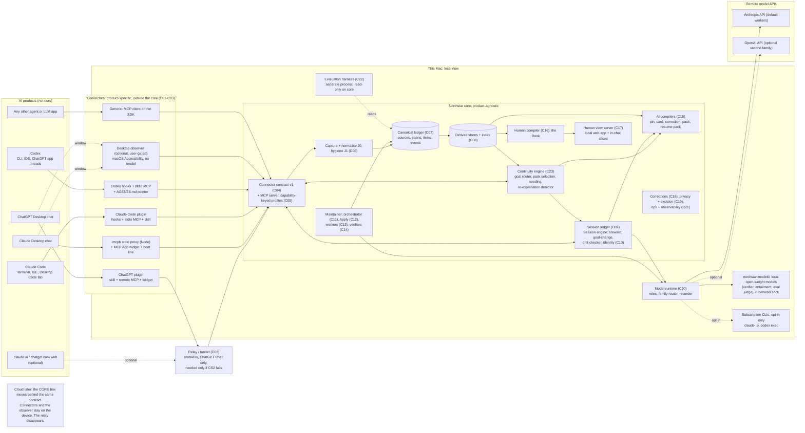

# Northstar system spine

**Status:** design draft, revised after adversarial review. Not approved. Nothing here is built. Revised on 2026-10-08 after a goal-fidelity audit; the changes are listed at the end, under "Fidelity fixes (2026-10-08)". Revised again on 2026-10-08 so the spine agrees with the component designs; those changes are listed under "Consistency fixes (2026-10-08)". Revised a third time on 2026-10-08 after the adversarial review ([`REVIEW.md`](../REVIEW.md)); these review revisions (2026-10-08) are listed under "Review fixes (2026-10-08)".
**Written:** 2026-10-08. Product facts were checked on 2026-10-08 unless another date is given (Appendix B).
**Authority:** [`docs/GOAL.md`](../../GOAL.md) overrides this document. The user's answers of 2026-10-08 (GOAL §2) override the round-2 synthesis where they conflict. This spine changes only the HOW. Where it finds part of the goal at risk, it records a risk (§11.1) or a question for the user (§11.2) and keeps designing for the goal as written. It adopts no reframe.

**What a spine is.** The shared skeleton every component design builds on:
- component boundaries and single responsibilities;
- the connector contract that keeps the core product-agnostic;
- the entity-level data model;
- interfaces, and who writes what;
- runtime topology, local now and cloud later;
- the model-runtime layer;
- the repo layout.

It fixes contracts and boundaries. It does not specify algorithms inside components. Those belong to the component designs.

**Inputs.**
- GOAL; round-2 SYNTHESIS (cited "SYN §n"); round-2 notes [10]–[14].
- The connector-strategy docs: [CD] `connector-claude-desktop-chat.md`, [GD] `connector-chatgpt-desktop-chat.md`, [OBS] `desktop-observer-macos.md`.
- The chosen human-side design, [TEXTBOOK] `TEXTBOOK.md` (final, 2026-10-08). The data model follows its §12.1 "Records the book needs from the shared core" (§5.2, §5.6). The three drafts it was built from, [TA], [TB], [TC], are cited only where an idea came from them.
- The component designs in `docs/design/components/`, cited where the consistency fixes adopt their choices: [CX] `connectors-desktop-and-mcp.md`, [HK] `connectors-claude-code-and-codex.md`, [IS] `ai-in-session.md`, [AC] `ai-continuity.md`, [CDM] `core-data-model.md`, [MT] `maintainer.md`, [PL] `platform-security-privacy.md`, [EV] `evaluation-and-build-plan.md`.
- `docs/archive/` is a rejected design and is not used.

**Labels.**
- **(Unv)**: an unverified product fact. Each one names the spike that settles it.
- **(Pn)**: a product fact listed in Appendix B with its source URL and the date checked.
- **Decisive / Leaning / Open**: as in SYN §4.
- IDs: **C** component, **IF** interface, **SD** spine decision, **SP** spine spike, **UQ** user question, **I** invariant. SYN risk numbers are kept; new risks start at 23.

---

## 0. Summary

1. **One product-agnostic core, many connectors.** The core never contains product logic. It reacts only to a **capability vector** that each connector declares and that per-turn **receipts** confirm (§4). A new product is a new connector plus a manifest, never a core change (invariant I23).
2. **Eight capabilities, each with ordered fidelity levels:** `capture_user`, `capture_ai`, `inject_turn`, `inject_start`, `check_reply`, `restart`, `audit_truth`, `write`. Core behaviour degrades by level, not by product: hook tier, observed-chat tier, sanctioned-chat tier, MCP-only tier (§4.6).
3. **Capture fidelity gates authority.** Text the chat model copied into a tool call steers the live session as *provisional*. It can never become a long-term goal, constraint, instruction or endorsement until a verbatim user span confirms it (new invariant I22, hardening I4 and I5).
4. **The core is a local daemon now.** Three LaunchAgents: `northstard` (contract API, MCP, session fast lane, AI compilers, Reader), `northstar-maintainer` (orchestrator, workers, verifiers, Apply) and `northstar-modeld` (local models on `run/model.sock`, [PL] PL-4). Separate SQLite files per concern, each with exactly one writer (§6, §7).
5. **Every client reaches the same contract.** Claude Code and Codex reach it through hook clients and a stdio MCP proxy. Claude Desktop reaches it through a `.mcpb` proxy (bundled Node runtime, P4). ChatGPT Desktop chat reaches it through a stateless relay, because its Chat mode appears to reach only remote MCP. That is inferred from P14 and is (Unv) until CS2 / DS1; the relay is needed only if CS2 fails. The optional observer reaches it through the Unix socket. Any other agent reaches it through MCP or a thin SDK (§4.8, §7.2).
6. **One MCP tool contract with capability-keyed profiles**, not one public server. Each connector's manifest declares capability flags (for example `per_turn_readonly`, `can_open_local_app`). The MCP server derives which tools a model sees only from those flags, so `readOnlyHint` stays truthful everywhere and no product name enters the core. At most five model-visible tools: `northstar_context`, `northstar_note`, `northstar_fetch`, `northstar_book`, `northstar_restart` (§6.2, [CX] §2).
7. **Session identity is Northstar's job.** Claude gives MCP no conversation ID (P2), and ChatGPT gives an anonymized one (P16). The core mints a session handle and joins it to every conversation key it sees, with a confidence and reversible joins (§5.2).
8. **The canonical ledger stays as SYN designed it:** immutable sources and spans, an append-only ledger of typed events, attribution on separate axes, write-time supersession, a code orchestrator with stateless workers, invariants I1–I21, two lanes (SYN §3.1, §3.5). The Book and the AI packs are two separate projections of the same leaves (§5).
9. **The textbook is a derived projection.** The data model carries what the chosen human-side design needs (TEXTBOOK §12.1): explanations, examples, comparisons, prerequisite order, stable chapter structure, refutations, editions, a generic agent registry, conversation identity states, capture and speaker fidelity, and engagement as dated events, never as a state. Learned content is compiled from leaf items, spans, relations and corrections only, never from earlier page text. What to learn may also hold topics Northstar itself suggests, labelled and never shown as learned, if the user wants them (UQ-10) (§5.6).
10. **Models sit behind one port with roles.** Default: Anthropic API for workers and the fast lane; a **local open-weight verifier** of a third family on this Mac (the target class: an Apple-silicon Mac with about 48 GB of unified memory; SP-3 sets the floor) for independent verification. Routing is family-aware: a verifier is never the family of the worker or of the AI that said the claim (§8). Profile A costs about $25–74 a month at 20–100 turns a day, ±2× ([MT] §9.6). Subscription CLIs (`claude -p`, `codex exec`) are evaluated honestly and allowed only as an opt-in, personal-only fallback with isolation and a quota guard (§8.2, UQ-6).
11. **Cloud later is configuration plus adapters.** Every store sits behind a repository port. Every record carries `tenant_id` and `account_ref` from day one. Connectors talk only to a base URL. The swap list is in §7.5. Enterprise seams are in §7.6.
12. **Build order (HOW):** hooks first. Stage 0a runs the desktop and ChatGPT account spikes on a throwaway server; Stage 0b builds a thin slice on Claude Code with the SDK fixture; then Claude Code and Book v1; then Codex and Claude Desktop chat; then ChatGPT Desktop chat; then the observer if the user accepts it; then the evaluated prototype ([EV] §5.1). All four first connectors are in the evaluated prototype, and desktop-chat results are reported separately, never replaced by hook results (SD-18).
13. **What stays at risk is reported, not designed away.** On desktop chat without the observer, live verbatim capture of AI-said text is not met, and per-turn focus is conditional on spikes (RISK 4, 19, 20). On ChatGPT Desktop chat at L0, whether a chat adds anything to memory depends on spikes CS1 / CS4 or on the user's answer to UQ-8(a) (RISK 33). Twenty-two questions go to the user, in one numbered list (§11.2); after the review, several are settled as HOW with a user override (ARCH R16).
14. **Cross-session continuity has its own engine, as deep as the in-session one.** C23 owns the goal router, pack selection, ledger seeding, the re-explanation detector and continuity receipts. It has its own model roles (§8.1), its own degradation rules (`inject_start`, §4.6) and a new-chat walk-through (§4.12).

---

## 1. Context and scope

### 1.1 What the system is

From GOAL §3: a shared knowledge core that captures both sides of AI conversations; a human architecture that reads like a textbook; an AI architecture that serves in-session focus and cross-session continuity equally, for any AI agent or LLM, through connectors; and AI-managed maintenance that stays correct when any one agent loses focus.

### 1.2 Scope of this document

| In scope | Out of scope (owned elsewhere) |
|---|---|
| Component boundaries, contracts, entity model, ownership, topology, model layer, repo layout, spine-level decisions, risks and questions | Connector internals ([CD], [GD], [OBS], [CX], and [HK] for Claude Code and Codex) |
| The connector contract and how the first connectors map onto it | The textbook's anatomy, prose rules and compile algorithm (TEXTBOOK.md, the chosen design, which goes to adversarial review) |
| What the core must hold for the textbook (from TEXTBOOK §12.1) | Extraction prompts, ranking formulas, drift rubrics, clustering parameters |
| How evaluation plugs into the core | The full evaluation plan (SYN §7 stands; its protocols are re-pointed in §2.1) |

### 1.3 System diagram



**Reading the diagram.**
- Solid arrows are the data path. Dotted arrows are optional or user-gated.
- Everything inside "This Mac" runs locally. The only internet-exposed piece is the relay, and only if ChatGPT Desktop chat (or the optional web) is connected and CS2 shows Chat cannot reach a local server (§7.3).
- Model calls leave the machine only to the providers configured, after redaction (C19, §8.5). What that means for "local now" is stated in §7.7 and asked in UQ-11.

### 1.4 Layer names across the design docs

[CD] and [GD] number their layers one way, [OBS] another. The spine uses the connector docs' numbering and maps [OBS] onto it.

| Spine layer | Meaning | [CD] | [GD] | [OBS] |
|---|---|---|---|---|
| **L0** | Sanctioned channels only: MCP tools, MCP App widget, instructions, skills, one-off export backfill | L0 | L0 | L0 |
| **L0+** | Sanctioned upgrades that depend on unverified product behaviour (widget hidden context, `ui/message` new chat, hooks or local MCP in Chat) | inside L0, "cond. CD-S2" | L0+ | "if DS1 / DS2" |
| **L1** | Observer reads the window (capture only) | L1 | L1 | L1 (shadow capture) |
| **L2-inject** | Observer places a visible, labelled block in the composer | L2 | L2a, L2e | L2 (visible injection) |
| **L2-auto** | Observer prepares or sends a fresh chat; optional correction turn | L2 | L2b, L2d | L3 (automation) |
| **L3** | Grey data paths: internal endpoints, app caches, debugger | L3 | L3 | Rejected (M14–M16) |

L3 is not built in any configuration (SD-14).

---

## 2. What changed from SYNTHESIS, and what stands

### 2.1 Changes forced by the 2026-10-08 answers

| SYN item | Change | Where in the spine |
|---|---|---|
| P1 "web first" (SYN §6.1), AD18, Q8, GOAL §4.6 old wording | **Superseded.** First connectors are Claude Desktop chat, Claude Code, ChatGPT Desktop chat and Codex. The web is optional. Connector build order is a HOW decision | §4.10, SD-18 |
| AD1–AD3 (browser extension capture and injection), Q1, Q2 | **Moot unless the optional web connector is built.** The extension is not required (GOAL §2). The desktop analogue is the observer, which is optional and user-gated (UQ-1) | §1.4, SD-14 |
| RISK 4 (desktop chat has no deterministic per-turn channel) | **Promoted to first priority.** The contract makes each desktop gap an explicit capability level, the core degrades by level, and the sanctioned spikes that could close the gaps run in the first build stage | §4, SD-18, §11.1 |
| AD4 hosting (Q4) | **Decided: local core now, cloud later.** A relay exists only for ChatGPT Chat. Moving to the cloud is adapters plus configuration | §7 |
| AD9 models (Q4) | **Now HOW.** Working default chosen, with family-aware routing | §8, SD-19–SD-21 |
| AD12 restart (Q7) | **Now HOW.** Policy keyed on the `restart` capability level: re-seed automatically on vendor resets on hook surfaces; prepared (one user action) on desktop L0/L0+; automatic only with L2-auto and the user's consent. The old chat always stays usable | §4.6, SD-15 |
| AD16 vendor memory (Q5) | **Now HOW.** Leave the user's settings alone, label every block, prefer hidden channels, measure absorption | SD-16 |
| Q3 accounts, RISK 2 | **Personal accounts first, enterprise later.** Capture is limited to allowlisted personal accounts; tenancy seams are in place from day one. At L0 no desktop channel carries an account signal, so the allowlist rests on the install-time account declaration (RISK 35) | §7.6, UQ-3 |
| Q6 mastery, RISK 8 | **Moot.** The human side is a textbook that helps the person understand and remember; it is not a quiz or a score. Engagement is kept only as dated, span-linked events, never as a per-concept state, label or summary (TEXTBOOK §12.1, Q5) | §5.2, §5.6 |
| SYN §3.2 "learning map views" | **Re-pointed.** The human compiler's output is the Book (a textbook projection). The learning-map mechanisms (concepts, prerequisites, frontier, gaps) become inputs to it | §5.6, C16 |
| SYN §7.1 protocol C (live n-of-1 on the web) | **Re-pointed** to the desktop chat apps, using the observer's shadow mode as the control arm when L1 exists. Protocol D (hook surfaces) is no longer "phase 2"; it runs from the first stage. Desktop and hook results are reported separately. A live arm on the user's real chats needs the user's yes, a fixed share and a stop rule (UQ-9) | §6.3, C22 |
| SYN §6.1 P2–P4 staging | **Replaced** by SD-18. Non-chat sources (reading and work) stay later, and the source-generic anchor stays in the first schema | §5.2 |

### 2.2 What still stands

All SYN items marked **Decisive** stand:
- **Capture must be deterministic, and MCP self-report is never the record** (AD1, its general part). On desktop chat L0 this is exactly why I22 exists.
- **Attribution on independent axes, speaker set by the adapter** (AD6).
- **The orchestrator is code; the chat model is never the maintainer** (AD8, AD9 part).
- **The core pack has a fixed contract, with explicit goal links and write-time supersession, and its knowledge slot is required** (AD13).
- **Verification is its own axis, never upgraded by acceptance or repetition** (AD14 part).
- **Exports are backfill only**, because a recurring export is a ritual (SYN §2, RISK 19).

These **Leaning** items stand as the spine's working choices:
- AD5 own SQLite ledger; AD7 keep all AI spans as passages and promote selectively; AD10 provisional items from both speakers steer at once; AD11 pin plus card plus specific corrections; AD19 automatic tension resolution; AD17 truthful `readOnlyHint` on ChatGPT.
- The two lanes, quarantine with automatic exits, the risk-tiered verification layers L0–L6, invariants I1–I21, never summarizing summaries (SYN §3.1–§3.5, §5).
- The evaluation ground rules, baselines and bars (SYN §7), with the re-pointing in §2.1.

### 2.3 Where the spine departs from SYNTHESIS with a better HOW

No SYN item marked Decisive is reversed. Each departure below replaces a Leaning item or an unstated assumption, and says why.

| SYN position | Spine choice | Why it is better |
|---|---|---|
| "One public MCP server: Streamable HTTP, OAuth" (SYN §3.6) | **One MCP tool contract, three transports** (stdio proxies over the Unix socket; loopback HTTP, off by default; a relay on its own listener, [PL] D-PL-1, D-PL-2), with **tool profiles keyed on capability flags** that each connector's manifest declares (SD-9) | Local now: Claude Desktop, Claude Code and Codex need no public endpoint (P4; [CD §4.1]). Only ChatGPT Chat appears to need a remote endpoint (inferred from P14; Unv, CS2). Capability-keyed profiles let one contract serve a read-only per-turn tool where write approvals recur (P19) and a recording tool where they do not, without a false `readOnlyHint` and without product names in the core (I23) |
| "Adapter contract: a control channel and a fidelity channel" (SYN §3.6) | **A capability vector of eight capabilities with ordered levels**, declared per connector and confirmed per turn by receipts (§4) | Two channels cannot express the desktop cases: "deterministic after the first tool call", "checked one turn late on self-report", "prepared restart, one keystroke". The core needs these levels to pick behaviour without product logic (I23) |
| Adapter supplies the conversation ID (SYN §3.1 anchor) | **Core-minted session handle plus a join table** of conversation keys with confidence (SD-10) | Claude passes MCP no conversation ID (P2); ChatGPT passes an anonymized one (P16); the observer sees a URL only if Accessibility exposes it (Unv, DS4). Joins must be reconcilable and reversible |
| I5 "only user-typed spans create instructions" | **Plus I22: fidelity-gated authority.** A model-reported copy of user text is provisional until verbatim confirmation | A model can be led by injected content to "report" text the user never typed ([GD] CR13); origin binding at write time is necessary ([13 F8]) |
| Independent verifier = "a local open-weight model of another family" (SYN §3.5, AD9) | **Family-aware routing**: the verifier family must differ from both the worker family and the speaker family of the claim (SD-21) | With ChatGPT and Codex now first connectors, AI-said content arrives from two vendor families. A single "other family" rule would let an OpenAI verifier check ChatGPT-said claims. CAPA shows same-family errors correlate ([13 F3]) |
| Model choice assumed API keys (SYN §3.5) | **Provider port with four adapters**, including the user's subscriptions through headless CLIs, evaluated honestly and gated (§8.2) | GOAL §2 makes keys a HOW decision. The CLI path is real (P7, P9, P11) but has terms, quota and isolation problems the design must handle explicitly |
| One SQLite file implied | **Separate SQLite files per concern, one writer each** (SD-3) | Keeps the per-turn path (session) from contending with batch writes (ledger); maps one-to-one onto cloud storage adapters later |

---

## 3. Component map

Each component has one responsibility. "Serves" names the GOAL §4 non-negotiable(s) it exists for. Non-negotiable numbers: §4.1 system, no rituals; §4.2 AI-said first-class; §4.3 the AI manages it; §4.4 two architectures, one core; §4.5 drift and continuity; §4.6 product-agnostic core with connectors; §4.7 robust maintainer; §4.8 prototype built and evaluated.

| ID | Component | Single responsibility | Inputs | Outputs | Serves |
|---|---|---|---|---|---|
| C01 | **Connector adapters** (one per product, plus the thin SDK) | Translate one product's native events and channels into the connector contract, and render core artifacts into that product's channels. Hold no canonical state | Hook payloads, MCP tool calls, widget calls, SDK calls | Contract events, synchronous requests, delivery receipts | §4.6; §4.2, §4.5 through fidelity |
| C02 | **Desktop observer** (optional, user-gated) | Read desktop chat windows through Accessibility; if allowed, place visible blocks and prepare fresh chats. No model inside ([OBS §4]) | AX tree of allowlisted apps | `turn.observed` at `verbatim_rendered`, watermarks, health, placement receipts | §4.2, §4.5, §4.7 on desktop chat |
| C03 | **Relay** | Carry MCP calls from a vendor's cloud to the local MCP endpoint. Stateless; stores nothing | Vendor MCP requests | Forwarded requests to a separate listener, `run/remote.sock`, that serves only the `remote` profile ([PL] D-PL-2) | §4.6 (local now) |
| C04 | **Connector / ingest API** | Accept versioned contract traffic; authenticate; validate envelopes; enforce idempotency; answer synchronous requests within their budgets | Contract events and requests over the Unix socket (loopback HTTP only as a fallback, off by default), each with a per-connector credential ([PL] PL-1, PL-2) | Raw capture records to C06; responses assembled from C10 and C15 | §4.6 |
| C05 | **MCP server** | Serve one tool contract over every transport. Derive which tools a model sees only from the capability flags in the connector's manifest (§6.2), never from a product name. Serve a widget bundle that a connector registers as opaque bytes, with no branching on the host. Delegates to C04 handlers | MCP JSON-RPC; the session's manifest flags | Tool results; app-only tool results for widgets | §4.6, §4.5 |
| C06 | **Capture and normalisation (J0) + hygiene (J1)** | Turn raw capture into immutable source records: speaker by construction, origin and fidelity bound at write, secrets redacted, PII tagged and masked at egress ([PL] PL-6), pastes detected, Northstar blocks stripped, watermarks kept, several captures of one message reconciled | Raw capture records; export files | Sources, messages, spans, observations; reconciliation events; hygiene flags | §4.2, §4.7; privacy |
| C07 | **Canonical ledger** | Hold the append-only record of what was captured and what the maintainer decided, with full history | Validated events from C12 only; excision from C19 | As-of reads; inputs to every projection | §4.2, §4.4; history |
| C08 | **Derived stores and index** | Rebuildable views: best-rank projection, full-text index, embeddings cache, relation-graph views, dated engagement events (never a per-concept state), frontier inputs | Ledger events | Query APIs for C10, C13, C15, C16, C17, C23 | §4.4, §4.5 |
| C09 | **Session ledger** | Hold in-session state per session: goal stack, constraints, established items from both speakers, assumptions, open questions, rejected options, artifact versions. Branch-aware and event-sourced ([11] impl. 1) | Validated session operations from C10 | State for C15, drift checks, resume packs; promotion candidates for the slow lane | §4.5 (in-session); §4.2 |
| C10 | **Session engine** (fast lane) | Identity reconciliation; Goal-Change Handler; Session Steward (JF); Drift Checker; composer triggers; restart triggers; eval arm assignment | Turn events, receipts, session ledger, best-rank items | Validated session operations; drift verdicts; queued corrections; trigger decisions; turn receipts | §4.5 |
| C11 | **Orchestrator** | Schedule and lease slow-lane jobs; enforce lanes, idempotency, error budgets, freezes, quarantine exits and rollback. Code only, never a model ([13 §A]) | Commit notifications, job outcomes, metrics | Jobs; freezes; repair batches | §4.3, §4.7 |
| C12 | **Apply** (validator gate) | The only writer of canonical events. Validates every proposal against the invariants and applies it as typed events in one transaction | Proposals from C13 and C14; corrections from C18; reconciliation from C06 | Ledger events; rejections; quarantine records | §4.7 |
| C13 | **Workers** | Stateless proposal functions: J2 segment, J3 extract, J5 link and resolve, J7 block writing for the Book, J8 reorganization proposals ([13 §B]) | Inputs assembled by code, job card last | Schema-constrained proposals | §4.3, §4.2 |
| C14 | **Verifiers** | Independent checks: J4, verification layers L1–L4, the drift judge, entailment spot-checks, claim verification (AD14); always family-routed | Proposal plus its spans | Verdicts with evidence | §4.7 |
| C15 | **AI compilers** (J9) | Deterministically build the pin, card, correction, core pack, resume pack, boot text, maintainer charter, restart prefill and widget model-context text, and record delivered Book slices, each fitted to a channel budget (kinds in §5.2) | Best-rank projection, session ledger, drift verdicts, capability vector, pack item selections from C23 | Artifacts with item IDs and content hashes | §4.5, §4.4 |
| C16 | **Human compiler** | Build the Book projection from leaves: structure, order, cited blocks, editions. Owned by the human architecture (TEXTBOOK.md); the spine fixes its inputs and outputs (§5.6) | Best-rank projection, relations, corrections, engagement events, episode identity states, context receipts by session | Book projection tables | §4.4; §6 textbook criterion |
| C17 | **Human view server** (Reader) | Serve the Book locally: read API, source cards to the verbatim span, search, in-chat slices, the correction API, a health page | Book projections, ledger reads, context receipts by session ("this chat draws on", TEXTBOOK §5.9) | HTML and JSON; correction submissions to C18 | §4.4; §6 |
| C18 | **Corrections** | Receive optional corrections from any channel; check their origin (I20, I22); register active corrections as hard constraints (I21) | Reader; widget app-only tool `northstar_widget_action` (origin `app_click` only with a valid `action_nonce`); MCP `northstar_note(kind: correction)` | Correction proposals to C12; a constraint registry that C13, C15 and C16 read | §4.3 |
| C19 | **Privacy and excision** | Capture allowlists; scope and sensitivity (I17); egress rules per provider and recipient family; redaction policy; excision with tombstones across every store, backups included (C19 orchestrates; each store's writer purges its own rows, §6.4 rule 3) | Configuration; user excision requests | Policy decisions; excision runs | Privacy; §4.1 |
| C20 | **Model runtime** | Map roles to providers; enforce family routing, budgets and redaction before each call; record every output | Role requests from C08 (`embedder`), C10, C13, C14, C22, C23 | Recorded outputs | §4.7, §4.3 |
| C21 | **Ops and observability** | Metrics, sentinels, watermark comparison, health, backups, a kill switch. Acts automatically (freeze, fail closed); never asks the user to act | Metrics from every component | Alerts to C11; status in C17 and the CLI | §4.7, §4.1 |
| C22 | **Evaluation harness** | Run SYN §7 protocols, golden and canary sets, and attention-loss fault injection; score; never writes to the core | Store snapshots, receipts, eval fixtures | Eval store and reports | §4.8; §6 |
| C23 | **Continuity engine** (fast lane) | Start every new session from the ledger: route it to the right goals, select pack items within the start budget, seed the new session ledger, detect re-explanations, and record continuity receipts | `session.started` (`start_kind`, `context_ref`, `parent_handle?`), the first user turns at any fidelity (or `hint_text`), open and reported goals from every surface, best-rank projection, goal→item links, context receipts | Routed goals and item selections to C15; seeding and re-explanation operations to the C10 session applier; continuity receipts | §4.5 (cross-session); §4.2; §6 criterion 2 |

**C23 in detail.** In-session focus has its own store (C09), engine (C10), model roles and per-turn rules. Cross-session continuity gets the same depth: one engine with five parts, two model roles (§8.1), its own degradation rules (`inject_start`, §4.6) and a new-chat walk-through (§4.12). C23 holds no store. Each output has one writer.

| Part | What it does | Inputs | Outputs | Single writer of the output |
|---|---|---|---|---|
| **Goal router** | Picks the open goals, from every surface, that the new chat continues (SYN §3.4) | `context_ref`, `parent_handle`, the first user message (verbatim, or the model's copy as `hint_text`), open goals and `reported` goals (SD-36) | Ranked goal set, with a reason per goal | C10 session applier records it in `session.db` as a `routing_record` row, not a session operation |
| **Pack selection** | Fills the core pack's slots over explicit goal→item links, within the channel's hard start budget. AI-said and user-said items compete on relevance only | Routed goals, best-rank projection, relations, recent provisional items (§5.5), active corrections (I21) | Ordered item IDs per pack slot | C15 builds the artifact and is the sole writer of `artifacts.db` |
| **Ledger seeding** | Enters the delivered pack items (plus guard-only items cut by the budget, [AC] §5.1) into the new session ledger as established items, so the Drift Checker runs from turn 1 (SYN §3.4) | The delivered artifact and its delivery receipt | Session operations `ADD`; there are no separate SEED or ROUTE op types. Each seed has actor `seeding`, `actor_ref` = the `continuity_params` version, `seeded_from {item_id@version, artifact_hash, delivery_receipt}`, `seed_kind`, `delivery` (delivered, unknown, guard_only), `on_route`, `by` = the original speaker (user, ai) and `authority` (confirmed, provisional, reported; [CDM] §5) | C10 session applier |
| **Re-explanation detector** | Flags early user turns (the first 5) that restate goals, knowledge or conclusions the core already holds. Each hit is a pack miss, used for the SYN §7.2 metric and retrieval tuning, never as a user prompt | User turns 1–5 at any fidelity, the delivered pack, best-rank projection | Re-explanation verdicts: item, turn, span, capture fidelity | C10 session applier; C21 aggregates the metric into `ops.db` |
| **Continuity receipts** | Record, per new session, what was routed, selected, delivered, seeded and missed | The four parts above; delivery receipts | One continuity receipt per session (§4.5) | C10 session applier |

When the start delivery happens before the first user message is known (for example `SessionStart` before the prompt), C23 routes on `context_ref` and the parent handle first, then re-routes on the first user turn, and the routed knowledge rides that turn's delivery.

**Grouping, for readers.**
- **Edge:** C01–C05. Product-specific code lives only in C01–C03, and in connector manifests and assets under `connectors/`.
- **Record:** C06–C09. Capture becomes immutable records; the ledgers hold history.
- **Maintain:** C10, C23 (fast lane), C11–C14 (slow lane) and C20. Both lanes share the model runtime.
- **Project:** C15–C17. The AI side and the human side are separate projections of the same leaves (§4.4).
- **Cross-cutting:** C18, C19, C21, C22.

---

## 4. The connector contract

### 4.1 Purpose and rules

The contract is the only way anything outside the core talks to the core. It makes the core product-agnostic (GOAL §4.6).

- **Connectors are outside the core.** Product names, hook formats, widget protocols, widget host shims, Accessibility profiles and the mapping from a product to its MCP tools live only in C01–C03 and in connector manifests and assets under `connectors/`.
- **The core reacts to capabilities, not products.** Core policy may branch on capability levels, MCP capability flags, budgets, render profiles, the generic `speaker_model_family` of a capture (§5.3), the generic recipient attributes `recipient_family` and `relay_operator` of a delivery ([PL] D-PL-6), and the generic manifest flag `vendor_memory_possible` (§4.3) only. Product, mode and connector identifiers are metadata for attribution, display and analysis (I23, §5.7).
- **Every capability can be missing on any turn.** The core records what was present, per turn, in receipts (§4.5) ([10] impl. 1).
- **The contract is versioned.** `northstar.connector/1.x` (§4.4).

### 4.2 Capability vocabulary and fidelity levels

Levels are listed best first. A connector declares its best expected level per capability. Receipts record the level actually reached on each turn.

| Capability | The question it answers | Levels, best first |
|---|---|---|
| `capture_user` | How does the user's turn reach the core? | **`verbatim_live`**: exact text, by construction, at send time (hook `prompt`, observer composer value, SDK). **`verbatim_rendered`**: exact text as displayed, read seconds later (observer transcript read). **`verbatim_deferred`**: exact text, minutes to days later (export, observer sweep). **`model_reported`**: the chat model's copy in tool arguments. **`none`** |
| `capture_ai` | How does the AI's reply reach the core? | `verbatim_live` (Stop hook `last_assistant_message`, SDK). `verbatim_rendered` (observer at reply end). `verbatim_deferred`. `model_reported` (points and short quotes from the previous reply, one turn late, or by a closing call (spiked)). `none` |
| `inject_turn` | Can Northstar put state into the model's context on every turn? | **`deterministic`**: on every turn whatever the model does (hook context, SDK, L2-inject visible block). **`deterministic_after_mount`**: on every turn once a widget is mounted, which needs one model tool call first (conditional on CD-S2 / CS4). **`model_pulled`**: only when the model calls a Northstar tool. **`static`**: fixed text written once (instructions). **`none`** |
| `inject_start` | Can a new chat start with the pack? | Same levels as `inject_turn` |
| `check_reply` | Can each reply be checked and corrected? | **`in_turn`**: checked before control returns to the user, and the connector can force a continuation that fixes it. **`next_turn_verbatim`**: the verbatim reply is checked after display; the correction rides the next delivery. **`next_turn_reported`**: only the model's own report of its reply is checked. **`none`** |
| `restart` | Can work move to a fresh context built from the ledger? | **`automatic`**: the core can open and seed a fresh context with no user action. **`reseed_on_reset`**: the core re-seeds automatically whenever the product resets context (compact, clear, fork). **`prepared`**: the pack is ready and one user action starts it. **`suggested`**: the core can only say a fresh chat would help. **`none`** |
| `audit_truth` | Is there a capture ground truth that does not depend on the chat model? | **`live_independent`**: two independent sources per turn (transcript vs hook field; composer value vs transcript). **`live_single`**: one live verbatim source. **`deferred`**: export only. **`none`** |
| `write` | Can the connector write to Northstar without the chat model choosing to? | **`deterministic`**: connector code writes from capture. **`user_action`**: a click in the widget or the Reader. **`model_pulled`**: write tools the model calls. **`none`** |

Each declared level carries up to four attributes:
- `channel`: which channel provides it (for example `hook`, `mcp_report`, `widget_context`, `ax_observer`, `export`);
- `budget_chars`: for the inject capabilities, the most the channel accepts;
- `conditional_on`: the spike that must pass for the level to hold (for example `CD-S2`);
- `requires_consent`: the user question whose "yes" the level needs before use (for example `UQ-1` for anything the observer does inside a vendor app). The core treats an unconsented level as absent. This keeps consent rules out of product logic (I23).

### 4.3 Connector manifest

Each connector ships a manifest. The core reads it at `session.started` and keeps the declared vector on the session.

```yaml
contract: "northstar.connector/1.1"
connector: {id: claude-desktop-chat, version: 0.1.0}
product:   {family: anthropic, product: claude-desktop, mode: chat}   # metadata only (I23)
identity:  {conv_key: none, minted_handle: true, nonce_per_turn: true}
account:   {signal: none}             # no account signal on this channel; the install-time declaration applies (RISK 35)
recipient_family: anthropic           # who receives this connector's deliveries; a generic egress input (I23; [PL] D-PL-6)
vendor_memory_possible: true          # the receiving product may keep its own memory of delivered text; generic, product-blind (I23)
mcp:       {profile: per_turn_write, flags: [widget, can_open_local_app], capture_mode: per_call}
                                      # C05 derives tool visibility and annotations from these only (§6.2);
                                      # capture_mode names the UQ-8(a) write path ([CX] §2.5); this is path C1 (cond. CD-S1)
assets:    {widget_bundle: mcp-app-widget/dist/northstar-widget.html}      # served by C05 as opaque bytes
render:    {format: markdown, label: "Northstar session state (not the user's words)"}
capabilities:
  capture_user: {level: model_reported, channel: mcp_report}
  capture_ai:   {level: model_reported, channel: mcp_report}
  inject_turn:  [{level: deterministic_after_mount, channel: widget_context, budget_chars: 1200, conditional_on: CD-S2},
                 {level: model_pulled, channel: tool_result, budget_chars: 4000}]
  inject_start: {level: model_pulled, channel: tool_result, budget_chars: 12000}
  check_reply:  {level: next_turn_reported}
  restart:      {level: prepared, channel: deep_link_prefill, budget_chars: 600, conditional_on: CD-S5}
  audit_truth:  {level: deferred, channel: export}
  write:        [{level: model_pulled}, {level: user_action, channel: widget}]
optional_channels:
  - {id: ax_observer, raises: {capture_user: verbatim_live, capture_ai: verbatim_rendered,
                               check_reply: next_turn_verbatim, audit_truth: live_independent,
                               write: deterministic}, requires_consent: UQ-1}
```

The `mcp` and `assets` blocks keep the product-to-tool mapping in `connectors/`. The connector picks a capability profile, flags and `capture_mode`; C05 maps them to tools and annotations by one generic rule table (§6.2). C05 never reads `product`. Budgets follow [CX] §2.7 for MCP channels and the [HK] §15 manifest for hook channels (§4.7).

`vendor_memory_possible` is a generic flag, not a product name (I23). It says the receiving product may keep its own memory of what Northstar delivers. The core uses it only to add a supersession note when the latest superseded version of an item was said in a captured chat on such a connector ([AC]; REVIEW AIE-12). The product-blindness test holds it fixed (§4.9).

### 4.4 Wire schema v1 (sketch)

**Envelope**, on every event and request:

```yaml
schema: northstar.connector/1.1   # 1.1 adds optional fields only; see the delta table below
id: 01JB...                  # ULID minted by the connector
idem_key: "sha256(connector, conv_key|handle, branch, role, ordinal, content_hash)"
connector: {id: claude-code, version: 0.1.0, mcp_profile: hook_backed}
product:   {family: anthropic, product: claude-code, mode: cli, app_version: "...", model: "..."}
account:   {ref: acct_7f3..., source: channel | install_declaration | ax_label}   # salted hash; never an email or name.
                                       # ax_label = the observer's reading of the app's account label (1.1; (Unv), DS4).
                                       # No L0 desktop channel carries an account signal ((Unv) for the observer,
                                       # [OBS §4.3]), so at L0 `source` is install_declaration (RISK 35)
session:   {handle: NS-7F3K?, conv_key: {kind: hook_session_id|openai_session|observer_url|export_id, value: "..."}?,
            branch: "0.2"?}
channel: hook | mcp_report | ax_observer | export | sdk | widget
occurred_at: "2026-10-08T14:02:11Z"
sent_at:     "2026-10-08T14:02:11Z"
type: turn.observed
payload: {...}
```

**Events** (fire and forget; acknowledged with the stored ID):

| Type | When | Key payload fields |
|---|---|---|
| `session.started` | A product starts or resets a context | `start_kind`: startup, resume, clear, compact, fork, new_chat, restart; `parent_handle?`; `title?`; `context_ref?` (project, repository or working directory); `model`; `capabilities` (declared vector or manifest reference) |
| `turn.observed` | A user or AI turn is captured | `role`: user or assistant; `ordinal?`; `text`; `fidelity` (a `capture_*` level); `paste_ranges`; `northstar_block_ranges`; `attachments_meta`; `grounding` (browsing, tools used); `citations`; `reply_complete`; for `model_reported` AI turns, `reported_points: [{kind, text, quote, body?}]` (`body` ≤ 1,500 chars, only on explanation or example points), with closing-call points (`this_reply_points`) for the same reply ([CX] §2.3) |
| `session.compacting` / `session.compacted` | Before and after a vendor compaction | `trigger`; `summary_hash?` |
| `branch.switched` | The user edits, regenerates or switches branch | `from`, `to` |
| `session.ended` | Product end or idle timeout | `reason` |
| `delivery.receipt` | After the connector places an artifact | `artifact_id`, `artifact_hash`, `kind`, `placement` (additional_context, tool_result, widget_context, composer_block, start_message), `delivered` (true, false, unknown), `suppressed_by_arm?`, `user_removed?` |
| `capture.watermark` | Each turn and periodically | `conv_key`, `message_count`, `last_content_hash`, `source` |
| `connector.health` | Start, update, self-test | `mode`, `profile_version`, `self_test` (pass or fail, with details) |

**Requests** (synchronous; the core answers within the budget or returns `deferred`):

| Request | Used by | Returns | Budget (initial, to tune) |
|---|---|---|---|
| `session.resolve` | Any connector with a conversation key or hints | `handle`, `identity_confidence`, `arm` | 50 ms |
| `context.get` `{moment: session_start, turn_start, post_compact, tool_call, subagent_start (1.1); hint_text?; prior_hint_texts? (1.1); budget_chars}` | Hook clients, the SDK, C05 tool handlers | One artifact (pin, card, correction, core pack or resume pack) rendered to the budget, with item IDs, `artifact_hash` and a receipt token | p95 300 ms for a pin; 1.5 s for a pack |
| `reply.check` `{turn, text, budget_ms}` | `in_turn` connectors (Stop hooks, the SDK) | `verdict` (pass or correct), `correction_text`, `continue` (bool), reason codes | `budget_ms`, default 8 s; otherwise `deferred` with the correction queued |
| `restart.prepare` `{reason}` | Any connector | Resume pack, new handle, open hints (for example prefill text) | 2 s |
| `tool.invoke` `{tool, args}` | C05 on behalf of MCP connectors | The tool result (§6.2) | Per tool |
| `correction.submit` | Reader, widget, MCP | Correction ID, or `proposed` when I22 holds it back | 300 ms |

**Versioning rules.**
- The major version is in `schema`. The core accepts the current and the previous major.
- Minor versions only add optional fields or new levels. Capability names are fixed within a major.
- Unknown fields are kept in the raw capture record and ignored by policy.
- A new capability or level needs a minor version, an entry in the policy table (§4.6) and conformance tests (§4.9).

**The `northstar.connector/1.1` delta.** One minor version gathers every addition the component designs need. `contract/` publishes it with JSON Schemas and conformance tests (§4.9). Every field is optional, so a 1.0 connector stays valid. No capability or level is added.

| Addition | Where | Needed by |
|---|---|---|
| `turn.observed` fields `turn_origin`, `speaker_scope`, `agent_ref`, `error` | Event payload | [HK] D-HK-2, §8 |
| Envelope fields `client.host_pid`, `flags.canary`, `product.surface`, `product.mode` | Envelope | [HK] D-HK-2 |
| Event `session.context_changed` (the working directory moved mid-session) | Event | [HK] D-HK-2 |
| `context.get` moment `subagent_start` | Request | [HK] D-HK-1 |
| `prior_hint_texts?` on `context.get` (and on the internal `session.early_turn`); MCP argument `prior_user_messages` (≤ 4) on `northstar_context`, mapped to it | Request; tool input | [AC] §13; [CX] §2.3 |
| `explicit_request: true` on `turn.observed` and as a tool input, when the user asks for Northstar by name (shadow-arm crossover) | Event payload; tool input | [EV] §3.3 |
| Manifest `mcp.capture_mode`: `per_call`, `widget_record`, `save_on_request`, `receipts_only` (UQ-8a paths C1 or W, C2, A, B) | Manifest | [CX] §2.5, D4 |
| Manifest flag `pull_fallback` | Manifest | [HK] D-HK-5; §6.2 |
| Manifest `recipient_family` (credentials also carry `relay_operator`) | Manifest; credential | [PL] PL-1, D-PL-6 |
| Manifest blocks `identity.turn_key`, `identity.joins`, `budgets`, `continuation`, `sweep`, `degraded` | Manifest | [HK] §15 |
| IF-1 endpoint `GET /v1/connectors/{id}/directives` (long poll: modes, arms, retest, kill) | IF-1 | [CX] §6.1, D9 |
| Generic `connector.sweep`: a connector-side reader of the product's own transcript, run detached and nightly; its results arrive as ordinary events | Connector | [HK] D-HK-4 |
| Join methods `process_lineage` and `widget_origin` | Identity joins (§5.2) | [HK] D-HK-3; [CX] D7 |
| Account source `ax_label` | Envelope | [CX] §6.1 |
| One turn-tag format, `NS-XXXXXX.<n>`: the handle, a dot and the turn number (examples here use short handles such as `NS-7F3K.14`); never a slash | Tool results and inputs; observer blocks | [CX] §2.3 |

**The `northstar.connector/1.2` delta** (REVIEW AIE-4). Contract minor version 1.2 adds `tool_action` observations for hook connectors: the file path, a diff hash and a bounded diff excerpt of each edit a coding agent makes. Like every minor addition, the fields are optional, so 1.0 and 1.1 connectors stay valid ([HK], [IS]).

### 4.5 Per-turn channel receipts

C10 assembles one **turn receipt** per (session, branch, turn) from the events and delivery receipts. It records what fidelity was captured and what was delivered.

```yaml
turn_receipt:
  session: NS-7F3K   turn: 14   branch: "0"   arm: treatment
  capture_user: {level: model_reported, channel: mcp_report, event: 01JB..., reconciled_by: null}
  capture_ai:   {level: none}                          # arrives next turn as reported points
  inject_turn:  {level: model_pulled, delivered: true, artifact: pin@3f9a..., placement: tool_result}
  widget:       {level: deterministic_after_mount, delivered: unknown}   # true only when the model echoes the widget tag
  check_reply:  {level: next_turn_reported, verdict_for_turn: 13, correction_queued: C-3}
  gaps: [ai_text_missing]
```

**What receipts feed.**
- **Promotion gates:** I22 reads the capture level of every supporting span.
- **Delivery metrics:** the per-turn delivery probability, `p_call` and its decay with depth ([GD §6.9], [OBS §6.5]).
- **Sentinels:** missing calls, missing captures and watermark gaps (C21).
- **The human view:** "this chat drew on these items" (TEXTBOOK §5.9, §12.1 context receipt).
- **Evaluation:** which arm was delivered what (C22).

`delivered: unknown` is a first-class value. Widget model context gives no acknowledgement, so the core never claims a delivery it cannot see.

Under `per_turn_readonly`, receipts are content-free operational logs only (time, tool, status, latency); delivered item IDs are derived when needed from the echoed turn tag and a deterministic recompile. Widget context is `delivered: true` when the model echoes the widget tag ([CX] §3.4), else `unknown`, never `false`.

**Continuity receipt.** C23 adds one per new session, written by the C10 session applier:

```yaml
continuity_receipt:
  session: NS-8A2Q   start_kind: new_chat   parent_handle: null   arm: treatment
  routed_on: hint_text            # context_ref | parent_handle | first_message_verbatim | hint_text | none
  goals_routed: [G1, G4]          # with reasons
  pack: {artifact: core_pack@9c1e..., delivered: true, placement: tool_result}   # true | false | unknown
  seeded: [G1, D2, E7, R1]        # items entered into the session ledger
  reexplain_hits: [{turn: 2, item: D2, fidelity: model_reported}]
  turns_seen: [1, 2, 4]           # at model_pulled, only turns with a call
```

### 4.6 How core behaviour degrades by capability level

Every row is a rule the core applies to a session from its capability levels. No row names a product.

| Capability at level | Core behaviour |
|---|---|
| `capture_user` ≥ `verbatim_rendered` | User spans can create goals, constraints and instructions (I5). On hook channels, long-term authority also needs the intake flag `observation.origin_confirmed`; a `confirmed_degraded` record steers the live session only (I22). The Goal-Change Handler and the re-explanation detector run on exact text |
| `capture_user` = `model_reported` | Items enter the session ledger as "provisional, from the model's copy of your message". They steer the live session at once (AD10). No long-term goal, constraint, instruction, endorsement or correction until verbatim confirmation (I22). Goals and questions are kept long-term as `reported` Agenda items with no authority, so they outlive the recent window (SD-36, §5.5). The re-explanation detector runs on the model's copy, so it sees only turns with a call. Copy fidelity is a sentinel |
| `capture_user` = `none` on a turn | A turn gap is recorded. No steward operation. The re-explanation detector skips the turn |
| `capture_ai` ≥ `verbatim_rendered` | Every assistant span is kept as a Passage; J3 extracts from both sides; the Drift Checker judges the real reply |
| `capture_ai` = `model_reported` | Reported points are stored as observations with origin `model_reported`. They enter the session ledger as "provisional, reported by the AI". Long-term promotion carries a "reported, not verbatim" chip and is re-derived when verbatim text arrives ([GD §7]) |
| `inject_turn` = `deterministic` | The pin is pushed every turn, within the channel budget; the card on triggers; corrections first |
| `inject_turn` = `deterministic_after_mount` | The pin goes into every tool result and into widget context, refreshed by the widget. Every result carries the refresh fact ([CD §4.2.2]) |
| `inject_turn` = `model_pulled` | The pin is appended at the end of every Northstar tool result, with the refresh fact and a "not in your recent context" list ([GD §5]). The call-rate decay is a sentinel |
| `inject_turn` = `static` only | The core produces boot text only. The session is marked as not meeting per-turn focus in reports |
| `inject_start` = `deterministic` | At `session.started`, C23 routes on `context_ref` and the parent handle, C15 builds the core pack within the start budget, and the connector delivers it before the first reply. If the first user message is not known yet, the start delivery carries goals, constraints and recent provisional items; C23 re-routes on the first user turn and the routed knowledge rides that turn's delivery. Delivered items are seeded into the session ledger |
| `inject_start` = `deterministic_after_mount` | The first Northstar tool call returns the pack, routed on its `hint_text`. After mount, the widget keeps the routed goals and top items in model context beside the pin. Seeding happens at that first call |
| `inject_start` = `model_pulled` | The pack is returned in the first Northstar tool result of the session, routed on the model's copy of the first message. The boot text names the tool. With no call, the core does not see the session at all: no pack, no seeding and no receipt. If verbatim capture arrives later (observer or export), C23 writes the receipt then, recording the miss. The first-call rate is a sentinel |
| `inject_start` = `static` only | Only the boot text reaches the model. No pack, no seeding. The session is marked "no pack delivered" in continuity reports |
| `inject_start` = `none` | No start delivery and no seeding. The session is marked as not meeting cross-session continuity in reports |
| `check_reply` = `in_turn` | The drift cascade runs synchronously within the budget. A high-severity violation returns `continue` with a specific correction, capped per turn. Otherwise the check finishes asynchronously and the correction is queued |
| `check_reply` = `next_turn_verbatim` | The cascade runs asynchronously after display. The correction is queued for the next delivery, or pushed to a widget or optional correction turn if the connector offers one |
| `check_reply` = `next_turn_reported` | Only tier-0 checks run, on the self-report. Corrections are marked weak and do not count as checks for the SYN §7.1 bars |
| `restart` = `automatic` | When thresholds cross, the core triggers a restart at reply end. If the level carries `requires_consent`, it is used only after the user's yes; until then the core falls back to the next level down |
| `restart` = `reseed_on_reset` | Every product context reset re-seeds from the resume pack built from the ledger. On drift thresholds the core prepares a pack and says so |
| `restart` = `prepared` | The core prepares the pack and offers it. One user action starts it. The old chat stays usable |
| `restart` = `suggested` | The next delivery says a fresh chat is ready; the boot line brings the pack when one is opened |
| `audit_truth` = `live_independent` | The audit job (every K turns) compares the two sources; steward error is measured live |
| `audit_truth` = `deferred` | Steward error is measured only on reconciliation. The session is flagged "no live audit truth" |
| `write` = `deterministic` | Capture writes need no model call. Write tools are offered only for explicit notes |
| `write` = `model_pulled` only, with recurring approvals (MCP flag `per_turn_readonly`) | Under `per_turn_readonly` the per-turn tool is stateless: it computes the pin from stored items and widget-held state, keeps no content or content hash, writes nothing beyond operational logs, queues no work and calls no model. The handle is derived from the host key or minted and carried in the echoed tag; the arm is a deterministic hash of the handle; the routing decision and its as-of time ride in the echoed tag or widget state. Content persists only through a declared write: C2 `northstar_widget_record` (the widget's own tool input), A `save_chat` carrying the turns or a widget save click, or `northstar_note`. Path B persists nothing. Path W (ARCH DQ-4(ii)) is `per_turn_write` with a recurring approval. Seeds and continuity receipts are written only on a declared write. The tool stays truthfully read-only, so focus never waits on a click (SD-17). The manifest's `mcp.capture_mode` names the path (UQ-8a; [CX] §2.5); under C1 (CS1 shows a one-time permission removes recurring approvals) the connector declares `per_turn_write` instead and every call records. Path-B sessions add **no** long-term user-said or AI-said items and carry **nothing** into later packs; content then arrives only through an explicit `northstar_note`, the observer (L1) or a one-off export (RISK 33). A `per_turn_readonly` manifest without `capture_mode` fails conformance, so B is never a default (§4.9) |

**Named tiers** are shorthand in the docs. The core never sees these names.

| Tier | Typical vector | Examples |
|---|---|---|
| **Hook tier** | Both captures `verbatim_live`; inject `deterministic`; start `deterministic`; check `in_turn`; restart `reseed_on_reset` + `prepared`; audit `live_independent`; write `deterministic` | Claude Code, Codex, an owned-loop SDK client |
| **Observed-chat tier** | Captures `verbatim_live` (user, composer) and `verbatim_rendered` (AI); inject `deterministic_after_mount` or `model_pulled` (L1), or `deterministic` (L2-inject); check `next_turn_verbatim`; audit `live_independent` | Claude Desktop or ChatGPT Desktop chat with the observer |
| **Sanctioned-chat tier** | Captures `model_reported`; inject `deterministic_after_mount` or `model_pulled`; check `next_turn_reported`; audit `deferred` | Claude Desktop or ChatGPT Desktop chat at L0 / L0+ |
| **MCP-only tier** | Everything `model_pulled` | Any MCP client with no hooks |

### 4.7 Channel budgets and rendering

- **Budgets come from the manifest, and Northstar's own budgets are tighter than the host caps.** Host caps: Claude Code `additionalContext` 10,000 characters (P5); Codex model-visible hook output roughly 2,500 tokens (P12); Claude tool results about 150,000 characters (P3). Northstar's budgets come from one table per channel family:
  - **MCP channels: [CX] §2.7.** Per-turn tool result ≤ 4,000 chars (pin ≤ 600, card ≤ 2,400, correction ≤ 400, "not in your recent context" ≤ 400); a session's first call ≤ 12,000 (the pack); book slice ≤ 2,400; fetch ≤ 8,000 with a cursor; widget model context ≤ 1,200. The relay admits the 12,000-char first call ([PL] §3.3).
  - **Hook channels: the [HK] §15 manifest.** Turn 2,400 chars; session start 9,000; subagent start 1,200.
  - **Restart prefill:** the handle plus one fixed line, ≤ 600 chars, no item text (RISK-CX-5). The pack arrives on the first `northstar_context` call of the new chat.
  - **L2-inject visible blocks:** per turn 600 chars, 1,800 on triggers ([IS] §8.3); the start block carries part S only, ≤ 1,500 chars ([AC] §3.4); all under the [OBS] §4.4 content rule (the user's typed goals and constraints and pending corrections only).
- **The composer fits by a fixed priority order.** Pending specific correction, then MUST constraints, then the goal stack, then the latest established items from either speaker, then card items. Truncation is deterministic and recorded in the artifact.
- **Sizes stay as SYN set them:** pin about 80–150 tokens (≤ 600 chars); card up to about 600 tokens (≤ 2,400 chars); core pack about 1.5–3k tokens (SYN §5 item 6). A pack larger than a channel's start budget is split: the start delivery carries goals, constraints and recent provisional items, and the rest follows in the turn-2 card or through `northstar_fetch`.
- **The core pack contract** keeps the SYN §3.4 slots with two changes. The "engagement state" slot is dropped: packs carry no per-concept state, and an item may at most cite a dated, attributed engagement event ("explained to the user by Claude, 12 Sep"). A labelled "reported, not confirmed" slot carries `reported` goals and questions as attributed facts with no authority (SD-36). Slot contents are chosen by C23 (§3).
- **Wording rules are the same everywhere:** third person, attributed facts with item IDs, labelled "Northstar state (not the user's words)", never imitating vendor tags, facts rather than commands (SYN §5 items 7–8; [10] F5).
- **Rendering is generic.** The core renders from the artifact to a format (plain or Markdown) and a budget given by the render profile. No product-specific rendering code exists in the core.

### 4.8 The generic path for any AI agent or LLM

GOAL §4.6 says the system serves any AI agent or LLM. Three paths cover that without a core change.

| Path | For | What it takes | Tier reached |
|---|---|---|---|
| **MCP only** | Any MCP-capable client with no hooks | Add the Northstar MCP endpoint (`northstar-mcp` over stdio; loopback Streamable HTTP only where enabled, [PL] PL-2) with the `per_turn_write` profile and `capture_mode: per_call` (or `per_turn_readonly` with a declared `capture_mode` if the client re-asks for write approval); paste the boot text into the client's instruction slot | MCP-only |
| **Owned loop** | An app or agent framework that builds its own prompts (a custom agent, an agent SDK, a script) | The thin SDK (Python and TypeScript), five calls: `resolve`, `context`, `observe`, `check`, `receipt` | Hook tier. It can also rebuild the prompt from the resume pack on every turn, which is the strongest lever (CONCAT, [11 F1]) |
| **Hook-capable agent** | Any other agent CLI with lifecycle hooks | A hook map file for `northstar-hook` that maps the agent's events onto contract events | Hook tier |

Owned-loop sketch (illustrative, not a final API):

```python
ns = northstar.Client()                                   # reads the socket path and its credential from config
s = ns.resolve(product="my-agent", conv_key=thread_id)
ctx = ns.context(s, moment="turn_start", budget_chars=4000)
reply = my_llm(system=base_prompt, messages=history + [user_msg], extra_context=ctx.text)
ns.observe(s, role="user", text=user_msg, fidelity="verbatim_live")
verdict = ns.check(s, text=reply, budget_ms=3000)          # optional, in_turn
ns.observe(s, role="assistant", text=reply, fidelity="verbatim_live")
ns.receipt(s, artifact=ctx, delivered=True)
```

### 4.9 Conformance: what makes a new connector valid

A connector is accepted when it passes the contract test suite. No core review is needed.
- **Replay:** recorded product payload fixtures (synthetic only) produce the expected contract events.
- **Idempotency:** replaying every event twice changes nothing.
- **Fail-open:** with the core down, the product keeps working, and events are spooled and replayed in order once the core is back.
- **Budget:** no delivery exceeds the declared `budget_chars`.
- **Self-capture:** a Northstar artifact echoed back into a captured turn is classified `northstar_injected` or `northstar_authored`, never user-said (I24).
- **Honest levels:** a declared level with `conditional_on` is rejected unless the spike result is recorded.
- **Write path declared:** a `per_turn_readonly` manifest without `mcp.capture_mode` is rejected, so path B comes only from a recorded user answer ([CX] §2.5).
- **Product-blindness:** the core's behaviour for the connector's sessions, including the set of MCP tools each session sees and their annotations, is identical when product, mode and connector names are scrambled while the capability vector, the MCP capability flags, `capture_mode`, `speaker_model_family`, `recipient_family`, `relay_operator` and `vendor_memory_possible` are held fixed (I23).

### 4.10 The first connectors on the contract

Levels use §4.2 names. "(cond. X)" means the level holds only if spike X passes. Sources: [CD §7], [GD §12], [OBS §8], [10] F5, F9, (P5, P12). The ChatGPT Desktop chat rows assume Chat reaches only remote MCP, which is (Unv) until CS2 / DS1. For ChatGPT at L0 and L0+, each capture cell says what **reaches** the core and what is **persisted**, because they differ by the write path chosen under UQ-8(a) (§4.6).

| Connector and layer | capture_user | capture_ai | inject_turn | inject_start | check_reply | restart | audit_truth | write |
|---|---|---|---|---|---|---|---|---|
| **Claude Desktop chat L0** | model_reported (verbatim_deferred by manual export, backfill only) | model_reported, one turn late | deterministic_after_mount (cond. CD-S2), else model_pulled; plus static boot | model_pulled (static boot line triggers it) | next_turn_reported | prepared, one keystroke (cond. CD-S5), else suggested | deferred (export) | model_pulled; user_action (widget) |
| **Claude Desktop chat L1** (observer read) | verbatim_live (composer) | verbatim_rendered | as L0 (corrections computed from verbatim) | as L0 (misses detected) | next_turn_verbatim; optional correction turn via `ui/message` (cond. CD-S4) | prepared | live_independent | deterministic |
| **Claude Desktop chat L2-inject / L2-auto** | as L1 | as L1 | deterministic (visible block) | deterministic (visible block) | next_turn_verbatim, delivered every next turn | prepared (the observer opens and fills a fresh chat; the user sends); automatic with auto-send only if UQ-1 allows | live_independent | deterministic |
| **Claude Code** (plugin: hooks + stdio MCP + skill) | verbatim_live (`UserPromptSubmit.prompt`) | verbatim_live (`Stop.last_assistant_message`) | deterministic (`additionalContext`; host cap 10,000 chars, Northstar budget 2,400 per turn and 9,000 at start, [HK] §15) | deterministic (`SessionStart` startup, resume, clear, compact, fork) | in_turn (Stop continuation, up to 8 in a row) | reseed_on_reset (compact, clear, fork) + prepared (the user runs `/clear`) | live_independent (transcript vs hook field) | deterministic |
| **ChatGPT Desktop chat L0** | **Reaches the core:** model_reported (when called). **Persisted:** model_reported under path C1 (cond. CS1); under path A only what an approved save carrying the turns saves; under path W every call (one approval per chat and per reload); **none under path B** (content-free logs only), except an explicit `northstar_note` or a one-off export | **Reaches the core:** model_reported (points with quotes). **Persisted:** as capture_user | model_pulled + static | model_pulled + static | next_turn_reported | suggested | deferred (export, up to 7 days) | model_pulled: a one-time permission (path C1, cond. CS1), an approved save (path A), the per-turn tool declared a write (path W) or stateless read-only (path B), per UQ-8(a); + user_action (cond. CS4) |
| **ChatGPT Desktop chat L0+** (cond. CS4) | **Reaches:** as L0. **Persisted:** as L0, plus path C2 by an app-only widget write with no click (cond. CS4) | **Reaches:** as L0. **Persisted:** as capture_user | deterministic_after_mount (hidden context) | model_pulled first call, then deterministic | next_turn_reported; correction delivery deterministic after mount | prepared, one tap (`ui/message` new chat) | deferred | model_pulled + user_action; app-only write (path C2, cond. CS4) |
| **ChatGPT Desktop chat with hooks in Chat** (cond. DS1 / CS3; not expected) | verbatim_live | verbatim_live | deterministic | deterministic | in_turn | reseed_on_reset | live_independent | deterministic |
| **ChatGPT Desktop chat L1** | verbatim_live (composer) | verbatim_rendered | as L0 / L0+ | as L0 / L0+ | next_turn_verbatim | automatic at reply end (cond. CS4: `ui/message` new chat timed by the observer; requires_consent UQ-1), else suggested | live_independent | deterministic |
| **ChatGPT Desktop chat L1 + L2** | as L1 | as L1 | deterministic (visible, or hidden via L0+) | deterministic (assisted first call or visible pack) | next_turn_verbatim; optional correction turn (off by default) | prepared with carry-over of the pending draft (the user sends); automatic with auto-send only if UQ-1 allows | live_independent | deterministic |
| **Codex** (hooks + stdio MCP + AGENTS.md; CLI, IDE and the ChatGPT app's Codex threads; Work threads only as noted below) | verbatim_live (`UserPromptSubmit.prompt`) | verbatim_live (`Stop.last_assistant_message`) | deterministic (developer context, ~2,500 tokens default) | deterministic (`SessionStart` incl. compact) | in_turn (`decision: block` continues) | reseed_on_reset + prepared | live_single to live_independent (transcript format is not a stable interface) | deterministic |
| *claude.ai web (optional)* | as Claude Desktop L0, through the relay with the `remote` flag | as CD L0 | as CD L0 | as CD L0 | as CD L0 | suggested (a remote server cannot open apps on the Mac) | deferred | as CD L0 |
| *chatgpt.com web (optional)* | as ChatGPT L0 | as ChatGPT L0 | model_pulled (hidden context is not on classic web chat, [10] F7) | model_pulled | next_turn_reported | suggested | deferred | as ChatGPT L0 |
| *Generic MCP client* | model_reported | model_reported | model_pulled | model_pulled | next_turn_reported | suggested | none | model_pulled |
| *Owned-loop SDK client* | verbatim_live | verbatim_live | deterministic | deterministic | in_turn | automatic | live_single | deterministic |

No browser extension is built for the web connectors. If one is ever proposed, SYN RISK 1 applies again and the user decides.

**ChatGPT Work threads.** Codex hooks also fire in local Work threads (P12), so the Codex connector could capture them. Work threads are captured only if the user already uses them, as an addition. They are never counted as ChatGPT Desktop chat results, never stand in for ChatGPT Desktop chat in capture, steering or reported results, and Northstar never offers or steers to them before the user answers UQ-7.

### 4.11 One turn through the spine, by tier

| Step | Hook tier (Claude Code, Codex) | Observed-chat tier (desktop chat + L1) | Sanctioned-chat tier (desktop chat L0) |
|---|---|---|---|
| User sends | `UserPromptSubmit` → `turn.observed` (user, verbatim_live) and `context.get(turn_start)` → pin in `additionalContext` | Observer reads the composer at send → `turn.observed` (user, verbatim_live) | Nothing reaches the core until the model calls a tool |
| Model starts its reply | — | The model may call `northstar_context`; the result ends with the pin; the widget keeps context alive (cond.) | Same: the model's copy of the user message arrives as `turn.observed` (user, model_reported) |
| Reply ends | `Stop` → `turn.observed` (assistant, verbatim_live) and `reply.check` → maybe `continue` with a specific correction | Observer reads the reply → `turn.observed` (assistant, verbatim_rendered) → async drift check → correction queued, pushed to the widget | Nothing until the next call, which carries reported points of this reply |
| Between turns | JF steward updates the session ledger; the next pin reflects it | Same, on verbatim text | Same, on model-reported text, provisional (I22) |
| Slow lane | Episode closes; J2–J6 promote verified items | Same | Same, with "reported" chips, re-derived when verbatim arrives. Under path A, only saved chats are promoted; under path B, nothing is persisted, so nothing is promoted (RISK 33) |

### 4.12 One new chat through the spine, by tier

This is the cross-session counterpart of §4.11. C23 does the routing, selection, seeding and detection; C15 builds the artifact.

| Step | Hook tier (Claude Code, Codex) | Observed-chat tier (desktop chat + L1) | Sanctioned-chat tier (desktop chat L0) |
|---|---|---|---|
| Chat opens | `SessionStart` → `session.started` (`start_kind`, `context_ref`) and `context.get(session_start)`. C23 routes on `context_ref` and the parent handle; C15 builds the pack; it arrives in `additionalContext` | The observer sees a new chat → `session.started`. At L1 nothing reaches the model yet. At L2-inject a visible start block (part S only, ≤ 1,500 chars, [AC] §3.4) is pre-armed in the composer | Nothing reaches the core until the model calls a tool. The boot text names `northstar_context` |
| First user message | `UserPromptSubmit` → `turn.observed` (verbatim_live). C23 re-routes on the exact text; routed knowledge rides the first pin | The observer captures it (verbatim_live). C23 re-routes; routed items ride the first delivery the model receives | The model's first `northstar_context` call carries its copy as `hint_text`. C23 routes on it; the pack returns in the tool result (≤ 12,000 chars), and the widget mounts (cond. CD-S2 / CS4) |
| Seeding | Delivered pack items enter the session ledger. The Drift Checker runs from turn 1 | Same | Same, only if the first call happened |
| Turns 1–5 | The re-explanation detector runs on exact text. Each hit is a pack miss | Same, on exact text, every turn | Only on turns with a call, on the model's copy |
| Receipts | Continuity receipt: routed, selected, delivered, seeded, missed (§4.5) | Same. A missed first call is visible | Same, for chats with a call. A chat with no call is invisible to the core; its receipt, recording the miss, is written only if verbatim text arrives later |
| What the next chat inherits | Everything this chat established, promoted by the slow lane, plus its recent provisional items (§5.5) | Same, from verbatim text | Claude Desktop: reported items with chips; user goals as `reported` items (SD-36). ChatGPT: the same under paths C1, C2 or W, and under A for saved chats only; **nothing** under path B (RISK 33) |
| Measurement (SYN §7.2) | Re-explanation in the first 5 turns, pack on vs off | Same, with misses detected | Counts only turns with a call (RISK 4) |

---

## 5. Data model (entity level)

Detailed DDL comes later. This section fixes the entities, their key fields and the rules component designers must share.

### 5.1 Three layers

1. **Capture layer (immutable).** What was observed, by which channel, at what fidelity. Written once by C06. Never edited.
2. **Canonical ledger (append-only).** Typed events, plus current-state tables that Apply updates in the same transaction. The state tables are a convenience; they rebuild hash-identically from events (I18).
3. **Projections (derived).** Session state views, the best-rank projection, indexes, AI artifacts and the Book. Each is owned by one compiler or indexer and rebuildable, with one exception: the Book's BookLedger, Edition and landmark tables are path-dependent (TEXTBOOK §7.2, B10), so they are backed up and restored, never rebuilt from the ledger (§7.4).

### 5.2 Entities

The entities below follow TEXTBOOK §12.1 for everything the human architecture needs. Fields marked "(TEXTBOOK)" came from that reconciliation.

| Entity | Layer | Key fields | Notes |
|---|---|---|---|
| **Observation** | Capture | `obs_id`, envelope ref, `channel`, `fidelity`, `text`, `text_hash`, `received_at`; `origin_confirmed?` (hook channels, I22) | One raw capture of one turn by one channel. A message can have several (reported, rendered, export). `origin_confirmed` is recorded later, as a separate intake flag and event; it never changes the origin bound at write (I20) |
| **Source** | Capture | `source_id`, `source_type` (chat_conversation, document, web_page, note, work_artifact, export_file), `product` {family, product, mode, surface}, `account_ref`, `conv_keys[]`, `title`, `deep_link?` and deep-link template, `context_ref?` (project, repository, working directory), `started_at`, `scope`, `sensitivity`, `tenant_id` | Source-generic, so reading and work sources need no schema change (SYN §3.1). Title, deep-link template and `context_ref` are needed by the Book (TEXTBOOK §12.1) |
| **Message** | Capture | `message_id`, `source_id`, `product_message_id?`, `branch_path`, `ordinal`, `platform_role`, `speaker`, `agent_id?`, `origin`, `model?`, `grounding` {browsing, tools}, `occurred_at`, `fidelity` (best of its observations, or `reconciled`), `content_hash`, `observations[]` | Speaker by construction (I3) |
| **Span** (anchor) | Capture | `span_id`, `source_id`, `message_id?`, `locator`, `start`, `end`, `quote`, `prefix`, `suffix`, `capture_fidelity`, `branch_path`, `model?`, `browsing`, `sensitivity` (including a `distressing` tag from J1, TEXTBOOK) | `{source_type, source_id, locator, quote, prefix, suffix}` as in SYN §3.1. Quotes are exact substrings (I2). The Book quotes only `verbatim` or `reconciled` spans (TEXTBOOK §5.8) |
| **Agent registry** (TEXTBOOK) | Ledger | `agent_id`, display name, vendor, product, surface, model, `model_family` | Generic speaker identity for any agent (TEXTBOOK §5.2). `speaker_model_family` (§5.3) is read from here, never from product logic |
| **Episode** | Ledger | `episode_id`, `source_id`, span ranges, `closed_at`; product, surface, model, start and end time, `context_ref`; **`identity_state`** (identified, session_only, not_identified); `connector_session_key {connector_id, key}`; join events `episode_joined` (reversible) | J2 output; contiguous, non-overlapping, covering. The identity state (TEXTBOOK §5.8) tells the Book honestly "in which conversation" an item came from; C16 reads it. A join is upgraded in place by code and never claims a title it has not been joined to |
| **Item** | Ledger | `item_id` (stable), `role` (concept, statement, passage, agenda), `kind_tags[]` (including definition, explanation, example, comparison, procedure, claim, insight, decision, belief, question, goal, suggestion), `text`, `gist`, **`gist_verified`** (the gist checked against its span), `qualifiers` {valid_time, context, version, population}, `primary_concept`, `concept_refs[]`, **`certainty`**, `span_size`, `scope`, `sensitivity` (including `distressing`), `status` (active, superseded, retracted, contested, quarantined, discarded, excised), `version`, `valid_from`, `valid_to`, `promoted_from?` | Four roles; finer kinds are tags (SYN §3.1). Ranks are not item fields: they live in `index.db` as `best_rank` ([CDM] D-1). `primary_concept`, the `suggestion` tag, `gist_verified`, `certainty` and `span_size` (for the substantive-teaching flag) are for the Book (TEXTBOOK §12.1, §4.7) |
| **Concept** | Ledger | An Item with role `concept`, plus `label`, `aliases[]`, `broader[]` (several parents allowed) | Merges are `same_as` alias events, reversible (I12) |
| **Statement** | Ledger | An Item; kind tags include fact, claim, definition, insight, decision, belief, preference, instruction | `instruction` and `preference` only from user-typed, verbatim spans (I5, I22) |
| **Passage** | Ledger | An Item holding a verbatim span reference, a gist and `explains` links; kind tags include explanation, procedure, example, comparison | AI teaching is kept as passages; checkable claims are children, never replacements (SYN §3.1). J3 must emit these kind tags (TEXTBOOK §12.1) |
| **Agenda item** | Ledger and projection | Canonical: `goal` {goal basis explicit, **reported** or inferred; `confirmation {event, origin}` (verbatim match, `reader_click`, `app_click`); status active, paused, done, expired; `target_concepts[]`; evidence spans}; `question` {`raised_by` user, agent (`agent_id`) or conflict; status open, answered, dormant; `answers[]`}; **`suggested_topic`** {origin `northstar_authored`, reason, `target_concepts[]`, status suggested or hidden}. Derived only: `next_step` and `gap` {reason, score, computed_at} | Next steps and gaps are computed views, regenerated, never canonical ([12] Model C). A goal with goal basis `reported` keeps an ordinary status (active, paused, done, expired), matching [CDM]. `reported` goals and questions come from model-reported user text and carry no authority (I22, SD-36; TEXTBOOK §5.8). A `suggested_topic` is labelled "suggested by Northstar, not from your conversations", is never shown as learned, and is generated only if the user wants it (UQ-10) |
| **Attribution** | Ledger | `item`, `span`, `speaker`, `agent_id` (from the agent registry), **`speaker_fidelity`** (by_construction, model_reported, reconciled), `modality`, `hedge_verbatim?`, `lineage_origin` | Axes in §5.3. Speaker fidelity decides whether an item may fill a "you said" slot in the Book (TEXTBOOK §5.8) |
| **Stance** | Ledger | `item`, `holder: user`, `attitude`, `evidence_kind` (explicit, branch_abandoned, reused, restated, thumbs), `span?`, `belief_time` {from, to?} | User stance only |
| **Verification** | Ledger | `item`, `checkability`, `status` (including `no_independent_verifier`, §8.3), `verifier` (model@version), `verifier_family`, `independent_of_speaker`, `independent_of_worker`, `evidence_refs[]`, `checked_at`, `recheck_after?` | Never upgraded by acceptance or repetition (AD14) |
| **Relation** | Ledger | `from`, `to` (item or relation), `type`, `confidence`, `status` (proposed, applied, user_confirmed, user_rejected, retracted), `created_by` (job), `direction_checked?`, `basis?` (for `advances_goal`: goal_stack, j5, answers, user, reexplained; [AC] §4.4) | Types: explains, defines, example_of, applied_in, part_of, broader, prerequisite_of, compares, supports, rebuts, undercuts, refines, answers, advances_goal, supersedes, contradicts, contests, same_as. `contests` is from TEXTBOOK §12.1. Status `retracted` is used by rollback |
| **Supersession** | Ledger | A `supersedes` relation plus `reason` (user_later_statement, ai_self_correction, verifier_contradicted, user_correction, reconciled_absent, scope_split), `causal_alternative_ref?` | `causal_alternative_ref` ("why the old view seemed right") is new, for refutation blocks (TEXTBOOK §7.6, §12.1) |
| **Tension** | Ledger | `sides[]`, `state` (open, resolved, contested), `resolution_rule`, `spawned_question?` | Automatic resolution order of AD19 |
| **Correction** | Ledger | `correction_id`, `kind` (including `misstated`, `reject_content` and `goal_confirmation`), `target`, `payload`, `constraint_form` (must_link, cannot_link, fixed_parent, fixed_label, hide…), `holder: user`, `origin` (`reader_click`, `app_click`, `chat_verbatim`, `chat_verbatim_reconciled`), `channel` (reader, widget, chat), `state` (proposed, applied), `status` (active, lifted), `lifted_by?`, `barred_text_hash?` | Active corrections are hard constraints (I21). Chat corrections whose only evidence is model-reported stay `proposed` (I22). Origins and kinds follow TEXTBOOK §9.2 and §12.1 |
| **Event** | Ledger | `event_id` (ULID), `type`, `scope`, `actor` (code, user, worker model@version + prompt hash), `job_id?`, `inputs[]`, `payload`, `reason`, `recorded_at`, `schema_v`, `tenant_id` | Every change is an event (I6) |
| **Engagement event** | Projection | `concept`, `kind` (explained_to, asked_about, used, restated), `span`, `at` | Dated, span-linked events derived by code, never by a model judging the user ([12 F10]). No per-concept state, label or summary is stored or shown, and no "confused" label is kept (TEXTBOOK §12.1, Q5). Never a score |
| **Anomaly mark** (TEXTBOOK) | Projection | `item`, `page`, `kind` | Split candidates for the Book (TEXTBOOK §7.9) |
| **Context receipt** | Session store | `session`, `product` (metadata), items and slices delivered, text hashes, `at` | Queried **by session** for the Book's "this chat draws on" card and the echo guard (TEXTBOOK §5.9). Built from delivery receipts (§4.5) |
| **Session** | Session store | `handle`, `conv_keys[]` with `identity_confidence`, `product` (metadata), `capabilities_declared`, `branch_path`, `parent_handle?` (restart lineage), `arm`, `started_at`, `ended_at` | Core-minted handle (SD-10) |
| **Identity join** | Session store | `handle`, `conv_key`, `method` (exact_key, process_lineage, nonce_echo, widget_origin, content_hash_sequence, fuzzy_time_text), `confidence`, `status` (active, reverted) | Joins are reversible events; wrong joins are monitored (RISK 24) |
| **Session item** | Session store | The Item schema with `scope: session:<handle>`, `status: provisional`, plus session fields: goal level (north_star, session_goal, focus), constraint force (must, should), `by` (user, ai; a seed keeps the original speaker), `authority` (confirmed, provisional, reported), `user_reaction`, `reason`, `source {turn, span, fidelity}`, `seeded_from?` | Same schema as long-term items ([12] impl. 11; [11] impl. 1) |
| **Session operation** | Session store | `op` (ADD, REFINE, SUPERSEDE, RETRACT, MARK_CONTESTED, GOAL_PUSH, GOAL_POP, GOAL_SUPERSEDE, ASSUMPTION_CONFIRM, ARTIFACT_VERSION), `item`, `turn`, `actor`, `validator_results` | Validated by code ([11] impl. 2). Seeds are `ADD` ops with actor `seeding` (§3, C23); routing is a `routing_record` row, not an op |
| **Turn receipt, delivery receipt** | Session store / capture | As §4.5 | — |
| **Drift verdict** | Session store | `turn`, `items_checked[]`, per-item result with quoted span, `severity`, `judge` (model, family, independent flag), `correction_id?` | — |
| **Job, recorded output, quarantine record** | Jobs store | `job_id`, `type`, `lane`, `idem_key`, `inputs_hash`, `model@version`, `prompt_hash`, `batch_id`, `lease`, `attempts`, `outcome` (succeeded, succeeded_no_output, failed, quarantined); raw output; parsed output; validator results | Outputs are recorded decisions, never regenerated ([13 §A.4]) |
| **AI artifact** | Projection | `artifact_id`, `kind` (pin, card, correction, core_pack, resume_pack, boot_text, charter, slice, prefill, model_context), `purpose?` (cards: for example `continuity_delta`, `goal_section`, [AC] §13), `profile?` (boot text: for example `instructions_line`, `mcp_instructions`, `skill`, [CX] §9), `session?`, `items[]` with versions, `built_from_watermark`, `budget_chars`, `render_profile`, `truncations[]`, `hash` | Built by C15 only. `slice` records compiled Book text as delivered in a chat, never new text (TEXTBOOK T-SLICE); `prefill` is a restart prefill; `model_context` is widget model-context text, including the continuity strip. A card's purpose and a boot text's profile are fields, not kinds; a subagent pin ([HK]) is a `pin` |
| **Book projection** | Projection | BookLedger, Edition, BlockVersion, landmark registry, build records (TEXTBOOK §12.2) | Owned by C16; TEXTBOOK.md fixes the details. BookLedger, Edition and landmark tables are canonical for restore (§5.1, §7.4) |
| **Reader state** | Projection (private) | `reader_id`, `page_id`, `last_printing_seen`, `view_toggles` (TEXTBOOK §12.2) | Never enters AI packs; can be switched off; covered by excision |
| **Tombstone** | Ledger | `target`, `scope`, `at`, `stores_purged[]` | Excision reaches every store (SYN §5 item 9) |

### 5.3 Attribution axes

Each axis is a separate field. No axis is derived from another.

| Axis | Values | Set by | Rule |
|---|---|---|---|
| **Speaker** | user, assistant, tool, external, northstar, system; `agent_id` for assistants, from the agent registry (vendor, product, surface, model) | C06, from channel structure | By construction, never by a model (I3) |
| **Speaker model family** | The model family of the AI that said it (for example `anthropic`, `openai`, `local:<family>`), or none | C06, from `agent_id` in the agent registry | A generic attribute of the capture. It is an allowed policy input for verifier routing (I23, §8.3); product, mode and connector names are not |
| **Speaker fidelity** | by_construction, model_reported, reconciled | C06, from the channel; reconciliation | A model-reported item never fills a user-voice slot in the Book until reconciled (TEXTBOOK §5.8) |
| **Origin** (trust tier, how the text entered Northstar) | user_typed, user_pasted, assistant_output, tool_output, external_document, model_reported, northstar_injected, northstar_authored | C06, at write | Immutable; no job can raise it (I20). Only `user_typed` at verbatim fidelity can create instructions, goals, constraints, endorsements or active corrections (I5, I22) |
| **Holder** | user, assistant (model), external, none | J3 proposal, validated | Assistant claims default to holder assistant, stance none, "encountered" (I4) |
| **Stance** (the user's attitude) | asserted, accepted, questioned, disputed, rejected, none | J3 proposal; endorsement needs a user evidence span | Pushback without evidence is stance, never verification (SYN §5 item 7) |
| **Verification** | unchecked, not_checkable, supported, contradicted, mixed, cited_unchecked, no_independent_verifier; plus verifier, family, independence flags, evidence, dates | C14 | Never upgraded by acceptance or repetition (AD14). The values are speaker-neutral: `cited_unchecked` means "cites a source, unchecked", whoever said it (TEXTBOOK; GOAL §4.2). Rank tiers ([CDM] §6 `ver_tier`): supported > mixed > the unchecked tier (unchecked, not_checkable, cited_unchecked, no_independent_verifier) > contradicted. `no_independent_verifier` never blocks promotion (§8.3) |
| **Capture fidelity** | verbatim (live), verbatim_rendered, verbatim (deferred), model_reported, reconciled | C06, from the `capture_*` level | Gates authority (I22) and drives chips in the Book |
| **Modality** | asserts, explains, suggests, asks, denies; `hedge_verbatim` | J3 proposal | Hedges cap certainty (I10) |
| **Lineage** | primary, ai_echo, northstar_echo, restatement | C06 and J5 | An echo never counts as independent support (I11). `northstar_echo` is new: a model repeating a Northstar artifact (TEXTBOOK §5.9) |
| **Product provenance** | product family, product, mode, model, grounding flags, conversation and turn | C06 from the envelope | Metadata only (I23); shown on every chip |

### 5.4 Time

| Time | Meaning | Field |
|---|---|---|
| Occurred | When the words were said | `Message.occurred_at` |
| Captured | When a channel observed them | `Observation.received_at` |
| Recorded | When the ledger learned a fact or decision | `Event.recorded_at` (ULID order) |
| Valid | When the fact holds in the world | `Item.valid_from`, `valid_to`, qualifiers |
| Belief | When the user held a stance | `Stance.belief_time` |

As-of queries use recorded time. "How understanding evolved" uses belief and valid time. I16 checks that valid-from ≤ recorded and belief ≤ capture.

### 5.5 Session items and long-term items

- Session items use the long-term Item schema, scoped to the session and marked provisional.
- They steer the live chat at once, from either speaker (AD10).
- At episode close the slow lane extracts and verifies independently from the source spans (J3, J4), never from the session items. A long-term item that matches a session item records `promoted_from`. Disagreement between the lanes is a monitored metric ([13 §B.5]).
- Unverified session items from recent sessions on any surface enter the next core pack labelled "provisional" (SYN §3.4).
- **The recent window.** A session's provisional items stay in the "recent provisional" slot for **14 days after the session ends** (a starting value, tuned on the SYN §7.2 continuity probes), newest first, within the pack budget. After that, only long-term items carry forward: promoted items, AI-said items promoted with a "reported, not verbatim" chip (§4.6), and `reported` goals and questions (SD-36).
- **What the window means for desktop L0.** Without SD-36, I22 would keep a goal the user stated in a desktop chat at L0 (no observer, no export) out of the long-term core. It would then reach later chats only for these 14 days, and continuity of the user's own goals would end there (RISK 34). SD-36 removes that cliff without giving those goals authority.
- **Read-only capture (paths A and B, §4.6).** Under paths A and B the core never holds unsaved turns, so nothing from them enters the recent-provisional slot; under C1, C2, W, and A after a save, §5.5 applies as on any surface.
- Nothing is deleted: superseded and discarded session items stay as history.

### 5.6 What the textbook needs, carried as derived projections

The chosen human-side design, TEXTBOOK.md, lists what the core must hold in its §12.1. This table is derived from that list, so the shared core carries what the human architecture needs (GOAL §4.4).

| Textbook need | Carried by | Rule |
|---|---|---|
| Explanations | Passages tagged `explanation`, with verbatim spans and a gist verified against its span (`gist_verified`) | Quote styling uses only `verbatim` or `reconciled` spans; a model-reported item renders as a labelled gist (TEXTBOOK §5.8) |
| Examples | Passages tagged `example`, `example_of` and `applied_in` relations, `context_ref` on sources; the `distressing` tag keeps upsetting episodes out of example selection | TEXTBOOK D7, H6 |
| Comparisons, definitions, procedures | Passage and statement kind tags; `compares`, `defines` relations | J3 must emit these tags |
| Ordering | `prerequisite_of` relations with `direction_checked`; order is computed in the projection | Order is a projection, never stored as truth |
| Chapter structure | BookLedger and Edition projections from concept clustering with stable IDs, a stability cost and corrections as hard constraints; anomaly marks as split candidates | Structure events are typed and reversible ([12] impl. 8; TEXTBOOK §7) |
| Key ideas and overviews | BlockVersion sentences, each citing leaf item IDs | Uncited sentences are rejected (I8) |
| Changed understanding | Supersession with `reason` and `causal_alternative_ref` | Refutation blocks: old, new, why (TEXTBOOK §7.6) |
| Disagreement | Tension with both sides attributed; `contests` relations | Contested stays contested (AD19) |
| Certainty | `certainty` on items; verbatim hedges (I10) | Shown, never raised by prose |
| Who said it (generic) | Agent registry; `agent_id` on attribution | Any agent, from any connector (TEXTBOOK §5.2) |
| Capture and speaker fidelity | `capture_fidelity` on spans; `speaker_fidelity` on attribution | A model-reported item never fills a "you said" slot until reconciled (TEXTBOOK §5.8) |
| In which conversation | Episode `identity_state` (identified, session_only, not_identified), `connector_session_key`, reversible join events | The Book never claims a title or link it has not joined (TEXTBOOK §5.8) |
| What has been learned (the user's engagement) | Dated, span-linked engagement events | Shown only as dated, quoted records; never a state, label or summary (TEXTBOOK Q5) |
| What to learn | Goals (explicit, `reported`, inferred) and questions with `raised_by` (canonical); frontier, gaps and next steps (derived); optional `suggested_topic` items (origin `northstar_authored`) | Learned content: leaves only, nothing invented (SD-23). Gaps, frontier and next steps may also hold Northstar-suggested topics the user has not met yet, labelled "suggested by Northstar, not from your conversations" and never shown as learned, only if the user wants them (UQ-10; related to TEXTBOOK Q2) |
| Reported goals | Agenda goals with goal basis `reported` (status stays active, paused, done or expired) and a confirmation event (origin: verbatim match, or a click if TEXTBOOK Q6 is yes) | No authority until confirmed (I22, SD-36) |
| Attribution on every sentence | §5.3 axes, drawn by code into chips | The writer model never writes attribution (TEXTBOOK §5.3) |
| Source cards | Span plus source title, product, conversation, turn, deep-link template, identity state | Every sentence reaches its span; verbatim where captured |
| Corrections | Correction with kind (including `misstated`, `reject_content`, `goal_confirmation`), origin (`reader_click`, `app_click`, `chat_verbatim`, `chat_verbatim_reconciled`), state, barred-text hash | Precedence in every compile stage (I21; TEXTBOOK §9) |
| "This chat draws on" and the echo guard | Context receipts, queried by session | Echoes never count as independent support (I11; TEXTBOOK §5.9) |
| Landmarks and permanent links | Landmark registry: current and past labels, redirects | — |
| Freshness | Build records with `built_from` item versions; dirty sets by watermark | Incremental recompile |

**Queries the Book needs** (TEXTBOOK §12.1): the best-rank projection; as of any date; items changed since a watermark; the dirty set for a printing; relations by type over a subgraph; context receipts by session.

**Never summaries of summaries.** For learned content, the human compiler's inputs are leaf items, spans, relations, corrections and engagement events. It may **reuse** a sentence it validated before, by hash, when every leaf that sentence cites is unchanged (TEXTBOOK §8.9). That is copying a checked sentence for stability, not summarizing it. Earlier page text is never an input to writing new text (I7).

### 5.7 Invariants

I1–I20 stand as defined in [13 §C], with I19 stated precisely below. I21 (correction precedence) stands as proposed in SYN §3.2. The spine adds three.

| ID | Invariant | Enforced by |
|---|---|---|
| **I22** | **Fidelity-gated authority.** An item whose only user evidence has origin `model_reported`, `northstar_injected` or `northstar_authored` cannot become a long-term goal, constraint, instruction, preference, endorsement or active correction. It stays provisional until a verbatim user span (live, rendered or deferred) confirms it, or, only if the user says yes to TEXTBOOK Q6, an optional user click whose origin is bound at write time (I20). A model-reported goal or question may be kept long-term only as an Agenda item marked `reported` (for a goal, goal basis `reported`; its status stays active, paused, done or expired): labelled, attributed to the chat model's report, re-derived on reconciliation, and with no goal, constraint or instruction authority until DQ-10 is answered (SD-36). **On hook channels**, a verbatim `user_typed` span gains long-term authority only once the intake flag `observation.origin_confirmed` is recorded: the connector's transcript sweep confirms the origin ([HK] §8). Origin itself stays immutable (I20). When the transcript reader is unavailable, C06 records `confirmed_degraded`: the prompt steers the live session (AD10) but gains no long-term authority until the reader confirms it, or until HK-S3 re-certifies the self-started templates for the running product version. A later `not_confirmed` record revokes authority already applied (a C12 compensation under one `compensation.batch`), and the sweep flags any authority-bearing item whose evidence has a `not_confirmed` record | C12 and the session applier reject the operation; the C12 gate reads `origin_confirmed` for hook channels; property tests |
| **I23** | **No product logic in the core.** Core policy code branches only on capability levels, MCP capability flags, budgets, render profiles, the generic `speaker_model_family` of a capture (§5.3), the generic `recipient_family` and `relay_operator` of a delivery ([PL] D-PL-6) and the generic manifest flag `vendor_memory_possible` (§4.3), never on product, mode or connector identifiers | A lint rule forbidding product names anywhere in core packages, `mcp/` included, with no exemption beyond `contract/` enums and display strings; the product-blindness conformance test, with the capability vector, flags and generic families held fixed (§4.9; [PL] RT-13) |
| **I24** | **Self-capture exclusion.** Text Northstar produced (pins, cards, packs, prefills, correction turns, visible blocks) is recognised by exact match or marker and stored with a `northstar_*` origin. Model calls made by Northstar's own workers never enter capture | C06 matching against C15's artifact store; a worker guard (environment marker plus `disableAllHooks`, P5) on any CLI provider; conformance test |

**I19, one rule for automatic releases.** Configuration that governs the maintainer (invariants, prompts, golden sets, thresholds, permissions, parameter bundles) changes only by a versioned commit outside the maintainer, or by an **automatic release through a committed procedure**: versioned bundles, replay and canary gates before activation, and automatic rollback on regression. Nothing else changes it at run time. [AC] §7.4 (`continuity_params` bundles, promoted and rolled back by C21) follows this rule; [MT] J10e is dropped for the prototype, so maintainer thresholds change only through committed, golden-gated bundles at stage gates.

---

## 6. Interfaces and ownership

### 6.1 Stores and their single writers

Each store is a separate SQLite file now, and a separate schema or table group later (§7.5).

| Store | Contents | Sole writer | Readers |
|---|---|---|---|
| `intake.db` | Raw envelopes, observations (with `origin_confirmed` flags, I22), spool replays, delivery receipts, watermarks | C06 (intake writer inside `northstard`) | C10, C12 (reconciliation input), C21, C22 |
| `ledger.db` | Canonical events and current-state tables: sources, messages, spans, items, attribution, stance, verification, relations, tensions, corrections, tombstones | **C12 Apply.** Exception: C19 writes it directly during excision, under a global lock (§6.4 rule 3) | All, read-only |
| `session.db` | Sessions, identity joins, session items and operations, turn receipts, continuity receipts, routing records and re-explanation records, context receipts, drift verdicts, queued corrections, fast-lane model-call records (`fast_model_call`) | C10 session applier (C23's outputs go through it) | C04, C05, C15, C16 and C17 (context receipts by session), C23, C11 (promotion triggers), C08 (session goal changes, for goal cards), C22 |
| `jobs.db` | Jobs, leases, recorded slow-lane outputs (`model_call`), quarantine, error-budget state | C11 | C12, C21, C22 |
| `index.db` | Best-rank projection, FTS, embeddings cache, graph views, dated engagement events, anomaly marks, frontier inputs, goal cards (rebuilt on commit and on session goal changes, [AC] §4.1) | C08 indexer | C10, C13 (through input assemblers), C15, C16, C17, C23 |
| `artifacts.db` | AI artifacts with hashes and inputs | C15 | C04, C05, C06 (for I24 matching), C22 |
| `book.db` | Book projection: nodes, editions, page versions, landmark registry, build records. BookLedger, Edition and landmark tables are path-dependent and canonical for restore (§7.4) | C16 | C17 |
| `reader.db` | Reader state (private) | C17 | C17; C16 only through `landmark_signals` (§6.3) |
| `ops.db` | Metrics, sentinel states, health | C21 is the single writer; the maintainer's J10 sweep and J10d sentinel results reach it over the [PL] §8.4 socket | C11, C17, CLI |
| `eval.db` | Eval runs, arms, scores | C22 | C22 |
| `blobs/` | Content-addressed large payloads (export files, long texts) | C06 | C06, C13 |

**Pin cache.** C15 builds pins, and C10 holds the core-side pin cache. The hook client's `run/pincache` file is the hook client's offline copy, registered in `ops.registered_store`, deleted after 30 minutes and at SessionEnd, epoch-checked, and purged by excision (REVIEW SEC-8; [PL] §2.4).

### 6.2 External interfaces

| ID | Interface | Transport | Owner | Clients |
|---|---|---|---|---|
| IF-1 | **Connector contract v1** (§4.4): `/v1/events`, `/v1/context`, `/v1/check`, `/v1/restart`, `/v1/sessions/resolve`, `/v1/corrections`; `GET /v1/connectors/{id}/directives` (1.1) | HTTP/JSON over the Unix socket `run/core.sock`. Each connector instance has its own credential in `run/creds/<cred_id>`, which caps its channels, fidelity, origins, scopes and recipient family ([PL] PL-1). Loopback TCP is off by default, enabled only as the CX-S3 fallback ([PL] PL-2) | C04 | Hook clients, `northstar-mcp`, the `.mcpb` proxy, the observer, the SDK |
| IF-2 | **MCP tool contract**, with capability-keyed profiles | stdio (through `northstar-mcp` or the `.mcpb` proxy, both forwarding over the Unix socket); loopback Streamable HTTP only as a fallback, off by default; the relay, which ends on a separate listener `run/remote.sock` that mounts only the `remote` profile ([PL] D-PL-2) | C05 | Claude Desktop, Claude Code, Codex, ChatGPT plugin, generic clients |
| IF-3 | **Reader API** (read, search, source cards, as-of, health, corrections) | Loopback HTTP; cookie session plus CSRF token | C17 | The local web app; MCP `northstar_book` |
| IF-4 | **CLI** `northstar` (install, status, doctor, pause, excise, export, ingest-export) | Local process | C21 / C19 | The user, once; scripts |
| IF-5 | **Model providers** | Outbound HTTPS; the Unix socket `run/model.sock` to `northstar-modeld`; subprocess for CLIs | C20 | — |
| IF-6 | **Markdown mirror** of the Book | One-way files into a user-chosen folder | C16 / C17 | Any editor (TEXTBOOK §12.3) |
| IF-7 | **Export ingestion** (one-off backfill) | File path given to the CLI | C06 | The user, once |

**The MCP tool contract.** One set of tools, as specified in [CX] §2 (catalog, schemas, annotations, limits). Which tools a model sees, and how each is annotated, is derived only from the capability flags and `capture_mode` in the connector's manifest (§4.3), by the rule table below. The product-to-tool mapping lives in each connector's manifest and design doc under `connectors/`, never in C05.

| Flag | Meaning |
|---|---|
| `per_turn_write` | The host lets a write tool run on every turn without a recurring approval (for example a one-time "Always allow"), or, under path W (ARCH DQ-4(ii)), the user accepts its recurring approval |
| `per_turn_readonly` | Stateless read-only per-turn tool ([CX] §2.5). Used where write approvals recur (for example once per conversation) |
| `hook_backed` | Capture and the pin arrive through hooks; tools serve notes, fetches and Book slices |
| `pull_fallback` | With `hook_backed`: the session also sees `northstar_context`, because trust gates can withhold hooks silently ([HK] D-HK-5; HP12, HP26). It answers with content only when hooks are not delivering. Under it `readOnlyHint: false` and `capture_mode: per_call` |
| `can_open_local_app` | The MCP server runs on the same machine as the chat app and may open a local deep link |
| `remote` | Reached through the relay's separate listener; `northstar_restart` is hidden |
| `widget` | The host renders MCP App widgets, so app-only tools and the registered widget bundle are served |

`mcp.capture_mode` (a manifest field, not a flag) names the UQ-8(a) write path: `per_call` (C1, W, or any host where writes do not recur), `widget_record` (C2), `save_on_request` (A), `receipts_only` (B, content-free operational logs only) (§4.6; [CX] §2.5).

| Tool | Visible to | Annotation | Purpose | Shown when |
|---|---|---|---|---|
| `northstar_context` | model | `readOnlyHint` = `per_turn_readonly` (true under `per_turn_readonly`; false under `per_turn_write` or `pull_fallback`); idempotent per (session, turn tag) | The one per-turn call: pin, card on triggers, pending correction, "not in your recent context", restart fact. A session's first call also returns the start pack, routed on its `user_message` as `hint_text`. Records the turn only under `capture_mode: per_call` | ((`per_turn_write` ∨ `per_turn_readonly`) ∧ ¬`hook_backed`) ∨ (`hook_backed` ∧ `pull_fallback`) |
| `northstar_note` | model | write; idempotent per `client_key` | A deliberate save: note, decision, goal, question; `correction` (a proposal unless its quote matches verbatim user text, I22; TEXTBOOK §9.2); or `save_chat` (path A: saves the turns it carries, under the host's write approval) | always; `save_chat` accepted only when `capture_mode = save_on_request` (else one fact line) |
| `northstar_fetch` | model | `readOnlyHint: true` | One item, goal or passage by ID, verbatim where captured, with chips and source card | always |
| `northstar_book` | model | `readOnlyHint: true` | A compiled Book slice; `view`: page, learned_about, next_for_goal, changes_since, contents, draws_on | always |
| `northstar_restart` | model | write | A resume pack and a fresh-chat open hint, which the connector runs and strips | `can_open_local_app` ∧ ¬`remote` |
| `northstar_widget_state` | app only (`visibility: ["app"]`) | write (registers the instance in `session.db`; read-only only under the client-side registry fallback, [CX] §2.4) | Widget polling (it registers the instance) | `widget` |
| `northstar_book_data` | app only | read-only | Card JSON for Book slices | `widget` |
| `northstar_widget_action` | app only | write | The user's clicks in the widget: `apply_correction`, `confirm_goal`, `reject_goal`, `hide_item`, `restart`, `dismiss_card`, `save_chat` (path A: sends widget-held turns). C18 sets origin `app_click` only for a valid, unused `action_nonce` (I20); anything else is a proposal | `widget` |
| `northstar_widget_record` | app only | write | Path C2 (cond. CS4): records the per-turn call's own arguments, which the widget receives as its tool input, so reported content is persisted while the model-facing tool stays truthfully read-only and stateless. The widget shows "Northstar recorded this turn". Used only if CS4 shows it works without a per-chat prompt and within the host's published rules ([GD §6.2.2]) | `widget` ∧ `per_turn_readonly` ∧ `capture_mode = widget_record` |

**Annotations and counts.** Every tool sets `readOnlyHint`, `destructiveHint: false`, `openWorldHint: false` and, where true, `idempotentHint` ([CX] §2.1). Fetch and book store context receipts (access logs for the echo guard), not user data, so `readOnlyHint: true` stays truthful. Model-visible tools per profile: Claude Desktop chat 5; ChatGPT Desktop chat 4; hook tier 4 (with `pull_fallback`); a generic MCP client 4. Every boot line names `northstar_context` only. MCP prompts (`northstar_continue`, `northstar_learned_about`, `northstar_next_for_goal`) are optional user actions ([CX] §2.8).

**The click credential** is the `action_nonce`: single use, bound to instance, session and target, valid 24 hours, carried only in widget-only result metadata ([CX] §3.5). It is the one name for it in every design.

**Earlier names** map onto this catalog ([CX] §1.2): `northstar_resume`, `northstar_sync` and [OBS]'s `northstar_turn` → `northstar_context`; `northstar_correct` → `northstar_note(kind: correction)`; `northstar_page` and TEXTBOOK's `northstar_learned`, `_to_learn`, `_changes`, `_toc` → `northstar_book(view)`; TEXTBOOK's `northstar_apply_correction` → `northstar_widget_action`.

**Widget bundle.** A connector registers its widget bundle in its manifest (`assets.widget_bundle`). C05 serves it as a `ui://` resource, as opaque bytes. It never inspects or branches on the host. The host shim for Claude MCP Apps and OpenAI MCP Extensions lives inside the bundle, which is connector code.

**Conformance.** The product-blindness test (§4.9) includes tool visibility and annotations: scrambling product, mode and connector names with the flags and `capture_mode` held fixed must leave every session's tool list and annotations unchanged.

Result rules, keyed on capability (not product): when a session's `inject_turn` is below `deterministic`, every tool result ends with the current pin and the refresh fact. On hook-tier sessions the pin already arrives through the hook, so tool results omit it to save context. The other result rules are in [CX] §2.6.

### 6.3 Internal interfaces and events

| Interface | From → to | Form | Purpose |
|---|---|---|---|
| `ledger.committed(watermark, types)` | C12 → C11, C08, C15, C16 | Outbox table, polled; in-process notify within a process | Schedule jobs; index; mark artifacts and pages dirty |
| `session.turn_closed(handle, turn)` | C10 → C10 workers | In-process queue | Run JF, the Drift Checker, the Goal-Change Handler |
| `session.opened(handle, start_kind, context_ref)` and `session.early_turn(handle, turn ≤ 5)` | C10 → C23 | In-process queue | Route, select, seed; run the re-explanation detector; write the continuity receipt through the C10 applier |
| `window.closed{handle, branch, window_id, turn_range, reason: idle\|no_call\|compact\|clear\|session_end, active_item_ids[], spans[]}` | C10 → C11 | Outbox | Starts J2–J5 and the lane-disagreement measure (records `promoted_from`, [MT] §2) |
| `session.ended(handle, active_item_ids[], spans[])` | C10 → C11 | Outbox | Lifecycle end only (product end or 24 h idle) |
| `items.retracted(ids)` | C12 → C10 applier | Outbox | Retract seeds whose `seeded_from` matches, expire queued corrections that cite them, invalidate pins and pending resume packs |
| `landmark_signals(watermark) -> {page_id: weight}` | C17 → C16 | Read call; derived vector only | Landmark weights for the Book. C16 never reads `reader.db` rows |
| `session.audit_result{handle, window, ops_rederived[], disagreements[]}` | C11 → C10 | Outbox | J10a session-audit results for the steward budget ([MT] §11) |
| `fastlane.mode{tier, mode, reason}` | C11 → C10 | Outbox | Set the fast lane to normal, degraded or frozen ([MT] §2) |
| `capture.gap(conv_key, kind)` | C06, C10 → C21 | Outbox | Sentinels |
| `budget.tripped(job_type)` | C21 → C11 | Outbox | Freeze high-risk applies |
| `freeze.changed{freeze_id, kind, target, effect, exit_conditions, state}` | C11 → C21 | Outbox | Freeze state for health, status and the Reader footer ([MT] §11) |
| `canary.result{config_version, role, metrics, pass}` | C22 → C21 (kept in `ops.db`), read by C11 | Outbox | Freeze exits and change gates ([MT] D2) |
| `printing.done{watermark, metrics}` | C16 → C11 | Outbox | A Book printing finished; budgets and scheduling ([MT] §11) |
| `correction.applied(id)` | C12 → C15, C16 | Outbox | Recompile affected artifacts and pages |
| `excision.begin(targets)` | C19 → every store writer | Outbox, under the global lock | Drain and pause; each writer runs its store's `ExcisionPort` purge inside its own process ([PL] §6.7 X5) |
| `excision.done(target)` | C19 → all | Outbox | Confirm purge; run the zero-hit scan; resume. The canonical record is the ledger event `excision.applied`, which C19 writes in `ledger.db` |
| `ModelPort.propose(role, input, schema)` | C08, C10, C13, C14, C22, C23 → C20 | Python interface | Every model call (§8) |
| Input assemblers | C13 ← C08, C07 | Python interface | Code assembles each worker's input; workers have no store access |

### 6.4 Single-writer rules

1. **One writer per store** (§6.1). A component that needs a change in another store sends a proposal or an event to that store's writer.
2. **Only Apply writes canonical knowledge**, including user corrections (actor `user`, origin `user_typed`) and reconciliations from C06. This keeps every invariant in one gate.
3. **Excision is the only destructive operation.** C19 orchestrates it under a global lock, only on the user's request, and writes a tombstone (I6). Each store's `ExcisionPort` is implemented and executed inside that store's own writer, so single writers hold. C19 writes `ledger.db` directly, the one exception in §6.1 ([PL] PL-11).
4. **Workers and verifiers never write.** They return proposals and verdicts ([13 §A.2]).
5. **The session applier writes only session scope.** Long-term items come only from the slow lane ([13 §B.5]).
6. **Connectors and the observer never write stores.** They send contract events.
7. **Projections are owned by their compiler.** The Book's tables are written only by C16; AI artifacts only by C15.
8. **The evaluation harness never writes to the core.** Shadow-arm suppression is a core policy (C10 assigns arms; C15 suppresses), so the harness only reads.
9. **Configuration that governs the maintainer** (invariants, prompts, golden sets, thresholds, permissions, parameter bundles) changes only by a versioned commit outside the maintainer, or by an automatic release through a committed procedure with replay and canary gates, versioned bundles and automatic rollback (I19, §5.7).

---

## 7. Runtime topology

### 7.1 Local now: processes on the Mac

| Process | What runs in it | Started by | Notes |
|---|---|---|---|
| `northstard` | C04, C05 (on `run/core.sock`, and on `run/remote.sock` only when a relay is used), C06, C09–C10 and C23 (fast lane), C15, C17, C18, C19 policy, C21 | `launchd` LaunchAgent (`RunAtLoad`, `KeepAlive`) | Latency-critical. No batch model calls in a request path |
| `northstar-maintainer` | C11, C12, C13, C14, C08 indexer, C16, J10 audit, J11 repair | `launchd` LaunchAgent | Crash-isolated from capture. Can be frozen without affecting chats |
| `northstar-mcp` | stdio ↔ socket proxy | Spawned by Claude Code, Codex or a generic client | Python console script; thin |
| `.mcpb` proxy | stdio ↔ Unix socket proxy (loopback only as the CX-S3 fallback) | Spawned by Claude Desktop | Node, because Claude Desktop bundles a Node runtime for `.mcpb` (P4) |
| `northstar-hook` | One short run per hook event | Spawned by Claude Code and Codex | Fails open; spools when the core is unreachable (SD-11) |
| Observer.app (optional) | C02 | Login item, only if the user accepts it (UQ-1, UQ-2) | Swift; Unix socket only; no network |
| Relay client (optional) | Secure MCP Tunnel client or a Cloudflare named tunnel, ending on `run/remote.sock` | `launchd` | Only when ChatGPT Desktop chat or the web is connected and CS2 shows Chat cannot reach a local server (§7.3) |
| `northstar-modeld` | Local open-weight models for C20's local roles (verifier, entailment, cascade, eval judge) behind `run/model.sock`, with no TCP port and no network | Its own LaunchAgent | The process boundary holds whatever the runtime. SP-3 picks the runtime: MLX as a library by default ([PL] PL-4); Ollama only if SP-3 picks it, loopback-pinned, accepting only models with a pinned local digest |
| `northstar-eval` | C22 | On demand or scheduled | Reads store snapshots; owns `eval.db` |

**Paths** (all under the user's account). **At rest:** If FileVault is off at install, the data root lives inside an encrypted APFS sparse bundle; otherwise inside FileVault. Real-data capture stays off until one of them is present ([PL] PL-3); `northstar install` checks this, and `northstar doctor` records the measured state locally, never in the repo.
- Data root: `~/Library/Application Support/Northstar/` with `db/` (the stores in §6.1), `blobs/`, `spool/` (replayed, then kept 48 hours for restores; inside the encrypted root and covered by excision), `run/` (sockets `core.sock`, `model.sock`, `remote.sock` with a relay only; per-connector credentials `creds/<cred_id>`; locks), `backups/` (encrypted archives, §7.4), `book/` (rendered pages).
- Logs: `~/Library/Logs/Northstar/`.
- Configuration: `~/Library/Application Support/Northstar/config.toml`.
- Secrets (API keys, relay credentials): macOS Keychain, never in files or the repo.
- The repository never holds data. Tests and evaluations in the repo use synthetic fixtures only.

**Sockets, ports and local authentication** ([PL] §2.7, §2.8).
- The Unix socket `run/core.sock` sits in a 0700 directory with mode 0600 and checks the peer UID. It is the path for every local client, the `.mcpb` proxy included.
- **Per-connector credentials** ([PL] PL-1): one per connector instance, minted at install, a 0600 file under `run/creds/`, rotated every 30 days. It caps what the client may claim: channels, fidelity ceiling, origins, read scopes, `recipient_family` and `relay_operator`. C04 enforces it before C06 sees an envelope, so I20 and I22 hold even if a client lies. There is no shared `run/token`.
- **Only the Reader listens on TCP by default:** `127.0.0.1`, on a port drawn at random at install and kept in configuration. Loopback IF-1 and IF-2 are off by default; they exist only as the CX-S3 fallback, with the credential, and refuse any request carrying an `Origin` header ([PL] PL-2).
- The Reader uses a cookie session, a `Host` allowlist, and a CSRF token and `Origin` check on every write.
- **The relay ends on its own listener,** `run/remote.sock`, a separate app that mounts only the `remote` MCP profile, with its own credential. A routing bug cannot reach IF-1, the Reader or the CLI endpoints, because they are not mounted there ([PL] D-PL-2).

**Lifecycle.**
- `northstar install` creates the data root (inside the encrypted bundle if FileVault is off), mints per-connector credentials, excludes the data root from Time Machine, writes the LaunchAgents and installs the connectors the user chooses ([PL] §2.3). The one-time steps per connector ([CD §4.2.1], [GD §6.1]) are listed by `northstar doctor`, which also checks every channel.
- Schema migrations run at maintainer start under the global lock. Contract versions are negotiated per connector.
- `northstar pause` stops all deliveries at once. Connectors then receive neutral results. Capture can be paused too.

### 7.2 How each kind of client reaches the core

| Client | Path | When the core is down |
|---|---|---|
| Claude Code hooks | `northstar-hook claude-code <event>` reads the hook JSON on stdin, sends IF-1 over the socket, prints `additionalContext` or a Stop decision | Exits 0 with no output (fail open); the event is appended to `spool/` and replayed in order on reconnect |
| Codex hooks | `northstar-hook codex <event>`, same pattern; hooks are trusted once by hash (P12) | Same |
| Claude Code and Codex MCP | `northstar-mcp` over stdio, configured in the plugin and in `~/.codex/config.toml` (P13) | Tool results say "Northstar unavailable" in one line |
| Claude Desktop chat | `.mcpb` proxy over stdio, forwarding to IF-2 over `run/core.sock` with its credential; the widget calls app-only tools through the host | Same one-line result; the widget shows "paused" |
| ChatGPT Desktop chat | If CS2 passes, `northstar-mcp` over stdio as above. Otherwise ChatGPT cloud → relay → `run/remote.sock` (the `remote` profile only) | The relay returns an error fast; the model answers without Northstar; the gap shows in the `openai/session` watermark ([GD §6.2.1]) |
| Observer | IF-1 over the socket, channel `ax_observer` | The observer buffers locally and replays; it switches to shadow if buffering exceeds a cap |
| Generic MCP or SDK | `northstar-mcp` or the SDK over the socket; loopback HTTP only where enabled | SDK calls fail open by default; `observe` spools |

**Hook latency.** `UserPromptSubmit` hooks run before every prompt, and Claude Code waits up to 30 s by default (P5). Northstar's budget is far tighter: p95 under 300 ms for the pin (SP-2 measures it). The pin comes from the cache of the last validated state, so the fast lane never sits in the prompt path (SYN RISK 16 fallback).

### 7.3 Surfaces that need an internet-reachable endpoint

Only ChatGPT Desktop Chat mode (and the optional web apps) need one, because Chat appears to reach only remote MCP tools. This is an inference, not a documented fact: P14 shows only that one local plugin "doesn't work in regular ChatGPT chats". It is (Unv) until CS2 / DS1 ([GD §6.2.1]). **The relay is needed only if CS2 fails.** If CS2 passes, ChatGPT Desktop chat reaches the local core like Claude Desktop does, and RISK 27 and the relay part of RISK 13 fall away.
- **Preferred relay: OpenAI Secure MCP Tunnel.** An outbound-only client to `api.openai.com:443` that serves a local server, with no inbound access (P18). It needs an OpenAI Platform personal organization and a runtime API key ([GD] V23, CQ5). Personal-account use is (Unv), settled by CS7.
- **Fallback: a Cloudflare named tunnel** with OAuth, serving only tools allowed with the `remote` flag.
- **Rules for any relay:** it stores nothing; it ends on the separate listener `run/remote.sock` and reaches only the `remote` profile's tools (§7.1); its result limit admits the 12,000-char first call ([PL] §3.3); it carries conversation text in transit, which is RISK 13; if a TLS-inspecting proxy is on the path, it may interfere (CS7). The user decides which relay (UQ-5, asked as ARCH DQ-4(iii)).
- The optional claude.ai web connector would use the same relay with a remote Claude connector, since Claude connects to remote servers from Anthropic's cloud ([10] F1).

### 7.4 Sleep, crash and restart

- **While the laptop sleeps,** `launchd` processes are suspended. The desktop apps on this Mac are not in use either, so local capture loses nothing.
- **Chats on other devices** (ChatGPT or Claude on the phone or web) get no Northstar while the Mac sleeps. ChatGPT plugin calls fail fast at the relay. Those turns are captured later by the observer's sweep when the chat is opened on this Mac ([OBS §4.3]), or by a one-off export backfill. The gap is visible in watermarks.
- **On wake,** expired leases are re-queued, catch-up jobs run, and Batch API jobs submitted before sleep are collected (they run server-side and expire after 24 hours, [13 F11]).
- **If `northstard` crashes,** hook clients spool and fail open, MCP clients get one-line "unavailable" results, and `launchd` restarts it. Replayed events are idempotent (I14).
- **If the maintainer crashes,** capture and the fast lane continue; the slow lane catches up after restart. The pin falls back to the last validated state.
- **Backups** ([PL] §2.5, PL-5): Northstar's own encrypted archives. They run nightly at the first idle moment after 02:00 (caught up after sleep) and before every migration, upgrade, restore and excision. Each is an SQLite online backup of every store at one ledger watermark, plus the blob manifest, compressed and encrypted (AES-256-GCM, a fresh Keychain key per archive); one a week is test-restored. Kept: 7 nightly, plus pre-operation archives for 48 hours, in `backups/` and on an external drive only if the user names one (UQ-14). **Time Machine excludes the data root** (`tmutil addexclusion`), so no copy exists that excision cannot rewrite. Excision purges each archive, re-encrypts it under a new key and deletes the old key (C19).
- **Restore** is automatic and per store ([PL] §2.5). `book.db`'s BookLedger, Edition and landmark tables are path-dependent (TEXTBOOK §7.2, B10), so they are canonical for restore: backed up and restored, never rebuilt. Only BlockVersion renders, `index.db` and `artifacts.db` are rebuilt from the ledger and recorded outputs (I18). `ledger.db` is restored, then restore replays jobs.db outcomes and the durable journal of non-model ledger writers (C18 corrections, Reader notes, C06 capture proposals, C10 joins) written after the archive's watermark; `intake.db` is restored, then client spools replay (48-hour retention, I14).

### 7.5 Cloud later: what gets swapped

The goal is that moving to the cloud is configuration plus adapters, not a rewrite.

| Concern | Local adapter now | Cloud adapter later |
|---|---|---|
| Stores (§6.1) | SQLite files, WAL mode | Postgres: one schema per store, row-level tenancy |
| Blobs | Filesystem, content-addressed | Object storage, same addresses |
| Jobs and leases | SQLite job table | The same table in Postgres (`SKIP LOCKED`), or a managed queue behind the same port |
| Internal events | Outbox tables polled | Outbox relayed to a queue |
| Full-text and vectors | FTS5 and a local vector extension (SP-1) | Postgres full-text and a vector extension, behind the same index port |
| Client authentication | Socket permissions and per-connector credentials ([PL] PL-1) | OAuth 2.1 for MCP and IF-1; credential fields as claims; per-device tokens |
| MCP transport | stdio proxies over the socket; the relay's separate listener for ChatGPT | A public Streamable HTTP endpoint; no relay needed |
| Secrets | Keychain | A cloud secret manager |
| Reader | Loopback | Hosted, behind authentication |
| Models | `northstar-modeld` plus APIs | APIs plus a hosted open-weight verifier |
| Observer and hook clients | Socket | Unchanged on the device: they keep sending to the local socket. A small local **intake forwarder** (`northstar-forwarder`, built from the hook client's spool code) listens on that socket and relays events to the cloud intake over authenticated HTTPS, with the same spool. The observer keeps its no-network property ([OBS §4.1, §4.8]); only the forwarder holds the cloud credential |

**Design rules that keep the swap cheap, applied from day one.**
1. All store access goes through repository ports. SQL stays in a subset both SQLite and Postgres accept, and the CI matrix later runs both.
2. Every record carries `tenant_id` and `account_ref` (the constant `local` and the allowlisted account hash for now).
3. No absolute file paths in records. Blobs are addressed by hash URI.
4. IDs are ULIDs, so ordering survives merging stores from several devices.
5. Connectors know only a base URL and a credential.
6. The per-turn budget assumes a network hop later. The pin is served from a cache that can sit close to the client.

### 7.6 Enterprise later: needs and seams

| Enterprise need | Seam kept open now |
|---|---|
| Tenancy and isolation | `tenant_id` on every record; storage adapters per tenant |
| Admin-installed connectors | Manifests are signed and versioned. Known admin paths: Claude Desktop on 3P runs plugin hooks in Chat (P24, [CD] V21); Team and Enterprise admins install desktop extensions and connectors ([CD] V2); managed Codex hooks (P12, Unv in detail). Each is a new connector or profile, not a core change |
| Account policy | The capture allowlist is a per-tenant policy (C19) |
| Data residency | Region-pinned storage adapters and region-pinned model providers (C20 provider configuration) |
| SSO and audit | OAuth on IF-1 and IF-2; the ledger is already an audit log |
| Model terms | Enterprise uses API keys only. The subscription-CLI provider is disabled for any tenant other than `local` (P8) |
| Retention | Excision and tombstones are already per scope; retention rules become scheduled excision |

### 7.7 What "local now" means in this design (pending UQ-11)

The user said "local now, cloud later" (GOAL §2). The spine reads it this way, and the reading is the spine's, not yet the user's:
- **Local:** every store, the ledger, the Book, the Reader and all Northstar services run on this Mac. Northstar stores nothing off the Mac.
- **Not local:** under the default Profile A (§8.4), workers send **redacted** conversation content to the Anthropic API for extraction, linking and writing. That includes content captured from ChatGPT Desktop chat and Codex, so a second vendor sees it. Batch jobs may wait server-side for up to 24 hours ([13 F11]). If the relay is needed (§7.3), ChatGPT tool traffic also passes through it in transit.
- **Already guarded:** items marked `private` go to local models only (§8.5 rule 1); scope rules can keep a scope away from any vendor (C19).

Whether "local now" allows this is UQ-11 (ARCH DQ-3(a)), which merges TEXTBOOK Q7. The alternative is Profile D (all local). Its expected effects: in-session checks fall back toward code-only; the steward and pins are slower; packs and pages are fresh mostly overnight; pages stay extractive (quoted excerpts) until a local writer passes; the verifier and the workers share one machine. These are estimates, measured by a Stage 0 capacity spike (SP-MT-7).

---

## 8. Model runtime abstraction

### 8.1 Worker roles

Every model call goes through `ModelPort.propose(role, input, schema)`. Model IDs below are from [13 F11] (prices checked 2026-10-07). Exact IDs are pinned per role at build time; the golden set picks tiers, not price ([13], option 5).

**[MT] §9.2 is the single C20 role table** (role → model per profile). This table keeps the latency budgets and input bounds the spine fixes; where the two differ on a model, [MT] §9.2 governs. The full role list: `steward`, `goal_change`, `drift_judge`, `goal_router`, `reexplain_detector`, `segmenter`, `extractor`, `linker`, `labeler`, `verifier`, `cascade_first`, `entailment`, `session_auditor`, `merge_coverifier`, `auditor`, `auditor_second`, `book_writer`, `reorganizer`, `topic_suggester`, `embedder`, `eval_judge`, `gold_builder`, `sim_user`, `sim_reader`, `chat_under_test`.

| Role | Jobs | Latency budget | Input bound | Default | Alternatives |
|---|---|---|---|---|---|
| `steward` | JF Session Steward | Within one turn, asynchronous (target p95 under 5 s, SP-6) | Session ledger plus the last two turn pairs ([11] impl. 2) | Anthropic Haiku 5.5, standard API | Local open-weight; Sonnet 5.5 |
| `goal_change` | Goal-Change Handler | Inside `context.get` when possible (under 1 s), else next turn | Current user turn plus the goal stack | Deterministic rules first, then Haiku 5.5 | Local |
| `drift_judge` | Drift Checker tier 2 | `in_turn`: within `budget_ms`; otherwise asynchronous | Reply plus in-scope items | In turn: Haiku 5.5; asynchronous judgments of Claude replies: the local verifier directly; certified by SP-IS-2 separately from S10 | Local; family-routed (§8.3) |
| `goal_router` | C23 goal router and pack selection | Inside `context.get(session_start)` or on the first user turn. Deterministic match first (goal IDs, `context_ref`, parent handle, lexical and embedding similarity), p95 under 300 ms; a model call only when the match is ambiguous, under 1 s, inside the 1.5 s pack budget. If over budget, the pack ships with goals and constraints, and routed knowledge follows in the next delivery | First user message (or `hint_text`) plus open and `reported` goals with their links | Deterministic first, then Haiku 5.5 | Local open-weight |
| `reexplain_detector` | C23 re-explanation detector | Asynchronous after each of the first 5 user turns, target p95 under 5 s; never in the prompt path | One user turn, the delivered pack and the candidate matching items | Embedding similarity, then Haiku 5.5 on candidates | Local open-weight. For SYN §7.2 scoring, C22 re-judges a sample with the eval judge |
| `segmenter` | J2 | Batch | One closed conversation | Haiku 5.5, Batch API | Local |
| `extractor` | J3 | Batch (verified items usually within about 2 hours, [13 §I]) | One episode as message-addressed blocks, charter, up to N neighbours | Sonnet 5.5, Batch API | Haiku 5.5 if the golden set allows |
| `linker` | J5 | Batch | Candidate plus top-k neighbours | Sonnet 5.5, Batch API | — |
| `verifier` | J4 (L2), claim verification (AD14) | Batch | Candidate, its spans, ±2 turns | **Local open-weight, third family** | OpenAI API (for non-OpenAI content); Anthropic API (for OpenAI-said content extracted by a non-Anthropic worker) |
| `cascade_first` | L3 first stage | Batch | As verifier | The local verifier with thinking off ([MT] D3, §9.2) | — |
| `auditor`, `auditor_second` | L4 daily audit; the cross-family second opinion | Daily | About 5% of applied events plus all high-risk ones, with leaves | Opus 5.5; second opinion on every disagreement by a local family ([MT] §9.2) | OpenAI API |
| `session_auditor` | J10a in-session audit: re-derives the steward's ops from raw turns ([IS] D1) | Every 10 verbatim turns, or every 10 recorded calls at desktop L0/L0+ on the model-reported window (R13), and at session end | The raw or model-reported window; recorded content only; IDs and gists only | The local verifier, a family other than the steward's | — |
| `labeler` | J8.2 edition labels | Weekly | Structure snapshot | Sonnet 5.5 | — |
| `merge_coverifier` | Second check on merges (I12) | Nightly merge window | Merge pair with spans | A second local family (V2) | Identity keys only |
| `book_writer` | J7 block writer | Nightly | Leaf items only (I7) | Sonnet 5.5 | — |
| `entailment` | Book spot-checks | Nightly | Sentence plus cited leaves | Local open-weight | OpenAI API |
| `reorganizer` | J8 proposals | Weekly or triggered | Structure snapshot and metrics | Sonnet 5.5 | — |
| `topic_suggester` | J12 suggested topics; off until UQ-10 | Weekly batch, after J8 | The goal, its target concepts and frontier, existing suggested topics and `hide` corrections; never page text (I7) | Sonnet 5.5, Batch API ([MT] §9.2) | The local verifier on Profiles C and D |
| `embedder` | C08 embeddings ([CDM] D-10) | On commit | Item or span text | Local by default (its input is captured text, §7.7) | — |
| `eval_judge` (J) | Scores replies, probes and pages for every SYN §7 protocol | Offline | Per protocol | **One local family for every cell**, different from the workers, the verifier, the chat under test and the generator ([EV] §1.3) | Another local family if the first fails calibration. **Never the OpenAI API**: one judge scores every cell, and OpenAI may not judge GD or CX cells ([EV] D-6) |
| `gold_builder`, `sim_user` (G) | World ledger, personas, simulated user, probes, gold ledgers | Offline | Per protocol | A family different from the workers, the chat under test and the judge: for example V2 or a fourth local family ([EV] §1.3) | — |
| `sim_reader` (R) | Comprehension tests (TEXTBOOK §13.2 D) | Offline | Pages | A family different from the workers, the judge and the generator; may share the verifier's family, labelled | — |
| `chat_under_test` (A) | The assistant being measured in replay (protocols B, B-sim) | Offline | Per protocol | The vendor's own model for that cell (Claude for CD, CC; OpenAI for GD, CX) | — |

### 8.2 Provider adapters

| Provider | How | Strengths | Limits, terms and costs | Spine use |
|---|---|---|---|---|
| **Anthropic API** | Messages and Batch APIs; structured outputs; citations ([13 F6]) | Pinned model IDs; Batch at 50% off; outputs recordable | Needs a key. Structured outputs guarantee syntax only, and citations cannot be combined with them ([13 F6]). Non-default temperature is rejected, so outputs are recorded, not regenerated ([13 F7]). A support notice dated 2026-10-07 says Max and Team plans now include monthly API credits that cover the Claude API (P9); amounts and Pro eligibility are (Unv), SP-5 | Default for workers and the fast lane |
| **OpenAI API** | Responses and Batch APIs; structured outputs | A second vendor family for verification (never the eval judge, §8.1) | A second vendor sees redacted memory (RISK 13). Needs a key | Optional (Profile B) |
| **Local open-weight** | Served by `northstar-modeld` on `run/model.sock` (§7.1). SP-3 picks the runtime: MLX as a library by default ([PL] PL-4), or Ollama (JSON-schema `format`, and `response_format` through its OpenAI-compatible API, P21), loopback-pinned with a local-digest check | No data leaves the Mac; a third family independent of both chat vendors; no key; the target hardware class (Apple silicon with about 48 GB of unified memory, P26) fits a quantized 30B-class model (Unv until SP-3) | Weaker at judging ([11] D2); must pass S10 at the [MT] §6.5 bars: the Wilson 95% upper bound on false accepts under 10% for fidelity and under 5% for entailment, with per-speaker-family parity | Default verifier, entailment and eval judge |
| **`claude -p`** (the user's Claude subscription) | Non-bare `claude -p` with `--settings '{"disableAllHooks": true}'`, a replaced system prompt (`--system-prompt`), no tools, `--output-format json --json-schema`, run in an empty temporary directory (P5, P7) | Uses the user's existing Pro or Max allowance. Anthropic's help center says `claude -p` and third-party apps can still use subscription limits (P9) | **Isolation:** without `--bare`, `-p` loads hooks, plugins, MCP servers and CLAUDE.md from the working directory and `~/.claude` (P7). That would fire Northstar's own hooks and contaminate worker input unless suppressed (I24). **Durability:** `--bare`, the documented scripting mode, never reads the subscription login and "will become the default for `-p`" (P7), so this path may close. **Terms:** Anthropic does not allow third-party developers to offer claude.ai login for their products unless approved (P8), so this is personal use by the subscriber only, never for enterprise or distribution; the Consumer Terms bar automated access "except … where we otherwise explicitly permit it" (P10), and Anthropic documents `-p` for scripts, which reads as permitted (an engineering reading, not legal advice). **Quota:** it shares the user's interactive limits, so maintenance could exhaust their chat allowance. No Batch API | Opt-in fallback only (UQ-6), with a daily quota cap |
| **`codex exec`** (the user's ChatGPT plan) | `codex exec --output-schema … --json`, read-only sandbox by default (P11) | Uses the plan's Codex limits; an OpenAI-family option without an API key | OpenAI says API keys "are the right default for automation" and to use ChatGPT-managed auth "only if you specifically need to run as your Codex account" on trusted runners (P11). It wraps the call in an agent with a sandboxed shell. Extraction work is off-label. It shares the user's quota | Opt-in fallback only (UQ-6), with a daily quota cap |

### 8.3 Family routing and independent verification

SYN RISK 18 says same-family verifiers share errors (CAPA, [13 F3]). The spine makes independence a routing rule enforced in code.

**Rule.** For any verification of an item: `verifier_family ∉ {family(worker that proposed it), speaker_model_family, if the speaker is an AI}`. `speaker_model_family` is the generic attribute from the agent registry (§5.3), so routing never reads a product name (I23). The verdict records `independent_of_worker` and `independent_of_speaker`. An item verified without independence is never counted as verified for the SYN §7 bars.

| Content | Worker (default) | Allowed verifier families | Default verifier |
|---|---|---|---|
| Claude-said claim | Anthropic | Not Anthropic | Local open-weight (or OpenAI with Profile B) |
| ChatGPT- or Codex-said claim | Anthropic | Not Anthropic, not OpenAI | Local open-weight. If it fails S10: a third family if the user allows it (UQ-4b); otherwise `no_independent_verifier` (below) |
| User-said item | Anthropic | Not Anthropic | Local open-weight (or OpenAI) |
| Drift verdict on a Claude reply | Anthropic judge | Prefer not Anthropic | `in_turn`: Haiku within budget, flagged `independent=false`, then re-judged asynchronously by the local model |
| Evaluation | System: Anthropic plus local verifier | Judge (J): differs from workers, verifier, chat under test and generator. Generator (G: gold builder, simulated user): differs from workers, chat under test and J. Simulated reader (R): differs from workers, J and G ([EV] §1.3) | J: one local family for every cell, never OpenAI. G: V2 or a fourth local family. Up to four local families are needed (V, J, G, R) |

So under the default profile, the local open-weight model is the universal independent verifier. If it fails S10, the bars in GOAL §6 and SYN §7 cannot be certified without a second family, and the user is asked (UQ-4). The bar is not lowered.

**S10 failure order (ARCH R12).** If no family passes S10, the workers' vendor checks at once (Opus 5.5 batch, flagged `independent: false`, L4 at 20%, budgets at 1%), a second local family is tried against S10, then UQ-4 (ARCH DQ-12) is asked (R12). Code (tier-0) verdicts count as independent.

**When no permitted verifier exists.** If the local model fails S10, Profile B's OpenAI verifier can still check Claude-said and user-said items, but it is barred for OpenAI-said content. ChatGPT- and Codex-said claims would then have **no permitted verifier at all**. Since SYN §3.1 ranks first by verification status and slow-lane verification gates promotion, ChatGPT- and Codex-said knowledge would be ranked and promoted below Claude-said and user-said knowledge. That would break GOAL §4.2 (AI-said is first-class) for one vendor. So:
- an item whose every permitted verifier is unavailable gets the verification status **`no_independent_verifier`**, distinct from `unchecked`;
- it ranks in the same tier as `unchecked`, never below it;
- it never blocks promotion: it is promoted on the same non-verifier gates as any other item (span match, schema, invariants, J4 extraction checks);
- its chip says "no independent check available";
- a **vendor-parity sentinel** (C21) compares, per AI vendor family, the share of captured AI-said items with the promotion rate and the share of featured slots (the pack's knowledge slot, the Book's key ideas). A gap above a threshold alerts C11 and is reported;
- the real fix is a third family for that content: a third vendor's API or a second local family (UQ-4b).

The same rule covers any other speaker family whose permitted verifiers are all unavailable.

### 8.4 Working default and alternative profiles

| Profile | Keys | Workers | Verifier and judge | When |
|---|---|---|---|---|
| **A (default)** | Anthropic API key, or Max/Team API credits (P9, Unv) | Anthropic | Local open-weight (third family) | Prototype. Sends redacted content from every connector, ChatGPT and Codex included, to the Anthropic API; whether "local now" allows that is UQ-11 (§7.7) |
| **B** | Anthropic and OpenAI keys | Anthropic | Local plus OpenAI as a verifier (never for OpenAI-said content); the eval judge stays local (§8.1) | If S10 fails, or for stronger independence (UQ-4) |
| **C** | None | Local open-weight for the fast lane and extraction; subscription CLIs opt-in | Local (a second local family) | Only if the user provides no key; quality unmeasured until the golden set runs (RISK 16, 28) |
| **D** | None | All local | All local, two families | Maximum privacy. The alternative if the user says no in UQ-11 (ARCH DQ-3(a)). Expected effects: in-session checks fall back toward code-only; slower steward and pins; packs and pages fresh mostly overnight; extractive pages; the verifier and workers sharing one machine. Measured by a Stage 0 capacity spike (SP-MT-7) |

Cost of Profile A at 20–100 turns a day is about **$25–74 a month**, ±2× ([MT] §9.6, the one cost model). That includes the Book, thinking tokens, the L4 audit, the nightly canary and the golden gate, which the earlier $12–40 ([13 §I]) left out. The local verifier adds no API cost.

### 8.5 Rules for every model call

1. **Redact first.** J1's deterministic secret and PII scan runs before any call: a secret blocks the call, and structured PII is masked for remote recipients ([PL] §6.2). Sensitivity tiers decide which providers may receive which items (C19). By default, items marked `private` go to local models only. Everything else may go to the configured remote providers; that reading of "local now" is §7.7 and is pending UQ-11.
2. **Workers are pure functions:** code assembles the input with the job card last; the output is schema-constrained; no network, no write tools, no delegation ([13 §A]).
3. **Record everything:** job, batch, model@version as returned, prompt hash, input IDs, raw output. Replays read the record; nothing is regenerated. Slow-lane calls are `model_call` rows in `jobs.db` (C11); fast-lane calls are `fast_model_call` rows in `session.db`, written by the C10 applier ([CDM] D-7, [MT] D1). That is the one record name for fast-lane calls. No fast-lane model call runs on unrecorded content of a `per_turn_readonly` session; `fast_model_call` rows exist only for recorded content.
4. **Retry in a fresh call,** possibly on another model, never by "fixing it" in the same thread ([13 F2]).
5. **Validate in code:** schema checks the provider cannot enforce, then the invariants in C12.
6. **Isolate CLI providers:** worker guard environment variable, `disableAllHooks`, replaced system prompt, no tools, empty working directory, quota cap (I24).
7. **Fault injection hooks** live in the port, so C22 can degrade one role at a time (SYN §7.4).

---

## 9. Package and repo layout

The Python ≥ 3.14 `uv` scaffold stays the home of the core. The MCP Python SDK lists Python 3.14 (P22). Other dependencies on 3.14 are checked in SP-1.

```text
northstar-agent-memory/
├── pyproject.toml                     # console scripts: northstar, northstard, northstar-maintainer,
│                                      #   northstar-modeld, northstar-mcp, northstar-hook, northstar-eval
├── src/northstar_agent_memory/
│   ├── contract/        # wire schema v1, capability vocabulary, manifests, JSON Schema export. No core imports
│   ├── api/             # IF-1 server (socket; loopback fallback off), credentials, hooks, budgets (C04)
│   ├── mcp/             # tool contract, capability-flag visibility rules, stdio proxy entry,
│   │                    #   HTTP transport; no product names (C05)
│   ├── intake/          # J0 normalise, J1 hygiene, reconciliation, watermarks, spool replay       (C06)
│   ├── ledger/          # entities, event types, invariants I1-I24, Apply, as-of queries          (C07, C12)
│   ├── storage/         # repository ports; sqlite adapter; migrations; (postgres adapter later)
│   ├── index/           # best-rank projection, FTS, embeddings cache, graph views, engagement events (C08)
│   ├── session/         # session ledger, identity joins, steward, goal-change, drift checker,
│   │                    #   triggers, receipts, arms                                                (C09, C10)
│   ├── continuity/      # goal router, pack selection, seeding, re-explanation detector,
│   │                    #   continuity receipts                                                     (C23)
│   ├── maintainer/      # orchestrator, job table, lanes, error budgets, quarantine, audit, repair  (C11)
│   ├── workers/         # J2, J3, J5, J7, J8: input assemblers, job cards, output schemas            (C13)
│   ├── verify/          # J4, L1-L4 cascade, entailment, claim verification                          (C14)
│   ├── models/          # ModelPort, providers (anthropic, openai, ollama, mlx, cli_claude,
│   │                    #   cli_codex), family router, recorder, quota guard; modeld entry          (C20)
│   ├── compilers/
│   │   ├── ai/          # pin, card, correction, packs, boot text, charter, prefill, model context (C15)
│   │   └── book/        # human compiler; internals follow TEXTBOOK.md                              (C16)
│   ├── reader/          # human view server: read API, correction API, templates                   (C17)
│   ├── corrections/     #                                                                            (C18)
│   ├── privacy/         # allowlists, scopes, sensitivity, egress rules, excision                   (C19)
│   ├── ops/             # metrics, sentinels, health, backups, pause                                 (C21)
│   ├── eval/            # protocols A-D, golden and canary loaders, judges, fault injection         (C22)
│   ├── hookclient/      # generic hook engine behind northstar-hook; stdlib only; no product names ([HK] §18)
│   ├── sdk/             # thin Python client for owned-loop agents (also published separately later)
│   └── cli/             # northstar install | status | doctor | pause | excise | export | ingest-export
├── connectors/                        # product-specific packaging; never imported by the core (I23)
│   ├── claude-code-plugin/            # .claude-plugin/plugin.json, hooks/hooks.json, skills/northstar/SKILL.md, .mcp.json
│   ├── claude-desktop-mcpb/           # manifest.json, Node stdio proxy, icon; packed with the MCPB CLI (P4)
│   ├── codex/                         # config.toml snippet (MCP + hooks), hook map, AGENTS.md pointer
│   ├── chatgpt-plugin/                # plugin manifest, skill, remote MCP app settings, relay configs
│   ├── mcp-app-widget/                # TypeScript widget, built to one HTML resource; Claude MCP Apps +
│   │                                  #   OpenAI MCP Extensions shim; registered through each connector's
│   │                                  #   manifest; served by C05 as opaque bytes (ui:// resource)
│   ├── observer-macos/                # Swift helper and app profiles; built only if the user accepts (UQ-1)
│   └── sdk-ts/                        # thin TypeScript client
├── tests/
│   ├── unit/  invariants/  storage/   # property tests for I1-I24; sqlite (and later postgres) suites
│   ├── contract/                      # conformance suite (§4.9) with synthetic product fixtures
│   └── fault/                         # attention-loss fault injection
├── evals/                             # protocol configs and synthetic personas only; no personal data
└── docs/
```

**Notes.**
- `contract/` has no dependency on the rest of the core, so connectors and the SDK can import it alone.
- A lint rule fails the build if a product name appears anywhere under `src/northstar_agent_memory/`, `mcp/` included, outside `contract/` enums and display strings (I23). There is no other exemption.
- Each connector's manifest under `connectors/` holds its capability profile, MCP flags and assets. That is where the product-to-tool mapping lives.
- Hook configs call the venv's Python by absolute path, so `northstar-hook` does not pay `uv run` start-up time per prompt (SP-2).
- `northstar-hook` and its engine in `hookclient/` are stdlib-only (socket and json), so a cold start imports nothing heavy. SP-2 measures that cold start.
- `northstar-modeld` may become a separate project with its own interpreter only if SP-1 finds a missing Python 3.14 wheel for a local-model dependency.
- The widget is one bundle for both chat products. Host differences sit in a small shim inside the widget, which is connector code, not core code. C05 serves the bytes without reading them.
- `.gitignore` gains the data-root patterns as a guard, although the data root is outside the repo.

---

## 10. Decisions table

Status words follow SYN §4. "Spike" names what settles an Open or Leaning item.

| ID | Decision | Options | Choice | Status | Rationale and evidence |
|---|---|---|---|---|---|
| SD-1 | Core process shape | One process; microservices; a modular monolith in two processes | Two processes: `northstard` (latency path) and `northstar-maintainer` (batch path); local models run in a third LaunchAgent, `northstar-modeld` (§7.1) | Leaning | Slow work never blocks a prompt; a maintainer crash never stops capture; still one codebase ([13 §A]) |
| SD-2 | Canonical store | Own SQLite ledger; Graphiti or Hindsight as core; plain SQLite + FTS | Own SQLite ledger, compiled projections, derived index | Leaning (strong) | SYN AD5; [12] comparison; −17.7% assistant recall and "new wins" in graph engines ([14] F7) |
| SD-3 | Physical store layout | One file; one file per concern | One SQLite file per concern, one writer each | Leaning | Removes write contention between the per-turn path and batch; maps to cloud schemas (§7.5). Kept after review: ledger-side idempotency ([MT] §3.3) closes the Apply/jobs seam; Postgres triggers and the Postgres CI matrix move to the cloud-adapter stage; ports, `tenant_id` and a portable-SQL lint stay now |
| SD-4 | Attribution | One enum; independent axes | Independent axes, speaker by construction, plus origin and fidelity | **Decisive** | SYN AD6; 43–55% misattribution when a model sets speaker ([13 F4]) |
| SD-5 | Maintainer shape | Agent; code orchestrator with stateless workers | Code orchestrator, SQLite job table | **Decisive** (shape); Leaning (SQLite jobs) | SYN AD8; [13 F1, F2, F7] |
| SD-6 | Fast-lane influence | Immediate provisional from both speakers; only after verification | Immediate, labelled provisional with speaker | Leaning | SYN AD10; [11 F4] |
| SD-7 | Authority of model-reported capture | Treat as user text; treat as evidence only | Evidence only; I22 gate | **Decisive** | I5 and I20; origin binding is necessary against laundering ([13 F8]); [GD] CR13 |
| SD-8 | Product-agnostic mechanism | Product adapters inside the core; capability vector | Capability vector with ordered levels; receipts; I23 | **Decisive** that the core holds no product logic (GOAL §4.6). Leaning on the exact vocabulary (may gain levels after spikes) | §4; [10] impl. 1 generalized |
| SD-9 | MCP shape | One public HTTP server; one contract with transports and profiles | One contract, three transports, profiles keyed on manifest capability flags; C05 holds no product names | Leaning | Local now (P4); ChatGPT Chat appears to need remote (P14; Unv, CS2); approvals differ (P19); I23 |
| SD-10 | Session identity | Trust adapter IDs; core-minted handle with joins | Core-minted handle, join table with confidence, reversible joins | **Decisive** | No conversation ID on Claude MCP (P2); anonymized ID on ChatGPT (P16) |
| SD-11 | Hook transport | `http` hooks; `command` hooks with a client | `command` hook client that fails open and spools | Leaning; SP-2 | `http` hooks fail open on connection failure (P5) but lose the event; spooling protects capture completeness (§4.2, §4.7) |
| SD-12 | Claude Desktop proxy runtime | Node; Python; binary | Node stdio proxy | Leaning | Claude Desktop bundles Node for `.mcpb` and recommends it (P4) |
| SD-13 | ChatGPT relay | Secure MCP Tunnel; Cloudflare tunnel; Sites relay | Secure MCP Tunnel, else Cloudflare named tunnel with OAuth; stores nothing | Open; CS7, UQ-5 (asked as ARCH DQ-4(iii)) | [GD §6.2.1]; P18, P32 |
| SD-14 | Desktop fidelity channel | None; observer read; observer write; grey paths | Observer as an optional, separate helper; L3 never built | Leaning (design); the user decides (UQ-1, UQ-2) | [OBS]; [CD §4.3–4.5]; [GD §6.4–6.6] |
| SD-15 | Restart policy | Automatic; prepared; suggested; off | By `restart` level: `reseed_on_reset` on hook tier; `prepared` on desktop L0/L0+ where the spikes allow, else `suggested`; `automatic` only where declared and, when the level carries `requires_consent`, only after the user's yes; the old chat is always kept | Leaning | CONCAT 95.1% ([11 F1]); GOAL §2 left the handoff to the design; [CD §4.2.6]; [GD §6.2.6]; [OBS §4.5] |
| SD-16 | Vendor memory | Leave on; turn off; scope by project | Leave the user's settings; label every block; prefer hidden channels; measure absorption | Leaning; CS10, DS9 | [CD §4.7]; [GD §9]; SYN RISK 11 |
| SD-17 | Write path where approvals recur | A: content saved by an approved `northstar_note(kind: save_chat)` carrying the turns, or a widget save click; B: stateless read-only per-turn tool, nothing persisted; C1: a one-time permission removes recurring approvals (CS1); C2: an app-only widget write of the call's own tool input (CS4); W: the per-turn tool declared a write, one approval per chat and after each reload (ARCH DQ-4(ii)) | The per-turn tool `northstar_context` is stateless and truthfully read-only where approvals recur, so focus never waits on a click; never a false `readOnlyHint`. Content capture: C1 if CS1 passes, else C2 if CS4 passes; otherwise A, B or W by the user's answer (UQ-8a), declared as `mcp.capture_mode`. B is not a default, because it stores nothing from the chat (RISK 33) | Decided in review (REVIEW FEAS-1): stateless read-only per-turn tool; paths C1, C2, A, B, W | P19; SYN AD17; [GD §6.2.2]; [GD] V15; [CX] §2.5, D5; P27 |
| SD-18 | Build order | Desktop first; hooks first; all at once | Hooks first. Stage 0a runs the desktop and ChatGPT account spikes on a throwaway server; Stage 0b builds a thin slice on Claude Code with the SDK fixture; Stages 1–5 follow [EV] §5.1; four connectors evaluated | Leaning | A verbatim channel first lets desktop measurements (model-reported at L0) be calibrated against a known-good core. The desktop spikes still run first, because they decide the desktop architecture. Desktop results are reported separately (SYN RISK 20, 21). [EV] §5.1 governs the stages (ARCH R5; REVIEW CPLX-3) |
| SD-19 | Default models | API-only; local-only; mixed | Profile A: Anthropic API workers, local open-weight verifier | Leaning; S10, SP-3 | [13 F11]; §8.3 |
| SD-20 | Subscription CLIs as providers | Default; opt-in fallback; never | Opt-in, personal-only fallback with isolation and quota cap, fenced behind a user override of UQ-6 | Leaning; SP-4, UQ-6 | P5, P7–P11 |
| SD-21 | Verifier independence | Any other model; other family than worker; other family than worker and speaker | Not the worker's family and not the speaker's family | **Decisive** | CAPA ([13 F3]); two AI vendors now captured |
| SD-22 | Human view medium | Vault; local web app; artifact page; MCP panels | Local web app, plus a Markdown mirror and in-chat slices through MCP | Leaning | The chosen human-side design, TEXTBOOK.md §10.1, on which all three drafts converged; TEXTBOOK goes to adversarial review |
| SD-23 | Book compilation | Incremental page edits; leaf-only compile | Leaf-only compile for **learned content** (explanations, examples, key ideas, history); sentence reuse by hash only when cited leaves are unchanged. **Not covered:** Northstar-suggested topics in what to learn, which are Agenda items with origin `northstar_authored`, labelled and never shown as learned | **Decisive** for learned content. Open for suggested topics (UQ-10; TEXTBOOK Q2) | I7; 4% hallucinated RAPTOR nodes ([12 F4]); [12] impl. 9 |
| SD-24 | Retrieval beyond the pack | FTS + embeddings; graph index; agentic search | FTS + embeddings cache behind an index port; others as test arms | Settled as HOW | SYN AD13; [14 F10] |
| SD-25 | Tension resolution | Automatic ordered rules; left for the user | Automatic, reversible, audited | Leaning | SYN AD19 |
| SD-26 | Cloud portability | Rewrite later; ports now | Repository ports, portable SQL, `tenant_id` and `account_ref` now | Leaning | §7.5 |
| SD-27 | Local authentication | None; token; socket permissions | Socket 0600 with a peer-UID check; per-connector credentials with ceilings, scopes and recipient family ([PL] PL-1); loopback IF-1/IF-2 off by default; the relay on its own listener; Host/Origin allowlist and CSRF on the Reader | Leaning | A local web server is reachable from browser pages unless guarded; a flag on a shared listener fails open on a routing bug ([PL] D-PL-2) |
| SD-28 | Secrets | Files; environment; Keychain | Keychain | Leaning | No secrets in files or the repo |
| SD-29 | Core outage behaviour | Block the product; fail open and lose; fail open and spool | Fail open and spool, idempotent replay | Leaning | §4.2 and §4.7 need completeness; GOAL §4.1 rules out blocking the user |
| SD-30 | Channel budgets | Fixed sizes; per-channel budgets in the manifest | Manifest budgets from one table per channel family ([CX] §2.7 for MCP; [HK] §15 for hooks); deterministic priority fitting (§4.7) | Leaning | P5 (10,000 chars), P12 (~2,500 tokens) |
| SD-31 | Evaluation arms | Harness-driven; core-assigned | Core assigns the arm at `session.started`; shadow arms suppress delivery; receipts record it. A live arm on the user's real chats runs only after the user's yes (UQ-9), with a fixed share and a stop rule, after which every chat is treated. Until then: protocol B and synthetic chats only | Leaning | SYN §7.1 C; [OBS §4.2]; GOAL §4.1 |
| SD-32 | Exports | Recurring capture path; one-off backfill | One-off backfill only | **Decisive** | GOAL §4.1; SYN RISK 19 |
| SD-33 | Python dependencies | — | MCP Python SDK (3.14 listed, P22), Pydantic, an ASGI server, httpx, the Anthropic and OpenAI SDKs | Open; SP-1 | Python 3.14 support for FTS5 in uv's Python build and for a vector extension is (Unv) |
| SD-34 | AI-said promotion | Every sentence; passages plus selective promotion; salience filter | All assistant spans kept as passages; selective promotion; AI-said recall probe | Leaning | SYN AD7; [12] R4 |
| SD-35 | In-session injection shape | Pin + card + correction; full card each turn; triggers only | Pin + card on triggers + specific corrections | Leaning | SYN AD11; [11 F6] |
| SD-36 | Model-reported user goals and questions across sessions | Keep them session-scoped (recent window only); keep them long-term as `reported` Agenda items with no authority; ask the user | Long-term `reported` Agenda items: chip "reported, not verbatim"; no goal, constraint or instruction authority; carried in packs as attributed facts in a labelled slot; re-derived on reconciliation. This mirrors the AI-said chip rule (§4.6) and TEXTBOOK §5.8 | Decided in review: kept, with guards (provenance, rate caps, decay, injection-safe rendering, stricter confirmation, fabrication sentinel; [AC] §4.1, §7.2). Steering of later chats and long-term reported constraints wait for ARCH DQ-10 (TB Q6) | GOAL §3.3 continuity; I22 kept; RISK 25 exposure noted in RISK 34 |
| SD-37 | Who owns cross-session continuity | Inside C15; inside C10; its own engine | C23 continuity engine: goal router, pack selection, ledger seeding, re-explanation detector, continuity receipts; two model roles; `inject_start` rules; a new-chat walk-through | Leaning | GOAL §3.3 (equal weight); SYN §3.4 |
| SD-38 | Items with no permitted verifier | Rank them lower; block promotion; a separate neutral state | `no_independent_verifier`: same rank tier as `unchecked`, never blocks promotion; vendor-parity sentinel | Leaning | GOAL §4.2; SD-21; §8.3 |

---

## 11. Risks and questions

### 11.1 Risks

SYN risk numbers are kept. "Status" says what the 2026-10-08 answers did to each.

| # | Risk | Status after 2026-10-08 | Threatens | Mitigation in the spine |
|---|---|---|---|---|
| 4 | Desktop chat has no deterministic per-turn channel with sanctioned means | **Elevated to first priority** | §4.5, §4.6 | Capability levels make it explicit (§4.2); widget context and refresh facts (§4.6); desktop spikes in Stage 0 (SD-18); observer optional (UQ-1). Bar from [CD §4.2.9]: at least 90% of turns with a Northstar call over 40 turns (CD-S3, CS5). If CD-S2 / CS4 fail, the bar is missed and the observer is declined, per-turn focus on desktop chat is reported as not met |
| 19 | Without a fidelity channel, verbatim AI-said capture depends on exports the user must trigger again and again | **Changed:** now applies to desktop chat at L0, not the web | §4.1, §4.2, §4.7 | Exports are backfill only (SD-32); reconciliation of model reports; I22; observer optional (UQ-1) |
| 20 | Weaker drift levers than the hook surfaces | **Changed:** now desktop chat vs Claude Code and Codex | §4.5, §6 | Specific corrections in the next delivery; widget push; optional correction turn (cond. CD-S4); prepared restart; desktop results reported separately |
| 21 | No whole-chat, same-chat comparison inside the apps | Stands (desktop apps) | §6 criterion 1 | Triangulate protocol B (API replay), C (shadow arm, needs L1) and paired-branch probes; never claim a whole-chat counterfactual |
| 3 | Drift reduction may be modest | Stands; sharper on desktop L0 | §6 criterion 1 | Specific corrections (−87%), restart (95.1%), pinned constraints; size early (S8); report honestly |
| 5 | ChatGPT's sanctioned path is plan-gated and unstable | **Worse and unclear:** official sources conflict on whether personal plans get write tools (P15, P28); CS1 decides on day 1 of Stage 0 | §4.3, §4.6 | CS1 picks the plugin path; read-only per-turn tool (SD-17); observer optional |
| 2 | Account and environment: a possible employer account, an employer-managed Mac, a TLS-inspecting proxy | **Changed:** personal accounts first | §4.6; privacy | Capture allowlist of personal accounts; a non-allowlisted account is skipped in both directions, and nothing is captured from an employer account until the user says so (UQ-3); employer and unclassified repositories on a personal account go to their own work scope, out of the personal book and packs (UQ-13); at L0 the allowlist rests on the install-time declaration only (RISK 35); observer install gated (UQ-2) |
| 6 | Semantic maintenance errors are bounded only statistically | Stands | §4.7 | Invariants, sentinels, canaries, audits, error budgets, rollback, quarantine with exits |
| 18 | Verifier independence | **Changed:** HOW decided (local third-family verifier, family-aware routing). If the local verifier fails S10, ChatGPT- and Codex-said claims have no permitted verifier under Profiles A and B, while Claude-said and user-said items can still use OpenAI (§8.3) | §4.7, §4.8; §4.2 (one vendor's AI-said knowledge ranked or promoted below another's) | SD-21; S10 calibration; Profile B on failure (UQ-4a); `no_independent_verifier` status that neither ranks below `unchecked` nor blocks promotion (SD-38); vendor-parity sentinel; a third family for OpenAI-said content (UQ-4b) |
| 7 | AI-taught errors become authoritative memory | Stands | §4.2; §6 sources | Verification axis; independent verifier; labels; "do not re-assert"; automatic supersession on evidence |
| 22 | Some tensions cannot be resolved automatically | Stands | §3.4, §4.3 | AD19 order; contested shown with both sides; count-and-age sentinels |
| 9 | Injection and memory poisoning through Northstar's own channels | Stands; new channels: widget context, visible blocks | §3.3; trust | Origin binding; I5, I22; delimited facts; red-team canaries in CI |
| 10 | Misattribution of pasted, restated or echoed text | Stands; plus model-reported copies | §4.2 | Speaker by construction; paste detection; lineage; I22, I24 |
| 11 | Vendor memory interference | Stands | §3.3 | SD-16; CS10, DS9 |
| 12 | Measurement noise; the API differs from the apps | Stands | §4.8, §6 | Three protocols; at least 8 samples |
| 13 | Exposure through a relay, a second vendor or the cloud | **Changed:** relay only for ChatGPT Chat; cloud later | Privacy | Relay stores nothing and reaches only `remote`-flagged tools; redaction; sensitivity egress rules; local verifier by default |
| 14 | Complexity and dependency churn | Stands; larger (four connectors, observer, widget) | §4.7, §4.8 | Staged build; ablation of HOW layers only; everything behind ports. Named trigger: a Claude Desktop release note or directory policy that restricts sideloaded `.mcpb` extensions → spike the remote-connector fallback ([CX] §4.1; P35) |
| 15 | Reorganization churn erodes landmarks | Stands (textbook landmarks) | §4.3 vs usability | Stable IDs; editions; churn budget; corrections as hard constraints |
| 16 | No keys; a lagging steward leaves pins stale | **Changed:** keys are HOW; Profiles A–D | §3.3 | Pin from the last validated state; Profile A; SP-5 checks Max API credits |
| 17 | AI-built structure helps learning less than self-built structure | Stands (informational) | None | Inform the user; the textbook designs carry optional, non-required aids |
| 1 | Browser extension is ToS-grey | **Moot** unless an optional web extension is ever proposed | — | Not built |
| 8 | Mastery cannot be inferred from chats | **Moot:** no mastery estimate (GOAL §2) | — | Engagement is kept only as dated, span-linked events; no per-concept state, label or score (TEXTBOOK Q5) |
| **23** | **The observer is ToS-grey and may run on an employer-managed Mac.** OpenAI bars programmatic extraction of Output (P20); Anthropic bars automated means and scraping (P10); on an employer-managed Mac, device management or security agents may object | New | §4.2, §4.5, §4.7 on desktop chat | Optional and separable; read-only first; no credentials or network; the user decides (UQ-1, UQ-2) |
| **24** | **Wrong session joins** without vendor conversation IDs could merge two chats or split one | New | §4.7; traceability (§3.2) | Core-minted handles; nonces; content-hash sequence joins; confidence; reversible joins; precision measured (DS10, CS11) |
| **25** | **Model-reported capture is fabricated or steered by injected content** | New | §4.2, §4.7; trust | I22; quote verification; copy-fidelity and fabrication sentinels ([GD §7]) |
| **26** | **Core erosion:** product logic leaks into the core over time | New | §4.6 | I23 lint and product-blindness test; conformance suite |
| **27** | **Relay availability:** ChatGPT Chat loses Northstar while the Mac sleeps or the relay fails | New | §4.5, §4.6 | Fast failure; watermarks; observer sweep backfill; cloud core later removes the relay |
| **28** | **Subscription-CLI provider** exhausts the user's chat quota, or its terms or defaults change (`--bare` default, P7) | New | §4.1 (user experience); §4.7 | Opt-in only; quota cap; personal only; Profile A default |
| **29** | **Self-capture:** Northstar's own workers or artifacts captured as conversation | New | §4.2; I5 | I24; worker guard; artifact matching |
| **30** | **The local verifier is too weak or slow** on 48 GB. Its failure hits ChatGPT- and Codex-said content hardest, because no other default verifier is permitted for it (§8.3) | New | §4.7, §4.8; §4.2 | S10 bar; Profile B for other content; `no_independent_verifier` and the vendor-parity sentinel (SD-38); a third family (UQ-4b); quantization and model choice in SP-3 |
| **31** | **MCP Apps and OpenAI Extensions churn** breaks widget context or supersession | New | §4.5 | Widget behind a shim; receipts mark `unknown`; spikes re-run on app updates |
| **32** | **Double capture:** one conversation reaches the core through model reports, the observer, an export and another device | New | §4.7; fragmentation | Content-hash reconciliation into one message with several observations; identity joins |
| **33** | **ChatGPT Desktop chat at L0 may add nothing to memory.** Under the read-only path (UQ-8a, path B), `northstar_context` is stateless: it keeps no content and writes only content-free operational logs (§4.6; [GD §6.2.2]). Without the observer (UQ-1, UQ-2), and apart from a one-off export, a ChatGPT chat then adds no user-said and no AI-said knowledge, and nothing it established reaches the next chat's pack. Capture would depend on the user saying "remember this". **Under path A** (UQ-8a), capture is model-pulled too, with an extra loss mode: a chat adds nothing if the chat model never calls `northstar_note(kind: save_chat)` carrying the turns and the user makes no widget save click, or if the user skips or declines the approval ([CX] RISK-CX-3). The same choice can arise on Claude Desktop chat if its click-free save fails (ARCH DQ-4(ii)) | New | §4.2, §4.3, §3.3 cross-session continuity, §6 criterion 2; on a first connector (§4.6) | Try paths C1 and C2 first: CS1 (does a one-time "Always allow" or "Allow all actions" permission, [GD] V15, cover a declared write tool? path C1) and CS4 (can the widget record through an app-only write tool while the model-facing tool stays truthfully read-only? path C2). If both fail, the user chooses A, B or W (UQ-8a). B is never assumed. Under A: a save cue at most every fifth call, a sentinel on chats with calls but no save (from operational logs), CX-S6 to measure the `save_chat` rate. Under W: one approval per chat and after each reload. Reported separately in §12 |
| **34** | **Model-reported user goals end with the recent window.** I22 bars them from becoming long-term goals. At desktop L0 without L1 or an export, they would reach later chats only through the recent-provisional slot, which lasts 14 days (§5.5) | New | §3.3 continuity ("without the user re-explaining"), §4.5, §6 criterion 2 | SD-36 keeps them as `reported` Agenda items with no authority (kept after review), with guards: provenance, rate caps, decay, injection-safe rendering, stricter confirmation and a fabrication sentinel ([AC] §4.1, §7.2). Whether they may steer later chats, and whether reported constraints may persist beyond the window, waits for ARCH DQ-10. The cost: a "goal" a model was led to fabricate (RISK 25) stays in later packs as a labelled report. It never gains authority and is re-derived on reconciliation. Without SD-36, continuity of the user's own desktop-chat goals lasts only the window |
| **35** | **Employer-account chats may be captured at L0.** No L0 desktop channel (`.mcpb` tool calls, ChatGPT tool calls) carries an account signal; only the observer might read one ((Unv), [OBS §4.3]). If the desktop app is signed into an employer account, its chats would be captured | New | Privacy; §4.6 personal first | The allowlist is enforced by the install-time account declaration (UQ-3): the connector is installed only in an app signed into a declared personal account. When the observer exists, it reads the account label and skips undeclared accounts (Unv, DS4) |
| **36** | **Observer profiles need developer work after vendor UI changes.** Both desktop apps update often. A UI change can switch the observer's injection off (shadow or L0 only) until its Accessibility profile is fixed in code | New | §6 "maintains itself without babysitting"; §4.7 | The self-test fails closed to shadow, so the connector runs at L0 automatically; the user is never asked to act. Profile repair is a code change and a release, which an AI coding agent can make from the failing self-test record. Expected cadence (Unv): a fix every few weeks while both apps ship frequent UI releases; DS11 measures it over 4 weeks ([OBS] DR3) |

### 11.2 Questions for the user

Only questions that accept a risk or touch the WHAT are listed. Each working assumption is labelled **pending user answer**. It is used for spikes and drafts only. Nothing ships on it, and silence is never taken as an answer. Where the three connector docs gave different working assumptions, the spine reconciles them into one and says so.

**This is the one numbered list the user answers.** UQ-12 to UQ-22 gather the questions the component designs raised, each with one working assumption; component docs cite the SPINE ID. Two conflicting pairs are merged: [HK] UQ-HK-1 with TEXTBOOK Q3's employer part (UQ-13), and [CDM] UQ-CDM-1 into [PL] UQ-PL-3 (UQ-14). [AC] UQ-AC-1 sits beside UQ-11 as UQ-12.

| ID | Question | Why it is the user's | Working assumption (pending user answer) |
|---|---|---|---|
| **UQ-1** | **The desktop observer.** May Northstar read your Claude Desktop and ChatGPT Desktop chat windows through macOS Accessibility (L1)? May it also place a visible, labelled Northstar block in the composer (L2-inject), and prepare fresh chats (L2-auto)? May it ever send messages for you? (Merges Q-CD1, Q-CD2, CQ1, CQ2, D-Q1, D-Q4) | ToS-grey under both vendors' terms (RISK 23). It is the only way found to meet live verbatim AI-said capture (§4.2) on desktop chat. **If you decline:** desktop chat keeps model-reported capture only, no live audit truth, and per-turn focus only as good as the widget spikes allow (RISK 4, 19) | **L1 read: yes**, allowlisted personal accounts, Temporary chats skipped. **L2-inject: yes only where the sanctioned widget context fails its spike** (CD-S2 / CS4), because visible blocks enter the transcript and vendor memory. **L2-auto: prepare fresh chats but never send.** No auto-send, no correction turns sent for you. *Reconciliation:* this takes [GD]'s rule for visible injection (only if CS4 fails) and [OBS]'s prepared-not-sent restart. It departs from [CD]'s "no L2 in the first prototype" only when CD-S2 fails, because Claude Desktop chat would then have no deterministic per-turn channel at all. It is narrower than [OBS]'s "capture plus visible injection" for the same reason in reverse: visible blocks are used only when the hidden channel fails |
| **UQ-2** | **Managed Mac.** If this Mac is employer-managed (management enrolment, security agents, a TLS proxy), is a helper that reads other apps allowed by your employer's policy? (D-Q2) | Employer policy is outside the design | Nothing is installed until you confirm. Sanctioned spikes go first |
| **UQ-3** | **Accounts and plans.** Which Claude account and plan do you use in Claude Desktop (a personal Pro or Max account, or an employer account)? Which ChatGPT plan (Plus or Pro) and app (the merged app or ChatGPT Classic)? (Q-CD6, CQ7, D-Q3) | If your main use is on an excluded employer account, §4.6 is narrowed for that surface (RISK 2). Plan decides which ChatGPT path exists (RISK 5). At L0 no channel tells Northstar which account a chat used, so your answer is the allowlist (RISK 35) | Personal Pro/Max for Claude; ChatGPT plan unknown, so spikes assume **Plus** (worst case); the merged app. Nothing is captured from an employer account until you say so |
| **UQ-4** | **If the local verifier fails calibration (S10).** (a) May a second vendor (OpenAI) verify redacted Claude-said and user-said claims, with your key? (b) ChatGPT- and Codex-said claims may not be verified by OpenAI (the speaker's family) or Anthropic (the worker's family). May a third vendor's API, with your key, verify them? Or should Northstar run a second local model family, which is slower and may also fail S10? | (a) and (b) accept more vendors seeing redacted memory (RISK 13) or, if declined, accept that independence cannot be certified (RISK 18). If (b) is declined, ChatGPT- and Codex-said items stay `no_independent_verifier`: equal in rank and promotion, but never independently checked (§8.3, RISK 30) | Ask only if S10 fails. Until then, the local verifier plus the automatic same-vendor check flagged not independent (R12). For (b), a second local family is tried first |
| **UQ-5** | **The relay for ChatGPT Desktop chat**, needed only if CS2 shows Chat cannot reach a local server. May conversation text pass through a relay? The preferred one, OpenAI's Secure MCP Tunnel, needs an **OpenAI Platform personal organization and a runtime API key**, set up on the OpenAI Platform rather than in ChatGPT ([GD] V23, CQ5). The fallback is a Cloudflare named tunnel with OAuth | Conversation text transits a third party (RISK 13). The preferred relay also needs a Platform organization and an API key, an extra setup step outside ChatGPT. Without a relay, ChatGPT Chat has no sanctioned channel to a local core | Asked as ARCH DQ-4(iii): (a) Secure MCP Tunnel only, or (b) also a Cloudflare fallback that reads content in transit; no relay until answered. The relay stores nothing |
| **UQ-6** | **Your subscriptions as model providers.** May Northstar's maintainer use your Claude or ChatGPT subscription quota through `claude -p` or `codex exec` when no API key is available? | It spends your chat allowance and relies on terms and defaults that may change (RISK 28) | **No** by default. Profile A with an API key, or Max API credits if your account has them (SP-5). **Settled as HOW (ARCH R16); user override only.** |
| **UQ-7** | **Adjacent modes as additions.** May Northstar *offer* Claude Desktop on 3P (your own API key, hooks in Chat), the Desktop Code tab, Cowork, ChatGPT Work or Codex threads as *extra* places to continue a long session? They never replace Claude Desktop chat or ChatGPT Desktop chat (Q-CD4, CQ6, D-Q5) | Using any of them instead of the chat apps would re-scope §4.6 | Not offered until you answer; after a yes, opt-in only, never steered to. Settled as HOW at this default (ARCH §12.1, formerly DQ-8); user override. |
| **UQ-8** | **Per-chat actions and cloud copies.** (a) **What a desktop chat adds to your memory without the observer** (asked as ARCH DQ-4(ii)). Asked for either desktop app that has no click-free way to save: Claude Desktop chat if CD-S1 approvals do not persist and CD-S13 fails; ChatGPT Desktop chat if CS1 and CS4 both fail (paths C1, C2). To stay honestly read-only, the per-turn tool stores nothing, so without the widget what a chat establishes does not reach later notes in that same chat. **Option A:** a chat is saved when you approve a save. The save is made by the chat model's save tool (`northstar_note` with `save_chat`, carrying the turns; Northstar reminds it at most every fifth reply) or by a save click in the widget. The app asks once per chat if you remember the approval for that chat, again after a reload or reopen, otherwise at every save. If no save is made, or you skip or are never asked, the chat adds nothing (RISK 33, RISK-CX-3). **Option B:** no clicks, but these chats add **nothing** to your memory, neither what you said nor what the AI said, unless the observer is on (UQ-1) or you say "remember this". Nothing they established reaches your next chat. **Option W:** declare the per-turn tool a write: one approval per chat and after each reload, then capture and focus work as on a click-free app. Under A and B the per-turn pin works without any click. (b) May a standing pack live in a Google Doc inside a Claude Project so Project chats start without a tool call (Q-CD5)? (c) May Northstar rewrite your custom instructions automatically (CQ3)? | (a) Option A costs an approval per chat, per reload or per save (§4.1) and leaves capture to the chat model and your click (§4.3; RISK 33, RISK-CX-3). Option B gives up §4.2, automatic capture (§4.3) and cross-session continuity (§3.3) on a first connector (RISK 33). Option W costs one approval per chat and after each reload (§4.1), and focus waits on it. (b) puts a copy of your knowledge in a cloud service while GOAL says local now; (c) changes an account setting and feeds vendor memory | (a) Path C1 or C2 if a spike passes. Otherwise **no option is assumed**: drafts carry A, B and W as a configuration switch, and the affected desktop connector does not ship until you answer. Recommendation (ARCH DQ-4(ii)): B with the observer (UQ-1 read); otherwise A. Option B is labelled as narrowing §4.2 and §4.3 on that connector. (b) No. **Settled as HOW (ARCH R16); user override only.** (c) No. **Settled as HOW (ARCH R16); user override only.** |
| **UQ-9** | **Live comparison arms on your real chats.** To measure drift and continuity against "the same chat without the system" (GOAL §6), Northstar can withhold its help from a random share of your real new chats: a shadow arm captures but delivers nothing. May it? What share, and for how long? | It costs you Northstar's help on some of your own chats (§4.1), for the sake of measurement (§4.8, §6) | No real chat is withheld until you say yes; until then, evaluation uses API replay (protocol B) and synthetic chats. If yes: 50% of new chats per connector, stopping after 40 shadow chats per connector or 6 weeks, whichever comes first; after that every chat is treated (SD-31) |
| **UQ-10** | **Topics Northstar suggests.** Learned content in the book comes only from your conversations (SD-23). Should "what to learn" also hold topics Northstar itself suggests for a goal, things you have not met yet, labelled "suggested by Northstar, not from your conversations" and never shown as learned? Related: TEXTBOOK Q2, on Northstar-written glosses | Without them, gaps and next steps can only name concepts already in your conversations, which may make "what to learn" thin (§3.2). With them, the book holds text that no conversation supports | The core holds them from the first schema (Agenda `suggested_topic`, origin `northstar_authored`). None are generated or shown until you answer. Until then this is labelled as a possible narrowing of §3.2 |
| **UQ-11** | **What "local now" allows.** Northstar's stores, services and Reader run on your Mac. Under the default Profile A, its workers send redacted conversation content to the Anthropic API, including content from your ChatGPT and Codex chats, and Batch jobs may wait there up to 24 hours ([13 F11]). Does "local now" allow that? (Merges TEXTBOOK Q7) | It sends your ChatGPT and Codex conversations to a second vendor, and processing leaves the Mac (§7.7) | Yes, under scope rules: `private` items go to local models only, and Northstar stores nothing off the Mac. If you say no, Profile D (all local) applies, with these expected effects: in-session checks fall back toward code-only; the steward and pins lag; packs and pages are fresh mostly overnight; pages stay quoted excerpts until a local writer passes; the verifier and workers share this Mac. Focus, continuity and the Book may all weaken (§8.4; ARCH DQ-3(a); measured by SP-MT-7) |
| **UQ-12** | **Carrying knowledge across vendors in chat** ([AC] UQ-AC-1). To start a ChatGPT Desktop chat with what you established in Claude Code (and the reverse), Northstar puts content captured on one vendor's product into the other vendor's chat. That vendor receives it and may keep it in its own memory, beyond Northstar's reach and beyond excision. May Northstar do this? | It accepts an exposure (RISK 13; [AC] RISK-AC-4). Declining limits continuity to within one vendor, which narrows GOAL §3.3 and §4.6. UQ-11 covers model workers; this covers chat delivery (the "V" column of [PL] §6.3) | **Yes** for personal `normal` items; `sensitive` items masked where the vendor would gain new exposure; `private`, work and unclassified items only to vendor families that already hold every source span ("no new exposure", [PL] §6.3) |
| **UQ-13** | **Employer and unclassified repositories on your personal account** (merges TEXTBOOK Q3's employer part and [HK] UQ-HK-1). Claude Code and Codex sessions on your allowlisted personal account sometimes run in an employer repository, or in a folder declared neither personal nor employer. Should Northstar capture them? Should they ever appear in your personal book or packs? | Capture keeps coverage automatic (§4.3) but keeps employer content on this Mac ([HK] RISK-HK-7; [PL] RISK-PL-3). Skipping is safe but loses what you learn at work and in undeclared folders. A non-allowlisted account is never touched either way (UQ-3) | **Capture them into their own scope**, `work:<org>` or `unclassified:<repo_hash>` (treated as work) ([PL] §6.6). Personal-scope content is never injected into those sessions; they receive only same-scope content. Their content leaves the Mac or reaches another vendor only under "no new exposure" ([PL] §6.3), and stays out of your personal book and packs. A later yes applies retroactively. A non-allowlisted account is skipped in both directions (UQ-3). TEXTBOOK Q3's Casebook for personal projects is unchanged |
| **UQ-14** | **Backups** ([PL] UQ-PL-3; retires [CDM] UQ-CDM-1). So that permanent removal reaches every copy, Northstar keeps its data folder out of Time Machine and makes its own encrypted backups (§7.4). May it also write those backups to a drive you name? | Without a second drive, losing this Mac loses your memory ([PL] RISK-PL-8). A drive is another copy, rewritten by excision only when mounted ([CDM] RISK-CDM-1) | Own encrypted backups, with the data folder out of Time Machine: **Settled as HOW (ARCH R16); user override only.** No external drive until you name one (ARCH DQ-11) |
| **UQ-15** | **Cloud and remote Claude Code and Codex sessions** ([HK] UQ-HK-2). They cannot be captured or steered live while the core is local. Accept that, with backfill when a session returns to this Mac? Or allow a minimal internet-reachable intake now? | Either a coverage gap on part of two first connectors ([HK] RISK-HK-3), or data leaving the Mac earlier than "local now" (GOAL §2) | **Accept the gap**; backfill on teleport or resume; cloud coverage reported separately |
| **UQ-16** | **Spend cap** ([MT] UQ-MT-1). Maintenance is estimated at about $25 a month at 20 turns a day and $74 at 100 (±2×), on your key or plan credits (SP-5). What should the monthly cap be? | A low cap slows maintenance, so pages and packs go stale ([MT] RISK-MT-7) | Soft cap $80, hard cap $120; the [MT] §9.5 deferral order applies above the soft cap |
| **UQ-17** | **Real-data calibration** ([MT] UQ-MT-2). May about 100 windows of your real conversations be labelled once, locally, by the local judge, with labels you may spot-check if you wish? | It uses your conversations for evaluation; synthetic data understates real error (RISK 6) | **No.** Synthetic data only; real error comes from L4 and optional corrections and is labelled as such. **Settled as HOW (ARCH §12.1, final gate; formerly ARCH DQ-6(c)); user override only.** |
| **UQ-18** | **Web fact checks** ([MT] UQ-MT-3). May code send short, redacted claim text to a web search API to check AI-said facts? | Claim text leaves the Mac (RISK 13). Without it, more claims stay unchecked or contested (RISK 22) | **No.** Internal evidence plus parametric judgements only; a parametric judgement can never mark a claim `contradicted` |
| **UQ-19** | **Notifications** ([PL] UQ-PL-1). When Northstar is degraded in a way only you can fix (a rejected API key, a revoked macOS permission, a full disk), may it show one macOS notification per incident, or only a Reader footer line? | A notification interrupts you (GOAL §4.1); silence can leave it degraded for weeks ([PL] RISK-PL-2) | Footer and `northstar status` only. **Settled as HOW (ARCH R16); user override only.** |
| **UQ-20** | **Your memory on this Mac** ([PL] UQ-PL-2). If it is employer-managed or has full-disk encryption off, your data is more exposed: employer agents may scan, upload or back up files, and excision cannot reach their copies. Acceptable for the prototype, or should the data live on a personal machine? (Related to UQ-2) | A privacy risk on your personal data; it may move where "local" is ([PL] RISK-PL-3) | Synthetic data only here; real personal data after your answer, inside the encrypted volume if FileVault is off ([PL] PL-3) |
| **UQ-21** | **Your real chats in evaluation** ([EV] UQ-EV-1). (a) May evaluation use a one-off export of your Claude and ChatGPT chats for API replay, continuity pairs and judging live arms at L0? It stays on the Mac; replay sends each chat only to its own vendor's API; judging is local. (b) On sampled turns of your real Claude Code sessions, may a fork probe get the reply without Northstar from a forked copy? | Your personal data and quota. Declining weakens evidence on real chats ([EV] RISK-EV-4) but changes no design | Neither until you say yes; synthetic only; real-data cells show "not run: UQ-21" |
| **UQ-22** | **Scripted in-app runs** ([EV] UQ-EV-2). In-app spikes need 40-turn scripted chats in both desktop apps. Should (a) the builder type a reduced set (about 240 turns per app), with the rest from API replay, or (b) the observer send scripted turns on a separate test account you create? | (b) is automated use of the apps (RISK 23) on an account in your name, and needs UQ-1 and UQ-2 | (a). **Settled as HOW (ARCH R16); user override only.** |

**Settled here as HOW, with a user override available:** restart policy (SD-15), vendor-memory policy (SD-16), connector build order (SD-18), default models (SD-19), verifier routing (SD-21), human-view medium (SD-22, pending textbook review), reported goals across sessions (SD-36, kept after review with guards; whether they steer later chats is ARCH DQ-10), the continuity engine (SD-37), the neutral verification state (SD-38), retrieval beyond the pack (SD-24). Per ARCH R16, these questions are also settled as HOW at their working assumptions, with a user override only: UQ-6, UQ-8(b), UQ-8(c), UQ-14 (own backups), UQ-19 and UQ-22; UQ-7 is settled at "not offered" (formerly ARCH DQ-8). The relay vendor in UQ-5 is asked as ARCH DQ-4(iii). L3 grey paths are never built (SD-14), which needs no question because it adopts nothing.

**Reconciled with the connector docs.** UQ-1 governs every observer write and every message sent for the user. It supersedes [CD]'s "automatic correction turn on for high severity" (§4.3, §6), [GD] CQ2's "yes for L2b" and [OBS] D-Q1's "capture plus visible injection" where they differ. Each connector doc now points here.

**Reconciled with the component designs.** UQ-13 replaces [HK]'s working assumption "skip" for unclassified folders and states TEXTBOOK Q3's employer rule in one place. UQ-14 retires [CDM] UQ-CDM-1's "keep the folder in Time Machine". UQ-8(a) option A now describes [CX] D5's mechanism.

---

## 12. Goal-fidelity table

| GOAL item | Where the spine serves it | Status and residual risk |
|---|---|---|
| §4.1 A system, no rituals | One-time install (§7.1); fail-open hooks (SD-29); exports backfill only (SD-32); quarantine and tension resolution automatic; ops acts without asking (C21); no review queue anywhere | Met by design on hook surfaces. **Conditional per-chat actions on desktop chat:** ChatGPT `@` plugin selection on packaging route PK-1, the custom MCP server saved as a personal plugin ([CX] §5.1; [GD] V3, §6.2.1; [OBS] §6.1, §9; RISK 5); Claude per-chat connector toggle or deferred Tool access, pending CD-S1 ([CD] CD-7); a write approval per chat, per reload or per save under UQ-8(a) option A, or per chat and reload under option W (RISK 33); a per-project boot line ([GD] CR10). None is required for the chat to work; each costs capture or focus in that chat if skipped |
| §4.2 AI-said knowledge is first-class | Passages for every assistant span (§5.2); speaker by construction (I3); AI-said capture levels explicit (§4.2); model-reported AI points kept and reconciled; family-routed verification (SD-21); AI-said parity sentinels (C21) | Met at hook and observed-chat tiers. **Not met live on desktop chat at L0** (RISK 19, UQ-1). **ChatGPT Desktop chat L0 under the read-only path (UQ-8a option B): nothing is persisted**, so its AI-said knowledge never enters memory (RISK 33). Vendor-parity sentinel guards ranking and promotion across AI vendors (SD-38) |
| §4.3 The AI manages it | Code orchestrator and stateless workers (SD-5); automatic promotion, resolution and reorganization; corrections optional and persistent (C18, I21) | Met at hook and observed-chat tiers, and at desktop chat L0 (model-reported capture) where a click-free save exists (C1, C2). **On either desktop chat at L0 without a click-free save, automatic capture holds under W after its approval; under A only saved chats persist (a save by the chat model's `save_chat` carrying the turns, or a widget click, that the user approves; RISK-CX-3); under B capture is off** unless the user says "remember this" (RISK 33, UQ-8a) |
| §4.4 Two architectures over one core | One canonical ledger (C07); AI compilers (C15) and the human compiler (C16) as separate projections of the same leaves (§5.6) | Met |
| §4.5 In-session drift and cross-session continuity, equally | In-session: session ledger, steward, drift checker, goal-change handler, pin, card, corrections, restart (C09, C10, C15); walk-through §4.11. Cross-session: continuity engine (C23: goal router, pack selection, ledger seeding, re-explanation detector, continuity receipts), core pack with its knowledge slot, resume pack, cross-surface by construction (C15, SYN §3.4); walk-through §4.12. In-session degrades by the `inject_turn`, `check_reply` and `restart` rules; cross-session by the `inject_start` and `capture_user` rules (§4.6) | Met at hook tier. **Partial on desktop chat**: per-turn focus conditional on CD-S2 / CS4 or the observer; no correction before display on any chat surface (RISK 4, 20); chat start model-pulled at L0; user goals from desktop L0 carried only as `reported` items (SD-36, RISK 34). **ChatGPT L0 under option B carries nothing into later chats** (RISK 33) |
| §4.6 Product-agnostic core with connectors; four first connectors; local now, cloud later; personal first, enterprise later | Connector contract and capability vector (§4); I23; all four first connectors mapped (§4.10); generic path (§4.8); local topology (§7.1); cloud swap (§7.5); enterprise seams (§7.6) | Met by design. ChatGPT plan gating (RISK 5) and relay dependence (RISK 27, only if CS2 fails). Personal-first rests on the install-time account declaration at L0 (RISK 35) |
| §4.7 The maintainer is robust | Apply as the single invariant gate (C12); I1–I24; verification tiers L0–L6; family routing; recorded outputs; error budgets and rollback; receipts and watermarks; fault injection (C22) | Structural errors met; semantic errors bounded statistically (RISK 6); independence depends on S10 (RISK 18, 30). **Partial on desktop chat L0:** maintenance input depends on the chat model calling tools, which is the agent that loses focus; turns without a call cannot be detected on ChatGPT L0 ([GD] §6.2.6 step 7, CR7); steward error is measured only on reconciliation (RISK 4, 19) |
| §4.8 A working prototype, built and evaluated | Build order with all four connectors in the evaluated prototype (SD-18); harness first (C22); core-assigned arms (SD-31); spikes listed (Appendix A) | Met by plan |
| GOAL §5 HOW constraints from research (attribution and provenance, supersession, never summarizing summaries, context rot, memory-induced sycophancy, prompt injection through stored memory) | Attribution axes (§5.3); write-time supersession (§5.2); leaf-only compile (I7, SD-23); pin, card and restart against context rot (§4.6); origin binding and fidelity-gated authority (I20, I22); facts, not commands, in every block (§4.7); fail-closed hook-tier authority (I22); [PL] threat model, Touch ID or password for destructive commands, one rendering rule for model-facing text | Partial: a prompt-injected coding agent running as the user (PL T14) and stored text reaching tool-using agents are mitigated (fail-closed authority, Touch ID for destructive commands, one rendering rule), not closed (RISK 9) |
| §6 Drift reduction measured against the same chat without the system | Arms assigned by the core; shadow suppression; receipts; protocols B, C and D (C22) | Partial: no whole-chat same-chat counterfactual inside the apps (RISK 21). Live arms on real chats need the user's yes (UQ-9) |
| §6 A new chat picks up goals, knowledge and conclusions without re-explaining, measured | Continuity engine (C23) with continuity receipts; core pack contract and resume pack (C15); re-explanation detector; continuity probes (SYN §7.2) | Met at hook tier. Desktop L0: chat start is model-pulled (RISK 4), and **measurement at L0 sees only turns where the model called a tool**. ChatGPT L0 under option B carries nothing into the next chat (RISK 33). User goals from desktop L0 persist as `reported` items (SD-36); without SD-36, only within the 14-day window (RISK 34) |
| §6 The human view reads like a textbook, with sources and what to learn next | Book projection from leaves (C16, §5.6), following TEXTBOOK.md; source cards to the span (C17); identity states, capture and speaker fidelity (§5.2); goals, questions, frontier and next steps carried (§5.2) | Met by design (TEXTBOOK.md). **Partial on desktop chat L0:** AI explanations are not captured verbatim (at most 5 reported points per reply), so the book cannot quote them or link sentences to verbatim spans, and conversation identity is weak ("session only" or "not identified"), until export backfill or L1 (TEXTBOOK §5.8; RISK 19, 24). ChatGPT chats under option B add nothing to the book (RISK 33). "What to learn" may be thin without Northstar-suggested topics (UQ-10) |
| §6 The system maintains itself; errors bounded, detectable, correctable | C11, C12, C14, C21; rollback by job, batch or model; corrections as labels | Met for structural errors; RISK 6 for semantic errors. If the observer is used, its Accessibility profiles need developer work after vendor UI changes; the user is never asked to act, and the connector falls back to L0 until the fix ships (RISK 36) |
| GOAL §7 Reframing needs the user | No reframe adopted. Adjacent modes, the observer, the relay, cloud copies and subscription providers are questions (UQ-1 to UQ-22, one numbered list). Narrowings that remain possible are labelled as such and wait for the user: option B in UQ-8(a), no suggested topics in UQ-10 | Checked |

---

## Appendix A. Spikes

**Spikes owned by the spine** (run in Stage 0; none needs an Accessibility grant):

| Spike | Question | Settles |
|---|---|---|
| SP-1 | On Python 3.14 under `uv`: is SQLite FTS5 available in the interpreter build; which vector extension has 3.14 wheels; do the MCP, Anthropic and OpenAI SDKs and the ASGI stack install and pass smoke tests? Each of these is also checked for Python 3.14 wheels: MLX and its structured-output path; leidenalg and python-igraph; scipy; cryptography; pyobjc or the `security` tool for Keychain; Hypothesis. A missing local-model wheel moves `northstar-modeld` to its own interpreter (§9) | SD-33; §7.5 index adapter; §9 |
| SP-2 | Hook overhead: p50 and p95 added latency per prompt for a `command` hook client (absolute venv Python, stdlib-only, cold start included) vs an `http` hook, with the core up and down; spool and replay correctness | SD-11; §7.2 budget |
| SP-3 | Local verifier: which open-weight models of a third family fit 48 GB with acceptable latency, and which runtime `northstar-modeld` uses (MLX by default; Ollama only loopback-pinned with a digest check); run S10 with the [MT] §6.5 protocol and bars (Wilson 95% upper bound on false accepts under 10% for fidelity and under 5% for entailment; per-speaker-family parity) | SD-19; RISK 18, 30; S10 |
| SP-4 | CLI worker isolation and quota: does `claude -p` with `disableAllHooks`, a replaced system prompt and no tools in an empty directory produce clean, schema-valid output with no Northstar hook firing; same for `codex exec --output-schema`; quota consumed per 100 jobs. Runs only on a UQ-6 override | SD-20; I24; RISK 28 |
| SP-5 | Account facts: does the user's Claude plan include monthly API credits (P9), and how are they used (a Console key or otherwise)? | Profile A without extra spend; RISK 16 |
| SP-6 | Fast-lane latency end to end: turn observed → provisional item visible in the next pin, on Haiku 5.5 over the standard API | §8.1 budget; RISK 16 |
| SP-7 | Identity joins: precision of nonce echo, content-hash sequence and time-and-text joins on synthetic multi-channel sessions | SD-10; RISK 24 (with DS10, CS11) |
| SP-8 | Conformance suite dry run: Claude Code and Codex fixtures through the contract, including fail-open, budget and self-capture tests | §4.9 |

**Connector spikes that gate the spine's capability levels:** CD-S1, CD-S2, CD-S3, CD-S4, CD-S5, CD-S7 [CD §8]; CS1, CS2, CS3, CS4, CS5, CS7, CS10, CS11 [GD §13]; DS1, DS2, DS3, DS4, DS10 [OBS §12]; SYN S8 (protocol B pilot) and S10 (local judge).

**Two path-C questions are added to CS1 and CS4** ([GD §6.2.2], §13), because they decide whether UQ-8(a) needs asking at all (RISK 33):
- **CS1 (path C1):** on a personal account, does the app permission "Always allow" or "Allow all actions" ([GD] V15) remove the per-conversation approval for a declared write tool?
- **CS4 (path C2):** can the widget persist the per-turn call it was rendered with, from the call's own arguments in its tool input, through an app-only write tool, with no per-chat approval, while the model-facing tool stays truthfully read-only? Does OpenAI's published guidance permit this?

Both touch the user's ChatGPT account, so they run only with the user's go-ahead, first in Stage 0a (SD-18). CS1 runs on day 1 of Stage 0a, because official sources conflict on whether personal plans get write tools (P15).

---

## Appendix B. Product facts used

"Checked by" says who checked the source on that date: "this doc" means checked for the spine; "review" means re-checked during the 2026-10-08 adversarial review (REVIEW.md Appendix B); [CD], [GD], [OBS] or [10] means checked by that document and relied on here.

| ID | Fact | Source | Checked |
|---|---|---|---|
| P1 | In Claude Chat (web, desktop, mobile), plugin skills load; hooks, agents and local MCP servers inside a plugin are "Ignored" | https://claude.com/docs/plugins/platform-support | 2026-10-08 by [CD] V1 |
| P2 | Neither MCP Apps `hostContext` nor tool arguments carry a Claude conversation ID; widget model context feeds "the next turn"; tool results persist in the transcript | https://claude.com/docs/connectors/building/mcp-apps/instance-supersession | 2026-10-08 by [CD] V4–V6 |
| P3 | Tool results about 150,000 characters; tool calls 240 s on claude.ai and Desktop | https://claude.com/docs/connectors/building/index | 2026-10-08 by [CD] V10 |
| P4 | A `.mcpb` runs a local server over stdio; Node.js is "Included with Claude Desktop on macOS and Windows" and "strongly recommended" | https://claude.com/docs/connectors/building/mcpb | 2026-10-08, this doc |
| P5 | Claude Code hook types `command`, `http`, `mcp_tool`, `prompt`, `agent`; `http` hooks proceed on connection failure or non-2xx; default timeout 30 s on `UserPromptSubmit`; `additionalContext` capped at 10,000 characters; `SessionStart` matchers startup, resume, clear, compact, fork; `Stop` gives `last_assistant_message` and can continue; `--settings '{"disableAllHooks": true}'` disables hooks for one run | https://code.claude.com/docs/en/hooks | 2026-10-08, this doc |
| P6 | A `Stop` hook can force continuation up to 8 times in a row by default | https://code.claude.com/docs/en/hooks | 2026-10-07 by [10] F5 |
| P7 | `claude -p` runs non-interactively; without `--bare` it loads hooks, plugins, MCP servers and CLAUDE.md; `--bare` never reads OAuth credentials (needs `ANTHROPIC_API_KEY`) and "will become the default for `-p`"; `--json-schema` and `--system-prompt` exist | https://code.claude.com/docs/en/headless | 2026-10-08, this doc |
| P8 | "Unless previously approved, Anthropic does not allow third party developers to offer claude.ai login or rate limits for their products, including agents built on the Claude Agent SDK" | https://code.claude.com/docs/en/agent-sdk/overview | 2026-10-08, this doc |
| P9 | Notice dated 2026-10-07: "Claude Max and Team plans now include monthly API credits", covering the Agent SDK, `claude -p`, the Claude API and Managed Agents; "You can still use the Claude Agent SDK, `claude -p`, and third-party apps with your subscription limits". Amounts and Pro eligibility not stated on the page read (Unv) | https://support.claude.com/en/articles/15036540-use-the-claude-agent-sdk-with-your-claude-plan | 2026-10-08, this doc |
| P10 | Anthropic Consumer Terms (effective 2025-10-08) bar access "through automated or non-human means … except … via an Anthropic API Key or where we otherwise explicitly permit it", and crawling or scraping | https://www.anthropic.com/legal/consumer-terms | 2026-10-08 by [CD] V20 |
| P11 | `codex exec` reuses saved CLI authentication by default; API keys "are the right default for automation"; ChatGPT-managed auth "only if you specifically need to run as your Codex account" on trusted runners; read-only sandbox by default; `--output-schema`, `--json` | https://learn.chatgpt.com/docs/non-interactive-mode | 2026-10-08, this doc |
| P12 | Codex hooks: `UserPromptSubmit` `additionalContext` becomes developer context; `Stop` gets `last_assistant_message`, `decision: "block"` continues; `SessionStart` startup, resume, clear, compact; model-visible output roughly 2,500 tokens by default; trust by hash; documented for local Work and Codex threads, not Chat | https://learn.chatgpt.com/docs/hooks | 2026-10-08 by [GD] V7 |
| P13 | The ChatGPT desktop app, Codex CLI and IDE share MCP configuration (`~/.codex/config.toml`) | https://learn.chatgpt.com/docs/extend/mcp.md | 2026-10-08 by [GD] V6 |
| P14 | Plugins work in Chat; a local plugin (Apple Messages) "doesn't work in regular ChatGPT chats". That Chat reaches **only** remote MCP is an inference from this, (Unv) until CS2 / DS1 | https://learn.chatgpt.com/docs/plugins.md | 2026-10-08 by [GD] V5 |
| P15 | Official sources conflict: help 12584461 limits full MCP to Business and Enterprise/Edu and gives Pro read/fetch in Developer mode; the custom MCP server guide offers read and write tools in personal plugins with no plan gate; CS1 decides | https://help.openai.com/en/articles/12584461-developer-mode-and-mcp-apps-in-chatgpt ; https://developers.openai.com/api/docs/guides/custom-mcp-server | 2026-10-08, review (earlier by [GD] V1, V2) |
| P16 | Tool calls carry `_meta["openai/session"]`, an anonymized conversation ID | https://developers.openai.com/apps-sdk/reference | 2026-10-08 by [GD] V14 |
| P17 | OpenAI MCP Extensions: hidden model context (`audience: ["assistant"]`), `ui/message` with `target: "new"`; Chat-mode coverage and persistence not specified (Unv, CS4) | https://github.com/openai/mcp-extensions/blob/main/docs/spec.md | 2026-10-08 by [GD] V11 |
| P18 | Secure MCP Tunnel: outbound-only client to `api.openai.com:443`, no inbound access; personal-plan use (Unv) | https://developers.openai.com/api/docs/guides/secure-mcp-tunnels | 2026-10-08 by [GD] V23 |
| P19 | ChatGPT respects `readOnlyHint`; writes need confirmation, remembered per tool per conversation; new conversations prompt again | https://developers.openai.com/api/docs/guides/custom-mcp-server | 2026-10-08 by [GD] V3 |
| P20 | OpenAI Terms of Use bar "Automatically or programmatically extract data or Output" | https://openai.com/policies/terms-of-use/ | 2026-10-08 by [GD] V17 |
| P21 | Ollama structured outputs take a JSON schema in `format`, and work through the OpenAI-compatible API via `response_format`; examples use `localhost:11434` | https://docs.ollama.com/capabilities/structured-outputs | 2026-10-08, this doc |
| P22 | The `mcp` Python SDK, latest 2.3.0, `requires_python >=3.10`, lists Python 3.14 in its classifiers | https://pypi.org/pypi/mcp/json | 2026-10-08, this doc |
| P23 | Both desktop chat apps are Chromium-based: Claude Desktop runs on Electron; the ChatGPT desktop app's bundle ID is `com.openai.codex`. Installed builds are recorded locally by `northstar doctor`, never in the repo | Inspection of the app bundles | 2026-10-08 by [OBS] V1, V3 |
| P24 | Claude Desktop on 3P runs plugin hooks in Chat (Desktop 1.52386.0 and later), with a Claude Console API key and API billing | https://claude.com/docs/third-party/claude-desktop/chat | 2026-10-08 by [CD] V21 |
| P25 | Claude exports: Free, Pro and Max from Settings → Privacy; Team/Enterprise members cannot export. ChatGPT exports can take up to 7 days | https://support.claude.com/en/articles/9450526-export-your-claude-data ; https://help.openai.com/en/articles/7260999-exporting-your-chatgpt-history-and-data | 2026-10-08 by [CD] V19, [GD] V18 |
| P26 | Target hardware class: Apple silicon with about 48 GB of unified memory; exact values recorded locally by `northstar doctor` | Design target for the local verifier (SP-3 sets the floor) | 2026-10-08, this doc |
| P27 | `readOnlyHint` definitions: MCP describes a read-only tool as one that does not modify its environment; OpenAI's Apps SDK reference, plugin guidelines ("Correct annotation") and app review check the annotation; Claude's connector review criteria: read-only tools run without per-call confirmation | https://developers.openai.com/apps-sdk/reference ; https://modelcontextprotocol.io/specification/2025-11-25/schema ; https://developers.openai.com/plugins/plugin-guidelines ; https://developers.openai.com/plugins/deploy/app-review ; https://claude.com/docs/connectors/building/review-criteria | 2026-10-08, review |
| P28 | ChatGPT: a custom MCP server is added through Plugins → + → Add custom MCP server → Create as a plugin; new conversations and refreshes prompt again for write approval | https://developers.openai.com/api/docs/guides/custom-mcp-server | 2026-10-08, review |
| P29 | ChatGPT: an app selection applies to the message it is sent with | https://help.openai.com/en/articles/12584461-developer-mode-and-mcp-apps-in-chatgpt | 2026-10-08, review |
| P30 | ChatGPT plugins are used when relevant; Sites plugins on any plan; local MCP apps on desktop; personal skills generally Business, Enterprise and Edu | https://help.openai.com/en/articles/20001256 | 2026-10-08, review |
| P31 | ChatGPT app permissions: "Always allow" only for an explicitly connected personal account; "Always ask"; "Allow low-risk actions" | https://help.openai.com/en/articles/20001495 | 2026-10-08, review |
| P32 | Secure MCP Tunnels: a personal Platform organization; set up through Tunnel → Create as a plugin; the authorization server is not automatically tunneled | https://developers.openai.com/api/docs/guides/secure-mcp-tunnels | 2026-10-08, review |
| P33 | MCP Apps model context applies to "future turns", and a new update overwrites the previous one; OpenAI's hidden context rides as composer attachments | https://github.com/modelcontextprotocol/ext-apps/blob/main/specification/2026-01-26/apps.mdx ; https://github.com/openai/mcp-extensions/blob/main/docs/spec.md | 2026-10-08, review |
| P34 | Claude tool access modes are set per conversation; a per-tool "Always allow" persists (Customize → Connectors) | https://support.claude.com/en/articles/13730515-manage-claude-s-tool-access ; https://claude.com/docs/connectors/getting-started | 2026-10-08, review |
| P35 | MCPB directory listings are deprecated; local MCP servers in a plugin are ignored in Chat; Claude MCP tunnels are Enterprise-only | https://claude.com/docs/connectors/building/mcpb ; https://claude.com/docs/plugins/platform-support ; https://claude.com/docs/connectors/mcp-tunnels/overview | 2026-10-08, review |
| P36 | Claude Code: a Stop hook's `additionalContext` continues the turn as "Stop hook feedback". Codex: a Stop continuation becomes a user prompt; `additionalContextLimit` is in approximate tokens; `systemMessage` shows as a warning; hooks are trusted through `/hooks` | https://code.claude.com/docs/en/hooks ; https://learn.chatgpt.com/docs/hooks | 2026-10-08, review |
| P37 | Claude Code runs read-only commands without a permission prompt | https://code.claude.com/docs/en/permissions | 2026-10-08, review |

---

## Sources

**Project documents (local).**
- `docs/GOAL.md` (authoritative).
- `docs/research/round2/SYNTHESIS.md`; [10] `10-integration-surfaces.md`; [11] `11-in-session-drift.md`; [12] `12-knowledge-structure.md`; [13] `13-robust-ai-maintenance.md`; [14] `14-memory-layer-landscape.md`.
- [CD] `docs/design/foundations/connector-claude-desktop-chat.md`; [GD] `connector-chatgpt-desktop-chat.md`; [OBS] `desktop-observer-macos.md`.
- [TEXTBOOK] `docs/design/foundations/TEXTBOOK.md`, the chosen human-side design (§12.1 "Records the book needs from the shared core"; §5.8; §15 Q2, Q5, Q6, Q7).
- [TA] `textbook-A-learning-science.md`; [TB] `textbook-B-knowledge-architecture.md`; [TC] `textbook-C-reader-experience.md`: the drafts TEXTBOOK.md was built from, cited only where an idea came from them.
- Component designs in `docs/design/components/`: [CX] `connectors-desktop-and-mcp.md`; [HK] `connectors-claude-code-and-codex.md`; [IS] `ai-in-session.md`; [AC] `ai-continuity.md`; [CDM] `core-data-model.md`; [MT] `maintainer.md`; [PL] `platform-security-privacy.md`; [EV] `evaluation-and-build-plan.md`. Their product facts carry their own source URLs and dates; the spine relies on them as cited (for example [PL] PL-3 for the at-rest encryption gate).

**Product documentation checked for this document on 2026-10-08.**
- Build a desktop extension with MCPB: https://claude.com/docs/connectors/building/mcpb
- Claude Code hooks reference: https://code.claude.com/docs/en/hooks
- Run Claude Code programmatically (headless): https://code.claude.com/docs/en/headless
- Agent SDK overview: https://code.claude.com/docs/en/agent-sdk/overview
- Use the Claude Agent SDK with your Claude plan: https://support.claude.com/en/articles/15036540-use-the-claude-agent-sdk-with-your-claude-plan
- Codex non-interactive mode: https://learn.chatgpt.com/docs/non-interactive-mode (redirected from https://developers.openai.com/codex/noninteractive)
- Ollama structured outputs: https://docs.ollama.com/capabilities/structured-outputs
- `mcp` package metadata: https://pypi.org/pypi/mcp/json

All other product facts are relied on from the connector docs and [10], with the dates in Appendix B.

**Official sources re-checked during the 2026-10-08 review** are listed in [`REVIEW.md`](../REVIEW.md) Appendix B; the facts taken from them are Appendix B rows P15 and P27–P37.

---

## Fidelity fixes (2026-10-08)

An independent goal-fidelity audit found the issues below. Each was fixed in place. No non-negotiable was weakened. Where a fix needed the user, it became a question (§11.2), not a change.

| # | Severity | Issue | What changed |
|---|---|---|---|
| 1 | Blocker | Under the read-only per-turn tool chosen as the default (SD-17, UQ-8a), a ChatGPT Desktop chat at L0 stored only a receipt and a hash, so it added no user-said or AI-said knowledge and nothing reached the next chat. §4.10, §12 and UQ-8(a) hid this, and §5.5 contradicted [GD]'s "never promoted" | §4.10: ChatGPT L0 and L0+ capture cells now split "reaches the core" from "persisted"; under path B, persisted capture is none (hash only) apart from `northstar_note` or a one-off export. §4.6: the `write = model_pulled` row now names paths C, A and B and states that path-B sessions add nothing long-term and carry nothing into later packs. §5.5: the conflict with [GD §6.2.2] is resolved explicitly (path-B items stay in an ephemeral cache and never enter the recent-provisional slot). New RISK 33. §12 rows §4.2, §4.3, §4.5 and §6 continuity updated. UQ-8(a) rewritten with both costs (option A: a click per new chat, or a one-time permission if CS1 shows it; option B: no clicks, but nothing added to memory). The "writes only when you say remember this" working assumption is withdrawn: no option is assumed, and B is labelled as narrowing §4.2 and §4.3. SD-17 is now Open. Path C spikes added to CS1 (one-time permission, [GD] V15) and CS4 (app-only widget write, `northstar_widget_record`) in Appendix A and [GD §6.2.2], §13. **The spikes were not run:** they touch the user's ChatGPT account and need the user's go-ahead; [GD §6.2.2] says so and holds the place for the result |
| 2 | Major | Cross-session continuity had no owner for the goal router or re-explanation detector, no model role, no `inject_start` rules and no new-chat walk-through, while §12 claimed both aims degrade by the same rules | New component C23 (continuity engine) with five parts, each with inputs, outputs and a single writer (§3). New model roles `goal_router` and `reexplain_detector` with latency budgets (§8.1). `inject_start` rows for every level in §4.6. New §4.12, one new chat through the spine by tier. Continuity receipt format in §4.5. C23 added to the diagram, §6.1, §6.3, §7.1 and §9 (`continuity/`). SD-37 added. The §12 §4.5 sentence now names the rules each aim degrades by |
| 3 | Major | I22 kept model-reported user goals out of the long-term core, so at desktop L0 they reached later chats only through an undefined "recent" window. The cost was unstated | §5.5 defines the window (14 days after session end, a starting value tuned on the SYN §7.2 probes) and states the desktop-L0 consequence. New RISK 34. §12 rows §4.5 and §6 continuity updated. HOW alternative SD-36, for adversarial review: model-reported goals and questions are kept long-term as `reported` Agenda items with a "reported, not verbatim" chip, no authority, re-derived on reconciliation (mirrors the AI-said chip rule and TEXTBOOK §5.8). I22 text updated to allow exactly that, and to name TEXTBOOK Q6 for click confirmation |
| 4 | Major | MCP tool visibility used product-named profiles inside the core (C05), against §3, I23 and the spine's own lint; the widget was served as a core resource | Profiles are now keyed on capability flags (`per_turn_write`, `per_turn_readonly`, `hook_backed`, `can_open_local_app`, `remote`, `widget`) declared in each connector manifest (§4.3). C05 derives visibility only from flags, by a rule table (§6.2). The product-to-tool mapping lives in connector manifests under `connectors/` (§9 notes). The I23 lint covers `mcp/` with no exemption; the product-blindness test now covers tool visibility (§4.9, §6.2). The widget bundle is registered through the manifest and served by C05 as opaque bytes. §0 item 6, §2.3, C05, SD-9, IF-2 and the `remote` wording updated |
| 5 | Major | §12 understated desktop-chat gaps on §4.1, §4.7 and the §6 textbook and continuity rows | §12 §4.1 lists the conditional per-chat actions (ChatGPT `@` on Path A; Claude connector toggle or Tool access pending CD-S1; ChatGPT approval under option A) with risk links. §4.7 adds "partial on desktop chat L0" (maintenance input depends on the chat model; gaps undetectable on ChatGPT L0; steward error measured only on reconciliation). §6 textbook adds "partial on desktop L0" (no verbatim AI explanations; weak conversation identity). §6 continuity notes that L0 measurement sees only turns with a tool call |
| 6 | Major | A per-concept engagement `state` (including "confused") was kept in the core and delivered in packs, against the user's "no" to "how well you know it" and TEXTBOOK Q5 | The Engagement projection is now dated, span-linked engagement events (`concept`, `kind`, `span`, `at`) with no state and no "confused" label (§5.2). "Engagement states" removed from C08 and `index.db`. The pack's "engagement state" slot is dropped (§4.7); [GD §6.2.7] updated. §2.1 and RISK 8 reworded |
| 7 | Major | The data model was the union of three drafts, not reconciled with the final TEXTBOOK.md §12.1 | §5.2 and §5.6 re-derived from TEXTBOOK §12.1: agent registry; episode `identity_state` and `connector_session_key` (read by C16); anomaly marks; `distressing` sensitivity tag; correction kinds (`misstated`, `reject_content`, `goal_confirmation`), origins (`reader_click`, `app_click`, `chat_verbatim`, `chat_verbatim_reconciled`), state and barred-text hash; `contests` relation; item `certainty`; `gist_verified`; speaker fidelity; reported goal status and `raised_by`; context receipts queried by session (added to C16 and C17 inputs). Inputs line, §1.2, §0 item 9, SD-22 and Sources now cite TEXTBOOK.md as the chosen design |
| 8 | Major | If the local verifier fails S10, ChatGPT- and Codex-said claims have no permitted verifier, so they would rank and promote below Claude-said and user-said items | §8.3 states the case and adds the status `no_independent_verifier` (same rank tier as `unchecked`, never blocks promotion), a vendor-parity sentinel, and the fix (a third family). §5.2, §5.3, RISK 18 and 30 updated. UQ-4 extended with (b): a third vendor's API or a second local family for OpenAI-said content. SD-38 added |
| 9 | Major | SD-23 made "nothing invented" Decisive for what to learn, so the AI could never point to a topic the user has not met, without a user question | SD-23 is Decisive for learned content only; Northstar-suggested topics are Open. The Agenda entity can hold `suggested_topic` items (origin `northstar_authored`), labelled "suggested by Northstar, not from your conversations", never shown as learned (§5.2, §5.6). New UQ-10, linked to TEXTBOOK Q2. §0 item 9 updated |
| 10 | Minor | Verifier routing branched on the speaker's vendor, which the product-blindness test scrambles | `speaker_model_family` defined as a generic capture attribute from the agent registry (§5.3); I23 and §4.1 list it as an allowed policy input; §8.3 routes on it; the product-blindness test holds it fixed while scrambling product, mode and connector names (§4.9) |
| 11 | Minor | The connector docs still carried superseded working assumptions (auto-sent correction turns; automatic restart that sends) and the old adapter contract and vocabulary | [CD], [GD] and [OBS] now open with a note that SPINE §4 supersedes their contract and vocabulary, with a vocabulary and tool-name map (`northstar_turn` = `northstar_sync`). [CD §4.3, §6] and [GD] CQ2 point to UQ-1. §11.2 states the reconciliation |
| 12 | Minor | [CD] listed a daily canary chat as an L1 mitigation | Fixed in [CD §4.3] and CD-9: no canary chat is sent; mitigations are watermarks, profile self-tests and model-report cross-checks; an optional passive self-test sends nothing and is off by default |
| 13 | Minor | "Chat mode reaches only remote MCP (P14)" was stated as fact | Labelled (Unv, CS2 / DS1) in §0 item 5, §2.3, §4.10, §7.3, SD-9 and Appendix B P14. §7.3, §7.1, §1.3 and UQ-5 say the relay is needed only if CS2 fails |
| 14 | Minor | Cloud-later had the observer sending over HTTPS, against its no-network rule | §7.5 adds a local intake forwarder (`northstar-forwarder`) that relays socket events to the cloud with the spool; the observer keeps no network access. [OBS §4.1, §4.8] reference it |
| 15 | Minor | The live shadow arm withholds Northstar from real chats without a user question, share or stop rule | New UQ-9 (consent, share, duration). SD-31 updated: no real chat is withheld until the user says yes; working assumption 50%, stopping after 40 shadow chats per connector or 6 weeks; then every chat is treated. §2.1 and §12 updated; [CD §4.8] and [OBS §4.2, §6.3] point to UQ-9 |
| 16 | Minor | Profile A sends every captured conversation, ChatGPT and Codex included, to the Anthropic API; the reading of "local now" was not stated or asked | New §7.7 states the reading. New UQ-11 asks it (merging TEXTBOOK Q7), with Profile D as the alternative. §8.4 and §8.5 rule 1 point to it |
| 17 | Minor | The Codex row folded in ChatGPT Work threads, while UQ-7 treats Work as an adjacent mode | §4.10 Codex row narrowed; a note says Work threads are captured only if the user already uses them, never count as ChatGPT Desktop chat results, and are never offered or steered to before UQ-7 |
| 18 | Minor | The account allowlist cannot be enforced at L0, where no channel carries an account signal | §4.3 manifest and §4.4 envelope record the account source (`install_declaration` at L0). New RISK 35 (employer-account chats captured if the app is signed into that account). §2.1, RISK 2 and UQ-3 updated |
| 19 | Minor | Observer profile updates after vendor UI changes are a recurring developer dependency, not stated against "maintains itself without babysitting" | New RISK 36 and [OBS] DR3 and §4.7: developer work, expected cadence (Unv, DS11), the user never asked to act, automatic fallback to L0. §12 §6 maintenance row updated |
| 20 | Minor | UQ-5 hid that Secure MCP Tunnel needs an OpenAI Platform organization and an API key | UQ-5 question and "why it is yours" now state it; §7.3 too |

**Coverage gaps the audit noted, and where they stand.**
- The Claude Code and Codex connector designs are written ([HK]) and were reviewed on 2026-10-08 (REVIEW.md).
- Continuity measurement at desktop L0 is now stated as limited to turns with a tool call (§4.6, §4.12, §12); it is not solved, and RISK 4 stands.
- Non-chat sources (GOAL §3.1, "reading and work") remain later; the source-generic schema is in place (§5.2). This stays an open item, not a narrowing.
- Enterprise remains seams only (§7.6). The 3P path stays an addition, never a replacement (UQ-7).

---

## Consistency fixes (2026-10-08)

A cross-document review found the spine out of step with the component designs. Each resolution was adopted in place, with local edits only. No non-negotiable was weakened, and every narrowing still waits for the user (§11.2).

| ID | Change in this file |
|---|---|
| X01 | One MCP catalog, [CX] §2: five model-visible tools and four app-only tools, flag-derived visibility and annotations, tool counts, the earlier-name map, `action_nonce` as the click credential (§6.2). C18, IF-3, §0, §4.11, §4.12 use the new names |
| X02 | Path A is [CX] D5 (held content saved by one approved `save_chat` per chat; unsaved content expires 24 h after the last call): §4.6 `write` row, §6.2 `northstar_note`, UQ-8(a) option A, SD-17, §4.10–§4.12, §5.5, §12. RISK 33 adds the "model never calls `save_chat`" loss mode. Paths are C1, C2, A, B |
| X03 | UQ-13 (merges TEXTBOOK Q3 and [HK] UQ-HK-1): employer and unclassified repositories on a personal account go to `work:<org>` / `unclassified:<repo_hash>`, no personal injection, "no new exposure", out of the personal Book and packs; RISK 2 |
| X04 | §7.4 follows [PL] §2.5 (own encrypted archives, Time Machine excluded, optional drive, UQ-14); BookLedger, Edition and landmark tables are canonical for restore (§5.1, §5.2, §6.1) |
| X05 | §6.2 flag `pull_fallback` with its visibility rule; `readOnlyHint: false`, `capture_mode: per_call` under it |
| X06 | §4.7 budgets: [CX] §2.7 for MCP, [HK] §15 for hooks; prefill ≤ 600 chars, handle and one line; L2-inject 600 / 1,800 and part S ≤ 1,500; relay admits 12,000. §4.3, §4.10, §4.12 |
| X07 | Seeds are `ADD` ops (actor `seeding`, `seeded_from`, `seed_kind`, `delivery`, `on_route`, authority, `by` = original speaker); no SEED or ROUTE ops; routing is a `routing_record` (§3 C23, §5.2) |
| X12 | C19 orchestrates excision; each store's writer runs its `ExcisionPort`; events `excision.begin` / `excision.done`; `excision.applied` is the ledger event (§6.3, §6.4 rule 3, §6.1, C19) |
| X13 | §8.1 points to [MT] §9.2 and lists every role; [EV] §1.3 family rules; OpenAI never the eval judge (§8.1–§8.4); `fast_model_call` (§8.5, §6.1) |
| X14 | §4.4 `northstar.connector/1.1` delta table; join methods and `ax_label` (§4.4, §5.2); turn tag `NS-XXXXXX.<n>`; examples at 1.1 |
| X16 | §11.2 is one numbered list: UQ-12 to UQ-22 added, pairs merged; §0 item 13, §12 |
| X18 | `observation.origin_confirmed` named in I22, §4.6, §5.2, §6.1, with the C06 fallback `confirmed_degraded` (steers live, no long-term authority until confirmed or re-certified; revocable; REVIEW MR-4) |
| X19 | Per-connector credentials, socket default, loopback off, relay on `run/remote.sock` ([PL]): §4.3 `recipient_family`, §6.2 IF-1/IF-2, §7.1–§7.3, §7.5, SD-27, C03, C04 |
| X20 | `northstar-modeld` on `run/model.sock`, runtime by SP-3: §0, diagram, §7.1, §8.2, IF-5, §9, SP-3 |
| X23 | Cost $25–74 a month from [MT] §9.6 (§0, §8.4) |
| X25 | `cited_unchecked`; rank order supported > mixed > unchecked tier > contradicted (§5.3) |
| X26 | PL-3 gate when FileVault is off at install (§7.1); C06 redacts secrets and tags PII, masked at egress (§8.5); spool kept 48 h |
| X27 | §12 uses packaging route PK-1 |
| X29 | C08 reads `session.db`; goal cards in `index.db`; Relation `basis` (§6.1, §5.2) |
| X30 | Artifact kinds add `slice`, `prefill`, `model_context`; card `purpose` and boot-text `profile` are fields (§5.2, C15, §9) |
| X32 | One I19 rule for automatic releases (§5.7, §6.4 rule 9); [MT] §6.5 S10 bars (§8.2, SP-3) |
| X33 | §6.3 adds six maintainer and session events; `recipient_family`, `relay_operator` in §4.1, I23, §4.9 |

---

## Review fixes (2026-10-08)

The adversarial review of the design set ([`REVIEW.md`](../REVIEW.md)) led to the changes below. Each is a HOW change made in place. No non-negotiable was weakened and no WHAT was changed; where a fix needed the user, it points to a question (ARCH §14). Finding IDs are REVIEW's; §5 there holds each finding and its verdict.

| ID | Change in this file |
|---|---|
| FEAS-1 | `per_turn_readonly` is a stateless read-only per-turn tool: §4.6 `write` row rewritten (declared writes only; handle, arm and routing in the echoed tag; path W); §5.5 path A/B rule; §6.2 flag, `capture_mode`, `northstar_note`, `northstar_widget_record`; SD-17 decided; UQ-8(a) rewritten to match ARCH DQ-4(ii) for either desktop app (options A, B, W); §4.10–§4.12, RISK 33 and CS4 aligned. Supersedes X02's held-content cache |
| FEAS-2 | P15 records the conflict of official sources; RISK 5 and Appendix A: CS1 decides on day 1 of Stage 0a |
| FEAS-7 | RISK 14 names the trigger for the remote-connector fallback if sideloaded `.mcpb` extensions are restricted |
| MR-3 | §7.4: restore replays jobs.db outcomes and the durable journal of non-model ledger writers |
| MR-4 | I22: `confirmed_degraded` when the transcript reader is unavailable (steers live, no long-term authority until confirmed or re-certified by HK-S3); a later `not_confirmed` revokes by compensation; sweep flag. §4.6 and X18 aligned |
| MR-8 | §6.3: `items.retracted(ids)` from C12 to the C10 applier (seeds, queued corrections, pins, resume packs); Relation status `retracted` (§5.2) |
| SEC-1 | §12: new GOAL §5 row, rated Partial (PL T14; RISK 9) |
| SEC-4 | §12 GOAL §5 row names the one rendering rule and its limits |
| SEC-5 | SD-36 kept with guards; RISK 34 lists them; steering waits for ARCH DQ-10 |
| SEC-6 | Device facts made generic: §0 items 4 and 10; §7.1 at-rest rule; §7.3 proxy; §8.2; RISK 2, 23, 35; UQ-2, UQ-3, UQ-20; P23, P26; Sources; X26 |
| SEC-7 | §4.5: content-free receipts under `per_turn_readonly`; §8.5 rule 3: no fast-lane model call on unrecorded content |
| SEC-9 | UQ-5 is asked as ARCH DQ-4(iii); §7.3 points to it |
| AIE-2 | SD-36 status; I22 "until DQ-10 is answered"; goal basis `reported` in §5.2, §5.6 and I22; RISK 34 |
| AIE-4 | §4.4: contract 1.2 adds `tool_action` observations for hook connectors |
| AIE-7 | §8.1 `drift_judge`: asynchronous Claude-reply judgments on the local verifier, certified by SP-IS-2; §8.3: tier-0 verdicts count as independent |
| AIE-11 | §4.5: widget context `delivered: true` only on an echoed widget tag, else `unknown`, never `false` |
| AIE-12 | §4.3: generic manifest flag `vendor_memory_possible`; §4.1, I23 and §4.9 list it |
| CPLX-1 | §8.1: `cascade_first` and `session_auditor` on the local verifier ([MT] D3, §9.2) |
| CPLX-3 | SD-18 and §0 item 12: Stage 0a spikes, Stage 0b thin slice, then [EV] §5.1 |
| CPLX-5 | Profile D effects in §7.7, §8.4 and UQ-11, measured by SP-MT-7 |
| CPLX-9 | SD-3 kept; Postgres triggers and CI move to the cloud-adapter stage |
| CPLX-11 | §9: `hookclient/`, stdlib-only `northstar-hook` (cold start in SP-2), `northstar-modeld` interpreter rule; SP-1 package list |
| CONS-1 | §6.3: `window.closed` starts J2–J5; `session.ended` is lifecycle end only |
| CONS-7 | R12 in §8.3 and UQ-4; R13 in the §8.1 `session_auditor` row; `topic_suggester` added to §8.1 |
| CONS-8 | UQ-7: not offered until answered; settled as HOW (formerly ARCH DQ-8) |
| CONS-9 | §4.6 and §6.2: `capture_mode` paths follow the stateless tool, with W under `per_call` |
| CONS-10 | §6.1 and §6.3: `landmark_signals` from C17 to C16, a derived vector only; ops.db writer and pin-cache owner stated |
| CONS-11 | R16 relabels UQ-6, UQ-8(b), (c), UQ-14 (own backups), UQ-19, UQ-22; SD-20, SD-24, SP-4; §11.2 settled-as-HOW paragraph |
| CLR-4 | UQ-11 states Profile D's effects and points to ARCH DQ-3(a) |
| SEC-8 | Landed at the final gate. §6.1: `run/pincache` is registered in `ops.registered_store`, deleted after 30 minutes and at SessionEnd, epoch-checked and purged by excision ([PL] §2.4) |
| BOOK-2 | Landed at the final gate. §4.4: `reported_points` carry an optional `body` (≤ 1,500 chars, explanation or example points), with closing-call points (`this_reply_points`) for the same reply. §4.2: `model_reported` AI capture is one turn late, or by a closing call (spiked) |

**Also from REVIEW** (merged findings, smaller issues and carried tasks): SEC-3 is merged into MR-4 and CLR-1 into FEAS-1 (UQ-8(a) covers either desktop app). FEAS-3, FEAS-4, FEAS-6 and the FEAS smaller issues supply Appendix B rows P27–P37. §0 item 4 says three LaunchAgents (BUILD smaller issue). §5.2 Item drops `rank` and `rank_reason`, which live in `index.db` `best_rank` (ARCH R10); §8.1 `cascade_first` follows [MT] (ARCH R9); SD-18 follows [EV] §5.1 (ARCH R5). "Coverage gaps" and §1.2 are updated now that [HK] exists (carried task (c)).

---

## Final-gate fixes (2026-10-08)

The final gate found decided review fixes that had not reached this file, and stale names. Each is a HOW change; no non-negotiable is weakened.

| Finding | What changed |
|---|---|
| SEC-8, BOOK-2 | §6.1 pin cache; §4.4 `reported_points` body and closing call; §4.2 `capture_ai` (rows above) |
| CX §2.4 alignment | §6.2: `northstar_widget_state` is a declared write (read-only only under the client-side registry fallback); `northstar_book_data` stays read-only; `northstar_widget_action` lists `save_chat` (path A) |
| FEAS-2 naming | §12 GOAL §4.1 row: PK-1 is the custom MCP server saved as a personal plugin |
| CPLX-8 | I19: J10e is dropped for the prototype; only [AC] §7.4 releases follow the automatic-release rule |
| L2-inject content rule (SEC smaller issue) | §4.7: visible blocks follow the [OBS] §4.4 content rule |
| CLR-1 | UQ-8 working assumption: the affected desktop connector does not ship until answered. §12 GOAL §4.3 row covers either desktop chat and paths C1, C2, W, A and B |
| Fewer questions (final gate) | UQ-17 is settled as HOW at its working assumption (no real-window labelling; ARCH §12.1), user override only. UQ-4 is now asked as ARCH DQ-3(d); DQ-12 is merged into it |
