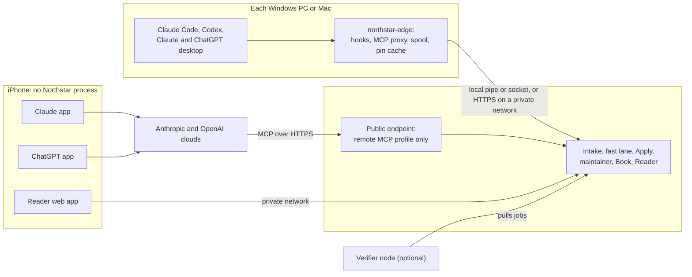

# Platforms and devices: Windows, iOS and Mac, many machines, one memory

**Status:** revision proposal for your approval. It answers your comment 1 of 2026-10-09 and your follow-up answers on devices and platform order. Nothing here is built. Written 2026-10-09.
**Authority:** [GOAL.md](../../GOAL.md) overrides this document; your answers of 2026-10-09 override everything earlier. No existing spec is edited; "Supersedes" lists what changes.
**Inputs:** [ARCHITECTURE.md](../ARCHITECTURE.md) §0, §2, §8, §9, §11, §14; [SPINE](../foundations/SPINE.md) §7, §8.4; [PL] [platform-security-privacy.md](../components/platform-security-privacy.md) §1–§4; [MT] [maintainer.md](../components/maintainer.md) §6.4; [CX], [HK] connector specs; [OBS] [desktop-observer-macos.md](../foundations/desktop-observer-macos.md); [10] in `docs/research/round2/`. The sibling [connector-strategy.md](connector-strategy.md) judges connector effectiveness; this document covers runtimes, platforms and devices only.
**Labels:** **(Unv)** marks an unverified fact and names its spike. **W1–W24** are facts verified today (§3). New IDs: spikes SP-PF-n, risks RISK-PF-n, questions PQ-n. No device-specific facts or personal data are recorded here.

---

## 0. Summary

1. **The design is Mac-specific in about 20 places** (§2): launchd, Unix sockets with peer checks, the Keychain, Touch ID, FileVault and the sparse bundle, Time Machine and Spotlight exclusions, Mac paths, the Accessibility observer, and a verifier sized for a 48 GB Apple-silicon Mac. All sit at the edge or in deployment, not in core logic.
2. **Each has a Windows equivalent, with three real tradeoffs:** weaker same-user peer identity on Windows IPC; no encrypted-volume fallback on Windows Home without BitLocker or Device Encryption; and verifier hardware (a large-memory GPU) that many Windows PCs lack.
3. **All four first connectors run on Windows** (W1–W13).
4. **On iOS three things cannot exist:** a Northstar process, a cross-app observer, and local MCP. Phone chat apps call tools from the vendor's cloud (W6, W8), so **Claude phone chat needs an endpoint reachable from the public internet; ChatGPT phone chat may not while a host is awake**, because ChatGPT chats run on a connected computer use that computer's MCP servers (W13; Unv for Northstar, SP-PF-17). Phone reading and phone-driven coding need no public endpoint.
5. **Recommended topology: one core, many edges.** One ledger and one Apply gate on one host; a small edge on each computer; nothing on phones. Where the core lives is a deployment setting.
6. **Per-device cores that sync the ledger are rejected:** two Apply gates break the single-writer rule, capped consolidation and hash-identical replay (§4.3).
7. **Stage order Windows, iOS, Mac** (§7). Windows runs the core on your PC, local only. iOS forces two decisions: where the always-on core lives, and whether a narrow public endpoint is allowed (PQ-1, PQ-2). The Mac joins as an edge and, with enough memory, as the verifier.
8. **"Local now" must be restated** (§4.6). We propose **"self-hosted now"**: everything on machines you control, no third-party Northstar service. **This touches the goal; PQ-2 asks you.**
9. **The verifier becomes a pull worker on a "verifier node"**, any machine you own that meets the floor. Without one, R12 applies, labelled not independent (§5).
10. **The Reader works on every device** as one web app, the phone included (§6).
11. **Cost:** about +9 to +15 builder-weeks (±50%) on 29–41; a rented host about $5–20 a month (Unv, SP-PF-11).

---

## 1. What this document decides

You asked us not to assume a Mac, to assess platform dependencies, and to state limits and tradeoffs. You added: many machines and potentially phones share one memory; order Windows, iOS, Mac, ranked close (GOAL §1, §2). This document decides the HOW for platforms, devices and deployment. Choices that expose your data or change "local now" go to you (PQ-1 to PQ-3).

---

## 2. Platform-dependency assessment

### 2.1 Every Mac-specific or Mac-assumed dependency

Effort: S < 1 builder-week, M 1–3, L > 3.

| # | Today (spec) | Windows | iOS | Effort | Limitation or tradeoff |
|---|---|---|---|---|---|
| 1 | **Supervision:** launchd LaunchAgents ([PL] §2.2) | Per-user Task Scheduler task at logon with restart on failure; a Windows service on an always-on host (admin once) (Unv, SP-PF-12) | No Northstar process | M | A logon task stops at sign-out; a service needs admin. Modern Standby may throttle work (Unv); the maintainer already catches up |
| 2 | **Local IPC:** Unix socket `run/core.sock`, 0700/0600, peer UID ([PL] §2.7) | **Named pipe** with a user-only DACL; Node speaks pipes natively (W20). Windows AF_UNIX exists, but third-party reports say credential passing is very limited (Unv). Loopback TCP plus credential stays the fallback (CX-S3) | — | M | Block pipe-name squatting (first-instance flag; SP-PF-1) |
| 3 | **Peer identity:** audit token plus code signature per message ([PL] §2.8, CX-S4) | Client process from the pipe, then an Authenticode or install-path check (Unv, SP-PF-2) | — | M | **Weaker than macOS.** Credential ceilings still cap claims (I20, I22); a hosted core takes the store off the PC (§4.4) |
| 4 | **Secrets:** Keychain ([PL] §2.9) | DPAPI, user-scoped, normally same computer (W21), or Credential Manager | Phone holds only a cookie and a passkey | S | Roaming profiles can decrypt elsewhere (W21); install refuses a roaming data root |
| 5 | **Step-up:** LocalAuthentication, Touch ID or password ([PL] §2.8) | Windows Hello via `UserConsentVerifier` (W22) | Face ID via a passkey | M | **Proposal:** one passkey (WebAuthn) step-up served by the Reader on every platform and for a hosted core; OS prompts stay local adapters (SP-PF-16) |
| 6 | **At rest:** FileVault, else APFS encrypted sparse bundle (PL-3) | BitLocker (Pro+) or Device Encryption (Home too, on supported hardware) (W23). **No volume fallback on Home without them:** app-level store encryption, key wrapped by DPAPI (Unv, SP-PF-4) | iOS Data Protection covers cached pages (Unv) | M | App-level encryption costs speed and may limit SQLite extensions. A rented host holds its keys while running (§4.6) |
| 7 | **No stray backups:** Time Machine exclusion ([PL] §2.5) | Data root in `%LOCALAPPDATA%`, not roaming or OneDrive-redirected; install checks OneDrive, File History and Windows Backup (Unv, SP-PF-5) | Small caches; backup inclusion Unv (SP-PF-16) | S | Copies we cannot see are reported, as today |
| 8 | **No indexing:** Spotlight marker | Compressed payloads; Windows Search exclusion if needed (Unv, SP-PF-5) | — | S | — |
| 9 | **Paths:** `~/Library/...` | `%LOCALAPPDATA%\Northstar\`; Linux host `/var/lib/northstar` | — | S | Records hold no absolute paths already (SPINE §7.5) |
| 10 | **Hook launcher:** symlink shim keeps Codex trust hashes ([HK] §3) | A native `.exe`: exec form needs a real executable (W4); Codex `commandWindows` (W11); shell hooks run in Git Bash, else PowerShell (W4) | — | M | Unsigned `.exe` may hit SmartScreen or antivirus (Unv, SP-PF-3). Agrees with [connector-strategy.md](connector-strategy.md): one compiled edge binary per OS |
| 11 | **`.mcpb` Node proxy,** `platforms: [darwin]`, `/usr/bin/open` ([CX] §4.1) | Add `win32`; Node is bundled on both (W1); pipe via Node (W20); link opening via the shell (Unv, SP-PF-14) | **Does not exist;** remote connectors only (W6, W16) | S | — |
| 12 | **Observer:** macOS Accessibility ([OBS]) | UI Automation reads other apps' UI (W24); Electron exposure Unv (CN-S3). **Not designed;** same ToS-grey status, DQ-1 consent | **Cannot exist** | L (5–8 per OS) | Only with your consent (DQ-1, PQ-4) |
| 13 | **Verifier:** 27–31B on MLX, Apple silicon about 48 GB ([MT] §6.4; P26) | Ollama or llama.cpp on NVIDIA or AMD (W18); dense 27B at 4-bit needs about 24 GB graphics memory (Unv); AMD Ryzen AI Max shared memory (Unv) (SP-PF-10) | **None** | M | Most Windows laptops cannot host it (§5) |
| 14 | **modeld** on `run/model.sock`; Ollama loopback-pinned | modeld on a pipe; Ollama on `localhost:11434` (W18); digest pin kept | — | S | S10 re-runs per runtime and quantisation ([MT] §6.5): one certificate per platform |
| 15 | **Reader** at `northstar.localhost`, launch via `/usr/bin/open` | Same name if browsers resolve `*.localhost` to loopback (Unv, SP-PF-6); launch via the shell | Private HTTPS web app (§6) | S–M | Passkeys need loopback or HTTPS (SP-PF-16) |
| 16 | **Relay client** under launchd ([PL] §3) | A service | — | S | Replaced by the iOS-stage endpoint (§4.4) |
| 17 | **Python and SQLite checks** (CDM PF-1; SP-1 wheels) | Re-run on Windows x64 and ARM64 (Unv, SP-PF-15) | — | S | Ship our own SQLite build if an option is missing |
| 18 | **Signing:** Developer ID | Authenticode, paid or locally trusted certificate (Unv, SP-PF-2) | — | S | — |
| 19 | **Managed devices:** MDM may block background items | Group Policy or app control may block unsigned binaries (Unv) | — | — | Existing employer rules (DQ-5) |
| 20 | **Sleep:** "while the laptop sleeps, the apps are not in use" (SPINE §7.4) | True for a lone PC | Phones chat while the PC sleeps | — | **False with phones and many machines;** drives §4 |
| 21 | **WSL** (absent) | Claude Code and Codex run in WSL 2; Claude Desktop's Code tab loads no plugins in WSL sessions (W2); a WSL Codex CLI has its own home (W9) | — | S | Target native Windows; WSL is an optional second edge install, else a labelled gap (SP-PF-13) |

The Mac column is "as designed" for every row.

### 2.2 What cannot exist, by platform

- **iOS:** no Northstar process (no core, edge, spool or verifier); no cross-app observer; no local MCP; no hooks in the chat apps. Phone chat reaches Northstar by a remote connector called from the vendor's cloud, except ChatGPT chats run on a connected computer, which use that computer's MCP servers (W13; Unv, SP-PF-17). Coding typed on the phone reaches it only through a session running on your computer (W5, W13).
- **Windows:** no macOS-grade peer code-signature check without a signing setup; no encrypted-volume fallback on Home without BitLocker or Device Encryption; no MLX. The rest has direct equivalents.
- **Mac:** nothing lost; the current design becomes its adapter.

### 2.3 Design rule: OS ports at the edge, an OS-blind core

- **OS ports**, each with macOS, Windows and Linux adapters: `Supervisor`, `LocalTransport`, `PeerIdentity`, `SecretStore`, `StepUp`, `AtRest`, `BackupGuard`, `Opener`, `Paths`, `ModelRuntime`.
- **An OS-blindness test** joins the product-blindness test (I23): the same fixtures on three OSes give hash-identical ledgers and projections.
- **Core CI on Windows, macOS and Linux.** Linux matters because a hosted core will most likely run it.

---

## 3. Product facts per platform

Checked 2026-10-09 unless stated. Runtime and platform facts only.

| ID | Fact | Source |
|---|---|---|
| W1 | Claude Desktop runs on macOS (`darwin`) and Windows (`win32`); an `.mcpb` declares both. Node is "Included with Claude Desktop on macOS and Windows". Extension directory listings are deprecated | https://claude.com/docs/connectors/building/mcpb |
| W2 | Claude Desktop: Windows x64 and ARM64 installers; Code-tab sessions can run in WSL 2, but "Plugins aren't available in WSL sessions" | https://code.claude.com/docs/en/desktop |
| W3 | Claude Code runs natively on Windows 10 1809+ without admin; Git for Windows optional (else the PowerShell tool); no sandbox on native Windows, sandbox in WSL 2; binaries signed by "Anthropic, PBC" | https://code.claude.com/docs/en/setup |
| W4 | Hooks run with "Git Bash on Windows, or PowerShell when Git Bash isn't installed"; "On Windows, exec form requires `command` to resolve to a real executable such as a `.exe`"; hooks fire in terminal, IDE, Desktop app and cloud sessions; `http` hooks post to a URL | https://code.claude.com/docs/en/hooks |
| W5 | Remote Control: the iOS or Android app drives a session on your computer, where "your filesystem, MCP servers, tools, and project configuration all stay available"; reconnects after sleep; Pro, Max, Team, Enterprise; not API keys | https://code.claude.com/docs/en/remote-control ; https://code.claude.com/docs/en/mobile |
| W6 | Custom connectors on Free (one), Pro, Max, Team, Enterprise. Claude connects "from Anthropic's cloud infrastructure, rather than from your local device", on every client including the mobile apps; the server "must be reachable over the public internet from Anthropic's IP ranges" | https://support.claude.com/en/articles/11175166 |
| W7 | MCP Apps on mobile render in `WKWebView` or `WebView`; "users must add a connector on web or desktop before it appears on mobile" | https://claude.com/docs/connectors/building/mcp-apps/design-guidelines |
| W8 | MCP tool calls "are proxied through Claude's backend and egress from Anthropic's published IP ranges, not the user's device" | https://claude.com/docs/connectors/building/mcp-apps/troubleshooting |
| W9 | ChatGPT desktop for Windows: Microsoft Store; "uses the Windows-native Codex agent" by default (PowerShell), or WSL 2; native sandbox; plugins and skills; config in `%USERPROFILE%\.codex`; a WSL CLI uses the Linux home unless synced or `CODEX_HOME` is set | https://learn.chatgpt.com/docs/windows/windows-app.md |
| W10 | Codex Windows sandbox: MXC (recommended, no admin), elevated (admin setup), unelevated (legacy) | https://learn.chatgpt.com/docs/windows/windows-sandbox.md |
| W11 | Codex hooks: "`commandWindows` is an optional Windows-only command override"; trust "against the hook's current hash"; hooks work "in local-only Work and Codex threads" | https://learn.chatgpt.com/docs/hooks.md |
| W12 | Codex CLI, IDE and desktop app share one MCP configuration; ChatGPT web "doesn't read local Codex configuration files" | https://learn.chatgpt.com/docs/extend/mcp.md |
| W13 | ChatGPT remote access "supports hosts running the ChatGPT desktop app on macOS and Windows"; host "awake, online, and signed in"; MCP servers come from the host. Codex on mobile runs in the cloud or on "a connected Mac or Windows PC" | https://learn.chatgpt.com/docs/remote-connections.md ; https://learn.chatgpt.com/docs/mobile.md |
| W14 | "Plugins work in Chat and Work across ChatGPT on the web, desktop, and mobile"; "Desktop only" plugins are not on mobile | https://learn.chatgpt.com/docs/plugins.md |
| W15 | **Conflict (Unv, SP-PF-7 = CN-S5):** on 2026-10-08 the help article said MCP apps are "web only" ([GD] V1); today it returned HTTP 403. The custom MCP guide covers "ChatGPT on the web", read and write tools, writes confirmed | https://developers.openai.com/api/docs/guides/custom-mcp-server |
| W16 | In Claude Chat (web, desktop, mobile): skills load; hooks and local MCP "Ignored"; remote MCP listed on the Connectors tab | https://claude.com/docs/plugins/platform-support |
| W17 | Claude MCP tunnels are Enterprise only (SPINE P35, 2026-10-08, not re-checked) | https://claude.com/docs/connectors/mcp-tunnels/overview |
| W18 | Ollama on Windows 10 22H2+, Home or Pro; NVIDIA and AMD GPUs; serves `localhost:11434`; can run as a service; ARM64 not mentioned | https://docs.ollama.com/windows |
| W19 | Tailscale Funnel: the device "terminates the TLS connection"; relays "do not decrypt the traffic"; ports 443, 8443, 10000; all plans; beta | https://tailscale.com/kb/1223/funnel |
| W20 | Node: "On Windows, the local domain is implemented using a named pipe" | https://nodejs.org/api/net.html |
| W21 | DPAPI: normally only the same user decrypts, on the same computer; roaming profiles excepted | https://learn.microsoft.com/en-us/windows/win32/api/dpapi/nf-dpapi-cryptprotectdata |
| W22 | `UserConsentVerifier` checks with Windows Hello or PIN; desktop apps use a window-handle interop call | https://learn.microsoft.com/en-us/uwp/api/windows.security.credentials.ui.userconsentverifier |
| W23 | BitLocker on Pro, Enterprise, Education; Device Encryption also on Home; needs TPM and Secure Boot | https://support.microsoft.com/en-us/windows/device-encryption-in-windows-cf7e2b6f-3e70-4882-9532-18633605b7df |
| W24 | UI Automation "provides programmatic access to most UI elements on the desktop" | https://learn.microsoft.com/en-us/windows/win32/winauto/entry-uiauto-win32 |

Also: iOS 16.4 Home Screen web apps open standalone (https://webkit.org/blog/13878/web-push-for-web-apps-on-ios-and-ipados/). AMD's shared-memory figures come from a search summary of amd.com (page timed out): (Unv, SP-PF-10).

**What follows.** Windows has every first connector at the Mac tiers (hooks for code, tool calls for chat); all desktop spikes re-run there (SP-PF-14). On iOS, Claude chat works by remote connector with widgets; ChatGPT chat may work through a connected computer (W13; SP-PF-17), and natively is unknown (SP-PF-7). Coding typed on the phone keeps hook quality, because the session runs on your computer (hooks firing there: Unv, SP-PF-9).

---

## 4. One memory across many machines and phones

### 4.1 Four facts that shape the topology

1. **Phone chat apps call tools from the vendor's cloud** (W6, W8); a VPN on the phone does not help. The exception is a ChatGPT chat run on a connected computer (W13; SP-PF-17), which needs that computer awake.
2. **The AI products need the internet anyway.** "Offline" mostly means "core unreachable while the internet works", which a reachable host removes.
3. **Laptops sleep; phones do not.** With phones, the core must be up when your computer is not.
4. **Apply must stay the single writer** (ARCH §8): robust maintenance, capped merges (I12, I13) and hash-identical replay (I18) assume one ordered ledger.

### 4.2 The options compared

| Criterion | **A1. Core on an always-on machine you own** + edges | **A2. Core on a rented VM you control** + edges | **B. A core on each device**, syncing the ledger | **C. Core on your workstation** + tunnel |
|---|---|---|---|---|
| Sleeping laptops | Edges spool and forward on wake | Same | Fine alone; merging is the problem | Others lose Northstar while it sleeps |
| Phones | Chat via a narrow public endpoint; Reader via your private network | Same | Unreachable unless one core is always on (then A) | Only while it is awake |
| Privacy | Data on hardware you own; tunnel in transit | Data at a provider; the running VM holds the keys | Copies on every device | Data on your PC |
| Conflicts | One Apply; immutable, idempotent observations | Same | Two Applys race on merges; Books diverge | One Apply |
| Offline capture | Edge spool | Edge spool | Native | Edge spool |
| Cost (Unv, SP-PF-11) | Power; a spare machine or the PC left on | About $5–20 a month; GPU hosts far more | Models and slow lane on every device | Lowest |
| Complexity | Medium | Medium, plus host hardening | **High:** sync and consensus | Low until phones join |
| Robust maintainer | One maintainer, always on | Same | Maintainers can diverge: fails GOAL §4.7 | Pauses while the PC sleeps |
| **Verdict** | **Recommended** | **Alternative**, needs your yes (PQ-2) | Rejected (§4.3) | Fine for the Windows stage only |

### 4.3 How the single-writer Apply survives (why B is rejected)

- **One device as "ledger home",** others replicas: that is A or C with more copies.
- **Every device runs Apply** and ledgers merge: merges, splits and re-parents (J5, J8c) race; Book structure is path-dependent (TEXTBOOK §7.2), so editions diverge; hash-identical replay needs one total order, so devices must agree, and sleeping devices cannot form a quorum without an always-on member, which is A.

**Rule adopted:** exactly one ledger home. Moving it is an explicit migration like `northstar cloud migrate` ([PL] §4.3), never automatic failover; a stale home that wakes is refused by a fencing token. B's strengths are kept inside A: capture never waits on the core (edge spool), and an optional read-only page cache serves offline reading (§6).

### 4.4 Recommendation: one core, many edges

| Machine | Runs | Never runs |
|---|---|---|
| **Core host** | Intake, session and continuity engines, Apply, maintainer, Book, Reader, backups; from the iOS stage, the public endpoint | Product logic (I23) |
| **Each computer** | `northstar-edge`, one native binary per OS and the only local endpoint connectors use: pass-through when the core is local; with a remote core, it forwards over HTTPS and keeps the encrypted spool and pin cache. Plus hook config, MCP proxy, `.mcpb` | Apply, ledger, Book stores |
| **Verifier node** (optional) | `northstar-modeld`, pulling verification and judge jobs over the private network | Apply; it writes only through the job table |
| **Phone** | Nothing: chat apps call the public endpoint from the vendor cloud; the Reader is a web app; phone-typed coding runs on a computer's edge | — |

**Why this shape.**
- **Connectors never change when the core moves;** they always talk to the local edge. The forwarder planned for "cloud later" ([PL] §4.2) is built in the Windows stage.
- **Hook latency holds:** the pin comes from the edge cache (p95 ≤ 300 ms; PT-6 already injects 80 ms).
- **Security improves, within limits:** with the core elsewhere, a prompt-injected coding agent (T14) cannot read the store files. It can still read whatever the session's tool profile returns, because hook-tier sessions see `northstar_fetch` and `northstar_book` through `pull_fallback` ([HK] D-HK-5) and the edge holds a device credential. So the hook-tier profile is restricted: `northstar_fetch` and `northstar_book` return only items in the session's project scope and items delivered to that session, under a per-session read budget (start: 30 items an hour); RT-17 gains a bulk-read case through the tools.
- **The robust-maintainer case is unchanged:** one Apply, one job table, one sentinel registry.

**Conflicts and order.** Edges send immutable observations with ULIDs and idempotency keys (I14). **Apply stays the single serialization point**, but meaning follows when words were said, not when they arrived: each message's `occurred_at` ([SPINE] §5.2) comes from the edge clock, corrected by an offset the core measures at every handshake and bounded like I16 (never later than its receipt at the core, never earlier than the edge's last handshake before it). An edge spool can hold observations for 48 hours or more while phones and other machines write live, so a late observation that is older than an active item on the same key (a stance on one position, a goal, a constraint, a pin) is **inserted into history and never supersedes it**; J5 sets supersession direction by `occurred_at`, never by arrival. Fault "late spool inversion" joins [MT] §8, and Stage I has a gate for it (§7). Corrections from two devices are serialized under the existing rules ([CDM] §7). A session moved between devices (Remote Control, teleport, `/desktop`) stays one session through the existing content-hash joins.

### 4.5 Devices: join, offline, revoke, excise

- **Join once per device:** `northstar join` shows a code; you approve it once in the Reader with a passkey; the core mints device and per-connector credentials. Nothing recurs (GOAL §4.1).
- **Work devices:** a device you mark "work" captures into work scope only and receives no personal items (DQ-5 rules). This holds for connectors that go through the edge.
- **Offline:** the edge spools until the core acknowledges, plus 48 hours; a size cap raises a footer state; nothing is silently dropped. A new chat while the core is unreachable gets one line, "Northstar unavailable", as today.
- **Revoke:** in the Reader. The core refuses the credential at once; edge caches, encrypted under a device key the core wraps, are crypto-shredded when the device next connects.
- **The remote connector bypasses the edge.** Phone chats, the web and, if you opt in, Claude Desktop chat call the public endpoint from the vendor's cloud with an account-level OAuth token and no device identity (W6, W8). So device marking, device revoke and spooling do not apply there: remote capture is scoped by the account you declared (DQ-2); revocation is per vendor (the core revokes that vendor's OAuth grant, and you can disconnect the connector in the vendor's settings, W6); and turns made while the host is down never reach Northstar. Those turns can be recovered only from an export, which is a manual step for these accounts ([CN] M6): optional, never required, and the gap is reported. For these reasons Claude Desktop chat keeps the local `.mcpb` through the edge on any device marked "work" or where device scoping matters; moving it to the remote connector is an opt-in per device (DQ-13).
- **Excision** purges every reachable device's registered stores; an offline device stays "pending purge" in the report until it reconnects.

### 4.6 What "local now, cloud later" means now

| | Before (ARCH §9; SPINE §7.7) | Proposed |
|---|---|---|
| Where the memory lives | This Mac | One core on a machine **you control**: your Windows PC first; from the iOS stage an always-on machine you own (A1) or a VM you rent (A2) (PQ-1) |
| Who can call in | Local clients; a relay only if CS2 fails | Windows stage: local only. iOS stage: your devices over a private network, plus vendor clouds through one endpoint serving only the remote profile, under its own hostname (PQ-2, PQ-3) |
| Copies elsewhere | None | Encrypted, short-lived edge spools and caches and the phone's page cache, all reached by excision |
| Model calls | DQ-3 | Unchanged |
| "Cloud later" | Postgres, object storage, OAuth, tenants | Same design, now meaning a managed or multi-tenant service; OAuth, forwarder and public endpoint arrive earlier |

**Plainly:** phones force an always-on core that vendor clouds can reach, so "local now" can no longer mean "one Mac". We propose **"self-hosted now"**. Under A2 your data sits at a hosting provider, which is "cloud" in your words. Both touch GOAL §4.6, so PQ-2 asks. Until you answer, the Windows stage runs local only and phone chat does not ship.

---

## 5. The local verifier and other local models

| Class | Hosts the 27–31B verifier? | Notes |
|---|---|---|
| Mac, Apple silicon, about 48 GB+ | Yes (design target) | MLX or Ollama ([MT] §6.4) |
| Windows desktop, GPU about 24 GB+ | Likely (Unv, SP-PF-10) | Ollama or llama.cpp, NVIDIA or AMD (W18) |
| AMD Ryzen AI Max box, 64–128 GB | Likely (Unv, SP-PF-10) | Large shared graphics memory; runtime maturity Unv |
| Typical laptop, 16–32 GB, integrated graphics | No | Edge only |
| Windows on ARM | Unknown (Unv) | Ollama does not mention ARM64 (W18) |
| Phone; rented CPU VM | No | A GPU VM costs far more (Unv, SP-PF-11) |

**Rule: verification is a core role that runs on a verifier node.** The job table already uses leases, so a sleeping node simply resumes; the core never assumes co-location.
- **Best:** the always-on host (A1) meets the floor and verifies beside the core.
- **A2:** a home node pulls jobs over the private network when awake; verification lags while it sleeps (lag is already a sentinel, [MT] §7).
- **No node:** R12 applies automatically: the workers' vendor checks, labelled not independent; check 4 at 20%; budgets 1%; independence "not certified" (RISK 18).
- **In-turn re-judging of Claude replies** needs an awake node; otherwise only code verdicts count as independent ([MT] §9.2).
- **One S10 certificate per platform** and runtime ([MT] §6.5).

**Other local models.** The embedder is small and runs on the core host's CPU (Unv, SP-1). Profile D (all local) needs a large GPU on the host or node, so it fits A1. **Should verification live on the hosted core?** Logically yes (routing, budgets and certificates are the core's); physically, where the hardware is. We do not recommend renting a GPU host: costly, and a new provider sees content (a DQ-3(d)-style question for you).

---

## 6. The human Reader on every device

One Reader web app served by the core; no native apps.

| Device | How | Notes |
|---|---|---|
| Windows or Mac, core local | Browser at `northstar.localhost` via a one-time launch token ([PL] §2.8) | SP-PF-6 |
| Windows or Mac, core hosted | HTTPS on your private network, passkey sign-in | No public Reader by default. The Reader never shares a hostname with the public endpoint: cookies are not isolated by port (RFC 6265 §8.5) and passkeys bind to the hostname, so a separate listener alone does not separate them (PQ-3) |
| iPhone | Added to the Home Screen; opens standalone; private network | Layout from 320 points; one-click corrections; Face ID passkey for destructive actions |
| In chat | Book slices and re-encounter cards through the widget in Claude on iOS (W7); elsewhere as today | Uneven by product (TB H14) |

- **Offline reading:** the phone keeps last-opened pages for 7 days, purged when the excision epoch changes; listed until confirmed.
- **No notifications:** footer states only (UQ-19 unchanged).
- **Markdown mirror:** desktop only, opt-in; install refuses OneDrive- or iCloud-synced folders, which excision cannot reach.
- **Page format is device-independent** (TEXTBOOK §10); the phone layout is a stylesheet.

---

## 7. Revised stage order: Windows, then iOS, then Mac

Platform work is reordered inside the existing stages ([EV] §5.1); the connector order is unchanged. Baseline-first measurement belongs to the evaluation revision; each stage reports platform cells separately.

| Stage | Platform scope | Must deliver | Exit gates | Added (±50%) |
|---|---|---|---|---|
| **0a Spikes** | Windows first | CD-S1/S2/S3/S13 and CX-S3 on Claude Desktop for Windows; CS1–CS7 on the Windows ChatGPT app; HK spikes on native Claude Code and the Codex Windows app (SP-PF-13, -14); SP-PF-1 to -6, -12, -15; S10 screening on available hardware (SP-PF-10) | Each spike has a record or "awaiting go-ahead" | +1 |
| **W (0b–3) Windows prototype** | Core on your Windows PC, local only | OS ports with Windows adapters; native edge binary; named pipes; DPAPI; at-rest check or app-level encryption; passkey and Windows Hello step-up; four connectors on Windows; Reader v0/v1; OS-blindness test; core CI on Windows and Linux. If CS2 fails on Windows, ChatGPT Desktop chat needs the relay or the iOS-stage endpoint early (DQ-4(iii)) | Existing Stage 0b–3 gates, in Windows cells | +4 to +6 |
| **I. iOS and many machines** | Core on the always-on host chosen in PQ-1 | Host deployment; public endpoint with OAuth 2.1, remote profile only; tunnel; device join and revoke; multi-device excision; Claude iOS connector and widget (SP-PF-8); ChatGPT iOS through a connected computer if SP-PF-17 passes, natively if SP-PF-7 passes; phone-driven coding (SP-PF-9); phone Reader (SP-PF-16); **a second computer joins** | **Cross-device continuity cell** (PC 1 → PC 2 → phone); **late spool inversion** (a laptop offline 24 hours, you revise a view on the phone, the laptop reconnects: the phone's view stays current); excision reaches every device or lists pending ones; public-endpoint red-team tests; pin p95 ≤ 300 ms through the forwarder (PT-6) | +3 to +6 |
| **M. Mac** | Mac as edge; optionally verifier node or core host | macOS adapters (largely specified); `.mcpb` for `darwin`; S10 on Apple silicon if present; observer only if DQ-1 | Same suites in Mac cells; OS-blindness across three OSes | +1 to +2 (observer +5 to +8, unchanged, only if DQ-1) |
| **5 Evaluated prototype** | All three | [EV] §6 plus per-platform and cross-device cells | [EV] §6 checklist | — |

**Total:** about +9 to +15 builder-weeks on 29–41: roughly 38–56 with the observer, 33–48 without. In-app calibration checkpoints become per app and per OS (more typing hours, Unv). Because the ranking is close, a Mac that passes S10 can serve as verifier node during Stage W or I without changing the order.

---

## 8. New spikes

| ID | Question |
|---|---|
| SP-PF-1 | Can the Python core serve a user-only named pipe that Node and the edge reach within budget? |
| SP-PF-2 | Can the core identify a pipe client by process and Authenticode or install path, per message, within the hook budget? |
| SP-PF-3 | Windows hook p95: native edge vs Python; Git Bash, PowerShell or exec form; antivirus on (with CN-S1) |
| SP-PF-4 | Detect BitLocker or Device Encryption without admin; app-level store encryption and WAL performance |
| SP-PF-5 | Is `%LOCALAPPDATA%\Northstar` copied by OneDrive, File History or Windows Backup, or indexed by Windows Search? |
| SP-PF-6 | Do Edge and Chrome resolve `northstar.localhost` to loopback; do launch token and passkey work? |
| SP-PF-7 | Does a personal custom-MCP or Sites plugin work in the ChatGPT iOS app? (= CN-S5) |
| SP-PF-8 | Claude iOS with a remote Northstar connector on a personal plan: appears after desktop setup; boot-line call rate; widget context reaches the next turn |
| SP-PF-9 | Do hooks fire for phone-typed turns under Remote Control and Codex remote on a Windows host? (= CN-S6) |
| SP-PF-10 | S10 on available Windows hardware via Ollama or llama.cpp; which classes pass; AMD shared-memory facts |
| SP-PF-11 | Tailscale Funnel, Cloudflare Tunnel or Secure MCP Tunnel reachable by both vendors; OAuth completes in both; p95 ≤ 1.5 s; host costs. Also: can the endpoint run under its own Funnel hostname (a separate node or tsnet name), and can it be restricted to Anthropic's published egress ranges and to OpenAI's, if published (Unv)? |
| SP-PF-12 | Logon task vs service under Modern Standby and update restarts |
| SP-PF-13 | Codex on Windows: `commandWindows` hooks in the app and CLI; trust survives updates (HK-S12; with CN-S2); WSL coverage |
| SP-PF-14 | Claude Desktop for Windows: CD-S1, -S2, -S3, -S13 and CX-S3 (credential file, pipe, link opening) |
| SP-PF-15 | PF-1 and SP-1 on Windows x64 and ARM64 |
| SP-PF-16 | Phone Reader over a private network: passkey step-up, cache purge, inclusion in device backups |
| SP-PF-17 | ChatGPT on a connected computer: does a ChatGPT chat started from the iOS app on a connected Windows host call the host's local Northstar MCP server, in which mode (Chat or Work), and do hooks fire? (W13; [CN] N19) |

---

## Supersedes

| File and section | What changes |
|---|---|
| ARCHITECTURE §0, §2 diagram | "Runs on your Mac" and "core on the Mac" become one core on a host you control, an edge per computer, phones through vendor apps (§4.4) |
| ARCHITECTURE §0.1 (observer, Profile D, local verifier) | Observer designed for macOS only, none on iOS; Profile D and the verifier run on machines you control, the verifier on a node (§5) |
| ARCHITECTURE §8 table ("Touch ID or password") | Passkey step-up via the Reader; OS prompts as local adapters |
| ARCHITECTURE §9 ("Local now", "Cloud later", "What leaves the Mac") | Replaced by §4.6; "What leaves machines you control"; the relay is subsumed by the iOS-stage endpoint |
| ARCHITECTURE §11 | Platform order and +9 to +15 builder-weeks (§7) |
| ARCHITECTURE §14 DQ-3, DQ-4(iii), DQ-5(a), DQ-9, DQ-11 | DQ-3 reads "What may leave machines you control". DQ-4(iii) becomes PQ-3 from the iOS stage. DQ-5(a)'s floor is per platform (§5); its location question merges into PQ-1. DQ-9's premise ends at the iOS stage, but vendor limits on cloud sessions remain ([HK] HP20, HP28): re-ask after Stage I. DQ-11's backup drive belongs to the core host |
| SPINE §7.1–§7.2 | launchd and Unix sockets become macOS adapters of OS ports (§2.3) |
| SPINE §7.3, §7.4 | Phones need an internet-reachable endpoint; "local capture loses nothing while the laptop sleeps" holds only for a lone computer |
| SPINE §7.5, §7.7; Appendix B P26 | Forwarder moves to the Windows stage as `northstar-edge`; §7.7 replaced by §4.6 pending PQ-2; hardware target per platform |
| [PL] §0, §1 B1, §2.1–§2.10 | Become the macOS adapter of OS ports; Windows and Linux adapters added (§2.1); step-up moves to passkeys |
| [PL] §3, §4.1–§4.2 | Relay replaced by the iOS-stage endpoint (earlier only if CS2 fails on Windows); OAuth, HTTPS Reader and forwarder arrive at the iOS stage |
| [CX] §4.1, D8 | `platforms` adds `win32`; `LocalTransport` (named pipe on Windows); link opening per OS |
| [HK] §3, §14.3 | Native launcher per OS (`%LOCALAPPDATA%\Northstar\bin\` on Windows); Codex `commandWindows`; exec-form hooks |
| [MT] §6.4 | Per-platform verifier classes; a verifier node that pulls jobs; runtime per platform |
| [MT] §8; [SPINE] §5.2 (Message, Supersession) | New fault "late spool inversion"; supersession direction and current-item choice by `occurred_at` with a handshake-corrected edge clock, never by arrival (§4.4) |
| [HK] §13 (D-HK-5); [CX] §2; [PL] §7 RT-17 | Hook-tier `northstar_fetch` and `northstar_book` limited to the session's project scope and delivered items, with a per-session read budget; RT-17 adds bulk reads through the tools (§4.4) |
| [PL] D-PL-2 | The public endpoint gets its own hostname, passkey RP ID and no Reader cookies, plus a source-IP allowlist where the tunnel allows (PQ-3) |
| [CDM] §10.4 (PF-2) | Time Machine becomes the macOS case of `BackupGuard` |
| [OBS] scope | Stays macOS; a Windows backend is not designed (PQ-4) |
| [EV] §5.1–§5.2 | Stages reordered by platform; per-platform and cross-device cells |
| TEXTBOOK §10 | Reader also over HTTPS on a private network and as a phone web app (§6) |

---

## Open questions for the user

**PQ-1. Where should the one core live once phones join?** *Before the iOS stage.* (a) An always-on machine you own: your Windows PC left on, if it is a desktop, or a small home machine. (b) A small VM you rent and control. (c) Your main computer plus a tunnel; phones and other machines lose Northstar while it sleeps. **Recommendation: (a)**, ideally a machine that also meets the verifier floor (§5); else (b), which needs your yes in PQ-2. *Until you answer:* the Windows stage runs local only; phone chat does not ship.

**PQ-2. What does "local now" allow?** *Touches the goal (GOAL §4.6). Before the iOS stage.* (a) "Self-hosted now": everything on machines you own, plus one narrow public endpoint called by the Claude and ChatGPT clouds, serving only the remote tool profile behind OAuth. (b) As (a), but the core may sit on a rented VM. (c) No public endpoint: phones get the Reader over your private network and coding through your computer, but no Northstar in phone chat apps. **Recommendation: (a)**; (b) only if you pick a VM in PQ-1. *Until you answer:* (c), reported "narrowed until PQ-2".

**PQ-3. Which tunnel may carry phone-chat traffic?** *Only under PQ-2 (a) or (b); replaces DQ-4(iii).* Tailscale Funnel ends TLS on your machine, so its relays cannot read content (W19); it is in beta. Funnel "can only use DNS names in your tailnet's domain" (https://tailscale.com/kb/1223/funnel, checked 2026-10-09), so the endpoint gets **its own node name** (a separate Tailscale node or tsnet hostname), with its own passkey RP ID and no Reader cookies, and is restricted to Anthropic's published egress ranges where the tunnel allows (Anthropic asks remote-connector servers on private networks to allowlist them: https://support.claude.com/en/articles/11175166, checked 2026-10-09) and to OpenAI's if published (Unv, SP-PF-11). Cloudflare Tunnel ends TLS at Cloudflare ([PL] §3.2). OpenAI's Secure MCP Tunnel serves ChatGPT only; Claude's tunnels are Enterprise only (W17). **Recommendation:** Tailscale Funnel for both vendors, Secure MCP Tunnel as ChatGPT's fallback, Cloudflare only if both fail SP-PF-11.

**PQ-4. The observer on Windows.** A UI Automation backend is possible but not designed, with the same ToS-grey exposure as DQ-1. **Recommendation:** not in the Windows stage; decide after the Windows desktop-chat spikes (SP-PF-14). *Until you answer:* not built.

**PQ-5. Phones beyond iOS.** Android is largely the same on the Claude side (W5, W7). **Recommendation:** iOS only in the prototype; the design stays Android-ready at no extra core cost. *Until you answer:* iOS only.

Hardware is not asked here. Stage 0a records locally which of your machines pass S10, never in the repo; if none does, R12 applies until one joins.

---

## Risks

| ID | Risk | GOAL | Mitigation |
|---|---|---|---|
| RISK-PF-1 | Weaker Windows peer identity: same-user code can pose as a connector | §4.7, §5 | Credential ceilings (I20, I22); user-only pipes, first instance; hosted core takes the store off the PC; SP-PF-2 |
| RISK-PF-2 | Public endpoint attack surface: OAuth bugs, scanning, injected calls | §5 | Remote profile only, on its own hostname (a separate node or tsnet name; its own passkey RP ID; no Reader cookies), not merely a separate listener ([PL] D-PL-2); source-IP allowlist of the vendors' published egress ranges where the tunnel allows (SP-PF-11); passkey consent; rate limits; kill switch; no Reader or admin there; red-team tests |
| RISK-PF-3 | Always-on host down (power, internet, updates): phone chats and maintenance pause | §3.3, §4.7, §6 | Auto-restart; fast "unavailable"; edge spools for local connectors; footer states. The remote connector has no spool: turns made in phone (or opted-in remote) chats while the host is down never reach Northstar, and come back only through an export you run by hand, an optional manual step; otherwise they are reported missing, not silently dropped |
| RISK-PF-4 | No machine meets the verifier floor: independence not certified | §4.7 | R12 automatically; node when one joins; per-platform S10 |
| RISK-PF-5 | More copies on more devices; offline or lost devices delay excision | §4.6 | Device-key crypto-shred; short cache lifetimes; "pending purge" per device |
| RISK-PF-6 | Spikes and calibration per OS; apps update separately per OS | §4.8 | Per-OS cells and budget (§7); spikes re-run on updates; OS-blindness test |
| RISK-PF-7 | ChatGPT on iPhone may get no Northstar (W15) | §4.6, §3.3 | ChatGPT chats on a connected computer may reach the host's local server while it is awake (W13; SP-PF-17); SP-PF-7 for phone-native chats; Codex from the phone still works through the PC (W13); reported "not met" only if both routes fail |
| RISK-PF-8 | Windows friction: shells, antivirus latency, SmartScreen, WSL sessions without plugins | §4.1, §3.3 | One native edge binary; exec form; SP-PF-3, SP-PF-13; WSL gap labelled |
| RISK-PF-9 | Restating "local now" could read as a reframe | §7 | Asked as PQ-2; nothing adopted |
| RISK-PF-10 | On a rented VM the provider could reach plaintext | §4.6 | A1 preferred; A2 only with your yes; `private` items stay on machines you own |
| RISK-PF-11 | A start pack crossing the network slows the first reply | §4.1, §3.3 | Precompiled packs ([AC]); edge cache; budgets measured at the iOS stage |
| RISK-PF-12 | Phone page cache enters device backups beyond excision | §4.6 | Small cache, 7-day lifetime; SP-PF-16; listed in excision reports |

---

## Goal-fidelity check

| GOAL item | How this document touches it | Status |
|---|---|---|
| §1 foundation 4: ChatGPT, Claude, Codex | All four first connectors on Windows; Claude chat on iOS by remote connector; ChatGPT on iOS through a connected computer or natively, both Unv (SP-PF-17, SP-PF-7) | **Partial** (RISK-PF-7) |
| §3.1 Shared core, both sides | One ledger and one Apply across devices; edges only capture | **Met by design** on computers; phones as connectors allow |
| §3.2 Human textbook | One Reader on every device, phone included; no quiz | **Met by design** for access; Book risks unchanged |
| §3.3, §4.5 Focus and continuity, equally | Unchanged per connector; continuity across devices measured; phone chat depends on PQ-2 | **Partial** (RISK 4, RISK-PF-3, -7) |
| §3.4, §4.7 Robust maintainer | Single Apply with fencing; verifier as pull worker; R12 without a node | **Partial** (RISK 6; RISK-PF-4) |
| §4.1 No rituals | One-time join per device; nothing recurs | **Met by design**, existing per-chat risks aside |
| §4.2, §4.3, §4.4 | Unchanged; phone chat is tool-call tier | As before |
| §4.6 Platforms, devices, local now | OS ports, OS-blind core; order as asked; one core, many edges; "local now" restated for you | **Partial:** Windows and Mac by design; iOS partly; PQ-2 pending (**touches the goal**) |
| §4.8 Built and evaluated | Per-platform and cross-device cells; +9 to +15 builder-weeks | **Planned** |
| §5 Injection, privacy | Public-endpoint and Windows peer-identity risks named and mitigated | **Partial** (RISK-PF-1, -2) |
| §6 Success measured | Each criterion per platform; cross-device continuity | **Planned** |
| §7 Reframing needs the user | PQ-1 and PQ-2 asked, not adopted | **Checked** |
