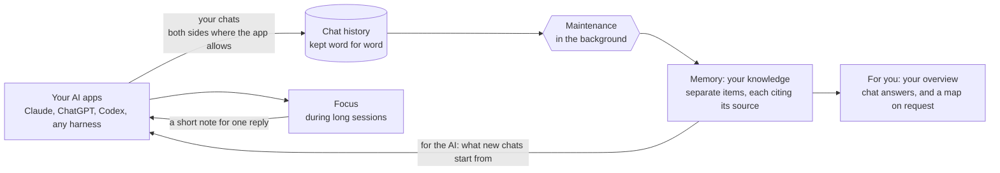

# Northstar: the revised design

**Status:** the baseline, version 3.4: version 3.3 of 2026-10-28, with the route of §1.4 revised on 2026-10-29. The design is settled, and the prototype is built from this version (§9, §10); the build has started and follows §10. [GOAL.md](../../GOAL.md) overrides this document.
- **Round 1, 2026-10-24.** You approved version 1 with changes: an architecture for the AI and for you, something like OpenAI's "dreaming", a focus that brings its own intelligence, research behind every part, and this Mac first.
- **Round 2, 2026-10-24.** You confirmed the new focus, approved going ahead, and asked that Northstar run on the AI you already use, and that "dreaming" mean ChatGPT's Dreaming memory system, not sleep.
- **Round 3, 2026-10-25** (GOAL §1, §2). You explained that ChatGPT's Dreaming was a reference, not something to copy literally: Northstar has memory structures for the AI and for you, helps with focus and memory, and "still works with existing AI like ChatGPT and Claude, it is not on its own". You also:
  - left the route to the AI to us;
  - allowed Claude and ChatGPT to check each other;
  - chose your website work plus chats you add for the sketches;
  - are not sure yet about the phone.
- **Version 3.2, 2026-10-25,** led with that positioning and kept ChatGPT's system as the reference (§1.5). It called the background process **maintenance**, your word for job 3, decided the route (§1.4), and turned on cross-vendor checks. It still revises the 2026-10-09 design ([ARCHITECTURE.md](../ARCHITECTURE.md)) and keeps its connector, platform and maintainer work (§12).
- **2026-10-28** (GOAL §1, §2). You approved the memory architecture as written ([MEMORY-ARCHITECTURE.md](MEMORY-ARCHITECTURE.md)), so its three §10 leans are decisions. Then you closed the design phase:
  - research decides the design, not your reactions; each research question ends in a decision; build a baseline, then improve it by measuring;
  - your overview is chat first, map on request (note 27 §4);
  - the tests use published benchmarks, automatic checks and measures from normal use instead of your blind picks, and any session with you is optional.
- **Version 3.3, the baseline,** recorded those decisions: the overview in §6 and §9, the tests in §8, what the build needs from you in §9, and build, then measure, in §10.
- **2026-10-29** (GOAL §1, §2). You gave the go-ahead for your sessions, marked your personal folders, and asked that Northstar run on Claude Desktop, ChatGPT desktop "or whatever harness it is on", since separate API keys and spend "kind of defeat the purposes". **This version, 3.4,** moves the hidden sub-tasks to the harness you use, on your own plans (§1.4), and changes §9, §10, §11 and §13 to match.

**Review page (version 3.2, kept as a record):** [`review.html`](review.html), published as a private page; the link is in [EXPLORATION.md](../../EXPLORATION.md).

**Reviews:** versions 1 to 3.2 each had a goal-fidelity pass and an adversarial review by a different model (Sonnet 5.5). Version 3's review found 4 blocking issues, all fixed in 3.1: unproven separations, an unasked reversal of the API default, a ChatGPT comparison that implied unpublished internals, and a wrong statement about your marks. Version 3.2 records your round-3 answers. Version 3.3 had the same on 2026-10-28: four reviewers (Sonnet 5.5) and a verifier (Opus 5.5) confirmed 37 findings, one of them blocking (§1.2's refresh example still assumed a plan had happened, against the approved "no later record" rule). All were fixed.

**Evidence tags:**
- **E2, E3** = [EXPLORATION.md](../../EXPLORATION.md) §2 (the probes) and §3 (the sketch rounds).
- **Notes 01–27** are in [`docs/research/`](../../research/); the newest are [27](../../research/round6/27-overview-medium.md) (where your overview appears), [26](../../research/round6/26-best-form-synthesis.md) (its best form), [25](../../research/round6/25-overview-display.md) (how to show your overview), [23](../../research/round5/23-memory-architecture-and-dreaming.md) (memory architectures and dreaming), [24](../../research/round5/24-focus-intelligence-evidence.md) (focus through the AI), [21](../../research/round5/21-focus-prior-art.md) and [22](../../research/round5/22-surface-facts.md). §8 starts from [09](../../research/09-evaluation-and-failure-modes.md) (evaluation and failure modes).
- **[MA]** = [MEMORY-ARCHITECTURE.md](MEMORY-ARCHITECTURE.md), approved 2026-10-28: the data structures and algorithms behind §1, §4 and §5. Where [MA] §4.7 and §4.8 call the overview's display or the expand step open, §6 of this version decides them; [MA]'s structures are unchanged.
- The 2026-10-09 documents reused here: [CN] connectors, [PF] platforms, [KO] knowledge organization, [PR] relevance, [BM] benchmark ([`revision-2026-10-09/`](../revision-2026-10-09/)); [MT] maintainer, [HK] hook connectors, [CX] desktop and MCP, [IS] in-session, [AC] continuity, [CDM] data model, [PL] platform and privacy ([`components/`](../components/)); [SPINE] ([`foundations/SPINE.md`](../foundations/SPINE.md)); [TB] the textbook ([`foundations/TEXTBOOK.md`](../foundations/TEXTBOOK.md)).
- §14 maps each part to its research.

---

## 0. On one page

**What Northstar is.** A memory and focus layer for the AI you already use.
- **Like ChatGPT's Dreaming memory system,** it gives your AI memory that builds up in the background (§1.5).
- **Unlike it,** it does three more things:
  - it works across all your AIs (Claude, ChatGPT, Codex or any harness);
  - it keeps memory structures for the AI and for you;
  - it helps you stay focused in long sessions.
- **It is not an AI of its own.** Every judgment is made by your own AI's models, in your conversation or as hidden sub-tasks through the harness you use, on your own plans (§1.4). Northstar's code keeps the memory and checks it.
- **It embraces the world-class AIs you use** instead of competing with them, which you noted is better commercially (GOAL §2, 2026-10-25). The first version stays personal (GOAL §4.6), and nothing in the design blocks a commercial one.

The three jobs (GOAL §1, 2026-10-15):
1. **Focus, a side job.** At a few moments in a long session, your AI works out what the goal still needs and whether the work got worse. It answers you first, then offers the step in at most two sentences, and acts only on your yes (§3).
2. **Memory, add context.** New chats get the facts they lack, as plain context; often nothing (§4). Your overview comes as chat answers when you ask, with a map on request (§6).
3. **Maintenance, behind the scenes.** Capture, then the maintenance run: a background process that builds your memory structures, keeps them current, checks them and logs every change (§1.2, §5).

**What changed in version 3.3** (your decisions of 2026-10-28):
- **The design is settled.** This version is the baseline: it is built, then improved by measuring.
- **The memory architecture is approved as written** ([MA]), and its three §10 leans stand.
- **Your overview is chat first, map on request** (§6). Questions about your past and where you left off come back as chat answers that quote your record; the map opens when you ask for it.
- **The tests no longer rest on your blind picks** (§8). They use published benchmarks, automatic checks and measures from your normal use. Any session with you is optional.

**Next:** build the baseline prototype in Claude Code on this Mac (§9), in the order of §10, starting with the measurement harness and the baseline without Northstar. Then measure it as §8 says, and improve it by measuring.

---

## 1. The memory system

This section is the summary. The approved detail, with the data structures and algorithms for storage, retrieval, expansion and consolidation for the AI and for you, is [MEMORY-ARCHITECTURE.md](MEMORY-ARCHITECTURE.md) ([MA]).

### 1.1 What sits underneath

| Store | Holds | Written |
|---|---|---|
| **Chat history** | Every captured turn, both sides where the app allows, and every work event, word for word, dated and attributed. Never edited | At once, by capture |
| **Memory items** | Your ideas and the AI ideas you adopted, one clear line each, with why, scope, origin, links and the chat turns they came from. Goals and open questions | Only by maintenance, through one write gate |
| **Working memory** | For each piece of work in progress: the goal, decisions, ruled-out options, versions with your feedback, the best version you picked, open side topics | Live: code records versions and your feedback; a small model notes decisions in your own turns |
| **Working style** | A few lines on how you like AIs to work with you, kept where learned | Only by maintenance. Reaches the AI only when it asks (§1.3) |
| **Your work** | Pointers to anything you got your hands on, with a small snapshot | Capture, then maintenance |
| **For the AI: the AI index** | One plain dated line per memory item, with scope and links, plus a search index; a start note for each piece of work in progress | Rebuilt by maintenance |
| **For you: the human structure** | Topics in your words; which ideas sit in each; connect and conflict links; open items; your work under each idea; your pins, corrections and "seen" marks; a stable layout | Rebuilt by maintenance; topics split and merge weekly |

The last two rows are the two memory structures you asked for (GOAL §4.4): one shaped for an AI to use, one shaped for you to recall. [MA] §2.1 keeps these rows in six stores: chat history; memory, where items, goals, your work, working style and topics share one event log; working memory; the AI index; the human structure; and the maintenance run records.

**Why chat history and memory are kept apart:**
- When value was judged right after capture, three models matched your keep labels about 48% of the time, chance level (E2; your labels were uncertain, and all items came from one project).
- Rewriting memory in place corrupts it: one rewrite collapsed a whole context below no memory at all (ACE), and memory systems miss over half of their updates (HaluMem).
- So the history is never edited, and memory is rebuilt from it.

### 1.2 Maintenance in the background

**When it runs:** after a session goes idle (that session only), each night (everything new), and weekly (structure). A scheduled job on this Mac starts it (§1.4).

**What it borrows:**
- From ChatGPT's Dreaming: a background process, memory kept current, time-bound items refreshed, and a page to see and correct it.
- From Codex's published memory pipeline: each idle session distilled in parallel, then one serialized step that integrates.
- From Anthropic's Dreams: a new copy you can adopt or discard, never changing the old one.

**What it does differently.** OpenAI does not describe how Dreaming stores or checks its memory state, and Codex's memories build summaries from summaries, which drift (note 23). So every change in Northstar is a separate item that cites its source, passes checks in a safety copy, and is logged.

After a trigger, eight stages run:

| Stage | What runs | Safeguard |
|---|---|---|
| *Trigger* | A session goes idle; a new day; once a week for stage 6 | Active sessions skipped; bounded batches; a daily budget Northstar counts itself, after which runs wait |
| 1. **Replay** | New chat turns, plus items used since the last run, those touching live goals and open questions first | Each new item judged next to its nearest old ones |
| 2. **Extract** (per session, in parallel, on that session's own AI family) | What you stated, adopted, rejected or revised, each with its exact quote; restated as one clear line; pointers to your work | The speaker comes from the app; "unclear" is allowed; tool and web text is data |
| 3. **Integrate** (one at a time) | Attach to an idea, update it (keeping the old version), keep a conflict across contexts, or start a new idea | Models propose; the write gate decides |
| 4. **Refresh** | "Planning to X in July" becomes "did X in July" only when a later record shows it; with no later record it reads "planned X for July; no later record" ([MA] §5.7). Finished work in progress closes | The old line is kept; a refresh never states what no record shows |
| 5. **Check** | Code: every item cites chat turns, quotes are exact, no input is a derived view, nothing is dropped without a recorded reason. The other model family checks merges, conflicts, broader ideas and whether adopted AI claims are correct | A check never runs on the family that did the work or the AI that said the claim; where none is left, the result is labelled "not independent". A failure waits aside; nothing from it applies |
| 6. **Abstract and restructure** (weekly) | Broader ideas, only from items seen in two or more contexts with a source that states them; your topics split and merge | Never built from overviews, notes or the log |
| 7. **Rebuild** | The AI index, start notes and the human structure, in a safety copy | Swapped in only after stage 5 passes |
| 8. **Log** | What changed and why, with links; any change undone in one step | Never read back as a source |

**Three more rules:**
- **An item that was used gets re-checked.** When an item was given to an AI or viewed by you, and a later statement of yours conflicts with it or builds on it, it is re-judged; the old version stays.
- **Unused items fade from view, never from storage.** Only you can purge.
- **Applied after checks, with a log, by default:** the AI manages it (GOAL §4.3). Holding each safety copy for your adoption is a setting.

### 1.3 What reaches the AI, and what you see

| When | What reaches the AI | From |
|---|---|---|
| You resume a piece of work | Its start note: the goal you stated, decisions, ruled-out options, the best version, open threads, as plain facts | The AI index |
| A new chat; or after the app shortens a long chat | Plain facts it lacks, only if very strongly linked; usually nothing. After shortening, the session's own facts come back | The AI index, through the strict gate (§4) |
| One of focus's moments | Focus's note, for one reply (§3) | Working memory |
| Whenever the AI asks | Your views and principles, your working style, a past decision, a source | The recall tool |

You see your overview, built from the human structure, in the assistant when you ask: chat answers first, the map on request (§6).

### 1.4 Where the thinking runs: on the AI you already use

You asked that Northstar run on the AI you use (Claude, ChatGPT, or any harness), generalized rather than separate, unless it has to be separate (GOAL §2, round 2), and that it work with existing AI, not on its own (round 3).

**The rule.** Northstar has no AI of its own to talk to, sign in to or manage. Its code holds the memory: storage, the write gate, schedules, a search index and the checks. Every judgment is made by your own AI, the same model families as the apps you use, in one of two ways:
- **In your conversation:** your assistant itself. It reads Northstar's notes, calls its recall tool, and does focus's thinking in its own reply.
- **As a hidden sub-task:** Northstar's code asks the same model family in the background, with a fresh context and a lean prompt, through the harness you use: Claude Code's headless mode for Claude, Codex's for ChatGPT's models. Claude handles work from Claude's apps, and ChatGPT's models handle work from ChatGPT and Codex. Any other harness with a headless mode, an SDK or an API plugs in the same way. You never see these runs, and they are never captured as your sessions.

**The route, revised 2026-10-29** (GOAL §1, §2): hidden sub-tasks run through the harness you already use, on your own plans: Claude Code's headless mode for Claude's family, and Codex's headless mode for ChatGPT's. You said separate API keys and spend "kind of defeat the purposes". On 2026-10-25 you had left the route to us, and we had chosen the vendors' APIs.
- **Allowed for personal use.** Anthropic's support page (updated 2026-10-07) says you can still use the Claude Agent SDK and `claude -p` with your subscription limits. Codex runs headless on your ChatGPT login (P11).
- **Isolated.** Each run starts in an empty folder with hooks off, no tools and no saved transcript (Claude Code's `--no-session-persistence`, Codex's `--ephemeral`), so it is never captured as your session (I24).
- **It shares your plans' limits.** Background work waits while you are in a session, stops at the first "limit reached", and resumes after the reset. Measurement runs follow the same rule, so they take longer.
- **The APIs stay an option;** the model port has both routes. A commercial version needs them, or Anthropic's approval to use plan logins ([SPINE] P8), and they are the fallback if the headless mode stops reading plan logins (P7).
- **Checked on this Mac (2026-10-29):** Claude Code's bundled command-line tool is not signed in outside the desktop app, so it needs one sign-in. Codex is signed in, but its workspace's spend cap had been reached. Both accounts are organization workspaces with spend caps (risk 5). Monthly API credits do not apply: Enterprise plans get none (SP-5).

| Job | How it runs | On which AI |
|---|---|---|
| **Focus's thinking at a moment** | Your assistant, in its own reply, from a note Northstar prepares ahead (§3.3) | The assistant you are talking to |
| **Focus's blind version check** | A hidden sub-task, prepared ahead: during the nightly run for a new-day moment, right after the turn that crossed half the window otherwise. Its result goes into the note | The same family as your assistant, in a fresh context |
| **Keeping working memory current:** decisions and ruled-out options in your turns | A hidden sub-task on a small model, in the background after each of your turns | The same family as your assistant |
| **Memory's selection in a new chat** | Code ranks candidates locally; a small model keeps only very strong links, within the 3-second budget for your first message ([HK] §4.3). If it would take longer, code alone decides with a stricter bar; through a headless harness a model call rarely fits, so code alone decides unless §8's timing shows otherwise. The first reply of a new chat can wait up to about 3 seconds | The same family as your assistant |
| **What your assistant asks for:** your views, a past decision, a source | Your assistant calls Northstar's recall tool | Your assistant itself |
| **Maintenance** | Hidden sub-tasks, started by a scheduled job after idle sessions and nightly | Each session's own AI family: Claude for Claude's apps, ChatGPT's models for ChatGPT and Codex |
| **Maintenance checks** | Hidden sub-tasks | The other family, as you allowed |
| **Search** | A small embedding model on this Mac. It finds candidates and judges nothing | Not an AI call |

The chat apps have no hooks, so there focus works only when you ask: your assistant calls Northstar's tool and does the thinking itself.

**Where it still runs apart, and why** (you asked us to say):
1. **Focus's blind version check, in a fresh context of the same AI.**
   - Blindness cannot be had inside the conversation that holds the versions, their order and your praise. Judges favour versions labelled "new" ("The Silent Judge", 2025) and the version users like (Sharma et al. 2023). Models showed an average 64.5% "blind spot": they failed to correct their own errors, yet corrected the same errors presented as coming from elsewhere (Tsui, NeurIPS 2025).
   - §8 still compares it with your assistant checking in its own reply. If that scores as well on §8's checks, the simpler one is used.
   - The rest of focus's thinking runs in your assistant's reply. A hidden sub-task would replace it only if §8 shows it does better on your sessions.
2. **Maintenance checks, by the other model family.**
   - Models' errors overlap, more so between similar models, and judges favour models like themselves (Goel et al., ICML 2025; Panickssery et al. 2024).
   - So a check never runs on the family that did the work or the AI that said the claim (kept from [SPINE] §8.3). Extracting each session with its own AI's family and checking with the other keeps both apart.
   - It sends excerpts of your Claude chats to OpenAI, and of your ChatGPT chats to Anthropic; you allowed this on 2026-10-25. Only the excerpts a check needs are sent.
3. **A trigger for maintenance when no chat is open.** A scheduled job starts the work; it is not an AI. It is Claude's own scheduled tasks, which run while the Claude app is open or on its next launch, or the Mac's scheduler, which runs even when the app is closed.
4. **A small search model on this Mac.** It turns text into numbers so related items can be found; it writes nothing and judges nothing. Keyword search alone needs no model but misses items said in other words. That is a setting.

**What it costs:** no separate bill on your plans. The same work takes roughly 0.5–2M tokens a day of your plans' usage at 20–100 turns a day (±2×), mostly maintenance.
- On the APIs it would be about $25–85 a month: the 2026-10-09 cost model gives about $25 at 20 turns a day and $74 at 100 for the same pipeline ([MT] §9.6, at its listed prices and assumptions). Cross-family checks and focus's blind checks add a few dollars.
- Monthly API credits do not apply to Enterprise plans (SP-5, checked 2026-10-28).

### 1.5 The reference: ChatGPT's Dreaming memory system

You pointed to ChatGPT's Dreaming memory system as what Northstar is like "in a sense": memory that builds up in the background and works inside an AI you already use. Here is what OpenAI publishes, and how Northstar relates.

**What OpenAI publishes.** These points come from OpenAI's Dreaming post ([openai.com/index/chatgpt-memory-dreaming](https://openai.com/index/chatgpt-memory-dreaming)) and memory help page ([help.openai.com/en/articles/8590148-memory-faq](https://help.openai.com/en/articles/8590148-memory-faq)), both read on 2026-10-24; note 23 §1 summarizes the same sources.
- **Saved memories:** details you ask ChatGPT to remember, or that it saves on its own where available. They are written "during the conversation" and can go stale. They are separate notes, stored apart from chats, so deleting a chat does not delete them.
- **Reference chat history:** ChatGPT uses relevant information from past conversations. What it keeps "can change as ChatGPT updates what is most useful to remember".
- **Dreaming:** a "background process" that learns from many conversations and synthesizes ChatGPT's "memory state", which supplements saved memories.
  - It began in April 2025 as V0; V3 has rolled out since 4 June 2026.
  - Memories are "automatically updated as time passes": a planned trip to Singapore in July becomes a trip that happened in July 2026.
- **What new chats get:** they "start from shared context rather than from scratch". OpenAI does not say what is loaded or how it is chosen.
- **Memory summary:** a high-level page of what ChatGPT knows, which "does not necessarily include every detail or source". You can correct it, choose "Don't mention this again", say which topics to bring up and when, or turn memory off.
- **Sources:** shown under some replies, so you can open, correct or delete what a reply drew on.
- **Project-only memory** limits memory to one project. **Temporary chats** "do not create or update memories".
- **Evaluation:** OpenAI's internal tests, read from the post's charts, show three gains between saved memories alone and V3:
  - carrying context forward, from 41.5% to 82.8%;
  - following preferences, from 31.4% to 71.3%;
  - time-sensitive answers, from 9.4% to 75.1%.

  Serving Free users cost about 5× less.
  - Caveats (note 23): the measures are not defined, the year labels are our reading of inconsistent chart titles, and nothing can be reproduced.
  - There is no paper, and nothing on storage, selection, schedule, checks or undo.

**How Northstar relates:**

| ChatGPT | Northstar | What is different |
|---|---|---|
| **Chat history**, referenced when relevant | **Chat history**, kept word for word from all your AI apps; searched by a recall tool when needed | Across Claude, ChatGPT, Codex and any harness, not one app. It is never edited; deleting is a purge you start |
| **Saved memories**, separate notes written during a chat | **Memory items**, written only by maintenance, each citing the chat turns it came from | Never written mid-chat (§1.1). A newer version supersedes the older one, which is kept |
| **Dreaming**, a background process that synthesizes a memory state and keeps it current | **Maintenance**, a background process that extracts, merges, checks and refreshes memory items (§1.2) | OpenAI does not describe Dreaming's stages, checks or undo. Northstar's items are separate and source-cited, checked by the other model family, staged in a safety copy, logged and undoable. Re-dating time-bound items is borrowed from ChatGPT |
| **What new chats get**: "shared context" | A start note when you resume a piece of work, or strictly selected plain facts; often nothing (§4) | Plain facts with no usage rules; nothing presumed; no lessons across projects |
| **Memory summary page** | **Your overview** (§6) | About your knowledge, not facts about you; where each idea came from, and where ideas conflict |
| **Sources** under some replies | Every memory item links to its chat turns, in your overview | Replies do not mention memory, as you asked (GOAL §2, 2026-10-15) |
| **Project-only memory**; **temporary chats** | **Scopes**, project by default; accounts and folders you have not marked are not captured | — |
| — | **Focus** during long sessions (§3) | ChatGPT has no equivalent |

---

## 2. The shared core: rules that hold everywhere

- **Chat history:** immutable. Deleting is an explicit purge you start, which reaches every copy. AI answers you never adopted live only here: private, searchable, never shown or given to an AI on their own (GOAL §4.2).
- **Event log:** every change is appended; a newer version supersedes an older one; history stays.
- **One write gate:** models only propose. The speaker comes from the app, never from a model. Quotes are exact.
- **What is yours:**
  - An AI idea becomes yours when you agree with it, build on it, or use it in your work.
  - Goals and corrections come only from your own words.
  - What a chat app's model reports you said is labelled "reported" and never sets a goal.
- **Captured text is data, never instructions** (GOAL §5):
  - Memory reaches an AI as restated lines.
  - Nothing from tool or web output, or that reads like a command, is passed on word for word.
  - This covers focus's note too. It is built by code from typed fields (the goal in your words, decisions, the check's result) and a fixed template, and checked for commands.
- **Scope:** an item starts with the scope where it was learned and widens only in a second context (your default). Northstar never pushes a project-only item into another project's chat. When your AI asks the recall tool, it searches every scope you allowed and labels each result with its scope ([MA] §10, choice 1).

---

## 3. Job 1: Focus

**What it is for.** In both of your examples the AI forgot nothing: it followed each latest message and lost what the session was for (GOAL §1, 2026-10-15). You wanted it to "keep the AI focus, it should talk about the stuff related to my goal, and capable to guide me through".

**Confirmed on 2026-10-24** (round 2): at a few moments your AI works out what the goal still needs and checks the work. It answers first, offers the step in at most two sentences, and acts only on your yes. You also asked that this thinking be your own AI's, not a separate one's: your assistant does it in its own reply (§3.2).

### 3.1 When it speaks: a few systematic moments

The probes found no watcher that could pick your moments from the session alone (0 of 7, then 1 of 6, E2), and trained proactive agents still raise false alarms about half the time (Lu et al., ICLR 2025). So the moments are fixed rules. We replayed each on your two marked sessions (13 marks; E2, "Trigger replay"):

| Moment | Your marks it hit | False alarms | In the design |
|---|---|---|---|
| You come back on a new day | 5 of 13 | 1 | **On** |
| The chat passes half of the app's context window | 1 of 13 | 1 | **On** |
| You ask (`/northstar step back`, `fresh`, `split`) | Any | None | **On** |
| The chat passes two thirds of the window | 0 of 13 | 2 | Off |
| A phase closes: a commit | 0 of 13 | 1–2 (only 2 commits) | Off. In a field study of 229 suggestions, about half of developers engaged with those shown right after a commit, while 62% of those shown mid-task after a declined edit were dismissed (Kuo et al., IUI 2026). So it stays a setting to test |
| A phase closes: "looks good"-style words | 1 of 13 | 1 | Off |

- **The defaults would have spoken at 6 of your 13 moments, with 2 false alarms.** That is in-sample: the same marks chose the defaults, so expect fewer on new sessions. For the rest, you ask.
- **Phase close** was one of the moments in the option you picked in round 1. Its two signals hit 0 and 1 of your marks, so it is off by default, as in the three moments you confirmed in round 2.
- **How the window is measured:** from the token counts Claude Code writes to its transcript, read when you send your next message, as our replay did. For Codex this is unverified (note 22 B9).
- **These sessions were picked because they drifted,** so none of this is tested on ordinary sessions.
- **Candidate moments, tested in §8's replay first:** a side topic starting (your early marks), versions that grow without changing much, and repeated vague "improve it" feedback (note 24 §5).

### 3.2 What your AI works out at a moment

Your assistant works this out in its own reply, from a note Northstar prepares ahead with the goal in your words, where things stand, and the blind check's result.
1. **Goal, needs, gap.** For the interview case: "two hours, 14 practice questions on agent design; the interview also needs a timed mock answer and a story from your own build, not yet practised". Tutoring systems hold a learner's goal this way (GenMentor, WWW 2025).
2. **A quality check** (your pick), where versions exist. This is the one part that runs apart: a hidden sub-task of the same AI, because blindness cannot be had inside the conversation (§1.4).
   - It compares the current version with the best one you picked, against a rubric drawn from your goal and your feedback.
   - It runs blind (neutral labels, no dates, no "latest", none of your praise), in both orders, with several screenshots for web work rendered from saved snapshots. On code, tests and the build run first.
   - It reports only if both orders and the absolute scores agree; otherwise "can't tell".
   - It is calibrated without you before it is switched on: on general published pairwise judgments, in both orders and with swapped labels, and on code against the tests and the build (§8). In use, its calls are compared with what you did next: the version you approved in your own words, kept, or went back to. In the website session you never marked "getting worse", and four of its five later marks were about length or clutter; in the Northstar session you marked it once (GOAL §1, 2026-10-16).
   - Judges flip about a third of pairwise calls when the order changes, favour versions labelled "new", and reach about 73% on design taste (note 24 §3).
3. **One suggestion and the move it enables:** step back with a short plan; split off a side topic; or prepare a fresh session with the goal and the best version.
4. **Or nothing,** the default. Replies built on random tutoring decisions were far worse than replies built on an expert's (Bridge, NAACL 2024): a wrong suggestion is costly.

### 3.3 How you hear it: a note for one reply

- **The note:** about 120 words, for one reply only (note 24 §7). It holds the goal in your words, where things stand, the check's result if any, and one instruction: answer the message first; then, only if a step clearly serves the goal, raise it in at most two sentences, as an offer with two options and a plain reason; act only on a yes.
- **It stays in the chat's hidden history.** The apps keep added context there, so the note says it applies to that reply only, and §8 checks that later replies do not keep acting on it.
  - In the study behind this kind of note, the instruction was not kept in the transcript (Leins et al. 2026), so its 87% may not carry over.
  - Users have reported that a standing reminder made Claude's tone drier in long chats (note 24 2.3; unverified reports).
- **This is the one exception to "plain context, no rules"** (GOAL §2, 2026-10-15). It applies only to focus's reply at a moment; memory stays plain facts. It never rewrites an answer, and the added sentences are about the task, not about you or your past: "the last five versions all changed the header", not "you keep tweaking" (Kluger and DeNisi 1996).
- **After your yes, the AI acts:** for example, it starts the mock round with a short rubric, or prepares the fresh session and tells you how to open it. A declined point waits for a new moment with new evidence.
- **Why through the AI:**
  - Tutoring systems split deciding from saying (StratL; Bridge). In one randomized trial, an on-demand assistant that suggested strategies to human tutors raised students' mastery by 4 points (Tutor CoPilot).
  - A one-reply instruction written for the situation cut drift by 87%, against 22–38% for generic reminders, on a simulated persona (Leins et al. 2026).
  - Anthropic steers long chats by appending to the user's turn (note 24 §2).

### 3.4 Also part of focus

- **Decisions check, on by default** (shown in Q6, which you confirmed). When a reply names an option you ruled out, or edits an outdated file, code catches it and the next reply's note carries one line saying so. You can switch it off or send it only to you.
- **Fresh start, in one move.** The seed carries the goal, decisions, ruled-out options, open threads and the best version you pick, never the drifted transcript.
  - Replacing a model's own earlier replies with neutral text raised its later performance (Li et al. 2026).
  - Putting all the information in one prompt kept 95.1% of single-turn performance, against about 61% spread over turns (Laban et al., ICLR 2026).
  - The seed is distilled rather than complete, so its benefit is tested (§8).
- **Firmness:** off; gentle; normal (default); firm.
- **Option (c), judging the moment as well,** stays an experiment, off until it beats the fixed moments in §8's replay.

---

## 4. Job 2: Memory, the read path

**What it is for.** Continuity across chats, products and compaction, without you re-explaining (GOAL §3.3). The detail is [MA] §4: search, routing a chat to a piece of work, start notes, the strict gate, the refill after compaction, and the recall tool.

**What the probes showed** (confidence as rated in E2):
- You preferred the memory-backed reply in only 2 of 9 pairs; in round 4 the reply with no memory took 3 of 6 top picks.
- Memory won where it supplied facts the model lacked, and lost where it presumed context or carried a lesson across projects.
- Strict selection found 9 of 10 required items and nothing off-topic.

**How it works:**
- **Plain context, no rules.** Nothing about you as a person reaches the AI unasked.
- **Facts, not judgment** (confirmed). Decisions, results, conclusions and what things are go in when strongly linked. Your views, principles and working style go only when the AI asks: you said "the key is to provide memory for the AI agents/LLM, not to alter the behaviours" (GOAL §2, 2026-10-15).
- **Strict and empty by default.** Most replies stay the AI's own fresh answer. Re-explanations you had to make loosen the gate; a presumption or a leak tightens it.
- **When:** start notes when you resume work; strict facts in a new chat; the session's facts after compaction; the recall tool any time.
- **Your apps' own memory stays as it is,** ChatGPT's included. Lasting project knowledge stays in each product's memory and files (your default). Northstar adds what crosses apps, and your knowledge.

---

## 5. Job 3: Maintenance, the write path

**What it is for.** One correct, attributed memory that stays correct when any one model call loses focus (GOAL §3.4, §4.7): capture plus the maintenance run (§1.2). The detail is [MA] §5, the write path (extraction, integration, placement, refresh, the weekly expansion and consolidation, checks and the gate, rebuild, re-check on use, fading and every starting value), with the invariants in [MA] §7.

**What the probes showed** (E2):
- Extraction credited 88–96% of items correctly, and about half of what you hold were AI ideas you adopted.
- Value judged right after capture matched your labels about 48% of the time: chance.
- Scope was written too broadly at capture.

**The jobs, by stage:**
- **Extract:** your moves only; a bare question records nothing; generic facts are not organized unless they support one of your ideas (GOAL §2). Each item is restated as one clear line; a second model checks the meaning both ways.
- **Integrate:** merges and links. Conflicts and cross-context links need two independent checks.
- **Check:** adopted AI claims are marked checked, unchecked or contradicted. Contradicted claims never reach an AI as fact; web checks are off unless you allow them.
- **Value, deferred:** an item starts as forming, and is kept once you come back to it on another day, build on it, use it in your work, see it in a second context, or say so (Go-CLS: Sun et al., Nature Neuroscience 2023; Xiong et al. 2025). Your optional marks move the bar per topic.
- **Structure, both ways** (GOAL §2, 2026-10-09; method kept from [KO]):
  - New material goes where it continues something.
  - A topic splits when it no longer fits one glance and holds a distinct recurring thread. There is no fixed count: the glance budget starts at 4 entries per topic ([MA] §5.8, from note 26) and adapts to how you use the overview (GOAL §2: dynamic over hard-coded).
  - Topics merge when they say the same thing.

**Robust when one agent loses focus** (kept from [MT]; note 13):
- Code holds the state and the write authority. Workers are stateless and see only what code gives them; their outputs are recorded and replayed.
- Risky changes are checked by the other model family, under the routing rule in §1.2.
- Failures wait aside with automatic exits; error budgets pause a job type that errs; rollback replays compensating events.
- Nothing waits on you.

**Corrections** are optional and one step: "not what I think", "keep", "project only".

---

## 6. The human view: your overview

Northstar's counterpart of ChatGPT's memory summary page, built around your ideas and your work. What it holds is the human structure ([MA] §2.11); this section is how it appears.

**What you told us:**
- Big picture first, grouped by topic, with connect and conflict lines.
- One line per item, and your real work brings it back.
- "Only for revisiting, not for generating new ideas"; the display "requires researchs".
- It lives "in the assistant, when I ask", inside Claude or ChatGPT (GOAL §1, §2).

**Decided (2026-10-28): chat first, map on request** (note 27 §4; GOAL §2). Each of your three needs goes where its evidence is strongest (note 26):
- **A question about your past** ("what did I decide about X?"): an ordinary reply from your assistant, which asks Northstar's recall tool ([MA] §4.7). Exact matches from your record come first, each with where it came from; then a short answer. Where the app shows cards, a small card can show the matches word for word before the assistant's answer.
- **Getting back into a piece of work** ("where did I leave the website?"): a reply with the last state, the last steps, what changed since, your stated next step and one step into the work. Where cards render, a short row of the work itself comes with it, one line each.
- **The big picture** ("show my map"): a small card in the reply opens the map full screen, inside Claude desktop chat, and inside ChatGPT if your plan allows.
  - A few topics in your words, with connect and conflict lines around the idea in focus. What to learn is marked "open": your open questions, conflicts between your ideas, and gaps on your own paths. A term that merely appeared is never a gap.
  - Up to 4 ideas per topic on the first view (the glance budget, [MA] §5.8), one line each, your words first, marked yours or adopted from a named AI.
  - Under each idea, one to three pieces of your work, each with one line on what it shows, then its sources. No IDs or file paths.
  - The same places on each visit.
  - Selecting an entry asks the chat, and the answer appears beside the map. There is no ask box in the map.
- **In Claude Code and Codex:** the same replies, with the big picture as a short outline.
- **Revisit, or also expand?** You were not sure (GOAL §2, 2026-10-27). Since research decides the HOW, the design decides it with the same split: the map only revisits, as your words of 2026-10-15 put it ("only for revisiting"), and applying an idea to a problem happens in the chat when you ask, through the recall tool's expand step, which keeps your items, your work and the AI's own thinking apart ([MA] §4.7). Use measures it (§8).

**Why this split:**
- The one field study of chat with a synced visual view found that people kept the chat at the centre and used the view for overview and revisiting. Uptake was uneven, and switching between them cost effort (Amin et al. 2026, 24 people over five days; note 27 §2.1).
- Claude's and OpenAI's own rules for apps in a chat draw the same line: the app shows what needs seeing, such as maps, and questions and judgment go to the chat (note 27 §2.2).
- Questions about your past are answered best from the record itself: in a pilot of 97 questions on short chat histories, ChatGPT with its memory answered 57.7% correctly, against 91.8% for GPT-4o reading the whole history (LongMemEval; note 26a).
- The big picture needs a view that Northstar draws, with the same layout each visit and your exact words. A chat reply is written afresh each time, and you turned down four text formats that "read like an answer from Claude/ChatGPT" (GOAL §1, 2026-10-14).

**Why the map is shaped this way** (notes 23 §4, 25, 26):
- No product or study tests glancing at an AI-made overview of one person's ideas (notes 20, 25–27). Studies back the parts: a small first screen, a layout that keeps what you saw in place, your own words and work as cues, origin marked quietly, and one-step corrections.
- A cue helps recall when it was part of how the memory was formed (Tulving and Thomson 1973, from secondary sources). So each idea shows your work.
- A week later, people recalled less accurately which ideas had involved an AI (Zindulka et al., CHI 2026). So origin is shown.
- Imposed groupings hurt joint memory in couples (Wegner, Erber and Raymond 1991, from the abstract). So topics come from your words.
- An AI's wording is risky: people who read a misleading AI summary of a short video recalled its central event correctly 44.8% of the time, against 83.6% after an accurate one (Sim et al. 2026, 328 people; a different task from your ideas; note 26b). So your words come first.
- The surfaces set limits: an inline card in Claude holds about 4–5 data points and two actions, so the map needs full screen; panels keep no lasting state, so pins, "seen" marks and the stable layout live in Northstar's store (note 25).

**How it got here:**
- **The sketch round (2026-10-27):** an outline and a map, built from your website work and three chats you sent. The test missed its bar (2 wins, 2 ties, 0 losses), and you chose neither: "Leaning towards B but still not very helpful."
- **The research you asked for:** four deep notes and a synthesis ([note 26](../../research/round6/26-best-form-synthesis.md)). Your three needs want different forms, and the shape matters less than the content. You picked the smarter map as the first view.
- **The look-and-react round (2026-10-28)** was not helpful, and you asked where the view should live. [Note 27](../../research/round6/27-overview-medium.md) answered, and you chose its recommendation.
- **No more mock-up rounds.** The overview is measured in use (§8).

**Risks** (note 27 §4):
- The map may be opened seldom. That suits a view you expect to open "Rarely, if chat does it" (GOAL §1, 2026-10-15).
- Your assistant decides when to call Northstar's tool, so you may need to ask for the map by name, and Claude asks before an app displays.
- The assistant writes its own answer around the exact quotes, and Northstar gives it no usage rules.
- Switching between the map and the chat costs effort (note 27 §2.1); in Claude, full screen keeps the chat box visible.
- ChatGPT needs a public address or a tunnel, so Claude comes first.

---

## 7. Connectors, platforms and storage

**One shared integration layer, thin adapters** (kept from [CN]). Each connector also carries §1.4's "where the thinking runs".

| App | Capture | Memory | Focus | Your overview |
|---|---|---|---|---|
| **Claude Code** | Both sides, word for word, through hooks (note 22 A1–A4) | Start notes; facts after clear, fork and compaction; recall tool | Full: your assistant thinks in its reply from the note; the blind check runs as a sub-task | Chat answers through the recall tool; the big picture as a short outline (§6) |
| **Codex** | As Claude Code (B1–B3) | As Claude Code | As Claude Code, with ChatGPT's models | As Claude Code |
| **Claude desktop chat** | Only when the model calls Northstar, as its report (C4) | Only when the model calls Northstar: weak (C6) | On request only: your assistant calls Northstar's tool and thinks in its reply; weak, tested | Chat answers through the recall tool; the map as a card that opens full screen (C9; notes 25, 27) |
| **ChatGPT desktop chat** | Possibly none on a personal plan: write tools are documented only for Business, Enterprise and Edu (D4) | Needs a public address or OpenAI's outbound tunnel, even on desktop; the tunnel needs an OpenAI Platform organization and API key (D2, D3) | On request, as in Claude's chat, if your plan allows custom tools | Chat answers and the map card, if your plan allows custom tools (D9) |

- **Codex specifics:** each Northstar hook must be trusted in Codex once, and again after each update, since an edited hook is skipped until re-trusted (B1). Hooks do not run in Work Cloud tasks, and the IDE extension is unverified (B6).
- **Platforms:** this Mac first, Windows right after. The phone was second in your 2026-10-09 order; you are not sure yet (2026-10-25). Until you decide, the plan puts it after the four first connectors, because phone chat needs an always-on core and a reachable address.
- **Storage:** local now (SQLite and files, encrypted at rest); other computers later forward to one core; cloud later is a storage swap. Only what you mark as personal is captured.

---

## 8. How each job is measured

**Rules** (GOAL §2, 2026-10-28; note 09; SYNTHESIS §9):
- **Baseline first, against your real apps.** Every measure is taken without Northstar, then with it, on the same inputs, with improvement defined beforehand (GOAL §2, 2026-10-09 and 2026-10-15).
- **Three kinds of evidence; your picks decide nothing:**
  - **published benchmarks**, wherever one exists;
  - **automatic checks**, where none does, such as memory pulled from your AI chats;
  - **measures from your normal use**, with the weeks before Northstar as their baseline.

  A session with you is optional. It can add evidence, and no bar depends on it.
- **Bars are starting values.** Each is fixed before the data it judges, and each can fail. Most are our own choices, not published levels. They are recalibrated once, after the pilot persona and before any held-out result is seen (note 09).
- **How a bar is decided.** Every comparison is paired: both systems on the same items, with a 95% bootstrap interval of the difference. "At least N points above" passes when the difference is at least N points and its interval's lower bound is above zero. "At least as good as" passes when the difference is not below zero and its lower bound is above −10 points. A stopped run is compared only on the items every system finished.
- **Held-out sizes, fixed now.** On LongMemEval the held-out split uses every knowledge-update question not used for building (62) and 60 temporal-reasoning questions, pooled for the bar on updates and time, so that it can be met or failed: at 10 per type, one question is 10 points. It adds 30 multi-session, 30 single-session-user and 20 abstention questions. B0, a reference, runs there on the abstention questions and 10 per type, which keeps its cost bounded.
- **Questions that need memory.** A question counts only if the model fails it with no history and passes it with the evidence (B3), as DolphinBench does (note 09). A no-history run is part of every set, and headline scores are over these questions.
- **Recalibrated once, 2026-11-04, after the pilot and before any held-out result** (the rule above). With Claude Opus 5.5 answering, the best simple baseline already scored 92.5% on LongMemEval's development questions that need memory (B2) and 93.5% on the pilot's (B1), against 100% for the evidence alone (B3). So "at least 10 points above the best of B1, B2 and B4" could not be met by any system: note 09 set that margin when published systems scored 5–47% on updates. The bar becomes **gap closure**. Northstar must close at least half of the gap between the best of B1, B2 and B4 and B3, with the paired interval of its difference from that best baseline above zero. Where the best baseline already equals B3, Northstar must be at least as good. Reading the whole history (B0) also scored at the ceiling at these lengths, about 143,000 tokens a question, so every LongMemEval comparison reports the tokens each system reads at question time.
- **Baselines we run ourselves,** in the same harness, because a competitor's baseline is easy to set up badly (note 09). B1 to B4 and Northstar get the same token budget; B0 runs at full length, with its cost reported:
  - B0: the whole history in context, where it fits;
  - B1: keyword search over the raw chat turns, with vector search added once the local search model is in (§1.4);
  - B2: an agent with grep over the raw transcripts;
  - B3: the evidence itself, as the ceiling;
  - B4: an append-only dated log of observations, the cheapest serious competitor (SYNTHESIS §9);
  - on your own work, your app as you use it, with its own memory, project files and web.
- **Judges are tested before they count.** Code scores known answers wherever it can. An AI judge counts only after it accepts fewer than 1 in 10 answers that are deliberately wrong but on topic: a standard judge accepted 63% on LoCoMo (note 09). A judge never scores its own family's work (Panickssery et al. 2024). A judge's preference between two replies is reported but is never a bar, because judges rate replies that mention the person higher than people do (note 19).
- **Each score comes with its cost:** tokens, dollars and latency.
- **Separate sets for building and for reporting.** Prompts and starting values are tuned on development sets only, and held-out sets report.

**The harness, built first** (§10; note 09 §5–§7):
- **Scripted scenarios.** Synthetic people whose hidden record holds the truth, so that most scoring is done by code. They carry note 09's 18 scenarios: an explicit update, a reversal with its reasons, views that hold in different scopes, hypotheticals and other people's views that must not become yours, an AI suggestion you never adopted, an open question that must stay open, an injected instruction, near-duplicate names, and more. Messiness is added on purpose, because simulated users are too cooperative (Zhou et al. 2026). A lean start (SYNTHESIS §9): one persona of about 30 sessions for building and one held out, plus one seeded from your own topics, used for building only, that stays on this Mac.
- **Scoring of each memory operation, HaluMem-style:** extraction, update and answering are scored separately, each as correct, hallucinated or omitted, because one end-to-end number hides which stage broke.
- **Citation checks, ALCE-style:** for every item and every answer, whether its cited turns support it (precision) and whether each of its claims has support (recall). They are checked against the raw turns, never against an earlier version.
- **Published sets:** LongMemEval_S, its knowledge-update, temporal-reasoning, multi-session and abstention questions; HaluMem-Medium, if practical; Laban et al.'s sharded tasks, for the fresh start; and MT-Bench's human pairwise judgments (Zheng et al. 2023), as a general check that the blind check agrees with people and holds in both orders. No published set covers close versions of your own work.
- **Measures from normal use,** computed by code from your captured sessions, and first from your sessions before Northstar.

**Memory**
- *Published:* LongMemEval_S subsets, with Northstar against B0–B4 at an 8,000-token budget.
- *Automatic, on your chats:* the first messages of your copied sessions are replayed, each answered with Northstar and without it. In continuing chats, what you went on to re-explain is the ground truth for what should have been delivered. Code and a tested judge of the other family check which of those facts each reply already holds, and whether it presumes anything your record does not show. Every pushed line is checked: no other project's items, no views, nothing superseded or contradicted. The added wait on your first message is timed.
- *Normal use:* re-explanations per continuing chat ([AC] §7's detector, first validated at precision and recall of at least 85% on its golden set, SP-AC-3); delivered facts that you flag or that your next message contradicts; recall calls, and whether their results are used.
- *Passes only if all hold:*
  - LongMemEval: at least B1 and B2 on single-session recall; close at least half of the gap between the best of B1, B2 and B4 and B3 on knowledge update and temporal reasoning (gap closure, recalibrated above; note 09, Implications 2); abstention no worse than B0.
  - Replay, over at least 10 continuing and 6 fresh chats from three or more projects: something delivered in at least 80% of continuing chats, and nothing in at least 5 of 6 fresh starts; with Northstar, the replies hold more of the facts you later re-explained than without, and presume no more often; no cross-project push, no view pushed and no stale fact delivered; the added wait within 3 seconds at the 95th percentile.
  - Normal use: a third fewer re-explanations than in the baseline weeks, and at most 1 in 20 deliveries flagged or contradicted.

**Focus**
- *Published:* Laban et al.'s sharded tasks, with a fresh session seeded from Northstar's working memory against continuing the long chat and against their RECAP condition (note 11). MT-Bench's human pairwise judgments, in both orders, as a general check of the blind check.
- *Automatic, on your chats:* the moments replayed on your copied sessions. The two sessions you marked (13 marks) chose the defaults, so they are a development set and report nothing; the bars are scored on your other sessions, with the restarts you made yourself as labels. Where versions exist, the blind check and your assistant's own check are compared with what you did next (the version you approved in your own words, kept, or went back to) and, on code, with the tests and the build. Each note is built only from typed fields, with no commands. The answer part with and without the note is compared by code and a tested judge of the other family, and the next three replies are checked for a repeated raise or a change of tone.
- *Normal use:* raises accepted, declined, and declined as wrong; the moves you ask for; fresh sessions started from the seed, and whether the work carried on there; whether you leave focus on.
- *Passes only if all hold:*
  - On the sharded tasks, the seeded session scores above the long chat and above RECAP, by a margin fixed before the run.
  - The moments catch at least 1 in 3 labelled moments, with at most 1 false alarm per session.
  - Over at least 10 replayed moments, the answer part with the note keeps every fact and step of the answer part without it, and no later reply repeats the raise or changes tone because of the note. The judge's preference between the two is reported, not used as a bar.
  - The blind check never flips on order or label alone. As a separate sub-task, it is kept only where it matches what you did next more often than your assistant's own check (§1.4).
  - Normal use: at least half of raises accepted, at most 1 in 4 declined as wrong, and focus left on.

**Maintenance**
- *Scripted, scored the HaluMem way:* the scenarios, over eight simulated weeks of runs.
- *Published:* HaluMem-Medium as an outside check, if practical.
- *Automatic, on your chats:* every invariant on every item ([MA] §7); citation precision and recall, scored by a tested judge of the other family; the meaning check both ways; scope never wider than the source; the injected faults ([MA] §5.12).
- *Normal use:* your optional corrections per 100 items shown; time asked of you, which should be none; quarantine and freeze rates; cost per day against your cap; whether kept items are used again more often than forming ones; weeks with at least one real use.
- *Passes only if all hold:*
  - Scripted scenarios: extraction at least 90% correct and at most 2% hallucinated; updates at least 80% correct and at most 15% omitted, a stretch target, since four published systems scored 5–47% correct and omitted 52–94% on HaluMem-Medium (note 09); nothing hypothetical, said by someone else, or not adopted is recorded as yours; recall of the scenarios' items holds over the eight weeks.
  - Scripted probes on updates and on how views changed: close at least half of the gap between the best of B1, B2 and B4 and B3, at the same 8,000-token budget (gap closure, recalibrated above). Otherwise consolidation is not paying for itself, and the design changes (note 09, Implications 2; SYNTHESIS §9).
  - Your chats: every invariant holds; citation precision at least 95% and recall at least 90%; scope too wide at most 10%; no leaks; every injected fault blocked.
  - Value: kept items are used again at least twice as often as forming ones. If not, value fails for now, and the overview's first view shows only items linked to your work or seen in a second context.

**Overview**
- *Published:* none exists for an overview of one person's ideas (notes 20, 25–27). The history search behind questions about your past is the path LongMemEval measures under memory.
- *Automatic, on your chats:* questions about your past, generated from your raw chat turns by the other family (not from Northstar's items) and scored the LongMemEval way; "where you left off" replies checked against working memory and the raw turns (the last state and steps are the latest recorded, the next step is quoted from your own turns, and what changed since matches the work events); every quote matches the record word for word; no IDs or paths; no link Northstar found shown before you confirm it; topic labels from your words; each topic's first view within its glance budget ([MA] §5.8); unchanged topics stay in place across rebuilds.
- *Normal use:* how often you ask about your past, ask where you left off or open the map, and whether you open the sources; "not what I think" flags per 10 lines shown.
- *Passes only if all hold:* questions from your record answered with the right turns cited at least 90% of the time, and more often than B1 and B2, which stand in here for your apps' own chat search; "where you left off" replies agree with the record in at least 9 of 10 cases; every quote exact; no unconfirmed link shown; no unchanged topic moved; at most 1 line in 10 flagged. These replace the timed comparison with your usual means that notes 26 and 27 proposed; a session with you may add it.

**Stop and rethink,** fixed now (note 09; SYNTHESIS §9): two or more weeks in a row with no use, or more than 30 minutes a week asked of you.

**Order** (note 09 §7; SYNTHESIS §9):
1. The harness and the baselines, with the judge test as the exit bar.
2. Each part's tests and automatic checks, run on every change.
3. The scripted scenarios over simulated weeks, with ablations.
4. The published benchmarks.
5. Your normal use against the baseline weeks. It is measured from the day capture runs (§10, step 3): two to four weeks with Northstar delivering, then followed to week eight, since people often stop using a tool only after weeks (SYNTHESIS §9).
6. Later: simulated years of runs, and a rebuild from an export with another model.

The held-out sets run last, and theirs are the results reported.

---

## 9. The first prototype: Claude Code on this Mac

**Aim.** All three jobs in Claude Code, with your overview also in Claude's desktop chat, on your real work and your own AI, measured as §8 says. **This Mac first,** where your sessions are; Windows right after. The memory parts (capture, core, maintenance and memory) are built from [MEMORY-ARCHITECTURE.md](MEMORY-ARCHITECTURE.md).

**In v0:**
1. **Capture** ([MA] §2.2, §5.2): a Claude Code plugin with hooks; with your go-ahead, a one-time backfill of your copied sessions.
2. **Core** ([MA] §2, §3, §7): chat history, the event log, the write gate, scopes, in the six stores.
3. **Maintenance** ([MA] §5): started by a scheduled job after idle sessions and nightly, with weekly restructuring; the safety copy and log; checks by the other model family.
4. **Memory** ([MA] §4): start notes, strict facts within the 3-second budget, the refill after compaction, the recall tool.
5. **Focus:**
   - working memory, with file snapshots on a hidden git ref and headless renders of web work;
   - the three default moments;
   - the note, and your assistant's thinking in its reply;
   - the blind check as a hidden sub-task;
   - the moves: step back, split and fresh start;
   - the decisions check and firmness.
6. **Overview** (§6), chat first, map on request: answers through the recall tool; the map as a card in Claude desktop chat that opens full screen, where selecting an entry asks the chat; a short outline in Claude Code.
7. **Robustness** ([MA] §5.9, §5.12): the write gate, invariants, quarantine, rollback, the log, and a fault-injection smoke test. The full fault suite runs before the prototype counts as evaluated.
8. **Measurement** (§8): the harness, the baselines and the measures from normal use, built first (§10).

**Checked before building:**
- SP-5 (checked 2026-10-28): Enterprise plans get no monthly API credits; on the plan route they are not needed;
- whether a small-model call fits the 3-second budget on your first message;
- Northstar's own runs must never be captured as your sessions ([HK] §11's guard, kept).

**Effort:** about 10 builder-weeks (±50%) for the parts below, our estimate by part, not a measurement. The measurement harness (§8) is larger than version 3.2 planned, and it is estimated as it is scoped, before its first large run.

| Part | Builder-weeks |
|---|---|
| Capture | 1 |
| Core | 1 |
| Maintenance | 2.5 |
| Memory | 0.5 |
| Focus | 2 |
| Overview (chat answers, map card, outline) | 1.5 |
| Robustness and tests (the harness not included) | 1.5 |

**Running cost:** no separate bill on your plans; roughly 0.5–2M tokens a day of your plans' usage for maintenance at 20–100 turns a day (±2×), or about $25–85 a month on the API route (§1.4). This leaves out the measurement harness (benchmark runs, scripted personas, judge tests), which is estimated before each large run. It is measured in the first week.

**Needed from you, each when the build first needs it:**
- the go-ahead to read your sessions, with a refresh of the copies in `~/northstar-probe/raw/` before Claude Code deletes old sessions (after about 30 days);
- one sign-in of Claude Code's command-line tool, and room under your plans' limits (API keys only if you choose the API route);
- which repositories and folders are personal;
- on the API route only, a monthly cost cap (see Settings, §10);
- when Codex follows: trusting Northstar's hooks in Codex.

---

## 10. Decisions so far, and what is next

**Decided:**
- **Round 1 (2026-10-24):** focus gets its own quality check; "facts, not judgment"; this Mac first; approval with changes.
- **Round 2 (2026-10-24):** focus confirmed; go ahead; Northstar runs on the AI you already use; "dreaming" means ChatGPT's Dreaming memory system.
- **Round 3 (2026-10-25):** ChatGPT's Dreaming is a reference for what Northstar is like, not a mechanism to copy; it works with existing AI, not on its own. Claude and ChatGPT may check each other. The sketches use your website work plus chats you add. The phone: not sure yet.
- **2026-10-29:** the go-ahead for your sessions; your personal folders; hidden sub-tasks run on the harness you use, on your own plans, not on separate API keys (§1.4).
- **2026-10-28:** the smarter map as the big picture's view. Then the memory architecture, approved as written with its three §10 leans (pulling may cross projects, and pushing never does; AI answers you did not adopt come back only when your AI asks, labelled "not adopted"; a plan whose date has passed with no later record reads "planned X for <date>; no later record"), and the end of the design phase: research decides the design, not your reactions; the overview is chat first, map on request; the tests use published benchmarks, automatic checks and measures from normal use.
- **Decided by the design, as you left to it:**
  - focus runs beside the conversation with equal weight to memory;
  - your overview is served by memory's read path;
  - hidden sub-tasks went through the vendors' APIs (2026-10-25), until you moved them to your harness and plans (2026-10-29);
  - the map only revisits, and applying an idea to a problem happens in the chat through the recall tool, measured in use (§6, §8).

**Open:**
- **The phone's place in the order:** you are not sure yet. Until you decide, it comes after the four first connectors.

**Next: build, then measure.** Each part passes its own tests and its automatic checks in §8 before the next part starts.
1. **The harness and the baseline without Northstar** (§8; note 09, Implications 2): the scoring code, the scripted scenarios, the judge test, baselines B0–B4, and the measures from normal use, computed on your sessions from before Northstar.
2. **Core** ([MA] §2, §3, §7): the six stores, the event log, the write gate and the invariants.
3. **Capture** ([MA] §2.2, §5.2): the Claude Code plugin, and the backfill of your copied sessions.
4. **Maintenance** ([MA] §5): extract, integrate, refresh, check, rebuild and log; then the weekly restructuring and the scheduled job.
5. **Memory** ([MA] §4): search, routing, start notes, the strict gate, the refill and the recall tool.
6. **Focus** (§3): working memory, the moments, the note, the blind check, the moves and the decisions check.
7. **Overview** (§6): chat answers, the map card and the outline.
8. **Robustness** ([MA] §5.9, §5.12): quarantine, rollback and the full fault suite.

Then the whole is measured as §8 says: the scripted scenarios and the published benchmarks first, then two to four weeks of your normal use against the baseline weeks. Windows follows (§7).

**Then improve by measuring:**
- A change is measured against the version before it, on the same sets, and kept only if it raises a measure without pushing another past its bar.
- A part whose removal lowers no measure is cut (note 09 §8).
- Each research question on the way ends in a decision, recorded here.

**Smaller choices we made** (tell us if any is wrong):
- The background process is called **maintenance**, your word for job 3, since "Dreaming" is OpenAI's name and you did not mean it literally.
- Your working-style lines reach the AI only when it asks, like your views. They used to go in where learned (your pick of 2026-10-10). We changed it because of "provide memory, not alter the behaviours" (2026-10-15).
- Phase close is off by default (§3.1).
- A goal from an earlier chat of the same work is reused and shown for correction.
- Only your stated goal reaches the AI as a fact.
- What to learn lives in your overview.
- There is no project layer beyond work in progress.

**Settings and their starting values:**

| Setting | Default |
|---|---|
| How sub-tasks reach your AI | The harness you use, on your plans: Claude Code and Codex headless; or the vendors' APIs |
| Checks across vendors | On (your answer of 2026-10-25) |
| Focus firmness | Normal |
| Focus moments | A new day; past half the window; on request |
| Focus's quality check | On where versions exist, once calibrated |
| Decisions check | One line in the AI's next reply; or only you; or off |
| Maintenance changes | Applied after checks, with a log; or held for your adoption |
| Your views and working style | Only when the AI asks |
| Lasting project knowledge | Each product's memory and files (your default) |
| When a project idea becomes personal | After a second context (your default) |
| Memory use shown in chat | Never inside the reply; options: a note outside it, or "used in this chat" in your overview |
| Search | A small local search model; or keywords only |
| Web checks of AI claims | Off |
| What is captured | Personal accounts, repositories and folders you mark |
| Plan use | Background work waits while you are in a session, stops at the first limit and resumes after the reset |
| Monthly cost cap (API route only) | You set it; suggested soft $80 and hard $120 ([SPINE] UQ-16). Above the soft cap, maintenance defers its lower-priority work ([MT] §9.5); at the hard cap, hidden sub-tasks wait |

---

## 11. Risks

| # | Risk | What we do |
|---|---|---|
| 1 | The moments catch about half of your moments (6 of 13, in-sample) | On-request moves; candidate moments tested in §8's replay; option (c) as an experiment |
| 2 | A wrong note is costly, and a false raise feels like nagging | Default silence; one raise per moment; blind checks with "can't tell"; the bars in §8 |
| 3 | No study has measured what a note costs the answer itself, and our note stays in the chat's hidden history, unlike the study's | The answer comes first; the note says "this reply only"; §8 tests the answer part and the three replies after |
| 4 | Focus's thinking runs in the conversation that drifted | §8 compares it with a hidden sub-task, which replaces it only if it does better |
| 5 | Background work uses your plans' limits, which you have hit before, and both accounts on this Mac are organization workspaces with spend caps | It waits while you work and stops at the first limit; usage is measured in the first week; the API route remains an option |
| 6 | Checks across vendors send excerpts between Anthropic and OpenAI | Allowed by you; only the excerpts a check needs; listed in the log |
| 7 | The chat apps have no hooks, so focus works there only on request | Said plainly; the scheduled job on this Mac processes chat-app captures |
| 8 | Judges are weakest on close versions and on taste | Blind, both orders, several screenshots; calibrated on general published judgments (none cover this domain) and checked against what you did next; a second opinion only |
| 9 | Maintenance can drift or drop updates over months (HaluMem; one curated map fell from 96% to 72%) | Source-cited items only; no derived inputs; the safety copy; the log; an eight-week drift test |
| 10 | ChatGPT may allow only read access on a personal plan, and needs a reachable address and an OpenAI API key for the tunnel; Codex hooks need re-trusting after updates | Checked on your plan before that stage; reported, never hidden |
| 11 | Value may stay hard to learn, so the overview starts thin | Deferral; your optional marks; a failing value test keeps the first view to items linked to your work or seen in a second context |
| 12 | The map may be opened seldom, and your assistant decides when to call Northstar's tool | Chat answers carry two of your three needs; you can ask for the map by name; the map opens full screen; measured in use (§8) |
| 13 | No benchmark covers memory from personal AI chats, focus, or an overview of one person's ideas, so much of §8 rests on automatic checks and model judges | Code scores known answers first; judges are tested on wrong but on-topic answers before they count and never score their own family; published benchmarks as outside checks |
| 14 | Measures from normal use come from one person and move with whatever you happen to work on | The weeks before Northstar, on the same measures, as the baseline; bars fixed before the data; results reported as directional |

---

## 12. What is kept, replaced and dropped from the 2026-10-09 design

| Kept | Replaced | Dropped |
|---|---|---|
| Connector strategy ([CN], [HK], [CX]) | The Book ([TB]) → the human structure and your overview | Textbook explanations; re-encounter cards; gaps from terms that merely appeared |
| Platforms ([PF]) | The per-turn steward and corrections ([IS]) → focus's working memory, your assistant's thinking at a few moments, and a one-reply note | Labelled memory blocks; usage rules in memory |
| Maintainer robustness ([MT]) | The maintainer's job catalog → the maintenance run, with a safety copy and a log | The holistic AI judge |
| Core data model ([CDM], [PL]) | The fixed-slot start pack ([AC]) → start notes, strict facts elsewhere | The local third-family verifier as the default: a separate AI you asked not to have. Cross-family checks replace it, as you allowed |
| Structure in both directions ([KO]) | Anthropic API workers → the same model families as the apps you use, through the harness you use on your plans (2026-10-29), with the APIs as an option | |
| Family-aware routing ([SPINE] §8.3) and its cost model ([MT] §9.6) | Relevance scoring ([PR]) → deferred value and scope; benchmark v0 ([BM]) → published benchmarks, automatic checks and measures from normal use, against your real apps (§8) | |

---

## 13. Goal-fidelity check

| GOAL item | Where | Status |
|---|---|---|
| §4.1 A system, no rituals | Every job runs without you | By design; one-time API keys |
| §4.2 Adopted AI knowledge first-class and validated; the rest archived | §1, §2, §5 | By design on Claude Code and Codex; partial on the chat apps |
| §4.3 The AI manages it | §1.2, §5 | By design |
| §4.4 Two architectures over one core | §1.1, §1.3 | By design: the AI index and the human structure, detailed in [MA] and approved 2026-10-28 |
| §4.5, §3.3 In-session focus and continuity, equally | §3, §4 | Partial: the moments catch about half of your moments (risk 1); the chat apps (risk 7) |
| §4.6 Product-agnostic with connectors; platforms; local now; personal first | §1.4, §7, §9 | By design; partial for ChatGPT (risk 10); the phone's place open (you are not sure yet) |
| §4.7, §4.8 Robust maintainer; built and evaluated | §5, §8, §9 | By design and planned |
| §2 (2026-10-15) Plain context, no rules, no memory talk | §3.3, §4 | Confirmed (round 2) with focus's one-reply note as the one exception; working style pull-only |
| §2 (2026-10-24, round 2; 2026-10-29) Runs on the AI the user uses; separation only where needed, with reasons; no separate API keys | §1.4 | By design: focus thinks in the assistant's reply; four places run apart, each with its reason; hidden sub-tasks run on your harness and plans |
| §2 (2026-10-25, round 3) Like ChatGPT's Dreaming in sense, not literally: memory structures for AI and human; focus and memory; works with existing AI, not on its own | §0, §1.5 | By design: positioning first, ChatGPT's system as the reference; the route keeps a commercial path open |
| §2 (2026-10-28) Research decides the HOW; a baseline improved by measuring; tests by published benchmarks, automatic checks and normal use; sessions with you optional | §6, §8, §10 | By design: no blind picks or mock-up rounds; each research question ends in a decision |
| §2 and §3.2 Human view | §1.1, §6 | Decided 2026-10-28: chat first, map on request (note 27 §4); measured in use (risk 12) |
| §2 (2026-10-09, 2026-10-10) Structure both ways; relevance; value threshold; dynamic rules | §5 | Partial (risk 11); no fixed topic counts |
| §2, §6 Baseline first, real apps, improvement defined in advance | §8, §10 | Planned: the baseline without Northstar is built first; bars fixed before the data; every test can fail |
| §5 Research constraints, including injection | §1.2, §2, §4 | By design |
| §7 Reframing needs you | §10 | Checked: every answer recorded in GOAL.md; the one open item (the phone) left open |

---

## 14. The research behind each part

Each row names the strongest sources, stated as the notes state them; "probes" means your own data (E2).

| Part | Research behind it |
|---|---|
| **Chat history kept; memory built from it** (§1.1) | Probes: value judged after capture was chance, with uncertain labels from one project. One rewrite collapsed a context below no memory (ACE). Memory systems miss over half of updates and accumulate invented content (HaluMem 2025). In brain research, a parallel rather than a proof: fast capture and slow learning are separate systems (McClelland, McNaughton and O'Reilly 1995). [notes 01, 13, 23] |
| **Maintenance in the background** (§1.2) | ChatGPT's Dreaming: a background process that synthesizes the memory state and keeps it current (OpenAI product post, 2026; no paper). Codex memories (open code): per-session extraction, then one consolidator. Anthropic's Dreams (preview): a new store you adopt or discard. Sleep-time compute (Letta, 2025): about 5× less answer-time compute at equal accuracy, and up to 13–18% more accurate, when the next request was predictable. [notes 03, 23] |
| **Separate items, safety copy, log, no summaries of summaries** (§1.2) | Iterated rewriting drifts toward model defaults (note 06; Perez et al., ICLR 2025). Consolidation strips hedges (Kwon 2026). OpenClaw bounds what a rewrite may drop. [notes 06, 13, 23] |
| **Re-check on use; fade, never delete** (§1.2) | Parallels from human memory, not proofs: a retrieved memory becomes changeable again, mainly after a mismatch, and the old one persists (Nader, Schafe and LeDoux 2000; Lee, Nader and Schiller 2017); the odds that a memory is needed follow its past use (Anderson and Schooler 1991). [notes 01, 23] |
| **Where it runs apart, and the route** (§1.4) | Blind check: judges favour "new" ("The Silent Judge", 2025) and what users like (Sharma et al. 2023); an average 64.5% blind spot for one's own errors (Tsui, NeurIPS 2025). Other family: errors overlap more between similar models (Goel et al., ICML 2025); judges favour their own text (Panickssery et al. 2024). The route: [SPINE] §8.2, P7, P8, P9, P11, UQ-6. Hooks and latency: note 22 A3, B1, B3, B6, B9; [HK] §4.3. [notes 13, 22, 24] |
| **Value deferred** (§5) | Go-CLS (Sun et al., Nature Neuroscience 2023); need × gain (Mattar and Daw 2018); strict selective addition beat add-all by 15–26 points (Xiong et al. 2025). [notes 01, 18] |
| **One write gate; second-family checks** (§2, §5) | Self-conditioning (Sinha et al., ICLR 2026); weak self-correction (Huang et al., ICLR 2024); family-aware routing ([SPINE] §8.3). [note 13] |
| **Captured text is data, including focus's note** (§2) | Detection defences fail under adaptive attack ("The Attacker Moves Second", 2025); only write-time origin binding is sound (Louck 2026). [note 13] |
| **Restate; link; conflicts only with two checks** (§5) | Claimify (ACL 2025): 99% of restated claims entailed when it may decline; opinion conflicts found poorly (ContraDoc, NAACL 2024). [note 17] |
| **Memory: strict, plain facts, views on request** (§4) | A memory agent that injects a short reminder or stays silent raised pass@1 by 8.3 and 6.8 points and beat always-on injection (Wu et al. 2026, preprint); memory profiles raised agreement sycophancy by up to 45% (Jain et al., CHI 2026). Probes. [note 19] |
| **Focus: fixed moments** (§3.1) | Your trigger replay (6 of 13, in-sample). Proactive agents still false-alarm about half the time (Lu et al., ICLR 2025). Kuo et al. (IUI 2026): 52% engaged after commits; 62% dismissed mid-task after a declined edit. [notes 21, 24] |
| **Focus: a note for one reply** (§3.3) | Tutoring systems split deciding from saying (StratL, ACL Findings 2025; Bridge, NAACL 2024); Tutor CoPilot's trial, with suggestions to human tutors on demand (+4 points); goal, needs, gap (GenMentor, WWW 2025); a monitor's one-reply instruction, not kept in the transcript, cut drift 87% on a simulated persona (Leins et al. 2026). [note 24] |
| **Focus: rare, an offer, about the task** (§3.3) | More frequent proactive help halved preference (Chen et al., CHI 2025); feedback aimed at the person backfires (Kluger and DeNisi 1996). [notes 21, 24] |
| **Focus: blind quality check** (§3.2) | Order bias and the both-orders fix (Zheng et al., NeurIPS 2023); judges favour "new" ("The Silent Judge", 2025) and what users like (Sharma et al. 2023); design taste near 73% (AesEval-Bench, ICLR 2026). [note 24] |
| **Fresh start from distilled state** (§3.4) | All information in one prompt kept 95.1% of single-turn performance (Laban et al., ICLR 2026); replacing a model's own earlier replies raised later performance (Li et al. 2026). [notes 11, 24] |
| **Your overview** (§6) | No study of glancing at an AI-made overview of one person's ideas (notes 20, 25–27). Chat first, map on request: the one field study of chat with a synced visual view (Amin et al. 2026, 24 people); Claude's and OpenAI's rules for apps in a chat (note 27 §2.2); answers from the record, 91.8% against 57.7% from summarized memory (note 26). The parts: encoding specificity (Tulving and Thomson 1973); origin recalled worse a week later (Zindulka et al., CHI 2026); transactive memory (Wegner, Erber and Raymond 1991); re-finding (Whittaker 2011); one wrong summary detail cut correct recall from 83.6% to 44.8% (Sim et al. 2026); with a model-made concept map, 14 students rated mental demand 31.5% lower at equal accuracy, mapping a text rather than a person's ideas (Han and Choi, BEA 2025); Claude's guidelines for inline cards (note 25 §3). [notes 20, 23, 25–27] |
| **Tests: published benchmarks, automatic checks, normal use** (§8) | Benchmarks test recall more than understanding, and LoCoMo is broken: 6.4% of its answer key is wrong, and its standard judge accepted 63% of wrong but on-topic answers (Penfield audit, 2026). So judges are tested first and baselines are run in one harness, including an append-only dated log (B4), the cheapest serious competitor (SYNTHESIS §9). LongMemEval (ICLR 2025) covers knowledge update, temporal reasoning, multi-session reasoning and abstention. HaluMem (2025) scores each memory operation as correct, hallucinated or omitted, and found that updates fail by omission (52–94%). Citation precision and recall (ALCE, EMNLP 2023); atomic checks against the sources (FActScore). Simulated users are too cooperative (Zhou et al. 2026). The best judge correlated only about 0.37 with people on personalized replies (Zhang, Liu and August 2026), so a judge's preference between replies is reported, never a bar. [notes 09, 11, 19; SYNTHESIS §9] |
