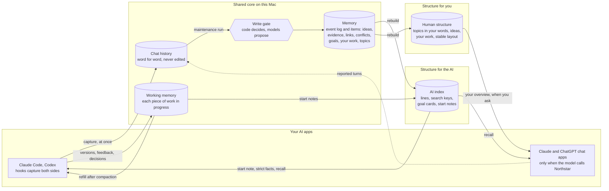
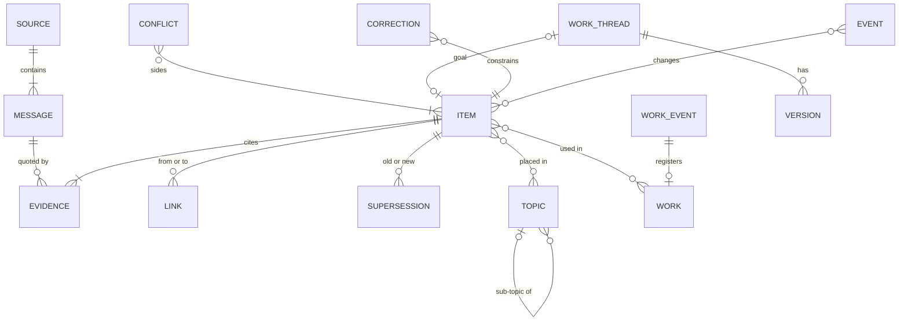
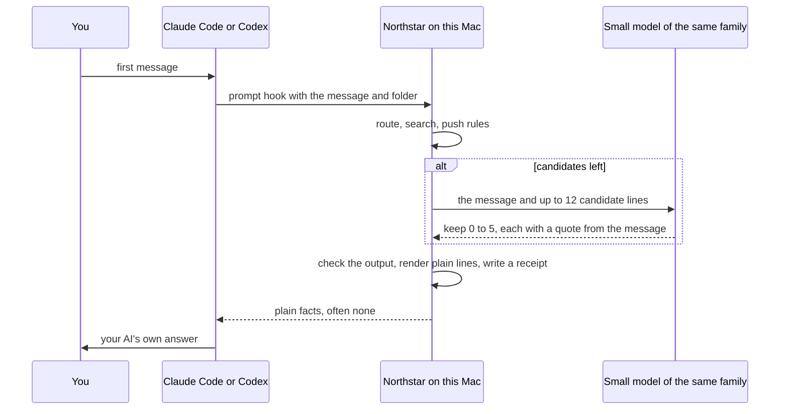
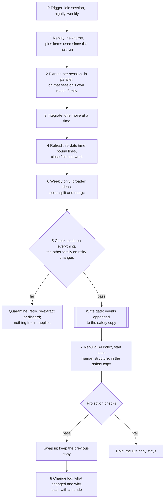
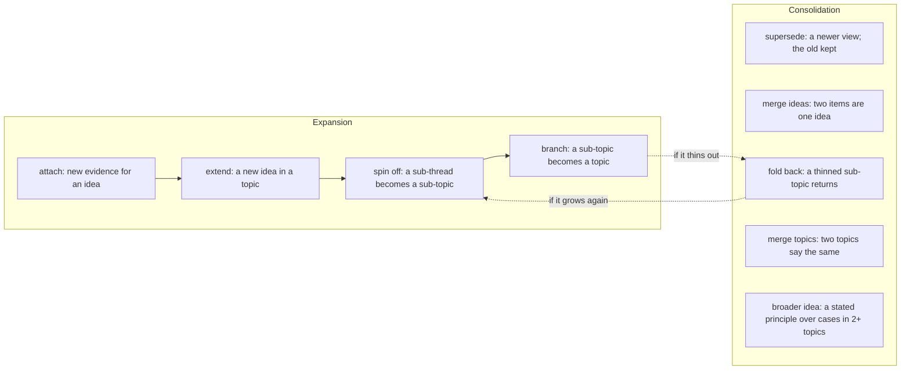

# Northstar's memory architecture: storage, retrieval, expansion and consolidation

**Status:** approved, version 1. Written 2026-10-28, and approved by you the same day: "Approve as written". The leans in §10 therefore stand as decisions. Nothing is built yet. [GOAL.md](../../GOAL.md) overrides this document. It details [DESIGN.md](DESIGN.md) v3.2 and changes only the HOW.

**Why this document.** You have asked for it twice:
- 2026-10-24: "I still dont see an architecture of the memory system yet".
- 2026-10-28: "I was assuming there's some algorithms and some data structure behind the scene for retrieval and storage. And also expansions and consolidation, etc. Those already in your notes?"

**Were they in the notes?** Partly. The component documents of 2026-10-08 and 2026-10-09 describe them in detail: the data model, knowledge organization, continuity and the maintainer. Those documents were written for the older design, which had a long textbook-style Book, and DESIGN v3.2 only summarizes them. This document brings them together for the current design, for both the AI side and your side, and says what changed.

**What is not here.**
- **How your overview looks.** Whether it is blended into ChatGPT or Claude, is a UI like the maps, or is a mind map is your second gap of 2026-10-28, which has its own research. This document defines the human structure that any of those displays would read.
- **How focus decides when to speak.** That is DESIGN §3. Only the working memory that focus reads is here.

**How to read it.**
- §0 is the one-page version.
- §2 covers the data structures, §3 storage, §4 retrieval, and §5 the write path with expansion and consolidation.
- §6 takes one invented example through all of it.
- §8 says what changed since 2026-10-09 and where research is thin. §9 checks this document against GOAL. §10 holds three choices for you.

**Tags.**
- Earlier design documents, as in DESIGN: [CDM] core data model, [KO] knowledge organization, [AC] continuity, [MT] maintainer, [TB] the textbook (its §7, how structure is computed), [PL] platform and privacy, [PF] platforms, [HK] hook connectors.
- Notes 03–26 are in [`docs/research/`](../../research/).
- E2 is [EXPLORATION.md](../../EXPLORATION.md) §2, the probes on your chats.
- **(start)** marks a starting value. It is calibrated before use and then moved by your corrections and use (§5.13).

No personal chat content appears here; the example in §6 is invented.

---

## 0. On one page

**The shape: two records, two structures, two paths.**
- **Two records, the shared core.**
  - *Chat history* holds every captured turn, both sides, word for word. It is never edited.
  - *Memory* holds your knowledge as separate items. Each item is one clear line that cites the exact words it came from. Memory changes only when events are appended, so nothing is overwritten and every change can be undone.
- **Two structures, rebuilt from memory** (GOAL §4.4).
  - *For the AI, the AI index:* plain dated lines, search keys, goal cards and start notes. It is shaped so that the right few facts are found in about 3 seconds.
  - *For you, the human structure:* topics in your words, your ideas in each topic, your work under each idea, the links you stated or confirmed, and a stable layout. It is shaped for recognizing and revisiting.
- **Working memory** sits beside them. It is the live record of each piece of work in progress: the goal, decisions, versions with your feedback, and the best version.
- **Two paths.**
  - The *write path* captures at once. Later, the maintenance run turns history into memory through one write gate.
  - The *read path* gives the AI a start note, strict facts or a recall result. It gives you the overview when you ask.



**The four jobs you named.**

| Job | Data structures | Algorithm in one line | Where |
|---|---|---|---|
| **Storage** | Append-only chat history; an event log with current-state tables and row history | One writer per store. Each change is a typed event, applied in one transaction after checks. Nothing is overwritten | §2, §3 |
| **Retrieval** | Keyword index, meaning vectors, typed links, goal cards, start notes | Route the chat to a piece of work, fuse four ranked lists, and filter by scope and kind. A small model then keeps only the facts that change the answer, which is often none | §4 |
| **Expansion** | Items with typed links; topics with one level of sub-topics | On evidence, new material attaches to an idea, extends a topic, spins off a sub-topic or branches into a topic. When your AI asks, an idea is expanded for a problem | §5.5, §5.6, §5.8, §4.7 |
| **Consolidation** | Supersession chains, conflict records, merges, topic history | A newer view supersedes and the old is kept. Duplicates merge when two model families agree. Topics fold back and merge. A broader idea appears only when someone stated it. Dated lines are refreshed. Items fade from view, never from storage | §5.5, §5.7, §5.8, §5.11 |

"Expansion" has two meanings in your notes. One is the structure growing: a topic "becomes detailed enough ... to deserve its own subsection or branch" (GOAL §1, 2026-10-09). The other is an AI expanding an entry for the problem at hand (2026-10-15). This document covers both.

**Two structures over one core.**

| | AI index (for the AI) | Human structure (for you) |
|---|---|---|
| Unit | One plain dated line per item, in the third person, with scope and origin | One line per idea, in your own words where they carry it, marked as yours or as adopted from a named AI |
| Organized by | Search keys: words, meaning, links to goals and work, project | Topics in your words, a few entries each, in stable positions |
| Built for | Finding fast the few facts that change an answer | Recognizing your ideas at a glance and getting back to your work |
| Ranked by | Strength of link to this message, then effect on the answer | Your pins, then how often, how recently and in how many contexts you used each idea |
| Also holds | Goal cards, start notes, use counts | Your work under each idea, open items, where you left off, your "seen" marks |
| Never holds | Your views as pushed context; AI answers you did not adopt; usage rules | AI prose; IDs or file paths; links Northstar found until you confirm them |
| Changes | Rebuilt each run, incrementally | Rebuilt each run from the last layout. Moves are limited by evidence, delay and a weekly budget |

---

## 1. Nine principles, and the evidence behind each

| # | Principle | Why |
|---|---|---|
| 1 | **Chat history is never edited; memory is rebuilt from it.** | Rewriting memory in place corrupts it. In one case a single rewrite cut a context from 18,282 tokens to 122 and scored below no context at all (ACE). Memory systems also miss over half of their updates (HaluMem) [notes 03, 23]. Value judged at capture matched your labels about 48% of the time (E2), so that judgment waits |
| 2 | **Memory is separate items. Each cites exact quotes and changes only by events. No summary is ever built from another summary.** | ACE's itemized memory, changed one entry at a time, gained 10.6% on agent tasks. Iterated rewriting drifts toward model defaults (note 06 §5). The leading vendor of overwrite-style updates moved to add-only in 2026 (Mem0, note 03 §3) |
| 3 | **Keep the raw words as values, with extra search keys.** | Keeping each raw exchange as the value, with extracted facts added as search keys, raised recall by 9.4% and accuracy by 5.4% (LongMemEval design study, note 03 §2). In another test, an assistant's memory answered 57.7% of questions correctly, against 91.8% for the same model reading the full history (note 26) |
| 4 | **Code decides and models propose. There is one write gate, and the other model family checks.** | Models have a 64.5% blind spot for their own errors. Errors overlap more within a model family, and judges favour their own text (DESIGN §1.4; note 13) |
| 5 | **Supersede, never overwrite, and settle it when writing.** | Memory systems scored 2–5% on multi-hop updates (MemoryAgentBench). Stores that settle updates when writing scored 0.70–1.00 (MERIT) [note 14 §11]. Answering "what did I believe when" needs separate clocks (note 06 §1) |
| 6 | **Goals and work are linked explicitly, never found by similarity alone.** | A goal stated early is far in meaning from the turn where it matters, and every system tested struggled with this (LoCoMo-Plus, note 14 §10) |
| 7 | **Deliver little: facts only when they change the answer, your views only when the AI asks, and often nothing.** | Adding memory selectively and strictly beat adding everything by 15–26 points (Xiong et al. 2025). A short reminder or silence beat always-on injection (Wu et al. 2026, preprint). Memory profiles raised agreement sycophancy by up to 45% (Jain et al.). In your blind picks, replies lost where memory presumed context (E2) |
| 8 | **Scope starts narrow, value is decided later, and fading never deletes.** | One example rarely transfers; two do (Gick and Holyoak 1983, note 18). Scope was written too broadly at capture (E2). The brain consolidates selectively (Go-CLS, Sun et al. 2023), and the odds that a memory is needed follow its past use (Anderson and Schooler 1991) |
| 9 | **Every bar is a starting value that moves.** | You asked on 2026-10-10: "Would it better to be more dynamic?" A per-user threshold moved by corrections cut errors from 45% to 31% (Gmail Priority Inbox, note 18 row 20). §5.13 lists every starting value and what moves it |

---

## 2. The data structures

### 2.1 Six stores

| Store | Holds | Written by | Kind |
|---|---|---|---|
| `history.db` and `blobs/` | **Chat history:** sources, messages word for word, work events, small snapshots | Capture, at once | Canonical; append-only |
| `memory.db` | **Memory:** the event log; items, evidence, links, supersessions, conflicts, goals and questions, your work, working style, corrections, scopes; topics and placements | The write gate only | Canonical: events, current-state tables and row history |
| `working.db` | **Working memory:** pieces of work in progress, live decisions, versions with your feedback, side topics, sessions, delivery receipts | The live writer: code, plus a small model that notes decisions in your turns | Canonical for live state; provisional; never a source for memory |
| `index.db` | **AI index:** item lines, keyword and vector indexes, a link view, goal cards, start notes, use counts, the gate's bar for each project | The maintenance rebuild | Derived; rebuilt, not backed up |
| `overview.db` | **Human structure:** topic and idea views, suggestions waiting for your confirmation, open items, where you left off, the layout, your "seen" marks | The maintenance rebuild, plus your viewing | Derived, except the layout and marks, which are backed up |
| `runs.db` | **Maintenance runs:** jobs, recorded model calls, proposals, verdicts, quarantine, budgets, the change log | Maintenance | Operational |

The 2026-10-09 design had nine stores. Three of them are gone: the Book, the Reader and the store of delivered text. Working memory replaces the per-turn session store, and checks now live in the run records.

**Why topics live in `memory.db`.** Creating, splitting, merging or renaming a topic, or moving an idea, is an event in the same log as everything else. With one log there is one undo, one "as of" query and one replay, and your topic IDs stay stable across rebuilds.

### 2.2 Chat history

```yaml
source:          # one conversation, document or piece of work
  id, kind: chat | work | document | northstar_output
  app, account, project                 # project: the repository or folder
  title, started_at, scope, sensitivity: normal | sensitive | private
message:         # one captured turn
  id, source_id, branch, ordinal
  speaker: user | assistant | tool | northstar | system   # from the app's role map, never from a model
  agent, model_family                   # which AI said it, e.g. Claude in Claude Code
  origin: typed | pasted | assistant_output | tool_output | model_reported | northstar_injected
  occurred_at
  text                                  # word for word; secrets replaced before writing
  content_hash
  fidelity: verbatim | model_reported | reconciled
work_event:      # anything you got your hands on, as capture saw it
  id, source_id, kind: commit | file_version | render | diagram | decision_record
  ref: commit SHA | file hash and path | permalink
  evidence: strong | medium | weak      # strong: you authored, committed or decided
                                        # medium: an AI edited it in your session; weak: opened
  snapshot -> blob
  occurred_at
```

**Rules,** kept from [CDM] §3:
- **Text lives here once.** Memory holds offsets and exact quotes, so a purge stays small and quote checks stay exact.
- **Model-reported turns.** On the chat apps, only the model can report what you said, so the report is kept as `model_reported`. If the word-for-word text arrives later, it is matched by normalized hash, then by a per-turn tag, then by a fuzzy match of at least 0.9 (start) within ±10 minutes (start). Every outcome is recorded.
- **Northstar's own text.** Text Northstar delivered into a chat is marked when it is captured. Northstar's hidden model runs are never captured as your sessions (I24).
- **The evidence ladder for work** comes from note 20. Viewing alone is weak evidence, and something merely on screen is no evidence.

### 2.3 The event log

```yaml
event:
  seq                     # local and increasing; the watermark
  id                      # a time-ordered ID (ULID), which orders events across devices
  type, subjects[], payload
  actor: code module | model@version with prompt hash | you
  run_id, proposal_id, index_in_proposal    # unique together, so a replayed run applies nothing twice
  inputs: [object@version, ...]             # what the proposer read
  compensates?                              # set when the event undoes another
  config_version, recorded_at
```

- **One proposal, one transaction.** A proposal's events, the current-state rows they change and the row history all commit together ([CDM] §2.1).
- **Row history** keeps every earlier state with the range of events it held for. "As of a date" and "changed since" are then index lookups ([CDM] §8.1).
- **There are 42 event types in 12 families:**

| Family | Types |
|---|---|
| Evidence | `evidence.anchored` |
| Items | `item.created`, `item.revised`, `item.value_changed`, `item.scope_widened`, `item.status_changed`, `item.checked` |
| Your moves | `stance.recorded` |
| Links | `link.proposed`, `link.applied`, `link.confirmed`, `link.rejected`, `link.retracted` |
| Supersession | `supersession.applied`, `supersession.undone` |
| Conflicts | `conflict.opened`, `conflict.resolved`, `conflict.reopened`, `conflict.undone` |
| Goals and questions | `goal.created`, `goal.status_changed`, `goal.confirmed`, `question.created`, `question.status_changed` |
| Your work | `work.registered`, `work.labelled` |
| Working style | `style.recorded`, `style.revised` |
| Corrections | `correction.applied`, `correction.lifted` |
| Structure | `topic.created`, `topic.split`, `topic.branched`, `topic.merged`, `topic.folded_back`, `topic.renamed`, `topic.dormant`, `idea.placed`, `idea.moved` |
| Maintenance and privacy | `compensation.batch`, `purge.applied`, `scope.hold_changed` |

The 2026-10-09 catalog had 51 types. Capture events moved to chat history, and the Book's events are gone.

### 2.4 Memory items

```yaml
item:
  id, version             # the ID is stable; the version rises when the line, scope or certainty changes
  kind: decision | ruled_out | result | conclusion | definition | plan
      | principle | approach | position | goal | question
  class: fact | view      # set by kind; when unsure, view (the stricter class)
  line                    # one clear standalone line; same strength; keeps hedges, negations and "only"
  your_words              # the shortest exact quote of yours that carries it; empty if none does
  why                     # one line of reasoning that cites evidence, or empty
  question_key            # the question it answers, in general words; used as a search key
  scope: project:<id> | personal | work:<org>
  applies_when            # conditions; "unknown" allowed; never wider than the source
  learned_in              # where it first appeared
  contexts_seen[]         # every context with evidence
  origin: yours | adopted from <agent>      # computed from evidence, never set by a model
  value: forming | kept
  status: active | superseded | retracted | quarantined | purged
  check: not_needed | unchecked | checked | contradicted | not_independent  # adopted AI claims only
  said_at                 # when you said or adopted it
  valid_from, valid_to    # when it holds in the world, if stated
  recorded_at             # when Northstar recorded it
  time_bound              # true for plans and "this week" lines, which will need re-dating
```

**Kinds, and what reaches an AI.** These follow "facts, not judgment", which you confirmed on 2026-10-24: decisions, results, conclusions and what things are may go to an AI when strongly linked. Your views and principles go only when the AI asks.

| Kind | Example (invented) | Class | Reaches an AI |
|---|---|---|---|
| decision | Readings are stored in SQLite, one file per meter | fact | Pushed when it changes the answer |
| ruled_out | InfluxDB on the Pi was ruled out as too heavy | fact | Pushed when it changes the answer; always in its work's start note |
| result | The Pi Zero keeps up with 6 sensors at one reading a second | fact | Pushed when it changes the answer |
| conclusion | Hourly averages are enough for monthly charts | fact | Pushed when it changes the answer |
| definition | energy-dash is a home energy dashboard on a Pi | fact | Pushed when it changes the answer |
| plan | Demo at the meetup on 26 March | fact; time-bound | Pushed when it changes the answer; refreshed (§5.7) |
| principle, approach, position | In my own projects, keep data in local files first | view | Only when the AI asks |
| goal | Alert me when running the dryer costs double | — | In its work's start note. Only goals you stated |
| question | How do I avoid alert fatigue? | — | In its work's start note; otherwise on request |

**Two fields change over an item's life:**
- **Value** moves one way only: from forming to kept. Code moves it on any one of five signals: evidence on a later day, a later move of yours that builds on it, a link to your work with medium or strong evidence, evidence in a second context, or your "keep". It never moves back on its own; disuse lowers salience instead (§5.11).
- **Status** starts as active. It can move to:
  - *superseded*, by your later statement in the same context, an AI's self-correction, or a check that contradicts it;
  - *retracted*, by your "not what I think";
  - *quarantined*, by a failed check, with automatic exits;
  - *purged*, only by you.

  Undo restores the earlier state.

### 2.5 Evidence and origin

```yaml
evidence:
  id, item_id, message_id, start, end
  quote                                   # exact; checked against the message
  role: primary | adoption | support | reason | scope
  speaker, agent, model_family, origin    # copied from the message by code, then frozen
  lineage: primary | northstar_echo       # an echo of Northstar's own text never counts as support
```

- **Who said it** is copied from capture, never taken from a model (I3, I20).
- **"Adopted" needs words you typed** that agree with the AI's idea, build on it or use it (I4). The item then cites two spans: the AI's (`primary`) and yours (`adoption`). In the probes, about half of what you held were AI ideas you had adopted (E2).
- **AI answers you did not adopt create no item.** They stay in chat history: private, searchable, never shown or given to an AI on their own (GOAL §4.2). §4.7 gives the one way they can be quoted.
- **Echoes do not count.** When an AI repeats something Northstar delivered into that chat, it is not new evidence. Delivery receipts catch it, along with 8-word fingerprints of delivered text, at an overlap of 0.6 (I11).

### 2.6 Links, supersessions and conflicts

```yaml
link:
  id, from, to, type
  reason                                  # one line that cites both ends
  stated_by: you | northstar | construction
  status: proposed | applied | confirmed | rejected | retracted
  checked_by: [family, ...]               # conflicts and cross-context links need two
supersession:
  old: item@version, new: item
  reason: your_later_statement | ai_self_correction | check_contradicted
        | your_correction | refresh | scope_split
  evidence, at                            # the old version stays readable
conflict:
  id, sides: [item@version, item@version]
  kind: across_contexts | same_context
  state: both_stand | open | resolved | contested
  resolution: {step, winner?, inputs, rule_version}
  question?                               # an open question, raised when contested
  recheck_after?
```

**Eight link types:**

| Type | Meaning | Made by | Shown to you |
|---|---|---|---|
| `supports` | One idea backs another | A model proposes; the other family checks | When you stated it, or once you confirm it |
| `refines` | Narrower, or builds on | Same | Same |
| `conflicts` | They disagree | Your words, or two families agreeing | Same |
| `answers` | Answers an open question | A model, then a check | Same |
| `case_of` | A case of a broader idea | A model, then a check | Same |
| `advances` | Moves a goal forward | Code: the move was made while that goal was active in working memory | Yes, by construction |
| `used_in` | An idea used in a piece of your work | Code, when the work was made in the same session; a model otherwise | By construction: yes. Inferred: once you confirm |
| `same_as` | Two items are one idea (a merge) | An exact key, or two families agreeing | Yes, as one idea |

"Links the AI spots are shown only once the user confirms them" (GOAL §2, 2026-10-15). On the AI side, checked links can still help search.

**How a conflict is settled.** This is kept from [CDM] §7.1 and simplified, because every item is now yours or adopted by you.
0. **Your correction** on either side decides.
1. **The sides differ in scope or condition:** another project, the exam against real work, another time or version. Both stand, each with its scope. This is the cross-context conflict you described on 2026-10-10.
2. **Same context, with a later statement of yours.** The newer view supersedes the older, which stays readable.
   - An AI's self-correction also counts, unless it directly follows your pushback and brings no new evidence.
   - A contradicting check by another family supersedes an adopted AI claim.
3. **Otherwise the conflict is contested.** Both items stay active, an open question is raised, and a date to check again is set.

Your own ideas are never ranked against each other, unlike the 2026-10-09 rank step, which compared verification tiers and counts. Every resolution is high tier: it is checked before it applies and audited the next night by the other family. If the audit disagrees, the resolution is undone and the conflict becomes contested ([CDM] §7.2).

### 2.7 Goals, questions, your work, working style, corrections, scope

```yaml
goal:             # an item of kind goal
  basis: stated | reported | reused
                  # stated: your typed words
                  # reported: a chat app's model said you said it; it carries no authority
                  # reused: carried over from an earlier chat of the same work and shown for correction
  status: active | paused | done | dropped
  work_id         # the piece of work in working memory
question:         # an item of kind question
  raised_by: you | an AI, taken up by you | a conflict
  status: open | answered | dormant
  answered_by: [item, ...]
work:             # a pointer to your work
  id, kind, ref, project
  label           # one line on what it shows; checked; else the commit message or file name
  evidence: strong | medium | weak
  snapshot -> blob
style_line:       # working style
  id, line, scope (where learned)
  evidence        # stated as a default, or seen in 2 or more sessions
  status
correction:       # your one-step marks
  kind: not_what_i_think | keep | project_only | rename | move | keep_together
      | these_are_different | give_own_topic | fold_back | not_part_of_this
      | confirm_link | reject_link | pin | purge
  target, payload, at
  constraint      # the rule the gate enforces from then on
  status: active | lifted     # lifted only by your undo, your later correction, or a purge
scope:
  id, kind: personal | project | work | session
  held            # held: captured, but never delivered or shown
```

- **Only a goal you stated sets a goal** (I5). A chat app model's report stays "reported" and sets nothing. A correction reported that way stays proposed and expires after 7 days ([CDM] §4.4).
- **Later evidence never lifts a correction** ([CDM] §4.4).
- **Only personal accounts, repositories and folders you mark are captured** (DESIGN §10).

### 2.8 Topics and placement

```yaml
topic:
  id                       # stable; never reused
  label                    # in your words (§5.8)
  parent?                  # one level of sub-topics
  anchor                   # your goal, a question you pursue, or an idea of yours
  status: active | dormant | merged_into | split_into | folded_into
  redirect_to?             # where a retired topic now lives
  formation_overlap?       # used to make merging back harder (§5.8)
placement:
  item_id, topic_id, role: home | also_in
  tentative                # settled by the next weekly run, never by you
  reasons                  # the top two placement signals, in words
```

- **Two levels at most:** a topic, then sub-topics. Ideas sit below them, and your work and sources below the ideas.
- **Every idea has one home** and up to two "also in" places.
- **A broader idea is an item:** a principle someone stated, with `case_of` links from its cases. The cases stay where they are.

### 2.9 Working memory

```yaml
work_thread:       # one piece of work in progress
  id, title, project, scope, status: active | paused | closed
  goal: {text (your words), message_id, basis: stated | reused}
  sessions[], opened_at, last_active, best_version?
live_decision:
  id, thread, kind: decided | ruled_out | constraint
  line, your_quote, message_id            # only from your own turns
  status: live | in_memory | dropped
version:
  id, thread
  artifact                                # a snapshot on a hidden git ref, or a rendered image
  parent, made_at_turn
  feedback: [{your_quote, message_id}]
  best                                    # your pick, or your last approval in your own words
side_topic:
  id, thread, line, opened_at_message, status: open | split_off | closed
session:
  id, app, project, thread
  context_used                            # token counts from the app's transcript
receipt:           # everything Northstar gave an AI
  id, session, at, kind: start_note | facts | refill | focus_note | recall
  items: [item@version], text_hash, fingerprints
```

- **Who writes it.** Code records versions and your feedback. In the background after each of your turns, a small model from your assistant's family notes decisions and ruled-out options in your own words (DESIGN §1.4).
- **Working memory is never a source for memory.** Maintenance extracts from chat history, so a wrong live note cannot become long-term memory ([MT] §2, kept).
- **Receipts drive three things:** the echo guard (§2.5), the re-check on use (§5.11), and "used in this chat" if you turn that setting on.

### 2.10 The AI index

```yaml
item_line:     item@version, line_text, class, scope, status, value, salience
keys:          a keyword index (BM25, a standard keyword ranking) over
               line, your_words, why, question_key, topic labels and aliases
vectors:       embeddings (numbers that capture meaning) of line and question_key,
               from a small model on this Mac; keyed by model
history_keys:  keyword and vector indexes over chat-history exchanges
               (your turn with its reply), with item lines added as extra keys
link_view:     checked links, for searching one or two steps out
goal_card:     per goal and work thread: goal text, aliases, project,
               top 8 linked items, open questions, last active
start_note:    per active work thread: rendered text, items@version, built_at, watermark
use:           per item: delivered, recalled, viewed, built on; dates; contexts
gate_bar:      per project: the current bar, and the recent misses and leaks that moved it
```

**The lines an AI sees.** Pushed lines carry no IDs. Recall results carry short IDs, so the AI can ask for more.

```text
2026-03-02 · project energy-dash · decided by the user: Readings are stored in SQLite on the Pi, one file per meter.
2026-03-02 · project energy-dash · suggested by Claude, adopted by the user: Readings older than 7 days are kept only as hourly averages.
```

Each line is in the third person, dated, scoped and attributed. There are no "you are" lines, no traits and no usage rules ([AC] §3.2, kept).

### 2.11 The human structure

```yaml
topic_view:   topic, label
              entries          # up to G ideas: your pins, then open items, then salience
              more_count, open_count, changed_since_seen
idea_view:    item
              shown_line       # your words if they carry it; else the line, marked as Northstar's wording
              origin_mark      # yours, or adopted from a named AI
              work_cues        # 1 to 3: a label and a snapshot
              sources          # app, chat title, day
              links            # stated or confirmed only
              conflict_pairs
suggestions:  links Northstar found, waiting for your confirmation; never drawn before it
open_items:   what to learn: open questions, open conflicts, active goals, next steps you stated,
              and gaps on your own paths (an active goal with nothing yet advancing it);
              a term that merely appeared is never a gap
left_off:     per work thread: last state, last steps, what changed since, goal,
              next step, open questions
layout:       positions of topics and entries; the previous layout; the seed
marks:        per idea, the last version you saw;
              per topic, how often you open its hidden entries
```

**What it is for:** recognizing your ideas and getting back to your work (GOAL §2, 2026-10-15; note 26).
- **Your own words come first,** because an AI's wording of a person's ideas is risky. A summary with one wrong detail cut correct recall from 83.6% to 44.8% (Sim et al. 2026, note 26).
- **Origin is marked,** because a week later people misremember which ideas involved an AI (Zindulka et al. 2026).
- **Work is the cue,** because a cue helps when it was part of how the memory formed (Tulving and Thomson 1973).
- **Topics and purpose come first, and time is a filter.** In re-finding tasks, people remembered an email's topic 85% of the time and its date 58% of the time (Elsweiler et al. 2008).

**What it is not: a display.** Your second gap decides how it is shown. This structure holds what any of the candidates needs: a map, a text hub, "where you left off", or answers to "ask".

`marks` stay on this Mac. They are never given to a model, and they only feed salience and the split bar.

### 2.12 Maintenance run records

```yaml
run:        id, trigger, watermark_from, watermark_to, budget_used, state, safety_copy, result
job:        id, run, stage, idempotency_key, lease, attempts, state
model_call: provider, model, family, prompt_hash,
            input_ids                     # never the assembled text
            raw_output, tokens, cost
proposal:   ops[], evidence quotes, abstentions
verdict:    checker family, rules (meaning both ways, attribution, scope, hedge),
            pass | fail, independent?
quarantine: target, reason, attempts (at most 3), deadline, exit
budget:     per change type: audited error rate, frozen?
change_log: per run: what changed and why, links, undo handle   # never read back as an input
```

**How the main records connect:**



---

## 3. Storage: local now, cloud later

### 3.1 On this Mac now
- **Files.** The SQLite stores live in `~/Library/Application Support/Northstar/`.
  - Write-ahead logging is on, with full sync for `history.db`, `memory.db`, `working.db` and `runs.db`.
  - Secure delete is on everywhere.
  - Snapshots are stored as blobs named by their content hash ([CDM] §1).
- **At rest.** The data folder sits on FileVault, or else in an encrypted disk image. Real capture stays off until one of them is present ([PL] PL-3).
- **Backups.**
  - Encrypted archives are taken at one watermark, each with its own Keychain key, and one is test-restored weekly.
  - Time Machine is excluded, so that a purge reaches every copy.
  - A restore treats history, memory, working memory and runs as canonical and rebuilds the rest, except the layout and your marks ([PL] §2.5; [CDM] §11).
- **Integrity.**
  - Triggers make append-only tables refuse updates and deletes.
  - A nightly read-only sweep checks every invariant (§7).
  - A weekly replay rebuilds memory from the event log and compares hashes (I18).
- **Speed** (estimates from [CDM] §11, at 100 turns a day):
  - applying a proposal: under 50 ms;
  - "as of" and "changed since" lookups: under 20 ms;
  - keyword and vector search: about 5 ms now, and about 50 ms at ten times the volume;
  - a full replay: under a minute.
- **Size.** [CDM] estimated about 1.3 GB a year at 100 turns a day (±2×) for the larger 2026-10-09 schema. This design drops the Book's tables but adds work snapshots, which are not yet estimated.

### 3.2 Ports, and Windows
Every component reaches storage through a port. The write gate is the only caller of the memory writer.

| Port | Main calls |
|---|---|
| `HistoryStore` | Append a message; append a work event; put a blob; watermark |
| `MemoryWriter` (the gate only) | Apply a proposal, giving a transaction or rejections |
| `MemoryReader` | Get by ID, optionally as of a date; changed since a watermark; subgraph; events since |
| `WorkingStore` | Threads, versions, live decisions, receipts |
| `IndexPort` | Search (keys, vectors, links), goal cards, start notes, use |
| `OverviewStore` | Topics, ideas, where you left off, layout, marks |
| `RunStore` | Enqueue, lease, record a call, quarantine, change log |

There is a SQLite adapter now and a Postgres adapter later, with one contract test suite for both ([CDM] §8.2). **Windows** runs the same core; only the edges change:
- the scheduler;
- DPAPI or Credential Manager for secrets;
- BitLocker or Device Encryption at rest, and app-level encryption where neither exists ([PF] rows 4 and 6).

### 3.3 Cloud later
- **A storage swap, not a redesign** (DESIGN §7). Postgres would hold one schema per store, with row-level security on `tenant_id`, which every table already has.
  - Keyword indexes become `tsvector` with GIN.
  - Vectors become `pgvector`.
  - Job leases use `SKIP LOCKED`.
  - Blobs move to object storage ([CDM] §8.3).
- **Many machines and the phone** (GOAL §2, 2026-10-09).
  - Other computers forward their captures to one core. The event log merges cleanly, because events are only appended and their IDs order them across devices (note 06 §10).
  - The phone needs that always-on core and a reachable address. Until you decide its place, that is why it comes after the first four connectors (DESIGN §7).
- **A purge in the cloud becomes a key deletion.** With one data key per tenant and scope, deleting a key erases its backups too ([PL]).

### 3.4 Deleting for real
A purge is the only destructive operation, and only you start it. It runs as a resumable saga, kept from [CDM] §10:
- It records what it will remove before removing anything.
- Each store's own writer purges that store's part.
- Backups are rewritten under new keys.
- A byte-level search of every file must find zero hits.
- Text that comes back through a later import is refused.

Purged items leave a stub that says "removed at your request on <date>". What vendors already hold is out of reach, and is listed.

---

## 4. Retrieval: the read path

### 4.1 Six ways in

| When | What is given | From | Started by |
|---|---|---|---|
| You resume a piece of work | Its **start note**: your goal, decisions, ruled-out options, the best version, open threads | The AI index, refreshed from working memory | Code, at chat start or at your first message, when routing is confident (§4.3, §4.4) |
| A new chat's first message | **Strict facts**: plain facts the AI lacks that change its answer; usually nothing | The AI index, through the strict gate | Code and a small model, within about 3 seconds (§4.5) |
| The app shortens a long chat | **Refill**: this session's own facts come back | Working memory | Code, on the compaction hook (§4.6) |
| Your AI asks | **Recall**: your views, working style, a past decision, a source, an idea expanded for a problem, quotes from your chats | The AI index, memory and chat history | Your assistant, through the recall tool (§4.7) |
| One of focus's moments | Focus's note, for one reply | Working memory | Focus (DESIGN §3) |
| You ask for your overview | The **human structure** | `overview.db` | You, through your assistant (§4.8) |

### 4.2 Search and ranking
One search serves every way in. Code runs it locally, with no model.

```text
search(query, context):
  L1 links     items tied to the routed work or goal (same thread, advances, answers),
               ordered by link strength: stated or confirmed > by construction > checked
  L2 words     keyword ranking (BM25) over the keys: top 50 (start)
  L3 meaning   similarity of vectors: top 50 (start)
  L4 time      time-bound items, newest first; used only when the query is about time
  fused(i) = sum, over the lists L that hold i, of 1 / (60 + rank of i in L)
             # reciprocal rank fusion
  keep eligible items only (table below)
  drop near-duplicates (vector similarity of 0.9 or more, start), keeping the better
  return the top N, each with the lists that found it
```

- **Why four lists.**
  - Hybrid search is the field's default in 2026 (note 14 §10).
  - Links are a list of their own, because similarity misses goals (LoCoMo-Plus).
  - Rank fusion needs no common score scale across lists, and it was the 2026-10-09 default ([AC] §4.5).
  - Searching one or two steps along links stays a test option, used only if it wins in testing ([AC] §4.5).
- **Never an input to ranking:** who said it, or which product (I23).

**What may be given, by direction** (all checked by code):

| Rule | Pushed by Northstar (start notes, strict facts, refill) | Pulled by your AI (the recall tool) |
|---|---|---|
| Status | Active items only. A superseded item never appears as current, because supersession is settled before delivery | Active items; earlier versions when the AI asks how something changed |
| Scope | The item's scope must cover this chat: project items only in their own project, personal items anywhere | Every scope you allowed, with each result labelled by where it applies (§10, choice 1) |
| Class | Facts only | Facts and views |
| Your corrections | Nothing you hid or rejected | Same |
| Checks | Never an adopted AI claim marked contradicted | Shown, with the contradiction |
| Already given | Not repeated in the same chat (receipts), except the refill after compaction, which restores what the app removed | Allowed |

### 4.3 Routing a chat to a piece of work
Kept from [AC] §4.2. Code scores every active work thread and goal card:

| Stage | Signal | Value (start) |
|---|---|---|
| Explicit | Your message names the work, or the chat continues one (resume, fork) | 1.0 |
| Lineage | The chat was cleared or compacted from one on that work | 0.9 |
| Context | Same folder 1.0; same repository 0.8; same project name 0.6 | 0.6–1.0 |
| Text | Keywords and meaning of your first message, matched against the goal card | 0–1 |
| Recency | exp(−days since last activity ÷ 7) | 0–1 |
| Live sibling | Another chat on that work was active in the last 30 minutes | 0 or 1 |

- The signals are combined into a calibrated probability, p.
- **Route** when p ≥ 0.7 and the margin over the next candidate is at least 0.1 (start).
- **Unsure** (p from 0.35 up to 0.7): a small model chooses among at most 8 cards. It must name a card and quote your message. On a timeout, there is no route.
- **No route** when p < 0.35: no start note, and the strict gate alone decides.
- **At chat start there is no message yet.** If the folder has one active thread, context alone routes it. If it has several, routing waits for your first message.
- The router never creates or changes a goal ([AC] §4.2).
- Routing by folder matters: in the probes, strict selection alone missed context when a question was about a whole project (E2).

### 4.4 The start note
- **What it holds:** the goal in your words, decisions, ruled-out options with their reasons, the best version with your feedback, open questions and side topics. These are plain facts, in the third person, dated (example in §6.6).
- **How it is made:** code fills a fixed template from typed fields in working memory and the thread's items. No model writes it, so it cannot invent anything ([AC] §3.2 wording rules, kept).
- **When:** it is built at the end of each maintenance run and stored in the AI index. If working memory changed after it was built, code re-renders it from working memory on the spot. It is never older than the live record.
- **Size:** about 1,500 characters (start). That is well under Claude Code's 10,000-character limit for start context (note 22 A2) and Codex's default of about 2,500 tokens (B2).
- **Why build it ahead:** offline work pays off when the next request is predictable. Letta's sleep-time compute used about 5× less compute at answer time (note 23 §2), and resuming a piece of work is predictable. Whether a start note beats selection at chat start is tested in DESIGN §8.

### 4.5 A new chat: the strict gate



1. **Trigger.** Your first message reaches Northstar through the app's prompt hook, `UserPromptSubmit` in both Claude Code and Codex (note 22 A3, B3). The chat apps have no hooks, so there the gate runs only when the model calls Northstar (DESIGN §7).
2. **Candidates.** The search of §4.2 runs with the push rules: facts only, in this chat's scope, active, and not already given.
3. **Bar.** Candidates below this project's bar (step 8) are dropped, and at most 12 (start) go on.
4. **Effect test.** A small model from your assistant's family gets your message and the candidate lines. For each one it answers: would a careful answer to this message be wrong, or clearly worse, without this fact?
   - It must quote the part of your message the fact bears on, and it may keep none.
   - Code checks that each quote is really in your message, and keeps at most 5 (start).
5. **Fallback.** If the small model would take longer than the time budget, code decides alone with a stricter bar: only facts from the routed work or named in your message, at most 3 (start) (DESIGN §1.4).
6. **Render.** The facts go in as plain dated lines (§2.10), under a one-line header naming them as records from earlier chats. There are no usage rules and nothing about you as a person.
7. **Record.** A receipt notes which item versions went to which chat, and when.
8. **Learn.** Each project keeps its own bar. Every move of the bar is logged, and it never drops below a strict floor.
   - **A re-explanation lowers it a step.** In your first turns you restate something an eligible item already held, as found by the re-explanation detector ([AC] §7).
   - **A presumption or leak raises it a step.** You say a delivered fact does not apply, or the next run finds that your next message contradicted it.

   This applies the per-user threshold of a mail filter (note 18 row 20) to delivery.

**Why this shape.**
- Selecting by effect on the answer, with nothing as an allowed result, was the main fix for echoing your views back (note 19 §3).
- In the probes, strict selection found 9 of 10 required items and nothing off-topic. Pasting all 226 items leaked unrelated details (E2).
- The bar keeps your rule "only when very strongly linked" (GOAL §2, 2026-10-10), and evidence moves it instead of a fixed cut.

### 4.6 After compaction: refill
When Claude Code or Codex shortens a long chat, the start hook fires again with the source "compact" (note 22 A2, B2). Northstar then returns this session's own facts from working memory: the goal in your words, decisions, ruled-out options, the best version and open side topics. Nothing from other work is added.

### 4.7 The recall tool
One read-only tool that your assistant can call. It is an MCP tool, available in Claude Code, Codex and Claude's desktop chat, and in ChatGPT's chat where your plan allows it (DESIGN §7).

| Operation | Returns | Notes |
|---|---|---|
| `recall(question)` | Up to 8 items, facts and views, each with origin, scope, date, why, conflicts and a short ID; plus where it looked | Pull: searches every scope you allowed, with each result labelled |
| `fetch(id, as_of?)` | One item: the current version, earlier versions with their reasons, evidence quotes with their place, links | "As of a date" uses row history |
| `expand(idea, problem)` | The idea in three parts kept apart: your items (the idea, its why and scope, links you stated or confirmed, conflicts with both sides), your work (one to three pieces, one line each), and the sources | The assistant itself writes how the idea applies to the problem |
| `history(question, when?, who?)` | Exact quotes from chat history with their place: app, chat, day | Your words by default; see below |
| `left_off(work?)` | Where you left off: last state, last steps, what changed since, goal, next step, open questions | From working memory |
| `overview(topic?)` | The human structure, for the display to render | The display is the second gap |

- **Expanding an idea for a problem** follows note 20. The index is built ahead, not the prose. Your items, your work and the model's own thinking are kept visibly apart. The model thinks about the problem first, then reads your stored positions. Whether the overview offers this step is still open, because you were not sure (GOAL §2).
- **History search answers questions about your past from the record itself.** Answers rebuilt from memory were far less accurate: 57.7% against 91.8% (note 26). It searches exchanges, with item lines as extra keys (§2.10).
  - It returns your own words by default.
  - The AI may ask for AI turns too. Those come back labelled "not adopted", with their place. They never appear in start notes, strict facts or the overview (§10, choice 2).
- **A "not found"** says where the tool looked (note 26).
- **Recall results are plain lines too.** The tool adds no usage rules.

### 4.8 Your overview on request
The overview reads `overview.db`: the topic views, the ideas with your words, their origin and work cues, open items, where you left off, and the layout. You open it through your assistant: "in the assistant, when I ask" (GOAL §2, 2026-10-15). How it looks is the second gap. That research (note 27, still in progress) leans to chat answers first and a map on request. Both read this same structure: chat answers come through the recall tool, and the map comes from `overview.db`, with its stable layout and your exact words.

### 4.9 What never reaches an AI
- A profile, statements about you as a person, or "you are" lines.
- Your views, principles or working style, unless the AI asks.
- AI answers you did not adopt, on their own.
- Superseded or contradicted items as if current.
- Items from another project, pushed by Northstar.
- Tool or web text, or anything that reads like a command, word for word (DESIGN §2).
- Usage rules. The one exception is focus's note for one reply (DESIGN §3.3).
- Anything in a scope you marked as held, or anything purged.

---

## 5. The write path

### 5.1 Two writers

| Writer | When | Writes | Model |
|---|---|---|---|
| **Live** | During your sessions | Chat history at once, and working memory | Code, plus a small model that notes decisions in your turns |
| **Maintenance** | After a session goes idle, nightly, and weekly | Memory, through the write gate; then the AI index and the human structure | Your apps' model families, through the vendors' APIs (DESIGN §1.4) |

### 5.2 Live: capture and working memory
- **Capture.**
  - Claude Code and Codex hooks write both sides word for word ([HK]). The chat apps write only when the model calls Northstar (DESIGN §7).
  - Commits, file versions and renders made in a session become work events.
- **Working memory.**
  - A version is recorded whenever the work's files change between your turns. It is a snapshot on a hidden git ref, or a headless render for web work.
  - Your next message is attached to that version as feedback.
  - A small model notes decisions and ruled-out options in your own turns.
  - The best version is your pick, or the one you last approved in your own words.

### 5.3 The maintenance run



The stage numbers follow DESIGN §1.2. Stage 6 runs only in the weekly run, and its changes pass the same checks and gate as the others.

| Stage | What runs | Model | Safeguard |
|---|---|---|---|
| 0 Trigger | A session ended or idle for 30 minutes (start); nightly; weekly for stage 6 | — | Active sessions are skipped; batches are bounded; once a daily budget that Northstar counts itself is spent, runs wait |
| 1 Replay | New exchanges since the watermark; items that were used (delivered, recalled, viewed) and then met a later statement of yours | Code | Items touching live goals and open questions go first. Each new exchange is judged next to its nearest items |
| 2 Extract | Your moves, with exact quotes (§5.4) | The session's own family, in parallel | The speaker comes from capture; "unclear" is allowed; tool and web text is data |
| 3 Integrate | Each move attaches, supersedes, stands as a conflict, or starts a new item; then placement (§5.5, §5.6) | One move at a time: a model labels relations, and code decides | Models propose; the gate decides |
| 4 Refresh | Time-bound lines are re-dated, and finished work is closed (§5.7) | Code, plus a model that reads later evidence | The old version stays |
| 5 Check | Code checks everything; the other family checks risky changes (§5.9) | The other family | A failure goes to quarantine, and nothing from it applies |
| 6 Weekly | Broader ideas; topics split, branch, fold back and merge (§5.8) | Code decides, a model proposes labels, and the other family verifies | Evidence, delay, a weekly budget, undo |
| 7 Rebuild | The AI index, start notes and the human structure, in the safety copy (§5.10) | Code | Swapped in only after the projection checks pass |
| 8 Log | The change log | Code | Never read back as an input |

**What it borrows** (note 23 §1):
- From ChatGPT's Dreaming: a background process, and the refresh of dated items.
- From Codex's memories: each session extracted in parallel, then one integrator working one change at a time.
- From Anthropic's Dreams: a new copy that is adopted or discarded.
- From OpenClaw: a bound on how much one run may retire, and a journal that is never used as a source.

**What it does not borrow:** one rewritten memory state, and summaries built from summaries. ChatGPT's Dreaming stays a reference for positioning, not a template (GOAL §2, 2026-10-25).

### 5.4 Extract
For each idle session, one call runs on that session's own model family, in a fresh context.
1. **Code assembles the input** in a fixed order ([MT] §4.1):
   - the rules in plain words, and the output schema;
   - the new exchanges as delimited data, with speaker and origin rendered by code;
   - up to 20 nearest existing items (start), as one-line gists;
   - your active corrections;
   - then the task, last.

   The input never includes overview text, start notes or the change log (I7).
2. **The output** lists each move of yours across the whole exchange, not turn by turn:
   - the move: stated, adopted, ruled out, revised, built on, or only asked (a bare question records nothing);
   - its kind (§2.4), the one clear line, `your_words`, why, question key, scope and conditions ("unknown" allowed), and the time-bound flag;
   - the evidence: exact quotes with message IDs, including your span and, for adopted ideas, the AI's span too;
   - proposed relations to the nearest items, and pointers to any work you mentioned;
   - or "unclear".
3. **Code checks at once:**
   - every quote is an exact substring of its message (I2);
   - speakers come from capture, never from the output (I3);
   - an adoption needs your span (I4);
   - goals and constraints need your typed words (I5);
   - a session window yields at most 60 changes (start). A dense window is split and re-run, never dropped ([MT] §4.4).
4. **The other family checks meaning both ways.** The line must say what your words say and nothing more. It must keep hedges, negations and "only", and its scope must be no wider than the source. A line that fails twice is replaced by a trimmed exact quote, marked as your words (note 17, job 3).

**What extraction does not do:**
- judge value, which §5.5 leaves for later;
- record a bare question;
- organize a generic fact on its own: a fact that supports one of your ideas attaches to that idea as support;
- treat Northstar's own text as yours.

**Evidence.** Restating one statement as one standalone line is the most reliable of these jobs: 99% of lines were entailed by their source when the method was allowed to decline unclear cases (Claimify). Finding conflicts between opinions, generalizing and noticing changed views are the weakest (note 17). The probes credited 88–96% of items correctly, on one project (E2). No benchmark covers personal AI chats.

### 5.5 Integrate: one decision per move
Moves are integrated one at a time, so that two sessions cannot make conflicting changes (Codex's single consolidator, note 23).

1. **Candidates (code).** The move's nearest items by the search of §4.2, plus items in the same work thread and items that share its question key: at most 8 (start).
2. **Labels (a model).** For each candidate, one relation: same idea, refines, updates (a newer view of the same thing), conflicts, supports, or unrelated. "Same idea" requires the same claim and the same scope.
3. **Decision (code):**

| The model's label | What code does | History kept |
|---|---|---|
| Same idea, same scope | **Attach:** add the evidence to the existing item. No new item | Both quotes |
| Same idea, different scope | **New item, linked** (`supports` or `case_of`), never merged: a different scope means a link, not a merge (note 17, job 7) | — |
| Updates, same context, a later statement of yours | **Supersede:** a new version replaces the old as current | The old version, with the reason |
| Conflicts, different contexts | **Conflict, both stand,** each with its scope | Both sides |
| Conflicts, same context, no later statement of yours | **Conflict, contested:** both stay, and an open question is raised | Both sides |
| Refines or supports | **New item, linked** | — |
| Unrelated to all | **New item** | — |

4. **Links that code adds without a model:**
   - `advances`, when the move was made while that goal was active in working memory;
   - `used_in`, when your work was made in the same session after the move;
   - `answers`, when the move replies to your open question and the model linked it.
5. **Value is decided later.** Every new item starts as **forming**. It becomes **kept** on any one of:
   - evidence on a later day (you came back to it);
   - a later move of yours that builds on it;
   - a `used_in` link with medium or strong evidence;
   - evidence in a second context;
   - your "keep".

   Value never moves back on its own. It waits because:
   - value judged right after capture was at chance against your labels (E2);
   - the brain consolidates what proves useful (Go-CLS, Sun et al. 2023);
   - adding memory selectively and strictly beat adding everything (Xiong et al. 2025).

   This applies note 18's idea, that a memory is worth how likely it is to be needed times how much it would change a choice. Here that worth is measured by what happens next instead of judged up front.
6. **Scope starts narrow.** An item keeps the scope where it was learned.
   - **A second context** means another project, or a chat outside any project, where you stated the item, adopted it, or made a decision that the other family checks as a case of it.
   - **It widens to personal** only when it has evidence in a second context and its line still holds with project names removed. The other family checks this, using note 18's strip test.
   - **Northstar never widens a scope by writing a general version itself.** The principle must have been stated, by you or by an AI you agreed with.
   - **Your "project only" narrows it back.**

### 5.6 Placement in the human structure
Code places each new or changed item right after integration. This adapts [KO] §3.

| Signal | What it is | Weight (start) |
|---|---|---|
| Explicit reference | Your words name a topic, an idea or a piece of work, or quote a line Northstar gave this chat | 1.0 |
| Goal or question it serves | `advances` or `answers` | 0.8 |
| An idea it argues with or continues | `supports`, `refines`, `conflicts` or a supersession: points to the topic where that idea lives | 0.8 |
| Same work or chat | The topic of the other items from the same work thread or recent turns; decays with distance | 0.6 |
| Shared words | Topic labels, aliases, question keys | 0.4 |
| Similarity | Meaning vectors | Finds candidates; never decides a topic |

**The ladder; the first step that matches wins:**
1. **Not organized.** Without a move of yours, the material stays in chat history only.
2. **Attached.** Evidence added to an existing idea stays where that idea lives.
3. **Home.** Code scores each topic by the signals the item has into it. The best topic becomes home if it passes a floor of 0.6 (start) and beats the runner-up by 1.5× (start). A runner-up above the floor becomes an "also in" place.
4. **Tentative.** Otherwise the item goes to the best guess, marked tentative, with "also in" the runner-up.
   - The next weekly run settles it.
   - There is no inbox, and nothing waits on you.
   - A tentative placement older than 14 days (start) raises a sentinel.
5. **New thread.** If no topic passes the floor and the item rests on something new (a new goal, a question you pursue, a problem), it waits as a tentative new thread. The weekly run decides whether it becomes a topic (§5.8).

Similarity alone may only choose among the sub-topics of a topic that the other signals already chose ([KO] §3.2). When unsure, Northstar does what is cheapest to reverse: link rather than move, keep apart rather than merge, and wait rather than restructure ([KO] §0).

### 5.7 Refresh
- **Time-bound lines** are checked nightly against the date and later evidence. These are plans, "this week", "currently" and version numbers.
  - Later evidence that it happened gives a new version, "did X on <date>", which cites that evidence.
  - Later evidence that it changed means the newer statement supersedes it.
  - If the date passed with no later record, the new version reads "planned X for <date>; no later record" (§10, choice 3).

  The old version always stays.
- **Work threads** close when you say the work is done or dropped. They pause after 14 days without activity (start), and a paused thread resumes when you come back.
- **Why.** In ChatGPT's internal tests, accuracy on time-sensitive prompts rose from 9.4% to 75.1% with this kind of refresh (DESIGN §1.5; internal and not reproducible). Northstar adds one rule: a refresh never states what no record shows ("no unstated facts", GOAL §2, 2026-10-15).

### 5.8 Weekly: expansion and consolidation of the structure
The structure grows and shrinks in both directions (GOAL §2, 2026-10-09).
- Code computes every trigger and decides.
- Models only propose labels and judge whether material is narrower or different.
- The other family verifies merges and broader ideas.
- Every change is a high-tier event with a reason, a redirect and an undo.



| Direction | Operation | Trigger (start values) | What changes |
|---|---|---|---|
| Expand | **Attach** | Same idea, same scope (§5.5) | Evidence is added |
| Expand | **Extend** | A new idea is homed in a topic (§5.6) | The topic gains an idea |
| Expand | **Spin off** | A sub-thread that is cohesive, distinct, at least G ideas and held 2 runs, in a topic under pressure; full rule below | A new sub-topic. The parent keeps its general ideas |
| Expand | **Branch** | A sub-topic separates from its parent in clustering for 2 runs, or grows sub-threads of its own | The sub-topic becomes a topic. IDs are kept and the old address redirects |
| Expand | **New topic** | A tentative new thread with at least 3 kept ideas and an anchor, held 2 runs | A topic, labelled in your words |
| Consolidate | **Supersede** | Your later statement in the same context (§5.5) | A new version; the old is kept |
| Consolidate | **Merge ideas** | Same idea and same scope, found later: an exact key, or two families agreeing | One idea with all the evidence. The other's line becomes an alias, and "these are different" undoes it |
| Consolidate | **Fold back** | A sub-topic with fewer than 3 kept ideas, or 60% or more of its links leading outside it, with its anchor closed, for 4 runs | It shows again inside its parent; its ideas are unchanged |
| Consolidate | **Merge topics** | The links between two topics weigh at least 0.6 of the smaller topic's internal links, for 2 runs. A topic formed by a split merges back only at its formation overlap plus 0.15 | One topic; the other redirects |
| Consolidate | **Broader idea** | A principle stated by you, or by an AI you agreed with in a chat where Northstar had given nothing on it. It has cases in 2 or more topics and 2 or more chats, each `case_of` link is checked by the other family, and at most 2 are added a week | The principle links to its cases, and the cases stay where they are |
| Neither | **Dormant** | No activity for 21 days (start) | The topic is shown folded. Nothing moves or merges |

**The glance budget, G.**
- The first view of a topic shows up to G entries; the rest sit one step away.
- **G starts at 4.** Research converges on two to four one-line claims per topic for a big picture (note 26), and attention holds about four chunks (Cowan 2001, note 20). DESIGN §5 left this number to the sketch round, which with note 26 points to about four.
- **G does not cap** how many ideas a topic holds. It sets the pressure that makes a split worth considering.

**The spin-off rule in full.** A sub-thread spins off when it is:
- *relevant*: its ideas are kept;
- *persistent*: it holds for 2 runs;
- *cohesive*: at most 35% of its link weight leads outside it;
- *distinct*: it has its own anchor, or was asked about in 2 or more chats;

and its topic is *under pressure*: the topic has more than 2G kept ideas, or you often open its hidden entries. Size alone never splits an incoherent topic, and a distinct thread alone never makes a thin sub-topic ([KO] §4.1).

**How clustering runs** (kept from [TB] §7.2):
- **The graph.** Ideas are nodes, plus anchor nodes for your active goals and open questions. Edges:
  - *high weight:* links you stated or confirmed, and checked `refines`, `case_of`, `answers` and `advances` links;
  - *medium:* checked `supports` and `conflicts` links, and two ideas in one exchange;
  - *low:* two ideas in one chat, decaying with age, and meaning similarity among each idea's 5 nearest neighbours.

  Each edge is damped by how many links its nodes have, so a term that appears everywhere cannot glue topics together ([KO] §7.2).
- **The algorithm.** Leiden community detection, a standard method for finding tightly linked groups, runs with a fixed seed, starting from last week's topics.
- **Stability.** A move is kept only if its quality gain beats a threshold scaled by how much you use that idea.
- **Your corrections are hard constraints.** "Keep together" pairs are joined before the run, "move to" is fixed, and "these are different" pairs are kept apart.
- **Topic identity across runs.** Members are matched by weighted overlap, with an optimal one-to-one assignment (the Hungarian method).
  - An overlap of at least 0.4 keeps the topic's ID.
  - Otherwise the old topic retires with a typed `merged_into` or `split_into` and a redirect.
- **Replay.** The inputs of each run are recorded: the graph, the previous topics, your corrections, use weights, the seed and the library version. A run therefore rebuilds identically.

**Labels in your words.**
- A model proposes a label only for a new topic, or when more than 40% of a topic's members changed.
- Code checks the label:
  - at most 6 words;
  - every content word taken from your words in member ideas, the anchor goal or question, or your own project names;
  - clearly different from sibling labels.
- If a label fails twice, the anchor's own words are used.
- A label you set is fixed ([TB] §7.2).
- Why: imposed groupings hurt joint memory (Wegner et al. 1991, note 23).

**Stability** ([KO] §6; [TB] §7.3):
- **Enter high, exit low:** a topic splits or merges only past the thresholds above, and undoing that needs a clearly stronger signal.
- **Dwell:** no automatic change is reversed within 4 runs. Your undo is exempt.
- **Weekly budget** (start): at most 2 splits or merges, at most 5% of ideas changing topic, and at most 3 labels changing. A run over budget is held: the previous structure stays live, and the next run retries with a higher stability weight.
- **Growth:** for the first 14 days the structure is rebuilt daily and these limits do not apply. Tentative placements and new ideas never count against the budget.
- **Inactivity never restructures.** An untouched topic only turns dormant.

**Your corrections** are optional and take one step:
- rename;
- move;
- keep together;
- these are different;
- give this its own topic;
- fold this back;
- not part of this idea;
- confirm or reject a suggested link;
- pin.

Each becomes a constraint the gate enforces, and later evidence never lifts it ([KO] §6.4).

**The limit, stated plainly** ([KO] §0). Northstar can show that ideas in several topics share something. It cannot state a principle that nobody stated; that waits for you, or for an AI you agree with.

### 5.9 Checks and the write gate
**The gate** applies each proposal in this order ([MT] §5.2):
1. fencing: the run is current;
2. freshness: its inputs have not changed since it read them (if they have, it is re-queued, not failed);
3. freezes;
4. code checks;
5. the verification its risk tier needs;
6. one transaction.

**Code checks every proposal** against:
- the invariants of §7;
- your corrections;
- the caps per run;
- a **loss bound:** a run may retire (supersede, merge, retract or quarantine) at most 5% of active items (start). Above that, the run is held for a second check. OpenClaw's rewrites may lose at most 25% (note 23).

**Model checks, by risk tier** ([MT] §4.3, routed across vendors):

| Tier | Changes | Before applying | After |
|---|---|---|---|
| Low | Evidence; refresh; value from forming to kept; placement in an existing topic; work labels | Code checks | Sampled in the nightly audit |
| Medium | A new item from your move; an adoption; `supports`, `refines` and `answers` links; the check of an adopted AI claim | Code, plus one check by the other family | Sampled |
| High | Supersede; merge; a conflict opened or resolved; a widened scope; a broader idea; any topic change; a claim marked contradicted; rollback | Code, plus a full-effort check by the other family. A merge also needs an exact key or two families agreeing | All audited the next night. A disagreement undoes the change automatically |

- **The family rule.** A check never runs on the family that did the work, or on the family of the AI that said the claim. Where no family is left, the result is labelled "not independent" (DESIGN §1.2). Work from Claude sessions is checked by ChatGPT's models and the reverse, as you allowed. Only the excerpts a check needs are sent.
- **Adopted AI claims** are marked checked, unchecked or contradicted.
  - "Contradicted" needs evidence of its own; the checker's opinion alone is never enough.
  - A contradicted claim never reaches an AI as fact.
  - Web checks stay off unless you allow them.
- **Quarantine.** A failing proposal waits aside with automatic exits: a fresh call, re-extraction on the other model, or discard after 3 attempts in 7 days (start). Nothing from it applies, and nothing waits on you ([MT] §7.1).
- **Error budgets.** A change type whose audited error rate passes 2% (start) is frozen until a test run on sample data passes. Rollback replays compensating events ([MT] §7.3–7.4).

### 5.10 Rebuild, swap and the change log
- **The safety copy.** Each run works on copies of `memory.db`, `index.db` and `overview.db`. Its events are appended to the copy, and the AI index and the human structure are rebuilt from it.
- **Incremental.** Only items changed since the last watermark are re-keyed and re-embedded. Start notes of touched threads and views of touched topics are re-rendered. A full rebuild runs when a hash check fails (I18).
- **Projection checks:**
  - every active item is in the AI index, or listed as filtered with a reason;
  - every kept item has a home or a tentative home;
  - no link Northstar found is shown without your confirmation;
  - topic IDs match across runs;
  - the layout starts from the last one: unchanged topics stay in place, and new ones are placed near their strongest links. Interfaces that move or rearrange items break people's memory of where things are (note 20).
- **Swap.**
  - When the checks pass, the copies replace the live files in one step.
  - The previous copy is kept until the next run, so a whole run can be undone at once.
  - Corrections you make during a run apply to the live store at once, and are replayed onto the copy before the swap.
- **Your adoption, as a setting.** By default, changes apply after the checks, with a log, because the AI manages memory (GOAL §4.3). You can instead hold each safety copy until you adopt it, as with Anthropic's Dreams.
- **The change log** has one plain line per change, saying what changed and why, each with its undo. It is for you and for audits, and is never read back as an input (I7).

### 5.11 Re-check on use, and fading
- **Re-check on use.** Receipts record each item given to an AI, recalled or viewed.
  - When a later move of yours conflicts with, updates or builds on a used item, the item goes back into the next run's replay and is judged again.
  - If it changed, it is superseded with a reason, and the old version stays.
  - This mirrors a finding about human memory, as a parallel rather than a proof: a recalled memory can change again, mainly when it meets a mismatch (Nader et al. 2000, note 23).
- **Fading lowers salience, never existence.**
  - Code computes salience from how often, how recently and in how many contexts an item was said, built on, given to an AI, recalled or viewed (Anderson and Schooler 1991).
  - The starting form is ACT-R's base-level formula, `ln(Σ (days since each use)^−0.5)`, plus a bonus for each extra context.
  - Salience only orders the entries in the first view and the open threads in start notes. It never deletes, and it never stops the gate from delivering a strongly linked fact.
  - Note 18 found that this kind of model predicts poorly on its own as a cache, which is why it only orders and never removes.
  - Only you can purge.

### 5.12 When a model loses focus
Kept from [MT]:
- **Code holds** state, schedules and write authority.
- **Workers are stateless:** they have no tools, network or writes, and see only what code assembles.
- **Outputs are recorded before they are read** and never regenerated. A failed output is never fed back.
- **Caps per run** limit the damage any one model can do (I13).
- **Sentinels** watch for a linker that links everything, a reorganizer that proposes many splits, items flipping between topic roles, and a drift in the share of new structure that comes from AI-said material. Each one freezes its change type ([KO] §6.6).
- **Fault injection** runs [MT] §8's 23 faults, plus over-splitting and over-generalizing. Each must be blocked with no action from you.

### 5.13 Starting values, and what moves them

| Value | Start | From | Moved by |
|---|---|---|---|
| Idle trigger | 30 minutes | This document | Measured cost and your cost cap |
| Routing | Route at p ≥ 0.7 with a 0.1 margin; unsure from 0.35; recency over 7 days | [AC] §4.2 | Calibrated on a labelled set from your chats (the DESIGN §8 tests) |
| Search lists | Top 50 each; fusion constant 60; near-duplicates at 0.9 | [AC]; the usual fusion constant | The same labelled set |
| Strict gate | At most 12 candidates in and 5 out; fallback at most 3; a bar per project | This document | Your re-explanations and the leaks you flag, one step each, logged |
| Start note size | About 1,500 characters | This document | App limits and the DESIGN §8 memory test |
| Extraction | 20 neighbours; 60 changes per window | [MT] §4.4 | Error budgets |
| Integration candidates | 8 | This document | Missed-merge and missed-update rates in the nightly audit |
| Placement | Floor 0.6; margin 1.5×; tentative alarm after 14 days | [KO] §3 | Your "move" corrections |
| Glance budget G | 4 | Note 26; Cowan | Per topic: how often you open its hidden entries |
| Spin-off | Cohesion: at most 35% of links outside; held 2 runs; pressure above 2G | [KO] §4.1 (its size bar of 8 is 2 × 4) | Your "give its own topic" and "fold back" corrections |
| Fold back | Fewer than 3 ideas, or 60% or more of links outside; 4 runs | [KO] §5.1 | Same |
| Merge topics | Overlap 0.6 or more; formation overlap plus 0.15 to merge back; 2 runs | [KO] §5.1 | Your "these are different" and "keep together" |
| Topic identity | Overlap 0.4 or more | [TB] §7.2 | — |
| Stability | Dwell 4 runs; weekly at most 2 splits or merges, 5% of ideas moving, 3 labels changing; dormant after 21 days | [KO] §6; [TB] §7.3; this document | Your undo |
| Broader ideas | At most 2 a week | [KO] §5.1 | — |
| Work threads | Paused after 14 days | This document | Your return |
| Loss bound | 5% of active items per run | This document (OpenClaw uses 25%) | Audits |
| Quarantine and budgets | 3 attempts in 7 days; 2% error budget | [MT] §7 | — |
| Salience | Decay 0.5 | ACT-R | Your viewing and use |
| Matching reported turns | Fuzzy 0.9; ±10 minutes | [CDM] §3.3 | Measured match rates |

The starting values are versioned files kept outside the stores (I19). A value changes only through a tested release, so every change can be traced. The per-project gate bar and each topic's pressure are state, which your use and corrections move, and every move is logged. Nothing in this table is a fixed rule of the design.

---

## 6. A worked example, on invented data

Robin is an invented person (they/them). Labels m1–m14 exist only for this example: you never see IDs.

### 6.1 The setting
- **Apps:** Claude Code and Codex on a Mac.
- **Folders, all marked for capture:**
  - `energy-dash`, a home energy dashboard on a Raspberry Pi;
  - `de-course`, a data-engineering course;
  - later, `garden-sensors`.
- **Dates:** March 2026.

### 6.2 Monday 2 March: capture and extraction
Chat A, in Claude Code, `energy-dash`:
> **A1 Robin:** Store readings in SQLite on the Pi, one file per meter. No server yet.
> **A2 Claude:** You could use InfluxDB instead; it has retention policies built in.
> **A3 Robin:** InfluxDB is too heavy for the Pi. Stick with SQLite.
> **A4 Claude:** Then downsample: keep 1-minute readings for 7 days and hourly averages after that. Also turn on WAL mode, so the dashboard can read while the logger writes. *(Then 200 words on how WAL works.)*
> **A5 Robin:** Good, do both. I plan to demo the dashboard at the meetup on 26 March.

**Capture** stores the five messages word for word, with speakers from Claude Code's roles. Claude then commits the change in Robin's repository, as `a41c9e0 "logger: one SQLite file per meter, WAL, downsampling"`. That commit becomes a work event with medium evidence: Claude made it in Robin's session, under Robin's name.

**Extraction** runs when the session goes idle. Claude's family extracts, and the OpenAI family checks.

| | Line | Kind, class | Evidence | Scope | Value after the run |
|---|---|---|---|---|---|
| m1 | Readings are stored in SQLite on the Pi, one file per meter, with no server yet | decision, fact | A1, Robin | energy-dash | kept: used in Robin's commit |
| m2 | InfluxDB on the Pi was ruled out as too heavy | ruled out, fact | A3, Robin; A2 for context | energy-dash | forming |
| m3 | Readings older than 7 days are kept only as hourly averages | decision, fact; adopted from Claude | A4, Claude; A5 "Good, do both", adoption | energy-dash | kept: used in the commit |
| m4 | SQLite runs in WAL mode, so the dashboard can read while the logger writes | decision, fact; adopted from Claude; a checkable claim | A4; A5 | energy-dash | kept; check: checked by the OpenAI family |
| m5 | Robin plans to demo the dashboard at the meetup on 26 March 2026 | plan, fact, time-bound | A5, Robin | energy-dash | forming |

The 200 words on how WAL works become no item. They stay in chat history only, because Robin adopted nothing in them beyond m4.

**The events for m3, as appended:**

```text
seq 1041  evidence.anchored   message A4, characters 5–79, speaker assistant (Claude)
seq 1042  evidence.anchored   message A5, characters 0–15, speaker user
seq 1043  item.created        m3 v1: decision, scope project:energy-dash, value forming
                              actor: model claude-… with prompt 9f2c; run r-0302a
seq 1044  stance.recorded     m3: adopted, evidence A5
seq 1045  link.applied        m3 used_in work a41c9e0 (same session, by construction)
seq 1046  item.value_changed  m3: forming to kept (used in your work); actor: code
```

The check is stored in `runs.db`: meaning both ways passed, by the OpenAI family, independent.

### 6.3 Wednesday 4 March: a second context, and a conflict
Chat B, in Codex, `de-course`:
> **B1 Robin:** What does the course mean by a landing zone?
> **B2 Codex:** In the course's reference design, raw data lands in a central warehouse first, …
> **B3 Robin:** For the exam I'll answer warehouse-first. In my own projects I keep data in local files first and add a server only when I need one.

**Extraction** runs on the OpenAI family, and Anthropic's family checks.
- B1 records nothing, because it is a bare question.
- **m6** "For the course exam, answer with the warehouse-first reference design": a position, a view, adopted from Codex, scope de-course.
- **m7** "In own projects, keep data in local files first; add a server only when needed": a principle, a view, Robin's own, learned in de-course.

**Integration** handles one move at a time.
- **m7 against its nearest items.** The model labels m1 a case of m7, giving a `case_of` link that the other family checks.
  - m7 now has evidence in two contexts: it was stated in de-course and applied in energy-dash.
  - It passes the strip test, since it names no project.
  - So its scope widens to personal and its value becomes kept. This is a high-tier change: it gets a full check now and an audit the next night.
- **m6 against m7.** This is a conflict across contexts, the exam against Robin's own projects. Robin stated it in one message, so it is a `conflicts` link stated by Robin. Both stand, each with its scope, and the link is shown.

**The structure after the daily run.** In its first 14 days the structure is rebuilt daily.

```text
Energy dashboard   m1 SQLite per meter · m3 hourly averages after 7 days · m4 WAL
                   forming, one step down: m2, m5
Course exam        m6 warehouse-first for the exam  <conflict, stated by Robin>  m7 local files first in own projects
                   m7 is also in: Energy dashboard
```

- **Where m7 goes.**
  - Its signals into "Course exam": the same chat (0.6) plus the idea it argues with, m6 (0.8), for 1.4.
  - Into "Energy dashboard": its case m1 (0.8).
  - 1.4 passes the floor and beats 1.5 × 0.8 = 1.2, so m7's home is "Course exam", also in "Energy dashboard".
- **The labels.**
  - "dashboard" comes from Robin's A5, and "energy" from Robin's project name.
  - "course" and "exam" come from B1 and B3.

### 6.4 Monday 9 to Wednesday 11 March: working memory
Chat C, in Claude Code, `energy-dash`:
> **C1 Robin (9 Mar):** New goal: alert me when the price is high enough that running the dryer costs double.

Claude then writes three versions of `alerts.py`:
- v1 alerts on any price above the 7-day average. Robin: "too many alerts".
- v2 alerts at 1.5 times the day's median. Robin: "still noisy".
- v3, on 11 March, alerts at twice the day's median. Robin: "This threshold feels right. How do I avoid alert fatigue though?"

**Working memory, written live:**

```yaml
work_thread: T2 "price-spike alerts", project energy-dash, active
  goal: "alert me when the price is high enough that running the dryer costs double"  # C1, stated
versions: v1 ("too many alerts"), v2 ("still noisy"), v3 ("This threshold feels right") -> best
live_decision: decided "alert when the price is at least twice the day's median"
               (Robin: "This threshold feels right")
side_topic: "avoid alert fatigue" (open)
```

**After the session goes idle on 11 March,** maintenance adds:
- m9, the goal (stated);
- m10, "Alert when the price is at least twice the day's median". Claude suggested the median and Robin adopted it, while "double" was Robin's own;
- m11, Robin's open question, "How do I avoid alert fatigue?";
- an `advances` link from m10 to m9, by construction.

### 6.5 Thursday 12 March: a new project gets nothing pushed
Chat D, in Claude Code, `garden-sensors`, a new folder:
> **D1 Robin:** How should I store soil-moisture readings from 6 sensors on a Pi Zero?

**The strict gate:**

| Candidate | Found by | Result |
|---|---|---|
| m1 SQLite per meter | words, meaning | Dropped: project energy-dash; project items are never pushed into another project |
| m3 hourly averages after 7 days | meaning | Dropped: same reason |
| m2 InfluxDB ruled out | words | Dropped: same reason |
| m7 local files first | meaning | Dropped: a view; it reaches an AI only when the AI asks |

- **Nothing is delivered,** and Claude answers in its own way.
- **If Claude asks** the recall tool "How does the user usually store sensor data?", it gets the result below. The tool's short IDs k1–k8 stand for m1–m8.

```text
[k7] principle · the user's own · personal (learned in de-course; seen in energy-dash) · 2026-03-04
     In own projects, keep data in local files first; add a server only when needed.
     Conflicts with [k6] (adopted from Codex · de-course): for the course exam, answer with the warehouse-first design.
```

Later in the chat:
> **D3 Robin:** Same as my energy dashboard: one SQLite file per sensor, and keep hourly averages after a week.

**Overnight:**
- **m8,** "Readings are stored in one SQLite file per sensor; after a week only hourly averages are kept", is a decision in scope garden-sensors.
- **Linked, not merged.** It is the same choice as m1 and m3, but in another project. A different scope means a link (`supports`), never a merge. m8 is also a `case_of` m7, which gives m7 a third context.
- **Placed tentatively.**
  - Robin's explicit reference points to "Energy dashboard" (1.0), and the case link points to "Course exam" (0.8).
  - 1.0 does not beat 1.5 × 0.8 = 1.2, so m8 goes to "Energy dashboard" as tentative, also in "Course exam", until the weekly run.
- **No new principle.** Northstar does not write "always keep hourly averages after a week" as a principle, because nobody stated it (§5.8).

### 6.6 Monday 16 March: resuming, and the start note
Robin opens a new Claude Code chat in `energy-dash`.
- **Routing.** The folder has two threads: T1, the logger, last active 2 March, and T2, the alerts, last active 11 March.
  - Context gives both 1.0, and recency favours T2: exp(−5 ÷ 7) = 0.49 against exp(−14 ÷ 7) = 0.14.
  - The calibrated p is 0.82 for T2 and 0.35 for T1, so the chat is routed to T2 at the start hook.
- **The start note,** filled in by code:

```text
Earlier work in this project (Northstar records, as of 2026-03-16)
Work: price-spike alerts (last active 2026-03-11, Claude Code)
Goal, in the user's words (2026-03-09): "alert me when the price is high enough that running the dryer costs double"
Decided: alert when the price is at least twice the day's median (suggested by Claude, adopted by the user, 2026-03-11)
Ruled out: alerting on any price above the 7-day average (the user: "too many alerts"); 1.5 times the day's median (the user: "still noisy")
Best version so far: alerts.py at commit 7d03b2e; the user said "This threshold feels right" (2026-03-11)
Open: how to avoid alert fatigue (the user's question, 2026-03-11)
```

It is about 680 characters, with no IDs, no usage rules, and nothing a model wrote.

### 6.7 Friday 20 March: a new chat that does get two facts
A new Claude Code chat in `energy-dash`:
> **E1 Robin:** Add a chart of last month's usage per meter.

- **Routing.** The text barely matches T2, so p = 0.45. The small model finds no card that fits, so there is no route and no start note.
- **The gate's effect test,** run by Claude's small model:

| Candidate (facts in energy-dash) | Kept? | Quote from the message |
|---|---|---|
| m1 SQLite per meter | Yes | "per meter" |
| m3 hourly averages after 7 days | Yes | "last month" |
| m4 WAL mode | No | — |
| m2 InfluxDB ruled out | No | — |
| m10 alert threshold | No | — |

- **Delivered,** through `UserPromptSubmit`:

```text
Records from the user's earlier chats in this project (Northstar, 2026-03-20):
2026-03-02 · decided by the user: Readings are stored in SQLite on the Pi, one file per meter.
2026-03-02 · suggested by Claude, adopted by the user: Readings older than 7 days are kept only as hourly averages.
```

Claude writes the chart query against hourly averages for most of the month, which it could not have known. A receipt records m1 v1 and m3 v1 for this chat.

### 6.8 Friday 27 March: refresh
- **The plan has passed with no record.** m5 ("plans to demo ... on 26 March 2026") has no later record, so the nightly run writes v2: "Planned to demo the dashboard at the meetup on 26 March 2026; no later record."
- **A later record updates it.** On 28 March Robin writes in a chat: "the demo went well, people liked the alerts". The next run writes v3: "Demoed the dashboard at the meetup on 26 March 2026", citing that message.
- **History stays.** v1 and v2 remain readable.

### 6.9 Sunday 29 March: the weekly run splits and merges
By now "Energy dashboard" holds 12 kept ideas:
- the logger: m1, m3, m4 and one more;
- the alerts:
  - m9 (the goal), m10, m11;
  - m12 "Alerts must be rare enough that I don't mute them" (11 March);
  - m13 "No alerts between 10 pm and 7 am" (19 March);
  - m14 "If alerts fire every day I'll start ignoring them" (19 March, in a quick Codex chat);
- charts: 2.

**Merge.**
- On 19 March, integration was unsure whether m14 and m12 were the same idea. It labelled them `supports` and kept them apart, which is cheaper to reverse.
- This week's duplicate check has both families agree that they are the same idea with the same scope.
- So m14 merges into m12. m12 keeps both pieces of evidence, and m14's wording becomes an alias.

**Spin-off.** The alerts sub-thread meets every condition:
- *relevant:* m10, m11, m12 and m13 are kept, which is 4 = G;
- *cohesive:* 20% of its links lead outside it, against the 35% limit;
- *distinct:* its anchors are the goal m9 and the question m11, asked on 11 and 19 March;
- *persistent:* it held on the runs of 22 and 29 March;
- *under pressure:* the topic has 12 kept ideas, more than 2G = 8.

It becomes the sub-topic "Price alerts". The label's words come from Robin's goal.

**Dormant.** "Course exam" has had no activity since 4 March, which is more than 21 days, so it is shown folded. Nothing moves.

**The change log:**

```text
29 Mar · Energy dashboard: "Price alerts" became its own sub-topic: 4 ideas around your goal of 9 Mar
         and your question on alert fatigue (asked 11 and 19 Mar).                        [Put it back]
29 Mar · Merged two ideas that say the same thing: "Alerts must be rare enough that I don't mute them"
         (11 Mar) and "If alerts fire every day I'll start ignoring them" (19 Mar).        [These are different]
29 Mar · Course exam: no activity since 4 Mar; shown folded. Nothing moved.
```

**The human structure now holds** (data, not a display):

```text
Energy dashboard
  "Store readings in SQLite on the Pi, one file per meter."   your words · work: commit a41c9e0
  "Readings older than 7 days are kept only as hourly averages."   adopted from Claude · work: commit a41c9e0
  ... 2 more entries (4 on the first view in all) · 2 more one step away · 3 forming
  Price alerts  (sub-topic; anchor: your goal of 9 Mar)
    goal: "alert me when the price is high enough that running the dryer costs double"
    "Alert at twice the day's median price."   adopted from Claude · work: alerts.py v3
    "Alerts must be rare enough that I don't mute them."   your words
    open: "How do I avoid alert fatigue?"
Course exam  (dormant)
  "For the exam I'll answer warehouse-first."  <conflict, stated by you>  "In my own projects I keep data in local files first ..."
```

### 6.10 Saturday 4 April: expanding an idea for a problem
In Codex, `de-course`:
> **F1 Robin:** Exam question: design ingestion for a fleet of home sensors. How would my own approach differ from the course's?

Codex calls `expand(k7, problem)` and gets three parts, kept apart:

```text
Your items
- [k7] principle, the user's own (2026-03-04; personal): In own projects, keep data in local files first;
       add a server only when needed.
- [k6] conflicts with it, for the course exam (adopted from Codex, 2026-03-04; de-course): answer with
       the warehouse-first reference design.
- Cases of k7: [k1] energy-dash: one SQLite file per meter (2026-03-02);
               [k8] garden-sensors: one SQLite file per sensor, hourly averages after a week (2026-03-12)
Your work
- energy-dash, commit a41c9e0: "logger: one SQLite file per meter, WAL, downsampling"
Sources
- Codex, de-course, 4 Mar · Claude Code, energy-dash, 2 Mar · Claude Code, garden-sensors, 12 Mar
```

Codex works on the exam question first, then sets it against Robin's own approach, because Robin asked for that. The result crossed projects because Codex asked for it and Robin's question invited it. Northstar would never push it (§10, choice 1).

---

## 7. Invariants

Each invariant is a rule that code checks: the gate checks it on every change, and a nightly read-only sweep checks it after the fact ([CDM] §9). The IDs are kept from 2026-10-09.

| ID | Rule | Enforced by | Status |
|---|---|---|---|
| I1 | Every item cites evidence that exists in chat history | Gate; sweep | Kept |
| I2 | Every quote is an exact substring of its message, after normalizing spaces and Unicode | Gate | Kept |
| I3 | Speaker, agent and origin come from capture; no proposal carries them | Schema; triggers | Kept |
| I4 | "Adopted" needs words you typed | Gate; trigger | Kept |
| I5 | Goals, constraints, working-style lines and corrections need words you typed; a chat model's report stays "reported" | Gate; triggers | Kept; now includes I22 |
| I6 | Append-only: no update or delete outside a purge | Triggers | Kept |
| I7 | No derived input: overview text, start notes, the change log and earlier model outputs are never inputs to extraction, integration or abstraction | Typed input assembly | Widened from the Book |
| I9 | Nothing leaves the AI index or the human structure without a recorded reason | Projection checks | Kept, widened |
| I10 | A hedge in your words caps certainty: restated lines keep hedges, negations and "only" | Lint; meaning check | Kept |
| I11 | Northstar's own delivered text never counts as evidence | Receipts; fingerprints | Kept |
| I12 | A merge needs an exact key or two agreeing model families | Gate | Kept |
| I13 | Each run's changes are capped, including the loss bound (§5.9) | Gate | Kept; the loss bound is new |
| I14 | Replaying a run applies nothing twice | Unique keys | Kept |
| I15 | Proposals match a versioned schema | Gate | Kept |
| I16 | Time order holds: said before recorded, and valid times consistent | Gate | Kept |
| I17 | Everything has a scope. Northstar pushes only scopes that cover the chat, so project items never reach another project's chat that way | Delivery checks; sweep | Kept, sharpened |
| I18 | Replaying the event log rebuilds memory identically; code-built projections rebuild identically with models off | Weekly replay | Kept |
| I19 | Rules, starting values, prompts and test sets are versioned files outside the stores | Lint | Kept |
| I20 | Origin is set at capture and never changes | Triggers | Kept |
| I21 | Your corrections are constraints that no automated change may break | Gate | Kept |
| I23 | The core is product-blind: no product names in core logic or ranking | Lint; test | Kept |
| I24 | Northstar's own text is marked at capture; its hidden runs are never captured as your sessions | Capture | Kept |
| I25 | Views, principles and working style are never pushed | Delivery check | New (GOAL §2, 2026-10-24) |
| I26 | No automatic structural change is reversed within its dwell; every structural change has a reason, a redirect and an undo | Structure gate | From [KO] B17 and B18 |
| I27 | Links Northstar found are not shown to you until you confirm them | Projection check | New (GOAL §2, 2026-10-15) |

I8 (every Book sentence cites its sources) is dropped with the Book, and I22 is merged into I5.

---

## 8. What changed from 2026-10-09

### 8.1 Kept

| Part | What is kept | From |
|---|---|---|
| Capture | Text lives once; speaker and origin come from capture; model-reported copies are matched by hash, tag or fuzzy match | [CDM] §3 |
| Event log | Append-only events, one transaction per proposal, row history for "as of" and "changed since", replay that gives the same result | [CDM] §2, §8 |
| Items | Attribution copied from capture; stances with your evidence; check statuses; supersession with reasons; the order for settling conflicts (simplified); corrections as constraints; scope and sensitivity | [CDM] §4, §7 |
| Invariants | I1–I24, except I8 (dropped) and I22 (merged into I5) | [CDM] §9 |
| Purge | The resumable saga across every store and backup, ending with a zero-hit search | [CDM] §10 |
| Ports | SQLite now, Postgres later, one contract test suite | [CDM] §8.2–8.3 |
| Retrieval | Keyword and vector fusion as the default; the goal router's stages; goal cards; goal links from structure; receipts and the echo guard; the re-explanation detector; supersession settled before delivery | [AC] §3.3, §4, §7 |
| Structure | Placement signals and ladder; spin off, fold back, merge and generalize; enter high and exit low; dwell; a weekly budget; no summaries of summaries; no principle that nobody stated; corrections bind; inactivity never restructures | [KO] §3–§6 |
| Structure computation | Leiden with a fixed seed, starting from last week's topics; a stability cost; identity matched by overlap; label rules; held runs | [TB] §7.2–7.3 |
| Maintainer | Code decides and models propose; stateless workers; recorded outputs; one gate; risk tiers; the family rule; quarantine with exits; error budgets; rollback by compensating events; fault injection | [MT] §3–§8 |

### 8.2 Changed

| Was (2026-10-09) | Now | Why |
|---|---|---|
| Nine stores, including the Book, the Reader and delivered text | Six stores; the human structure replaces the Book | GOAL §2, 2026-10-15: an index of your ideas, not a textbook |
| Item roles (concept, statement, passage, agenda), and AI-said items you only encountered | Items only for your moves (stated, adopted, ruled out, revised) plus goals and questions. AI answers you did not adopt stay only in chat history | GOAL §2, 2026-10-10 |
| A concept graph with pages, chapters and parts, six levels deep | Topics in your words, one level of sub-topics, ideas, your work | GOAL §2, 2026-10-15; DESIGN §6 |
| Fixed sizes: 8 leaves, or 4 with an anchor | Relative to a glance budget, starting at 4 entries per topic, which your use moves | GOAL §2, 2026-10-10: dynamic |
| A 13-slot start pack of about 2,000 tokens, with a knowledge slot never left empty | A start note when you resume work; otherwise strict facts, often none; views only on request | GOAL §2, 2026-10-15 and 2026-10-24; E2 |
| A weighted selection score | Fusion to find candidates, then an effect test by a small model, with a bar for each project moved by misses and leaks | Note 19; Wu et al. 2026 |
| `northstar_fetch` | The recall tool: recall, fetch, expand, history, left off, overview | GOAL §2, 2026-10-15 and 2026-10-24; note 26 |
| Relevance roles and a value profile | Value decided later: forming until a later day, use, work, a second context or your mark | E2 (48%); Go-CLS; Xiong et al. |
| A per-turn steward and drift judge writing session items | Working memory: versions, feedback, and decisions in your turns | DESIGN §3 |
| A job catalog, J1r–J12, with Book editions | The maintenance run: eight stages, a safety copy, a change log | DESIGN §1.2; note 23 |
| Local verifier models on this Mac | The other vendor's model family checks, as you allowed | GOAL §2, 2026-10-24 and 2026-10-25 |
| Conflicts settled by ranking the sides on verification and counts | Your ideas are never ranked against each other: they stand scoped, the newer statement supersedes, or they are contested | All items are now yours or adopted by you |
| — | New: refresh of time-bound lines; re-check on use; fading by salience; a loss bound per run | Note 23 |

### 8.3 Dropped
- The Book: chapters, pages, written prose, editions and numbering, and overview pages written by a model.
- Engagement records ("explained to you", "asked about"), the derived "what to learn" score, and suggested topics.
- Items for AI answers you did not adopt.
- The 13-slot start pack, its never-empty knowledge slot, and its verbatim passages.
- Conflict settlement by ranking tiers.
- The local verifier models and the holistic AI judge.
- The per-turn steward, drift judge and goal-change handler.
- Confirming a reported goal with a click.

### 8.4 Details this document adds to DESIGN v3.2
These are new, and you approved them with this document on 2026-10-28:
1. Six named stores, with topic changes recorded as events in the memory log (§2.1).
2. Item kinds split into facts and views, and "when unsure, view" (§2.4).
3. Eight link types. Links Northstar finds are shown only after you confirm them (§2.6).
4. Your own ideas are never ranked against each other to settle a conflict (§2.6).
5. Value moves one way, from forming to kept, on five named signals (§5.5).
6. A refresh never states what no record shows (§5.7).
7. Search fuses four ranked lists. The gate adds an effect test, and a bar for each project that misses and leaks move (§4.2, §4.5).
8. Start notes are filled in by code from working memory and re-rendered when stale (§4.4).
9. The recall tool's six operations, including history search and expanding an idea for a problem (§4.7).
10. A glance budget of 4 entries per topic to start, with the pressure to split measured against it (§5.8).
11. Salience uses ACT-R's base-level form and only orders entries (§5.11).
12. The safety copy covers memory, the AI index and the human structure, and corrections are replayed onto it (§5.10).
13. A loss bound per run (§5.9).
14. Work links made in the same session count as yours; links inferred later wait for your confirmation (§2.6, §5.5).

### 8.5 Where research is thin

| Gap | What is known | What the design does |
|---|---|---|
| Glancing at an AI-made overview of one person's ideas | No study (notes 20, 25, 26) | The human structure stores more than any one display needs: your words, origin, work, links, layout. The display can change without changing the data |
| When a personal topic should split or merge | No published values. [KO]'s numbers are estimates, and clustering stability comes from other fields | Starting values tied to the glance budget, calibrated on a labelled set; your corrections and use move them; the weekly budget and undo limit the cost of a mistake |
| Value | The probes were at chance (48%), with uncertain labels from one project. Go-CLS is neuroscience; Xiong et al. studied agents | Value decided later, not judged up front; the DESIGN §8 test; if that fails, the overview shows only items you confirmed |
| Extraction from personal AI chats | No benchmark. Figures from other kinds of text are upper bounds (note 17). The probes: 88–96% credited correctly, on one project | Exact quotes; "unclear" allowed; meaning checked both ways by the other family; the 60-item marking page |
| Finding conflicts between opinions | Poor: asked directly, a model found 8% (ContraDoc); finding them in two steps reached F1 54 | Conflicts you state are recorded directly. Conflicts Northstar finds need two families and stay hidden until you confirm. Expect misses |
| The effect test in a new chat | One preprint (Wu et al. 2026). The probes found 9 of 10 items mechanically. Untested in your real apps | The DESIGN §8 memory test; the code-only fallback; a bar for each project |
| Start notes against selection at chat start | Offline gains depend on how predictable the next request is (Letta) | Start notes only when routing is confident; measured in DESIGN §8 |
| Re-check on use, and fading | Parallels from human memory (Nader; Anderson and Schooler). ACT-R alone predicted poorly as a cache (note 18) | Salience only orders entries; nothing is deleted |
| Drift over months | Lost updates (HaluMem). One study of 6 users: a curated map fell from 96% to 72% by week 9 | Items that cite sources; no derived inputs; an eight-week simulated test (DESIGN §8) |
| A local embedding model against keywords alone | Untested on your chats | A setting; vectors keyed by model and rebuilt on change |
| Cross-vendor checks on this task | Errors overlap less across families (Goel et al. 2025), but no test of Claude and ChatGPT checking each other on personal memory | Calibrated on the labelled set before switching on; results labelled "not independent" where no other family is left |

---

## 9. Goal-fidelity check

| GOAL item | Where | Status |
|---|---|---|
| §1, §2 (2026-10-24, 2026-10-28): an architecture for AI and human knowledge, with the algorithms and data structures for storage and retrieval, expansion and consolidation | §2–§6 | Answered here; approved 2026-10-28 |
| §4.4: two architectures over a shared core | §0, §2.10, §2.11 | By design |
| §3.2: the human side covers what has been learned and what to learn (goals, gaps, open questions, next steps), each traceable to its sources | §2.11 | By design: open items come from your own goals and questions, never from terms that merely appeared (GOAL §2, 2026-10-09) |
| §3.1: both sides captured, attributed, evolving without destroying history | §2.2–§2.6 | By design. Both sides are captured on Claude Code and Codex; capture is partial on the chat apps (DESIGN §7) |
| §4.2: adopted AI knowledge first-class and attributed; the rest only in a private, searchable archive | §2.5, §4.7, §4.9 | By design; one reading for you to confirm (§10, choice 2) |
| §4.1, §4.3: a system the AI manages, with no rituals | §5 | By design: corrections are optional and take one step |
| §4.7: robust when one agent loses focus | §5.9, §5.12, §7 | By design, kept from [MT] |
| §3.3, §4.5: continuity, and in-session focus | §4.3–§4.6 for continuity; working memory (§2.9) for focus | By design; focus itself is DESIGN §3 |
| §2 (2026-10-10): relevant context only; views only when very strongly linked | §4.2, §4.5 | By design: views go only when the AI asks, as confirmed on 2026-10-24 |
| §2 (2026-10-15): plain context, no rules, no memory talk; facts, not judgment; no unstated facts; no lessons carried across projects | §2.10, §4.4, §4.5, §4.9, §5.7 | By design; one reading for you to confirm (§10, choice 1) |
| §2 (2026-10-09): structure in both directions, explaining placement and when to split or merge | §5.6, §5.8 | By design, with the limits stated |
| §2 (2026-10-10): dynamic, not hard-coded | §1 principle 9, §5.13 | Starting values that move, all listed |
| §2 (2026-10-10): a value threshold | §5.5 | Value decided later; untested (§8.5) |
| §2 (2026-10-14): project knowledge stays in each product's memory; personal only after a second context | §2.4, §5.5 | By design |
| §2 (2026-10-15): the human side has its own structure, for revisiting; entries point to your work; links the AI spots shown only once you confirm | §2.8, §2.11, §5.6, I27 | By design; the display is the second gap |
| §2 (2026-10-15): an AI expands an entry for the problem at hand | §4.7 | The data path is ready; whether the overview offers it is still open, since you were not sure |
| §2 (2026-10-08, 2026-10-09): local now, cloud later; many machines; Windows and Mac | §3 | By design |
| §4.6: a product-agnostic core with connectors | §3.2, I23 | By design |
| §5: provenance, supersede not overwrite, no summaries of summaries, context rot, sycophancy, injection through stored memory | §1, §4.9, §7 | By design |
| §2 (2026-10-24): backed by research | §1, §8.5 | Each part cites its evidence; the gaps are listed |
| §2 (2026-10-25): Dreaming as a reference, not a template | §5.3 | Borrows the cycle; no single rewritten memory state |
| §7: reframing needs you | §10 | Three readings put to you; none adopted silently |

---

## 10. Three choices, decided 2026-10-28

Each choice came with our lean. You approved this document as written on 2026-10-28, so each lean below is now the decision.

1. **Pulling may cross projects; pushing never does.** When your AI asks the recall tool, the tool searches every scope you allowed and labels where each result applies. Northstar itself never puts another project's items into a chat.
   - *Alternative:* recall also stays inside the chat's project, unless your message names another one.
   - *Lean:* as written. Asking is your AI's own judgment, and your "don't cross projects" (2026-10-15) was about what Northstar adds to a new chat.
2. **AI answers you did not adopt.** History search returns your own words by default. If your AI asks for AI turns, they come back as quotes, labelled "not adopted", with their place. They never go into start notes, strict facts or your overview.
   - *Alternative:* never return them, even when asked.
   - *Lean:* as written. Your archive is "searchable" (GOAL §4.2), and the assistant is where you search it.
3. **Plans whose date has passed.** A plan with no later record becomes "planned X for <date>; no later record", not "did X".
   - *Alternative:* follow DESIGN §1.2's example and assume that it happened.
   - *Lean:* as written. Assuming would state a fact no record shows.

**Next.** The memory parts of the Claude Code prototype (DESIGN §9) are built from this document: capture, the core, maintenance and memory. None of it is built yet.
