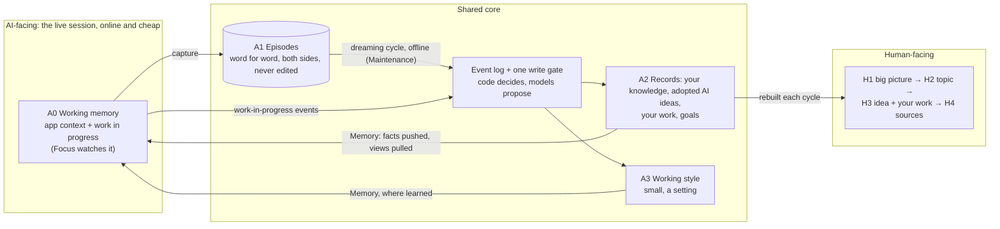

# Round 5 research: a memory architecture for Northstar, and what "dreaming" is

**Date:** 2026-10-24. **Read with:** [`GOAL.md`](../../GOAL.md) §1 (the note on maintenance, 2026-10-24), §2 (rows "Architecture" and "Evidence" of 2026-10-24) and §4.4; [`DESIGN.md`](../../design/revision-2026-10-23/DESIGN.md) §1 and §3–§5. Builds on notes [01](../01-human-memory-and-learning.md), [03](../03-ai-memory-systems.md), [06](../06-time-history-and-consolidation.md), [18](../round3/18-value-threshold-and-scope.md) and [20](../round4/20-index-expansion-capture.md) without repeating them.
**Question:** what is OpenAI's "dreaming"; which offline, between-session consolidation designs exist for LLM agents, and what backs them; what brain and memory research they draw on; and what AI-facing and human-facing architecture over Northstar's core this suggests?
**Method:** one desk pass on 2026-10-24. **[E]** = checked today at the URL given, or in the earlier note named. **[L]** = my lean. "Unverified" = seen only in third-party pages. Findings constrain the HOW only (GOAL §5).

**Short answer.** OpenAI's "dreaming" is ChatGPT's background memory synthesis: between chats it rebuilds a memory state from chat history and keeps it current. OpenAI has published a product post, not a paper. The same move, an offline worker that consolidates what the live session only captured, runs in Codex, Claude Managed Agents, Letta and OpenClaw, and it mirrors complementary learning systems in neuroscience. Northstar's maintenance job is already such a cycle but was never drawn as one. §5 draws the two architectures, with an explicit dreaming cycle, its safeguards, reconsolidation and forgetting.

---

## 1. What "dreaming" is in products

| Product | What runs between sessions | What it produces | Safeguards and controls | Evidence | Source |
|---|---|---|---|---|---|
| **ChatGPT dreaming** (OpenAI). V0 in April 2025, as chat-history reference; V3 rolling out from 4 June 2026 | A background process that can "automatically curate memories in the background by referencing chat history", synthesizing one memory state from many chats. Time-relative facts are re-dated: a planned July trip becomes a past one | The context new chats receive; a memory summary page where you add or correct facts and say which topics to bring up | The summary is high-level and can omit details. Deleting a chat does not necessarily delete a saved memory made from it. Turning off chat-history reference schedules derived context for deletion within 30 days | Internal evals only, from the page's chart data, mapped by section because the chart titles are inconsistent (2024 saved memories → 2025 with V0 → 2026 V3): carry-forward recall 41.5 → 67.9 → 82.8%; preference adherence 31.4 → 55.3 → 71.3%; time-sensitive prompts 9.4 → 52.2 → 75.1%. Serving cost for Free users cut about 5x. No paper, stages or model named | openai.com/index/chatgpt-memory-dreaming ; help.openai.com/en/articles/8590148-memory-faq [E] |
| **Codex memories** (OpenAI; not called dreaming) | When a new session starts, for past threads idle long enough: phase 1 extracts one memory per thread, in parallel; phase 2 runs one consolidation agent at a time, sandboxed (no network, local writes only), over a git-tracked memory folder and the diff of its inputs | Layered files: a small summary loaded at every session start, a searchable handbook, reusable skills, one summary per session. Raw sessions stay untouched | Off by default; per-chat controls; chats that used MCP or web search can be excluded; secrets redacted; inputs ranked by use and recency, and unused ones age out; prompts forbid invented facts and over-general preferences. Phase 2 never reopens raw sessions: it updates the previous memory files from phase-1 outputs | None published | learn.chatgpt.com/docs/customization/memories ; github.com/openai/codex/tree/main/codex-rs/memories (README, prompt templates) [E] |
| **Dreams, Claude Managed Agents** (Anthropic; research preview, May 2026) | An asynchronous job reads a memory store plus 1–100 past session transcripts | A new store: duplicates merged, stale or contradicted entries replaced by the latest value, new insights added | The input store is never modified: you review the new store, then use or discard it. The pipeline's own transcript is kept. Optional steering instructions | Vendor anecdote only | platform.claude.com/docs/en/managed-agents/dreams [E] |
| **Claude Code "Auto Dream"** | Reported: cleanup of memory files between sessions | — | — | — | Third-party reports only; absent from the official memory docs (checked today). Unverified |
| **Letta Code dreaming** (its sleep-time feature, renamed) | Background subagents review recent conversations after a set number of steps, or at compaction | Updates to git-backed memory files | Optional review by a second agent, which does not ask you | The sleep-time paper (§2) | docs.letta.com/guides/agents/architectures/sleeptime [E] |
| **OpenClaw dreaming** (open-source agent; its creator joined OpenAI in February 2026, per press) | A nightly sweep in three phases: light (stage candidates), REM (themes), deep (the only phase that writes) | Promotions into a long-term memory file; a dream diary | Untrusted or system text is dropped first. The model returns operations, not free text. By default a rewrite may lose at most 25% of prior entries, and it must cite sources. The diary is never a source. Fallback to append-only | None published | docs.openclaw.ai/concepts/dreaming [E] |
| **Google Gemini** | No named consolidation feature found | | | | Absence unverified |

**Lessons.**
- **[E] "OpenAI dreaming" is ChatGPT's memory synthesis.** OpenAI has published one product post and help pages; write-ups of a "Dreaming V3 architecture" infer it from that post. What it models is you (preferences, projects, constraints), not your knowledge.
- **[E] OpenAI's most detailed public design is Codex's,** because the code is open: per-session extraction in parallel, then one serialized consolidator, with layered outputs.
- **[E] The designs converge.** Capture stays cheap; an offline worker with more compute consolidates; the output is layered, with a small always-loaded part and detail on demand; raw inputs are kept. Anthropic adds a shadow store you adopt or discard; OpenClaw adds code-checked limits.
- **[L] Borrow the cycle, the layering, the shadow store and the time refresh. Do not borrow one rewritten memory state.** ChatGPT's summary can omit details and its derived memories outlive deleted chats. Codex's phase 2 is an incremental summary of summaries, which GOAL §5 rules out.

## 2. Offline consolidation in agent research

| System | What runs offline | What it produces | Evidence of benefit | Known failure modes | Source |
|---|---|---|---|---|---|
| Generative Agents (Park et al. 2023) | Reflection, when the summed importance of recent events passes a threshold | Higher-level insights that cite the memories they came from | Ablation: removing reflection, planning or observation made agents less believable | Embellished memories; missed retrieval (note 18) | arxiv.org/abs/2304.03442 [E]; note 03 |
| MemGPT → Letta (Packer et al. 2023; Lin et al. 2025) | The agent edits its memory blocks under context pressure; later a separate sleep-time agent owns them and reasons over the context before any query arrives | Rewritten memory blocks; precomputed inferences | Sleep-time compute: about 5x less test-time compute at equal accuracy; up to +13% and +18% accuracy; 2.5x cheaper per query when shared. The gain tracks how predictable queries are | Block edits overwrite (note 03) | arxiv.org/abs/2504.13171 [E]; note 03 |
| A-MEM (Xu et al., NeurIPS 2025) | Each new note links to neighbours and rewrites their descriptions and tags | Zettelkasten-style linked notes | Better than baselines on six models (the abstract gives no numbers) | Neighbour rewrites overwrite history; scored low in Mem0's rerun (note 03) | arxiv.org/abs/2502.12110 [E] |
| Mem0 (2025, then 2026) | Per new fact, an LLM picks add, update, delete or no-op against its 10 nearest; since 2026 add-only, with conflicts settled at retrieval | Atomic facts | Cheaper and faster than full context, not more accurate on LoCoMo (note 03) | Deletes lost history; extraction recall 3% on HaluMem-Long | note 03 [E]; HaluMem below |
| Zep / Graphiti (2025) | Entity and fact extraction; a contradicted fact gets an end time, and nothing is deleted | A temporal knowledge graph with two timelines | +18.5% on LongMemEval (vendor) | −17.7% on questions about what the assistant said | note 03 [E] |
| HippoRAG 1–2 (2024–25) | Batch indexing of extracted triples; PageRank from the query's concepts at read time | An associative index, after hippocampal indexing theory | About 7 points on multi-hop memory tasks | Add-only: nothing is revised | note 03 [E] |
| MemoryOS (Kang et al. 2025) | Promotes memory from short-term to mid-term (first in, first out) to long-term personal memory (segmented pages) | A three-level store with a persona | +49% F1 on LoCoMo, a weak benchmark (note 03) | Not studied | arxiv.org/abs/2506.06326 [E] |
| LightMem (Fang et al., ICLR 2026) | Filters and groups input by topic online; long-term memory is updated offline, at "sleep time" | Compact long-term memory | Up to +7.7% and +29.3% QA accuracy with up to 38x and 21x fewer tokens (LongMemEval and LoCoMo; pairing assumed) | Not studied | arxiv.org/abs/2510.18866 [E] |
| Auto-Dreamer (Ye et al., May 2026 preprint) | A consolidator trained with RL reads a memory region as read-only evidence, with links to the source runs, and writes a replacement set | A smaller, abstracted memory | +7 points on ScienceWorld with a 12x smaller bank; held up on ALFWorld and WebArena | One training domain; a preprint | arxiv.org/abs/2605.20616 [E] |
| Surveys (Du et al. 2025; Hu et al. 2025) | Name the operations (consolidation, updating, indexing, forgetting, retrieval, condensation) and functions (factual, experiential, working memory) | — | — | Trustworthiness listed as open | arxiv.org/abs/2505.00675 ; arxiv.org/abs/2512.13564 [E] |

**Known failure modes of consolidation, and the guards they call for.**

| Failure | Evidence | Guard |
|---|---|---|
| Summaries of summaries collapse or drift | Rewriting a context as one block cut it from 18,282 to 122 tokens and fell below no context at all (ACE, arxiv.org/abs/2510.04618 [E]; note 03). Iterated rewriting drifts toward model defaults (note 06) | Itemized records changed only by events; abstractions built from source items, never from views |
| Invented or over-general memories | Memory systems generate and accumulate hallucinations while extracting and updating (HaluMem, arxiv.org/abs/2511.03506 [E]). Codex's own prompts forbid invented facts and warn that broad rules mislead later agents [E] | Every item cites an exact quote; "unclear" is allowed; scope stays narrow until a second context |
| Lost updates | Most systems miss more than half of the updates they should make, and QA accuracy stays under 70% (HaluMem [E]) | Append-only events, explicit supersession, one serialized integrator |
| Errors that compound | Agents copy retrieved past experiences, so stored errors propagate (Xiong et al., arxiv.org/abs/2505.16067 [E]) | Contradicted items never delivered; quarantine; rollback by events |
| Drift over months | A curated map's recall fell from 96% to 72% by week 9, while a provenance graph rose to 90% (one small study, note 03) | Evaluate over weeks, not days; keep provenance |

## 3. The science underneath

| # | Finding | What it implies for a system | Source |
|---|---|---|---|
| N.1 | Two learning systems: fast storage of specifics (hippocampus) and slow, interleaved learning of structure (neocortex). Fast learning in one shared store overwrites old structure | Keep an episodic archive and slowly built records. Never rewrite knowledge records on the hot path | McClelland, McNaughton & O'Reilly 1995, doi.org/10.1037/0033-295X.102.3.419 [E] |
| N.2 | Updated: replay allows goal-dependent weighting of experience, and neocortical learning can be fast for information consistent with known structure | Replay by link to live goals. Attach material that plainly extends an idea in the same cycle; hold new or conflicting ideas as forming | Kumaran, Hassabis & McClelland 2016, doi.org/10.1016/j.tics.2016.05.004 [E] |
| N.3 | Hippocampal cells that fired together during a task fire together again in the following sleep | Replay by episode, so items that co-occurred are judged together; co-occurrence suggests links | Wilson & McNaughton 1994, doi.org/10.1126/science.8036517 [E] |
| N.4 | Sleep consolidation is active: reactivation transforms memories for long-term storage, favours those relevant to future goals, and supports gist. Human evidence for this selection is weaker than its fame (note 01 §14) | A scheduled offline cycle that puts goal-relevant items first and writes gist while keeping the details. Justify it computationally, not by analogy | Rasch & Born 2013, pmc.ncbi.nlm.nih.gov/articles/PMC3768102 [E] |
| N.5 | A consolidated memory becomes changeable again when retrieved. In people, revision follows a mismatch at retrieval, and the old knowledge persists (note 01 §5) | Reopen an item only when it was used and then contradicted. Supersede it with a reason and keep the old version | Nader, Schafe & LeDoux 2000, doi.org/10.1038/35021052 [E] |
| N.6 | The odds that a memory will be needed follow the frequency, recency and pattern of its past use, and memory mirrors those odds | Forgetting means lower salience computed from use, never deletion for relevance | Anderson & Schooler 1991, doi.org/10.1111/j.1467-9280.1991.tb00174.x [E] |

## 4. The human side

| # | Finding | What it implies for the human view | Source |
|---|---|---|---|
| H.1 | A cue helps recall only if it was part of how the memory was encoded (encoding specificity) | Show the work where the idea was formed or used, in your phrasing. Topic labels alone are weak cues | Tulving & Thomson 1973, doi.org/10.1037/h0020071 [E, citation; principle via secondary summary] |
| H.2 | For one's own past events, the content of the event (what happened) was the best cue by far (Wagenaar's diary study). In a similar 24-year diary study, entries were dated exactly only 2% of the time (mean error 545 days), and rehearsal predicted retention best | Index by content and work, not by timeline; dates are secondary. Revisiting is rehearsal: make it cheap, never scheduled | Storms, *J. Cogn.* 2024, pmc.ncbi.nlm.nih.gov/articles/PMC10798175 [E] |
| H.3 | Relating material to oneself improves memory, mainly through elaboration and organization (meta-analysis) | Phrase each item by its place in your own decisions and projects | Symons & Johnson 1997, doi.org/10.1037/0033-2909.121.3.371 [E] |
| H.4 | Generating information beats reading it by about 0.4 SD (86 studies) | Use your own words for your ideas. For adopted AI ideas, show your move (where you used it), not the AI's prose | Bertsch et al. 2007, doi.org/10.3758/BF03193441 [E] |
| H.5 | Couples remember more together than strangers, through an implicit split of who remembers what. Imposing a split hurt the couples | The overview is a directory of what you know and where it lives; the AI holds the detail. Group by your own words and corrections; do not impose a scheme | Wegner, Erber & Raymond 1991, doi.org/10.1037/0022-3514.61.6.923 [E, abstract via search] |
| H.6 | A week after producing ideas with and without an LLM, people were worse at recalling which ones involved the AI; mixed human-AI work was worst (n = 184, pre-registered) | Store and show origin: yours, or adopted from a named AI. You cannot rebuild it later | Zindulka et al., CHI 2026, arxiv.org/abs/2509.11851 [E] |
| H.7 | People keep too much; re-finding one's own items still relies on navigation; piles do surprisingly well | Keep the overview small, navigable and loosely grouped. The value threshold serves the human side too | Whittaker 2011, doi.org/10.1002/aris.2011.1440450108 [E] |
| H.8 | Wearable-camera images helped people connect to their own past, differently for remembering and for knowing. Design for cues to human memory, not total capture | Keep small snapshots of your real work as cues; capture selectively | Sellen et al., CHI 2007, doi.org/10.1145/1240624.1240636 ; Sellen & Whittaker 2010, doi.org/10.1145/1735223.1735243 [E, abstracts] |

Note 20 holds the gap: no study tests glancing at an AI-made overview of one person's ideas. The rows above support its parts, not the whole.

## 5. Proposed architecture (leans)

**[L] Two architectures over one core, with a dreaming cycle as the maintenance job.**

| Layer | Holds | Written by, when | Read by | Analogue and evidence |
|---|---|---|---|---|
| **A0 Working memory** | The app's context window, plus the work-in-progress record (goal, decisions, ruled-out options, versions with your feedback, best version, side topics) | Focus, online, mostly code | The AI, through Memory; Focus | Goal maintenance. A fresh start from consolidated state beats a drifted transcript (note 21, 2.1) |
| **A1 Episodic archive** | Every exchange, word for word, both sides, dated and cut into events | Capture code, online | The dreaming cycle; the recall tool | Fast, specific storage (N.1). Codex and Anthropic keep raw inputs too (§1) |
| **A2 Semantic records** | Your knowledge, yours or adopted from a named AI, each with why, scope, route, links and status, each citing episodes; your work; goals and open questions (DESIGN §1) | The dreaming cycle, offline, only through the write gate | Memory; the human view | Slow, interleaved structure (N.1, N.2) |
| **A3 Working style** | A few lines on how you like AIs to work with you, scoped where learned | The dreaming cycle, on repeated evidence, only if the setting is on | Memory | Procedural memory. Codex's prompts count a preference only when stated as a default or seen across tasks |
| **H1–H4 Human view** | Big picture; a topic's ideas, one line each with origin; an idea with one to three pieces of your work; sources | Rebuilt by the dreaming cycle from A2, with a stable layout | You, inside the assistant, when you ask | Cue-based recall and transactive memory (§4) |

**[L] The dreaming cycle.**

| Stage | What runs | Safeguard | Evidence |
|---|---|---|---|
| 0. Trigger | A session goes idle, or a new day starts; stage 6 weekly | Skip active sessions; bounded batches; a watermark of what was consumed | Codex's idle rule and watermark (§1) |
| 1. Select (replay) | New episodes, plus items used since the last cycle, ordered by link to live goals and open questions, then by surprise | Each new item is judged next to its nearest old ones | N.1, N.2, N.4 |
| 2. Extract, per session, in parallel | Your moves (state, adopt, reject, revise, build on), each with the exact quote; pointers to your work | The speaker comes from the channel; "unclear" is allowed; tool and web text is data | Codex phase 1; HaluMem |
| 3. Integrate, one at a time | Each move attaches, supersedes (same context), stands as a conflict (across contexts), or starts a new item | Models propose and the write gate decides; events, never overwrites | N.1, N.2; Mem0's move to add-only; Codex's lock |
| 4. Refresh | Time-relative lines are re-dated; the work in progress of finished work closes | Supersession events; the old line is kept | ChatGPT's time-sensitive gain (§1) |
| 5. Check | Code checks that every item cites an episode, that no input is a derived view or journal, that no more than a set share of prior items is dropped, and that quotes are exact. A second model family checks merges, conflicts and broader ideas | Failures go to quarantine and nothing is applied | OpenClaw's loss bound (§1); ACE; HaluMem |
| 6. Abstract, weekly | Broader ideas, only from source items seen in two contexts | Never from overviews, briefs or journals | Selective consolidation (note 01, Go-CLS); OpenClaw's diary rule |
| 7. Rebuild into a shadow copy | The AI-facing index, a start brief for each active piece of work, and the human view | Swapped in only after stage 5 passes | Anthropic's separate output store; sleep-time compute pays where the next request is predictable |
| 8. Report | A dream journal: what changed and why, with links | Never an input to later cycles; each change undoable in one step | Codex's workspace diff; OpenClaw's diary |

**[L] Reconsolidation: reopen on use plus mismatch.** When Memory delivered an item, or you viewed it, and a later statement of yours conflicts with it or builds on it, the item is queued for stage 1. It is re-judged on the new evidence and superseded with a reason; the old version stays (N.5). Items used and not contradicted gain use evidence, as Codex counts use.

**[L] Forgetting lowers salience, never existence.** Need is estimated from frequency, recency and spread across contexts (N.6). Unused items leave the big picture and the start briefs but stay searchable. Work in progress is short-lived. Only you can purge.

**[L] Where the three jobs sit.**
- **Focus** watches A0 during the session and keeps its work-in-progress part. A fresh session is seeded from A0, never from the drifted transcript. How focus speaks is outside this note (GOAL §2, 2026-10-24, row "Focus").
- **Memory** is the read path: from A2 and A0 into the AI's context (facts pushed when strongly linked, your views pulled by tool, GOAL §2, 2026-10-24), and from A2 into the human view when you ask.
- **Maintenance** is the write path: capture into A1, then the dreaming cycle into A2, A3 and both views. DESIGN §4 jobs 2–11 map onto stages 2–7. This note adds the trigger, the replay order, the refresh, the shadow copy, the start briefs, the journal, reconsolidation and forgetting.

**[L] How it keeps GOAL's constraints.**
- **Plain context, no usage rules:** the cycle writes records (facts with sources), never instructions, and delivery adds no rules.
- **Adopted AI knowledge first-class and attributed:** stage 2 takes the speaker from the channel; adoption is one of your moves; H2 shows origin, which you will not reliably remember yourself (H.6).
- **No summaries of summaries:** stage 5 rejects derived inputs, and stage 6 builds only from source items.
- **Code decides, models propose:** one write gate, a shadow copy, and code-checked invariants.

## 6. Open questions and unverified items

- How often should the cycle run, and what does one cost on this Mac? Codex skips a pass when rate-limit headroom is low.
- Does a precomputed start brief beat selection at session start? Sleep-time gains depend on how predictable the next request is: resuming a piece of work is predictable, a new chat is not.
- Is A3 wanted at all, given that memory must not alter the AI's behaviour (GOAL §2)? It stays a setting.
- Unverified: Claude Code "Auto Dream"; the absence of a Gemini feature; how OpenAI's evals are defined; LightMem's figure pairing; Wegner et al. 1991 beyond its abstract; the wording of encoding specificity (secondary summary only).
